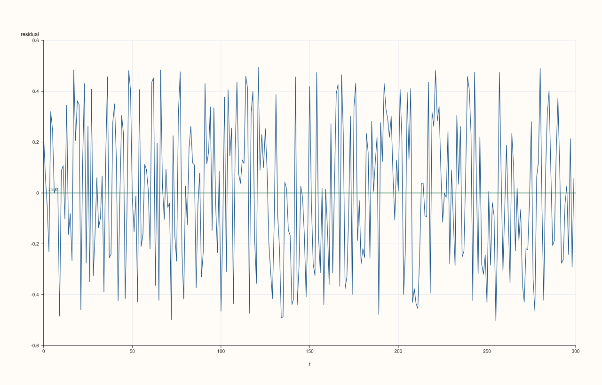
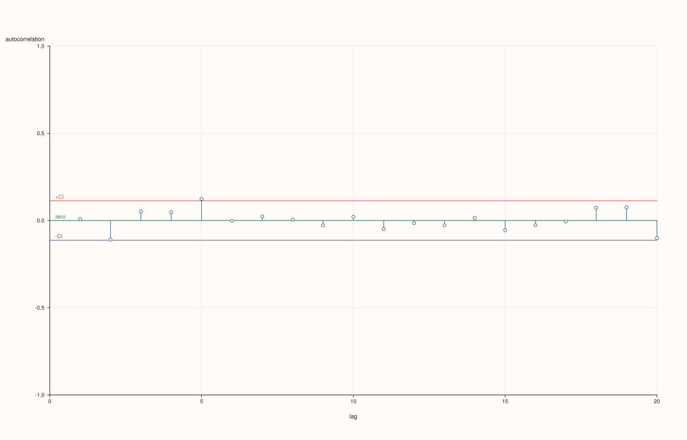

<!-- generated from plot_residuals.md.in by PlussMa/docs/tools/render_guide.py; edit the template -->

# `pluss::subsp::stats::ts::plot_residuals`

Draws the residuals of a model against time into a `pluss::pl::Studio` figure.

## Signature

```cpp
pluss::pl::Studio& ts::plot::residuals(pluss::pl::Studio& studio, const pluss::Series& residuals, const ts::plot::ResidualPlotOptions& options = {}, pluss::codem::Config cfg = {});
```

## What It Does

Draws the residual series as a line against the time index, with a zero line. For a well-specified model the residuals scatter evenly around zero with no pattern; look for trends, changing spread (volatility clustering) and outliers. Pair it with the autocorrelation plot of the residuals.

## Parameters

`pluss::pl::Studio& studio`
: The figure to draw into.

`const pluss::Series& residuals`
: The residual series.

`const ts::plot::ResidualPlotOptions& options`
: Zero line and line width; see [`ResidualPlotOptions`](ResidualPlotOptions.md).

`pluss::codem::Config cfg`
: Output configuration of the payload arrays.

## Returns

The same `Studio`.

## Practical Examples

### Example 1

Plot the residuals of an AR(1) model and the autocorrelations of the same residuals: the first scatters around zero, the second stays inside the band.

```cpp
#include <pluss/ma.h>

#include <cmath>
#include <cstdlib>
#include <iomanip>
#include <iostream>
#include <string>
#include <vector>

#include <pluss/pl/studio.h>

namespace ts = pluss::subsp::stats::ts;
using pluss::Series;

const auto f64 = pluss::Config{}.with_dtype(pluss::ScalarType::Float64);
void show(const char* label, const Series& s) {
  std::cout << std::left << std::setw(14) << label << std::right << std::fixed << std::setprecision(4);
  for (double v : s.host<double>()) std::cout << std::setw(9) << v;
  std::cout << "\n";
}
std::vector<double> noise(int n) {
  std::vector<double> e(n);
  for (int i = 0; i < n; ++i) {
    double u = std::sin(12.9898 * (i + 1.0) + 78.233) * 43758.5453;
    u -= std::floor(u);
    e[i] = u - 0.5;
  }
  return e;
}
Series ar1(int n, double phi) {
  const auto e = noise(n);
  std::vector<double> x(n);
  double carry = 0.0;
  for (int i = 0; i < n; ++i) {
    carry = phi * carry + e[i];
    x[i] = carry;
  }
  return pluss::make_series(x, {n}, f64);
}
Series walk(int n) {
  const auto e = noise(n);
  std::vector<double> x(n);
  double sum = 0.0;
  for (int i = 0; i < n; ++i) {
    sum += e[i];
    x[i] = sum;
  }
  return pluss::make_series(x, {n}, f64);
}

int main() {
  const Series y = ar1(300, 0.7);
  const auto residuals = ts::Arima::fit_mle(y).infer(y);
  pluss::pl::Studio figure("residuals", pluss::pl::Theme::paper());
  ts::plot::residuals(figure, residuals);
  pluss::pl::Studio correlogram("residual acf", pluss::pl::Theme::paper());
  ts::plot::CorrPlotOptions options;
  options.max_lag = 20;
  ts::plot::acf(correlogram, residuals, options);
  const char* dir = std::getenv("PLUSSMA_GUIDE_ASSETS");
  if (dir != nullptr) {
    figure.save_svg(std::string(dir) + "/ts_residuals.svg");
    correlogram.save_svg(std::string(dir) + "/ts_residual_acf.svg");
  }
  std::cout << "two figures drawn\n";
}
```

Output

```text
two figures drawn
```






## See Also

- [`residuals_payload`](plot_residuals_payload.md)
- [`ResidualPlotOptions`](ResidualPlotOptions.md)
