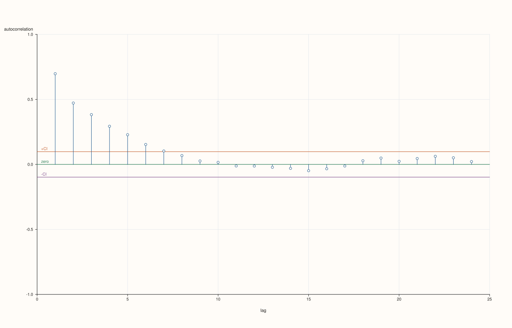
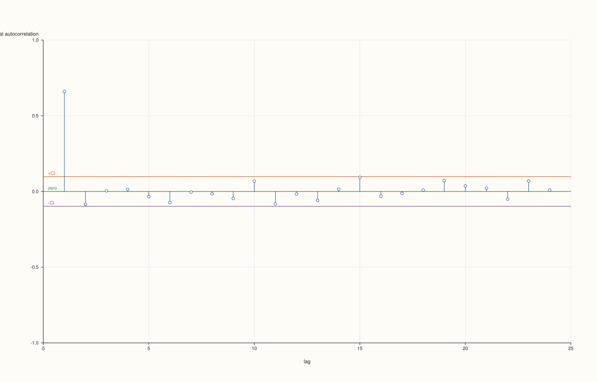

<!-- generated from autocorrelation_and_partial_autocorrelation.md.in by PlussMa/docs/tools/render_guide.py; edit the template -->

# Autocorrelation and partial autocorrelation

[Back to Plots](../ts_07_plots.md)


```cpp
#include <pluss/ma.h>
#include <pluss/pl/studio.h>

#include <cmath>
#include <cstdlib>
#include <iomanip>
#include <iostream>
#include <string>
#include <vector>

namespace ts = pluss::subsp::stats::ts;
using pluss::Series;

const auto f64 = pluss::ScalarType::Float64;
Series vec(std::vector<double> v) { return pluss::make_series(v, {static_cast<std::int64_t>(v.size())}).to(f64); }
std::vector<double> noise(int n) {
  std::vector<double> e(static_cast<std::size_t>(n));
  for (int i = 0; i < n; ++i) {
    double u = std::sin(12.9898 * (i + 1.0) + 78.233) * 43758.5453;
    u -= std::floor(u);
    e[static_cast<std::size_t>(i)] = u - 0.5;
  }
  return e;
}
int main() {
  const int n = 400;
  const auto e = noise(n);
  std::vector<double> x(static_cast<std::size_t>(n));
  double carry = 0.0;
  for (int t = 0; t < n; ++t) {
    carry = 0.7 * carry + e[static_cast<std::size_t>(t)];
    x[static_cast<std::size_t>(t)] = carry;
  }
  const Series y = vec(x);

  ts::plot::CorrPlotOptions options;
  options.max_lag = 8;
  const auto a = ts::plot::acf_payload(y, options);
  const auto p = ts::plot::pacf_payload(y, options);
  const auto lags = a.lags.to_vec<std::int64_t>();
  const auto av = a.values.to_vec<double>(), pv = p.values.to_vec<double>();
  std::cout << std::fixed << std::setprecision(3) << "95% band for white noise: +/- " << a.conf_high << "\n";
  std::cout << std::setw(5) << "lag" << std::setw(10) << "acf" << std::setw(10) << "pacf" << "\n";
  for (std::size_t i = 0; i < lags.size(); ++i) std::cout << std::setw(5) << lags[i] << std::setw(10) << av[i] << std::setw(10) << pv[i] << "\n";

  // Draw into figures and save them where the guide expects its pictures (skipped when the variable is not set).
  const char* dir = std::getenv("PLUSSMA_GUIDE_ASSETS");
  if (dir != nullptr) {
    options.max_lag = 24;
    pluss::pl::Studio acf_figure("acf", pluss::pl::Theme::paper());
    ts::plot::acf(acf_figure, y, options);
    acf_figure.save_svg(std::string(dir) + "/ts_acf.svg");
    pluss::pl::Studio pacf_figure("pacf", pluss::pl::Theme::paper());
    ts::plot::pacf(pacf_figure, y, options);
    pacf_figure.save_svg(std::string(dir) + "/ts_pacf.svg");
  }
}
```

Output

```text
95% band for white noise: +/- 0.098
  lag       acf      pacf
    1     0.698     0.698
    2     0.472    -0.028
    3     0.383     0.125
    4     0.293    -0.028
    5     0.228     0.026
    6     0.153    -0.056
    7     0.103     0.006
    8     0.068    -0.017
```




For an AR(1) series with coefficient 0.7 the autocorrelation decays geometrically (0.70, 0.47, 0.38, 0.29, … at lags 1, 2, 3, 4) and stays outside the band for the first six or seven lags, while the partial autocorrelation is large only at lag 1 (0.70); the other bars are small, with lag 3 (0.125) just outside the band, as one bar in twenty is by chance. A large first partial autocorrelation followed by small ones is the signature of an autoregression of order one. The band for 400 observations is ±0.098.
