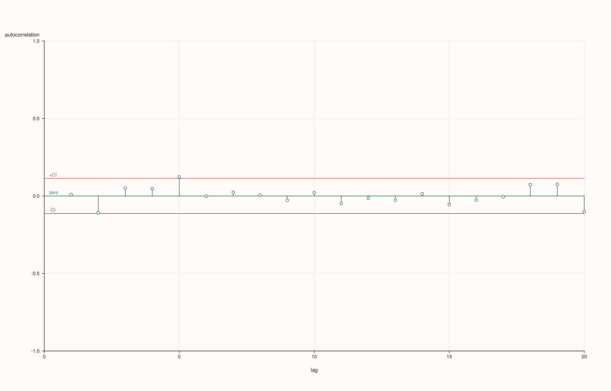
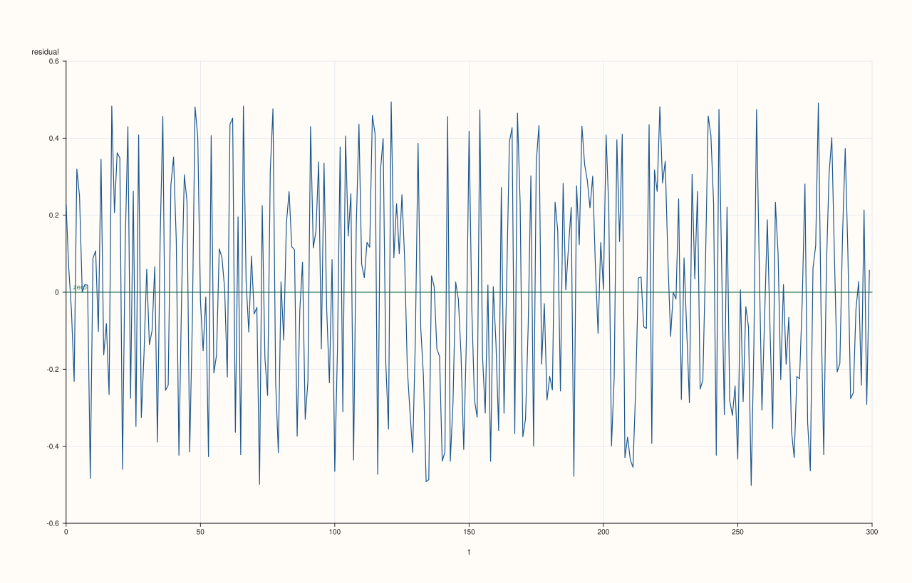

<!-- generated from plots_of_the_residuals.md.in by PlussMa/docs/tools/render_guide.py; edit the template -->

# Plots of the residuals

[Back to Plots](../ts_07_plots.md)


```cpp
#include <pluss/ma.h>
#include <pluss/pl/studio.h>

#include <cmath>
#include <cstdlib>
#include <iomanip>
#include <iostream>
#include <string>
#include <vector>

namespace ts = pluss::subsp::stats::ts;
using pluss::Series;

const auto f64 = pluss::ScalarType::Float64;
Series vec(std::vector<double> v) { return pluss::make_series(v, {static_cast<std::int64_t>(v.size())}).to(f64); }
std::vector<double> noise(int n) {
  std::vector<double> e(static_cast<std::size_t>(n));
  for (int i = 0; i < n; ++i) {
    double u = std::sin(12.9898 * (i + 1.0) + 78.233) * 43758.5453;
    u -= std::floor(u);
    e[static_cast<std::size_t>(i)] = u - 0.5;
  }
  return e;
}
int main() {
  const int n = 300;
  const auto e = noise(n);
  std::vector<double> x(static_cast<std::size_t>(n));
  double carry = 0.0;
  for (int t = 0; t < n; ++t) {
    carry = 0.7 * carry + e[static_cast<std::size_t>(t)];
    x[static_cast<std::size_t>(t)] = carry;
  }
  const Series y = vec(x);
  const char* dir = std::getenv("PLUSSMA_GUIDE_ASSETS");

  std::cout << std::left << std::setw(24) << "model" << std::setw(28) << "lags outside band (of 20)" << "largest |autocorrelation|\n";
  for (int p = 0; p <= 1; ++p) {
    ts::ArimaOptions o;
    o.ar_order = p;
    const auto resid = ts::Arima::fit_mle(y, o).infer(y);

    ts::plot::CorrPlotOptions options;
    options.max_lag = 20;
    const auto a = ts::plot::acf_payload(resid, options);
    int outside = 0;
    double largest = 0.0;
    for (double v : a.values.to_vec<double>()) {
      if (std::abs(v) > a.conf_high) ++outside;
      largest = std::max(largest, std::abs(v));
    }
    std::cout << std::left << std::setw(24) << (p == 0 ? "no AR term" : "AR(1)") << std::setw(28) << outside << std::fixed << std::setprecision(3) << largest << "\n";

    if (dir != nullptr) {
      const std::string tag = p == 0 ? "ar0" : "ar1";
      pluss::pl::Studio figure("residual acf " + tag, pluss::pl::Theme::paper());
      ts::plot::acf(figure, resid, options);
      figure.save_svg(std::string(dir) + "/ts_resid_acf_" + tag + ".svg");
      if (p == 1) {
        pluss::pl::Studio series_figure("residuals", pluss::pl::Theme::paper());
        ts::plot::residuals(series_figure, resid);
        series_figure.save_svg(std::string(dir) + "/ts_residuals_ar1.svg");
      }
    }
  }
}
```

Output

```text
model                   lags outside band (of 20)   largest |autocorrelation|
no AR term              7                           0.700
AR(1)                   1                           0.124
```






A model without an autoregressive term leaves the full autocorrelation of the series in its residuals: seven of the first 20 bars are outside the band and the first is 0.70. After the AR(1) fit one bar of 20 lies just outside (0.124), as expected by chance, and the residuals are scattered evenly around zero with no visible pattern.
