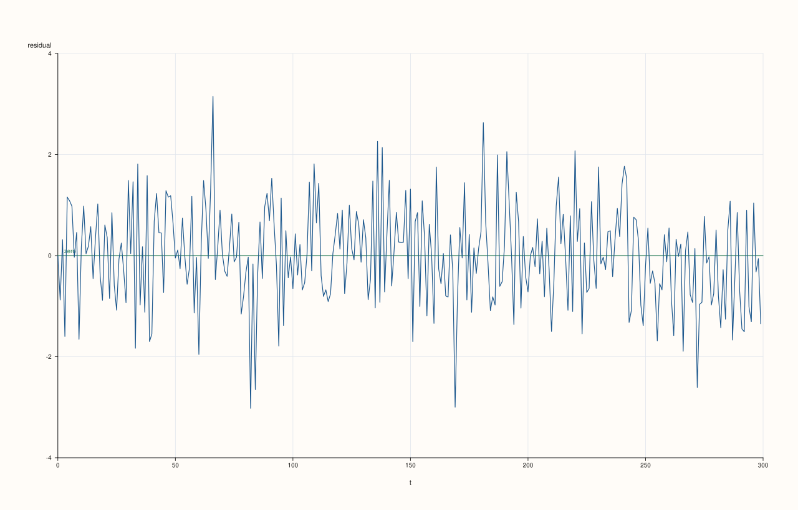
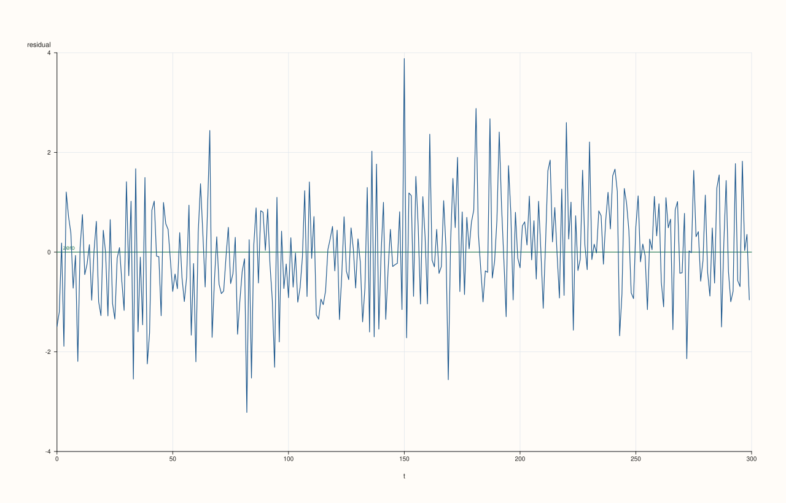
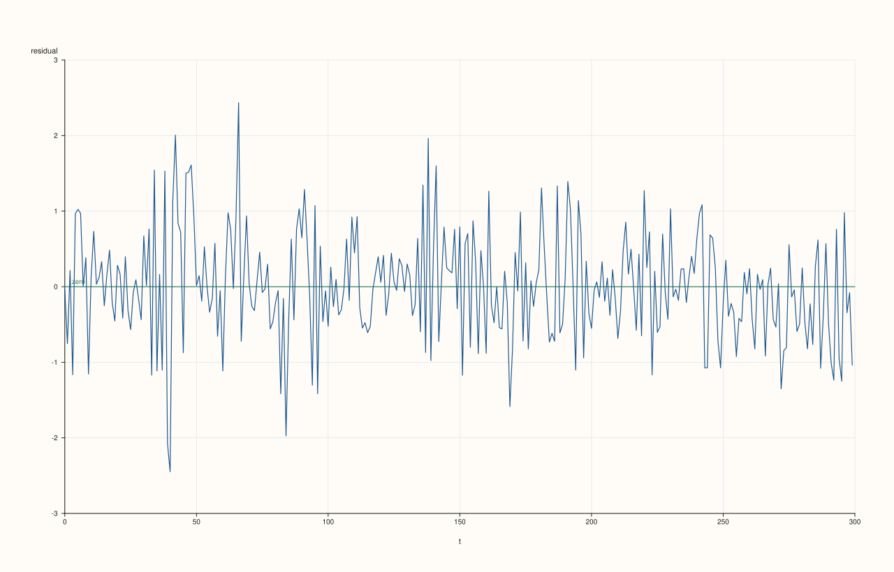
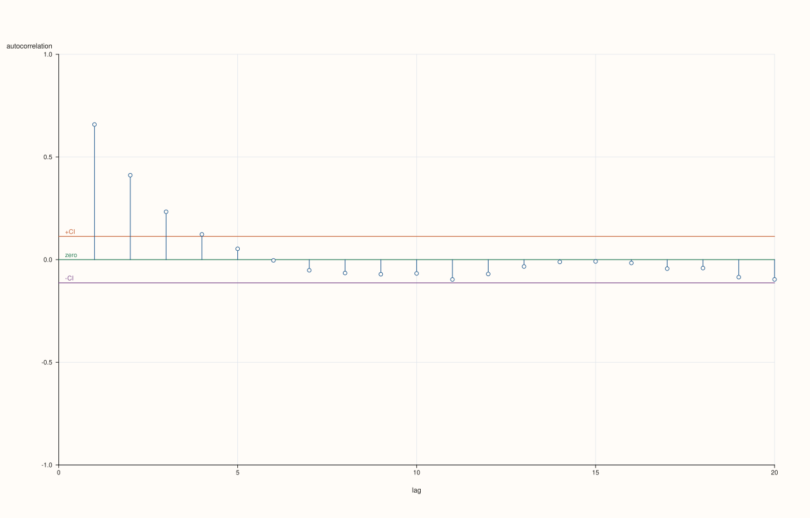

<!-- generated from plots_of_the_residuals.md.in by PlussMa/docs/tools/render_guide.py; edit the template -->

# Plots of the residuals

[Back to Plots](../ts_07_plots.md)

A test answers one question; a picture of the residuals answers questions you did not think to ask. After fitting a model, two plots do most of the work: the residuals against time, and the autocorrelation of the residuals. A model that has captured the dynamics leaves residuals that look like noise on both: scattered evenly around zero with a steady spread in the first, and no bars beyond the band in the second. Each kind of failure leaves a different footprint.

| What you see | What it means | Next step |
|---|---|---|
| bars outside the band in the residual ACF | autocorrelation left | add AR or MA terms |
| a step or a drift in the residual series | a level shift or a trend not in the model | add a regressor or difference |
| the spread of the residuals changes over time | the variance is not constant | a volatility model (Chapter 3) |
| a few residuals far from the rest | outliers | investigate those dates |

`plot::residuals(studio, r, ResidualPlotOptions)` draws the residuals against time with an optional zero line (`show_zero_line`, `trace_width`); `plot::residuals_payload(r)` returns the plotted numbers (`index` and `residuals`). The correlation plots of the previous page apply directly to residuals. As on that page, the programs save their figures when `PLUSSMA_GUIDE_ASSETS` is set.

## What the residual series reveals

The first program fits an AR(1) to three series and draws the residuals of each. The first series really is an AR(1), so its residuals should be clean. The second has an AR(1) plus a level shift in the middle, which an AR(1) with a constant cannot represent. The third has AR(1) dynamics but volatility that clusters. The program also prints two numbers per series that summarise what the eye sees: the mean and the standard deviation of the residuals in each half.

```cpp
#include <pluss/ma.h>
#include <pluss/pl/studio.h>
#include <pluss/tils/aux/output.h>

#include <cstdlib>
#include <string>
#include <vector>

namespace ts = pluss::subsp::stats::ts;
using pluss::Series;
using namespace pluss::tils;

int main() {
  const auto f64 = pluss::Config{}.with_dtype(pluss::ScalarType::Float64);
  OutputEngine out;
  out.print_defaults(PrintOptions{}.fixed(3));

  const int n = 300;
  ts::ArimaFit truth;
  truth.ar = {0.6};
  const Series base = truth.simulate(n, f64, /*seed=*/9);
  // A level shift halfway through: add 3 to the second half.
  const Series shifted = base + (pluss::series::linspace(0.0, 1.0, n, f64) >= 0.5).to(pluss::ScalarType::Float64) * 3.0;

  ts::Garch11Fit g;
  g.mean = 0.0;
  g.omega = 0.05;
  g.alpha = 0.3;
  g.beta = 0.65;
  const auto shocks = g.simulate(n, f64, /*seed=*/9).host<double>();
  std::vector<double> clustered(n);
  double carry = 0.0;
  for (int t = 0; t < n; ++t) { carry = 0.6 * carry + shocks[t]; clustered[t] = carry; }

  const std::vector<const char*> labels = {"clean AR(1)", "level shift", "volatility clusters"};
  const std::vector<const char*> tags = {"clean", "shift", "volatility"};
  const std::vector<Series> series = {base, shifted, pluss::make_series(clustered, f64)};

  out.writeln("residuals of an AR(1) fit: first half, then second half");
  for (std::size_t i = 0; i < series.size(); ++i) {
    ts::ArimaOptions o;
    o.ar_order = 1;
    const Series resid = ts::Arima::fit_mle(series[i], o, f64).infer(series[i], f64);
    const Series first = resid.slice(0, 0, n / 2), second = resid.slice(0, n / 2, n);
    out.writeln(labels[i], "mean", first.mean().item<double>(), second.mean().item<double>(), "std dev", first.std().item<double>(), second.std().item<double>());
    if (const char* dir = std::getenv("PLUSSMA_GUIDE_ASSETS")) {
      pluss::pl::Studio figure(std::string("residuals ") + tags[i], pluss::pl::Theme::paper());
      ts::plot::residuals(figure, resid, {}, f64);
      figure.save_svg(std::string(dir) + "/ts_resid_" + tags[i] + ".svg");
    }
  }
}
```

Output

```text
residuals of an AR(1) fit: first half, then second half
clean AR(1) mean 0.111 -0.111 std dev 0.967 0.977
level shift mean -0.278 0.286 std dev 1.010 1.052
volatility clusters mean 0.094 -0.094 std dev 0.779 0.652
```







The clean residuals scatter evenly around zero and have the same spread in both halves (0.97 and 0.98); their half-means (+0.11 and −0.11) are the small, opposite offsets that any residual series shows, since the residuals of a model with a fitted mean add up to about zero. The level-shift residuals are different in kind: the residual series sits below zero for most of the first half and above it for most of the second, and the half-means are −0.28 and +0.29, two and a half times those of the clean case. The shift is split into a step in the residuals because a single constant cannot represent two levels. The clustered series has residuals of similar mean throughout, but the plot shows bursts (around observations 40, 65 and 85 the residuals swing widely) followed by quieter stretches, and the spread falls from 0.78 in the first half to 0.65 in the second; the test for it is the ARCH-LM test of [Chapter 1](../ts_01_describing_a_series/volatility_clustering.md). No single summary number catches all three patterns, which is why the picture comes first.

## Autocorrelation left in the residuals

The autocorrelation of the residuals is the check for dynamics that the model missed. The program fits an AR(1) series with a model that has no autoregressive term and with an AR(1), counts the bars outside the 95% band in each, and draws both.

```cpp
#include <pluss/ma.h>
#include <pluss/pl/studio.h>

#include <algorithm>
#include <cmath>
#include <cstdlib>
#include <iomanip>
#include <iostream>
#include <string>

namespace ts = pluss::subsp::stats::ts;
using pluss::Series;

int main() {
  const auto f64 = pluss::Config{}.with_dtype(pluss::ScalarType::Float64);
  ts::ArimaFit truth;
  truth.ar = {0.7};
  const Series y = truth.simulate(300, f64, /*seed=*/17);
  const char* dir = std::getenv("PLUSSMA_GUIDE_ASSETS");

  std::cout << std::left << std::setw(24) << "model" << std::setw(30) << "lags outside the band (of 20)" << "largest |autocorrelation|\n";
  for (int p = 0; p <= 1; ++p) {
    ts::ArimaOptions o;
    o.ar_order = p;
    const Series resid = ts::Arima::fit_mle(y, o, f64).infer(y, f64);

    ts::plot::CorrPlotOptions options;
    options.max_lag = 20;
    const auto a = ts::plot::acf_payload(resid, options, f64);
    int outside = 0;
    double largest = 0.0;
    for (double v : a.values.host<double>()) {
      if (std::fabs(v) > a.conf_high) ++outside;
      largest = std::max(largest, std::fabs(v));
    }
    std::cout << std::left << std::setw(24) << (p == 0 ? "no AR term" : "AR(1)") << std::setw(30) << outside << std::fixed << std::setprecision(3) << largest << "\n";

    if (dir != nullptr) {
      const std::string tag = p == 0 ? "ar0" : "ar1";
      pluss::pl::Studio figure("residual acf " + tag, pluss::pl::Theme::paper());
      ts::plot::acf(figure, resid, options, f64);
      figure.save_svg(std::string(dir) + "/ts_resid_acf_" + tag + ".svg");
    }
  }
}
```

Output

```text
model                   lags outside the band (of 20) largest |autocorrelation|
no AR term              4                             0.658
AR(1)                   0                             0.085
```




The model without an autoregressive term leaves the autocorrelation of the series in its residuals: four of the first 20 bars are outside the band, and the first is 0.66, the series' own first-order autocorrelation. After the AR(1) fit no bar is outside the band and the largest is 0.085. This pair of pictures is the picture version of the Ljung–Box test in [Checking the residuals](../ts_02_arima_models/checking_the_residuals.md), with the advantage that it also shows *which* lags are responsible.

## Finding the outliers

Outliers show up in the residual plot as isolated points far from the rest, and the payload makes it easy to list them. The program plants two outliers in an AR(1) series, fits the model, and reports the dates whose residual is more than three standard deviations from zero.

```cpp
#include <pluss/ma.h>

#include <cmath>
#include <iomanip>
#include <iostream>
#include <vector>

namespace ts = pluss::subsp::stats::ts;
using pluss::Series;

int main() {
  const auto f64 = pluss::Config{}.with_dtype(pluss::ScalarType::Float64);
  ts::ArimaFit truth;
  truth.ar = {0.6};
  const int n = 300;
  auto data = truth.simulate(n, f64, /*seed=*/23).host<double>();
  data[80] += 6.0;    // planted outliers
  data[210] -= 7.0;
  const Series y = pluss::make_series(data, f64);

  ts::ArimaOptions o;
  o.ar_order = 1;
  const Series resid = ts::Arima::fit_mle(y, o, f64).infer(y, f64);
  const auto payload = ts::plot::residuals_payload(resid, f64);
  const auto index = payload.index.host<std::int64_t>();
  const auto r = payload.residuals.host<double>();

  double m = 0.0, s = 0.0;
  for (double v : r) m += v;
  m /= static_cast<double>(r.size());
  for (double v : r) s += (v - m) * (v - m);
  s = std::sqrt(s / static_cast<double>(r.size() - 1));

  std::cout << std::fixed << std::setprecision(2) << "residual standard deviation " << s << "\n";
  std::cout << std::setw(8) << "index" << std::setw(12) << "residual" << std::setw(14) << "in std devs" << std::setw(18) << "next residual" << "\n";
  for (std::size_t i = 0; i + 1 < r.size(); ++i)
    if (std::fabs(r[i] - m) > 3.0 * s) std::cout << std::setw(8) << index[i] << std::setw(12) << r[i] << std::setw(14) << (r[i] - m) / s << std::setw(18) << r[i + 1] << "\n";
}
```

Output

```text
residual standard deviation 1.21
   index    residual   in std devs     next residual
      80        4.43          3.66             -2.87
     210       -7.13         -5.89              3.13
```

The two planted dates stand out at 3.7 and 5.9 standard deviations. Look at the last column: the residual that follows each outlier has the *opposite sign* and is large too (−2.87 after the +4.43, +3.13 after the −7.13). That is because an autoregression predicts from the previous value, so the outlier contaminates the next prediction, by about the autoregressive coefficient times the outlier (0.6 × 4.43 ≈ 2.7). A useful rule for reading a residual plot is that a large spike followed by a smaller spike of the opposite sign is usually one outlier, not two. Once found, an outlier is a question about the data (a recording error, a genuine shock), not something to delete automatically.

## Decisions and pitfalls

- **Plot the residual series, not only the ACF.** Level shifts, outliers and changing variance can be invisible in an autocorrelation plot.
- **Use standardised judgement for outliers.** Three standard deviations is a screening rule; about 0.3% of Gaussian residuals exceed it by chance.
- **An outlier contaminates its neighbour.** In an autoregression the residual after an outlier is distorted too.
- **A clean residual plot is necessary, not sufficient.** Pair it with the tests in [Checking the residuals](../ts_02_arima_models/checking_the_residuals.md).
- **Differenced models start with `NaN` residuals.** The observations used up by differencing have no residual; drop them before computing summaries.

This completes the time-series guide. The API reference documents every function and type used here, family by family.
