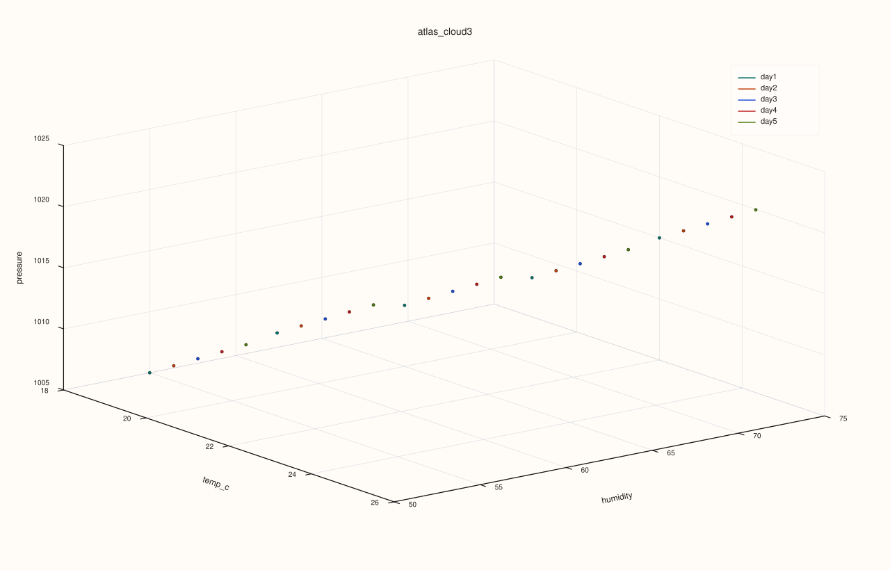
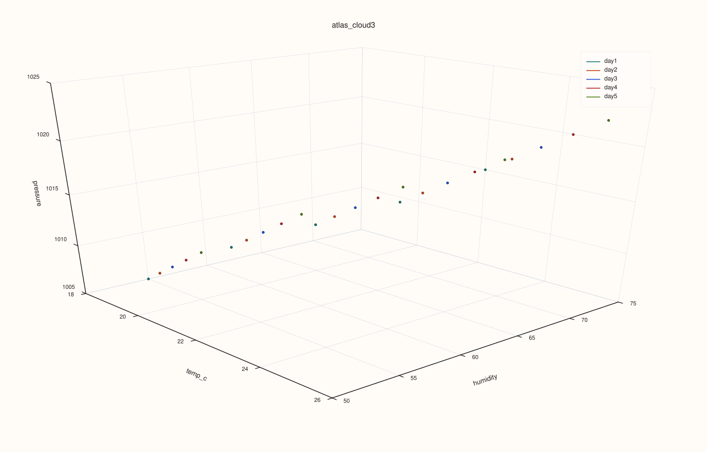

<!-- pluss-hand-authored -->
<!-- pluss-signature-hash: 1e481f2327ae -->

# ArchivePlotAccessor::cloud3

[Back to ArchivePlotAccessor API Reference](../../archive_plot_accessor_api_reference)

## Signatures

```cpp
pluss::pl::Studio ArchivePlotAccessor::cloud3(std::string_view x_key,
                                              std::string_view y_key,
                                              std::string_view z_key) const

pluss::pl::Studio ArchivePlotAccessor::cloud3(std::string_view x_key,
                                              std::string_view y_key,
                                              std::string_view z_key,
                                              const Scatter3DPlotOptions& options) const
```

## What It Does

A genuine 3-key 3D scatter of `(x_key, y_key, z_key)`, broken out per catalog — the
depth-aware counterpart to [`triplot()`](triplot.md)'s pooled-across-catalogs view. The
same distinction [`AtlasPlotAccessor::cloud3`](../atlas-plot/cloud3.md) draws one layer up.
See [`surface()`](surface.md)'s important callouts for the scoped-tabelize and
ragged-catalog behavior shared by every single/pairwise-key method on this accessor —
here, all three requested keys are tabelized together (not just one).

## Parameters

**x_key**, **y_key**, **z_key** (`std::string_view`)
    The three numeric keys forming each point's 3D position. Must all exist and be numeric
    in every catalog in the stack.

**options** (`const Scatter3DPlotOptions&`)
    The identical struct documented on
    [`AtlasPlotAccessor::cloud3`](../atlas-plot/cloud3.md) (`scene`, `trace`,
    `default_marker_size`).

## Returns

`pluss::pl::Studio`
    A figure with one 3D pane holding one point-cloud trace per catalog in the stack.

## Examples

Example 1. A default 3-key cloud across `temp_c`/`humidity`/`pressure`.

```cpp
using namespace pluss::kindle::literals;

std::vector<std::string> cities = {"Accra", "Tema", "Kumasi", "Takoradi", "Ho"};
auto city_labels = pluss::table::Thread(pluss::make_note(cities));

std::vector<pluss::kindle::Catalog> catalogs;
for (int i = 0; i < 5; ++i) {
    double base = static_cast<double>(i);
    catalogs.push_back(pluss::kindle::Catalog({
        "temp_c"_k = pluss::kindle::Stream(pluss::make_series({18.0 + base, 19.0 + base, 20.0 + base, 21.0 + base, 22.0 + base}))
                         .with_label(city_labels),
        "humidity"_k = pluss::kindle::Stream(pluss::make_series({55.0 - base, 60.0 - base, 65.0 - base, 70.0 - base, 75.0 - base}))
                           .with_label(city_labels),
        "pressure"_k = pluss::kindle::Stream(pluss::make_series(
                                  {1005.0 + base * 2, 1008.0 + base * 2, 1010.0 + base * 2, 1012.0 + base * 2, 1015.0 + base * 2}))
                           .with_label(city_labels),
    }));
}
auto archive = pluss::kindle::Archive(catalogs, pluss::kindle::Stream(pluss::make_note({"day1", "day2", "day3", "day4", "day5"})));

auto chart = archive.plot().cloud3("temp_c", "humidity", "pressure");
chart.show();
```

Each catalog in the stack becomes its own point-cloud trace, distinctly colored, with a
legend.



Example 2. The same cloud with `Scatter3DPlotOptions`, tuning marker size and scene preset.

```cpp
using namespace pluss::kindle::literals;

std::vector<std::string> cities = {"Accra", "Tema", "Kumasi", "Takoradi", "Ho"};
auto city_labels = pluss::table::Thread(pluss::make_note(cities));

std::vector<pluss::kindle::Catalog> catalogs;
for (int i = 0; i < 5; ++i) {
    double base = static_cast<double>(i);
    catalogs.push_back(pluss::kindle::Catalog({
        "temp_c"_k = pluss::kindle::Stream(pluss::make_series({18.0 + base, 19.0 + base, 20.0 + base, 21.0 + base, 22.0 + base}))
                         .with_label(city_labels),
        "humidity"_k = pluss::kindle::Stream(pluss::make_series({55.0 - base, 60.0 - base, 65.0 - base, 70.0 - base, 75.0 - base}))
                           .with_label(city_labels),
        "pressure"_k = pluss::kindle::Stream(pluss::make_series(
                                  {1005.0 + base * 2, 1008.0 + base * 2, 1010.0 + base * 2, 1012.0 + base * 2, 1015.0 + base * 2}))
                           .with_label(city_labels),
    }));
}
auto archive = pluss::kindle::Archive(catalogs, pluss::kindle::Stream(pluss::make_note({"day1", "day2", "day3", "day4", "day5"})));

pluss::table::Scatter3DPlotOptions options;
options.default_marker_size = 20.0;
options.scene.preset = pluss::pl::flash::ScenePreset3D::Presentation;
auto chart = archive.plot().cloud3("temp_c", "humidity", "pressure", options);
chart.show();
```



## Notes

- All three requested keys are tabelized together, not just one — see
  [`surface()`](surface.md)'s important callout for the general scoped-tabelize rule.
- Ragged (unequal-length) catalogs are accepted — see [`frames()`](frames.md)'s important
  callout.
- Delegates to [`AtlasPlotAccessor::cloud3`](../atlas-plot/cloud3.md) for the actual point
  construction.

## See Also

- [`ArchivePlotAccessor::triplot`](triplot.md): every pairwise combination among several
  keys, pooled across the whole stack, instead of one chosen 3-key cloud broken out per
  catalog.
- [`ArchivePlotAccessor::surface`](surface.md) / [`wireframe`](wireframe.md): a single key
  over a record/depth grid, rather than three independent keys.

<div class="pluss-inline-prev-next">
  <a class="next-link" href="depth.html">
    <span class="label">Next</span>
    <span class="title">depth</span>
  </a>
</div>
