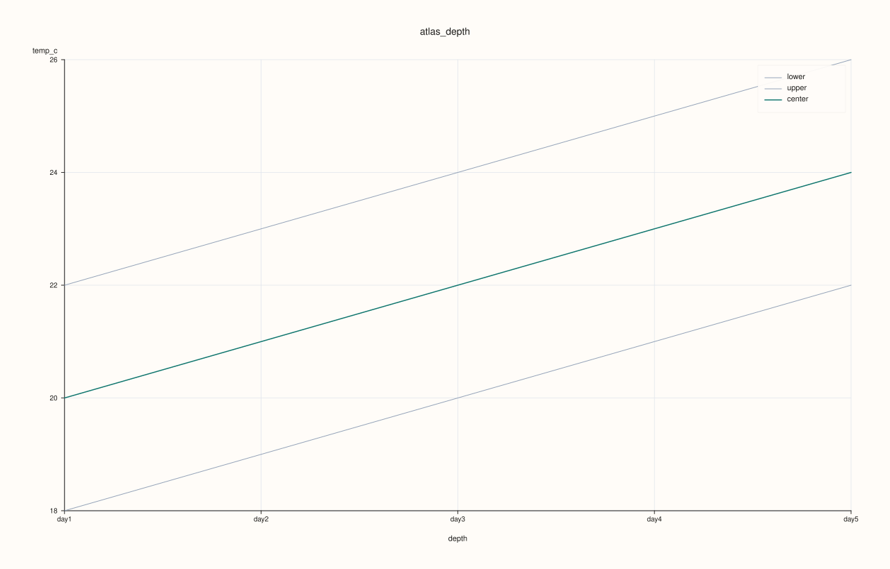
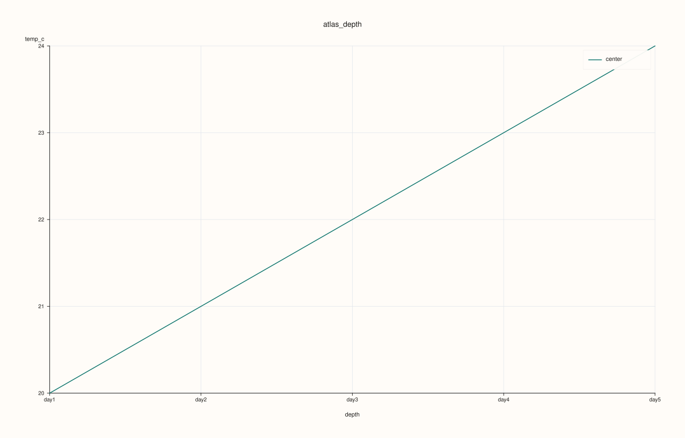

<!-- pluss-hand-authored -->
<!-- pluss-signature-hash: d0dcc3a82e78 -->

# ArchivePlotAccessor::depth

[Back to ArchivePlotAccessor API Reference](../../archive_plot_accessor_api_reference)

## Signatures

```cpp
pluss::pl::Studio ArchivePlotAccessor::depth(std::string_view key) const
pluss::pl::Studio ArchivePlotAccessor::depth(std::string_view key, const AtlasDepthPlotOptions& options) const
```

## What It Does

Reduces `key` to one summary statistic per depth level (across every record in each
catalog), drawn as a line down the depth axis, optionally banded between a lower and upper
statistic — the same shape as
[`AtlasPlotAccessor::depth`](../atlas-plot/depth.md), reused directly. See
[`surface()`](surface.md)'s important callouts for the scoped-tabelize and ragged-catalog
behavior shared by every single/pairwise-key method on this accessor.

## Parameters

**key** (`std::string_view`)
    The numeric key to reduce per depth level. Must exist and be numeric in every catalog.

**options** (`const AtlasDepthPlotOptions&`)
    The identical struct documented on
    [`AtlasPlotAccessor::depth`](../atlas-plot/depth.md) (`center`, `lower`,
    `upper`, `show_grid`, `center_trace_width`, `band_trace_width`).

## Returns

`pluss::pl::Studio`
    A figure with one pane: a center-statistic line, plus a shaded band if `lower`/`upper`
    both resolve.

## Examples

Example 1. Default: mean line with a min/max band.

```cpp
using namespace pluss::kindle::literals;

std::vector<std::string> cities = {"Accra", "Tema", "Kumasi", "Takoradi", "Ho"};
auto city_labels = pluss::table::Thread(pluss::make_note(cities));

std::vector<pluss::kindle::Catalog> catalogs;
for (int i = 0; i < 5; ++i) {
    double base = static_cast<double>(i);
    catalogs.push_back(pluss::kindle::Catalog({
        "temp_c"_k = pluss::kindle::Stream(pluss::make_series({18.0 + base, 19.0 + base, 20.0 + base, 21.0 + base, 22.0 + base}))
                         .with_label(city_labels),
    }));
}
auto archive = pluss::kindle::Archive(catalogs, pluss::kindle::Stream(pluss::make_note({"day1", "day2", "day3", "day4", "day5"})));

auto chart = archive.plot().depth("temp_c");
chart.show();
```



Example 2. `center = Median`, `lower`/`upper` cleared: a line with no band.

```cpp
using namespace pluss::kindle::literals;

std::vector<std::string> cities = {"Accra", "Tema", "Kumasi", "Takoradi", "Ho"};
auto city_labels = pluss::table::Thread(pluss::make_note(cities));

std::vector<pluss::kindle::Catalog> catalogs;
for (int i = 0; i < 5; ++i) {
    double base = static_cast<double>(i);
    catalogs.push_back(pluss::kindle::Catalog({
        "temp_c"_k = pluss::kindle::Stream(pluss::make_series({18.0 + base, 19.0 + base, 20.0 + base, 21.0 + base, 22.0 + base}))
                         .with_label(city_labels),
    }));
}
auto archive = pluss::kindle::Archive(catalogs, pluss::kindle::Stream(pluss::make_note({"day1", "day2", "day3", "day4", "day5"})));

pluss::table::AtlasDepthPlotOptions options;
options.center = pluss::table::AtlasDepthStatistic::Median;
options.lower = std::nullopt;
options.upper = std::nullopt;
auto chart = archive.plot().depth("temp_c", options);
chart.show();
```



## Notes

- Only tabelizes the requested `key` — see [`surface()`](surface.md)'s important callout.
- Ragged (unequal-length) catalogs are accepted — see [`frames()`](frames.md)'s important
  callout.
- Delegates to [`AtlasPlotAccessor::depth`](../atlas-plot/depth.md) for the reduction and
  rendering.

## See Also

- [`ArchivePlotAccessor::depth_compare`](depth_compare.md): several keys' center statistics
  overlaid on one pane, instead of one key's center-plus-band.
- [`ArchivePlotAccessor::depth_rolling`](depth_rolling.md): a rolling-window smoothed
  version of the same per-depth reduction.

<div class="pluss-inline-prev-next">
  <a class="prev-link" href="cloud3.html">
    <span class="label">Previous</span>
    <span class="title">cloud3</span>
  </a>
  <a class="next-link" href="depth_compare.html">
    <span class="label">Next</span>
    <span class="title">depth_compare</span>
  </a>
</div>
