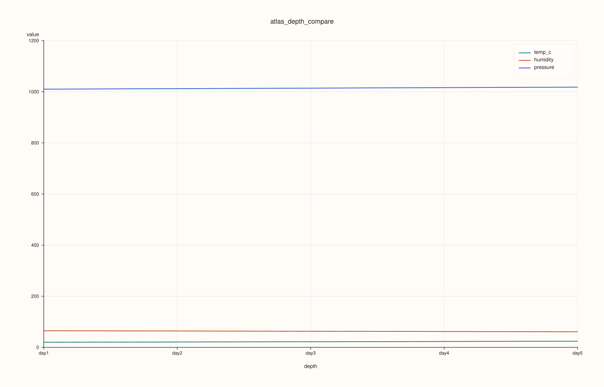
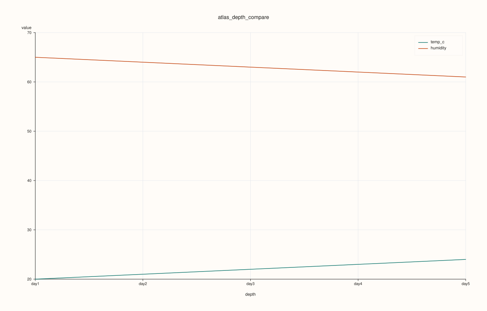
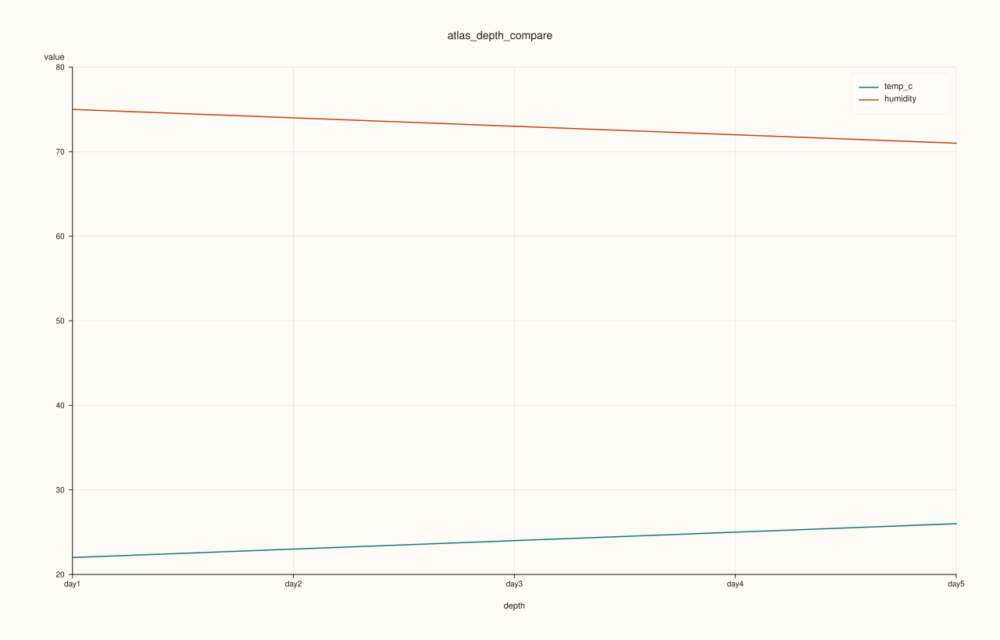

<!-- pluss-hand-authored -->
<!-- pluss-signature-hash: c174f3addbb8 -->

# ArchivePlotAccessor::depth_compare

[Back to ArchivePlotAccessor API Reference](../../archive_plot_accessor_api_reference)

## Signatures

```cpp
pluss::pl::Studio ArchivePlotAccessor::depth_compare(pluss::msharp::RangeView::Of<std::string_view> keys = {}) const

pluss::pl::Studio ArchivePlotAccessor::depth_compare(
    pluss::msharp::RangeView::Of<std::string_view> keys,
    const AtlasDepthComparePlotOptions& options) const
```

## What It Does

Overlays several keys' center-statistic depth lines on one pane — the multi-key sibling of
[`depth()`](depth.md), reusing
[`AtlasPlotAccessor::depth_compare`](../atlas-plot/depth_compare.md) directly.

```{important} An empty keys selection tabelizes the whole archive, not just one key
Every other single/pairwise-key method on this accessor ([`surface()`](surface.md),
[`depth()`](depth.md), etc.) only ever tabelizes the specific key(s) requested. `keys = {}`
here is different: since the actual key list isn't known until the default resolution runs
(every numeric key in the **first** catalog — the same rule
[`AtlasPlotAccessor::depth_compare`](../atlas-plot/depth_compare.md) uses), this
overload tabelizes the **entire** archive up front instead. Passing an explicit, non-empty
`keys` avoids this — only those keys get tabelized, the same scoped behavior every other
method has.
```

## Parameters

**keys** (`RangeView<std::string_view>`, defaults to `{}`)
    The numeric keys to compare. An empty range selects every numeric key in the **first**
    catalog only — see the important callout above.

**options** (`const AtlasDepthComparePlotOptions&`)
    The identical struct documented on
    [`AtlasPlotAccessor::depth_compare`](../atlas-plot/depth_compare.md)
    (`statistic`, `show_grid`, `line_width`, `max_features`).

## Returns

`pluss::pl::Studio`
    A figure with one pane, one center-statistic line per selected key.

## Examples

Example 1. Default: every numeric key in the first catalog, default `Mean` statistic.

```cpp
using namespace pluss::kindle::literals;

std::vector<std::string> cities = {"Accra", "Tema", "Kumasi", "Takoradi", "Ho"};
auto city_labels = pluss::table::Slate(pluss::make_note(cities));

std::vector<pluss::kindle::Catalog> catalogs;
for (int i = 0; i < 5; ++i) {
    double base = static_cast<double>(i);
    catalogs.push_back(pluss::kindle::Catalog({
        "temp_c"_k = pluss::kindle::Stream(pluss::make_series({18.0 + base, 19.0 + base, 20.0 + base, 21.0 + base, 22.0 + base}))
                         .with_label(city_labels),
        "humidity"_k = pluss::kindle::Stream(pluss::make_series({55.0 - base, 60.0 - base, 65.0 - base, 70.0 - base, 75.0 - base}))
                           .with_label(city_labels),
        "pressure"_k = pluss::kindle::Stream(pluss::make_series(
                                  {1005.0 + base * 2, 1008.0 + base * 2, 1010.0 + base * 2, 1012.0 + base * 2, 1015.0 + base * 2}))
                           .with_label(city_labels),
    }));
}
auto archive = pluss::kindle::Archive(catalogs, pluss::kindle::Stream(pluss::make_note({"day1", "day2", "day3", "day4", "day5"})));

auto chart = archive.plot().depth_compare();
chart.show();
```



Example 2. Explicit 2-key subset.

```cpp
using namespace pluss::kindle::literals;

std::vector<std::string> cities = {"Accra", "Tema", "Kumasi", "Takoradi", "Ho"};
auto city_labels = pluss::table::Slate(pluss::make_note(cities));

std::vector<pluss::kindle::Catalog> catalogs;
for (int i = 0; i < 5; ++i) {
    double base = static_cast<double>(i);
    catalogs.push_back(pluss::kindle::Catalog({
        "temp_c"_k = pluss::kindle::Stream(pluss::make_series({18.0 + base, 19.0 + base, 20.0 + base, 21.0 + base, 22.0 + base}))
                         .with_label(city_labels),
        "humidity"_k = pluss::kindle::Stream(pluss::make_series({55.0 - base, 60.0 - base, 65.0 - base, 70.0 - base, 75.0 - base}))
                           .with_label(city_labels),
    }));
}
auto archive = pluss::kindle::Archive(catalogs, pluss::kindle::Stream(pluss::make_note({"day1", "day2", "day3", "day4", "day5"})));

auto chart = archive.plot().depth_compare(pluss::msharp::RangeView::Of<std::string_view>{"temp_c", "humidity"});
chart.show();
```



Example 3. `statistic = Max` with `max_features = 2` truncation, using the empty-selection
default.

```cpp
using namespace pluss::kindle::literals;

std::vector<std::string> cities = {"Accra", "Tema", "Kumasi", "Takoradi", "Ho"};
auto city_labels = pluss::table::Slate(pluss::make_note(cities));

std::vector<pluss::kindle::Catalog> catalogs;
for (int i = 0; i < 5; ++i) {
    double base = static_cast<double>(i);
    catalogs.push_back(pluss::kindle::Catalog({
        "temp_c"_k = pluss::kindle::Stream(pluss::make_series({18.0 + base, 19.0 + base, 20.0 + base, 21.0 + base, 22.0 + base}))
                         .with_label(city_labels),
        "humidity"_k = pluss::kindle::Stream(pluss::make_series({55.0 - base, 60.0 - base, 65.0 - base, 70.0 - base, 75.0 - base}))
                           .with_label(city_labels),
        "pressure"_k = pluss::kindle::Stream(pluss::make_series(
                                  {1005.0 + base * 2, 1008.0 + base * 2, 1010.0 + base * 2, 1012.0 + base * 2, 1015.0 + base * 2}))
                           .with_label(city_labels),
    }));
}
auto archive = pluss::kindle::Archive(catalogs, pluss::kindle::Stream(pluss::make_note({"day1", "day2", "day3", "day4", "day5"})));

pluss::table::AtlasDepthComparePlotOptions options;
options.statistic = pluss::table::AtlasDepthStatistic::Max;
options.max_features = 2;
auto chart = archive.plot().depth_compare(pluss::msharp::RangeView::Of<std::string_view>{}, options);
chart.show();
```

Even though the first catalog has three numeric keys (`temp_c`, `humidity`, `pressure`),
`max_features = 2` truncates the resolved selection down to the first two.



## Notes

- An empty `keys` tabelizes the **whole** archive, unlike every other method on this
  accessor — see the important callout above. Pass explicit keys to keep the scoped
  behavior.
- `keys = {}` resolves to every numeric key in the **first** catalog only, the same rule
  [`AtlasPlotAccessor::depth_compare`](../atlas-plot/depth_compare.md) uses for frames.
- Delegates to [`AtlasPlotAccessor::depth_compare`](../atlas-plot/depth_compare.md) for the
  reduction and rendering.

## See Also

- [`ArchivePlotAccessor::depth`](depth.md): the single-key version this generalizes.
- [`ArchivePlotAccessor::depth_facet`](depth_facet.md): the same multi-key comparison, laid
  out as a small-multiple grid instead of one overlaid pane.

<div class="pluss-inline-prev-next">
  <a class="prev-link" href="depth.html">
    <span class="label">Previous</span>
    <span class="title">depth</span>
  </a>
  <a class="next-link" href="depth_facet.html">
    <span class="label">Next</span>
    <span class="title">depth_facet</span>
  </a>
</div>
