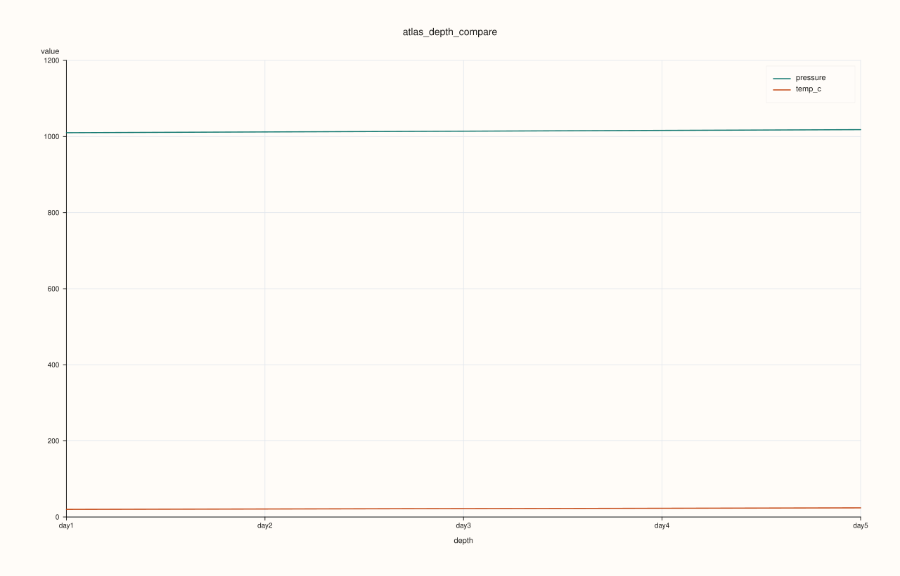
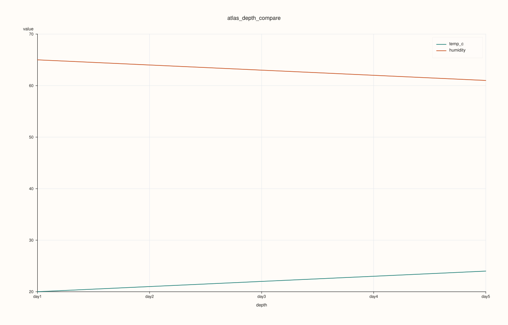
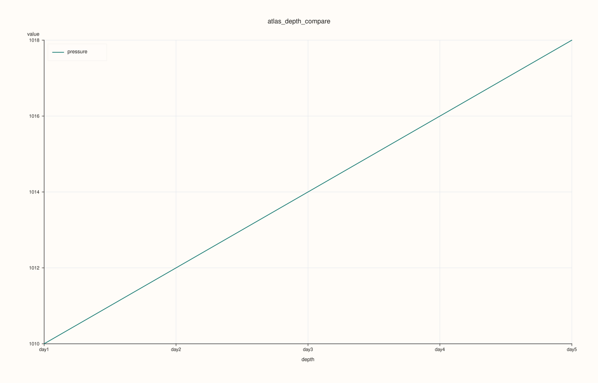
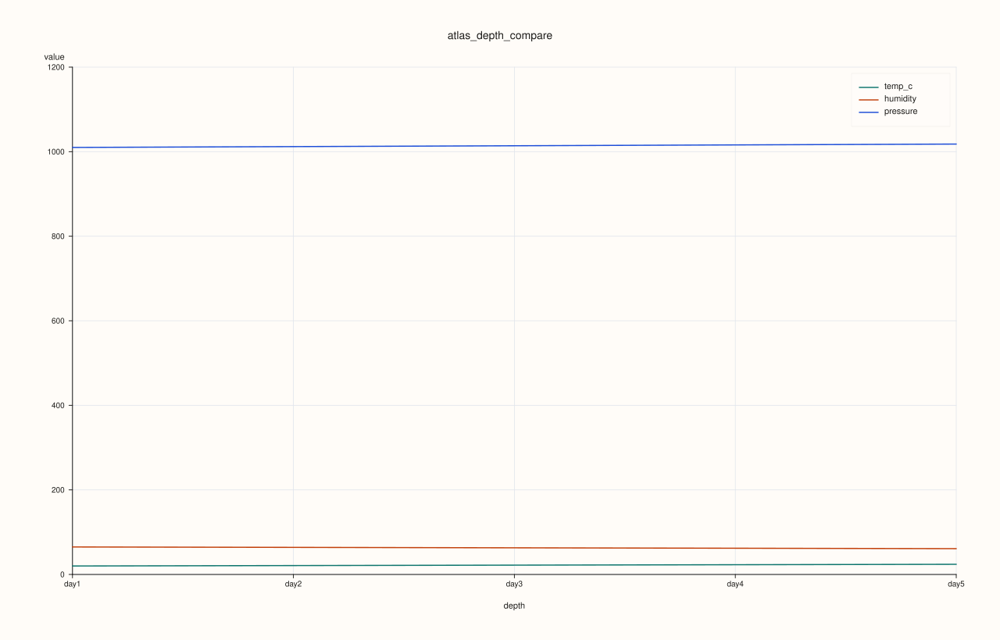
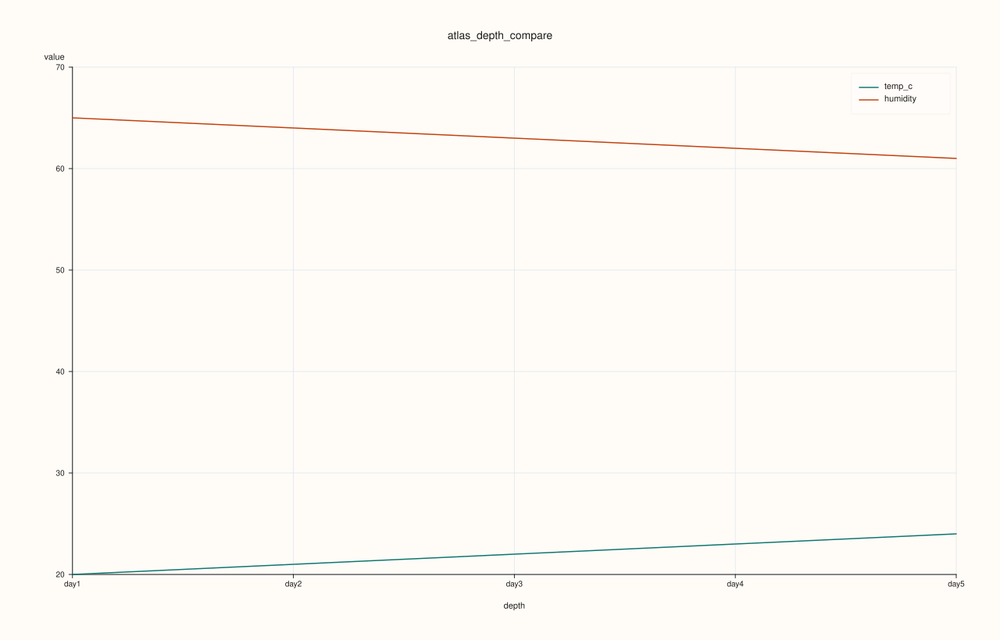
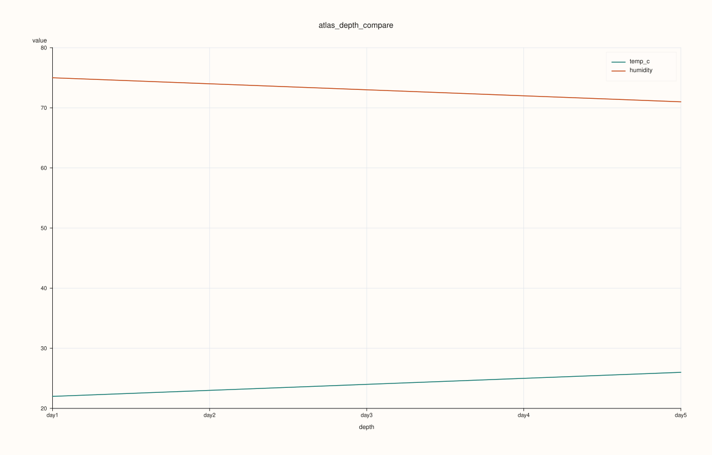

<!-- pluss-hand-authored -->
<!-- pluss-signature-hash: ccd2cfd7f62a -->

# ArchivePlotAccessor::depth_compare

[Back to ArchivePlotAccessor API Reference](../../archive_plot_accessor_api_reference)

## Signatures

```cpp
pluss::pl::Studio ArchivePlotAccessor::depth_compare(pluss::RangeView<std::string_view> keys = {}) const

pluss::pl::Studio ArchivePlotAccessor::depth_compare(
    pluss::RangeView<std::string_view> keys,
    const ArchiveDepthComparePlotOptions& options) const

pluss::pl::Studio ArchivePlotAccessor::depth_compare(const ArchiveDepthComparePlotOptions& options) const
```

## What It Does

Overlays several keys' center-statistic depth lines on one pane — the multi-key sibling of
[`depth()`](depth.md). The keys are named in the call or chosen by a key selection
(`all_keys`, `include_keys`, `exclude_keys`); see [Selecting keys](#selecting-keys).

```{important} An empty keys selection tabelizes the whole archive, not just one key
Every other single/pairwise-key method on this accessor ([`surface()`](surface.md),
[`depth()`](depth.md), etc.) only ever tabelizes the specific key(s) requested. `keys = {}`
here is different: since the actual key list isn't known until the default resolution runs
(every numeric key in the **first** catalog — the same rule
the same rule every depth plot of an Archive uses), this
overload tabelizes the **entire** archive up front instead. Passing an explicit, non-empty
`keys` avoids this — only those keys get tabelized, the same scoped behavior every other
method has.
```

## Parameters

**keys** (`pluss::RangeView<std::string_view>`, defaults to `{}`)

The numeric keys to compare. An empty range selects every numeric key in the **first**
catalog only — see the important callout above.

**options** (`const ArchiveDepthComparePlotOptions&`)

The settings of the plot.

| Field | Type | Default |
|---|---|---|
| `statistic` | `pluss::table::AtlasDepthStatistic` | `Mean` |
| `show_grid` | `bool` | `true` |
| `line_width` | `float` | `1.5` |
| `max_keys` | `std::int64_t` | `0` (no cap) |
| `keys` | `KeySelection` | no knob set |

`max_keys`, when positive, keeps only the first `max_keys` of the selected keys.

## Returns

`pluss::pl::Studio`
    A figure with one pane, one center-statistic line per selected key.

## Selecting keys

An Archive is a stack of catalogs that share keys, so its depth plots select **keys**. When a call names no
keys, the keys it draws come from one of three alternative knobs, each a field of `KeySelection`:

| Knob | Type | Draws |
|---|---|---|
| `all_keys` | `bool` | every numeric key |
| `include_keys` | `std::vector<std::string>` | exactly these keys, in this order |
| `exclude_keys` | `std::vector<std::string>` | every numeric key except these |

The knobs are set per plot, in the `keys` field of `ArchiveDepthComparePlotOptions`, or for the whole accessor
with `Archive::plot(const KeySelection& keys)` or the `keys` field of `ArchivePlotOptions`. The first source that applies wins:

1. keys named in the call, such as `depth_compare({"temp_c"})`;
2. the plot's own `keys`;
3. the accessor-level selection;
4. with none of these, every numeric key, as if `all_keys` were set.

The knobs are alternatives, and a misuse throws a `pluss::Error` that says what was combined, why it is invalid
and what to do; an unknown key is reported with the closest name and the available keys. The examples below use this archive.

```cpp
using namespace pluss::kindle::literals;

std::vector<std::string> cities = {"Accra", "Tema", "Kumasi", "Takoradi", "Ho"};
auto city_labels = pluss::table::Shelf(pluss::make_note(cities));

std::vector<pluss::kindle::Catalog> catalogs;
for (int i = 0; i < 5; ++i) {
    double base = static_cast<double>(i);
    catalogs.push_back(pluss::kindle::Catalog({
        "temp_c"_k = pluss::kindle::Stream(pluss::make_series({18.0 + base, 19.0 + base, 20.0 + base, 21.0 + base, 22.0 + base}))
                         .with_label(city_labels),
        "humidity"_k = pluss::kindle::Stream(pluss::make_series({55.0 - base, 60.0 - base, 65.0 - base, 70.0 - base, 75.0 - base}))
                           .with_label(city_labels),
        "pressure"_k = pluss::kindle::Stream(pluss::make_series(
                                  {1005.0 + base * 2, 1008.0 + base * 2, 1010.0 + base * 2, 1012.0 + base * 2, 1015.0 + base * 2}))
                           .with_label(city_labels),
    }));
}
auto archive = pluss::kindle::Archive(catalogs, pluss::kindle::Stream(pluss::make_note({"day1", "day2", "day3", "day4", "day5"})));
```

Example S1. `include_keys`: exactly these keys, in the order given.

```cpp
auto chart = archive.plot().depth_compare({.keys = {.include_keys = {"pressure", "temp_c"}}});
```

Two lines, `pressure` first, then `temp_c`.



Example S2. `exclude_keys`: every numeric key except these.

```cpp
auto chart = archive.plot().depth_compare({.keys = {.exclude_keys = {"pressure"}}});
```

Two lines: `temp_c` and `humidity`.



Example S3. A selection for the whole accessor, a plot's own selection that overrides it, and keys named in the
call that override both.

```cpp
const auto shared = archive.plot(pluss::kindle::KeySelection{.include_keys = {"temp_c", "humidity"}});

auto a = shared.depth_compare();                                          // accessor: temp_c, humidity
auto b = shared.depth_compare({.keys = {.include_keys = {"pressure"}}});  // the plot's own selection wins
auto c = shared.depth_compare({"humidity"});                              // names in the call win over both
```

`a` draws two lines; `b` and `c` draw one (`pressure`, `humidity`).




The following calls misuse the knobs. Each throws a `pluss::Error`; the messages, printed with `e.message()`, are shown
verbatim.

Example S4. `all_keys` with `exclude_keys`.

```cpp
archive.plot().depth_compare({.keys = {.all_keys = true, .exclude_keys = {"pressure"}}});
```

```text
Archive::plot().depth_compare: all_keys and exclude_keys cannot be combined: all_keys already means every numeric key. To drop some keys set exclude_keys instead (and leave all_keys false), or to plot everything remove exclude_keys.
```

Example S5. `include_keys` with `exclude_keys`.

```cpp
archive.plot().depth_compare({.keys = {.include_keys = {"temp_c"}, .exclude_keys = {"pressure"}}});
```

```text
Archive::plot().depth_compare: include_keys and exclude_keys cannot both be set: include_keys lists exactly the keys to draw, while exclude_keys drops keys from every numeric key. Use include_keys to name the keys you want, or exclude_keys to remove the ones you do not, but not both.
```

Example S6. An unknown key in a selection, with the closest name suggested.

```cpp
archive.plot().depth_compare({.keys = {.exclude_keys = {"humidty"}}});
```

```text
Archive::plot().depth_compare: exclude_keys names unknown key 'humidty'. Did you mean 'humidity'? Available keys = [temp_c, humidity, pressure]. Fix the spelling or remove 'humidty' from exclude_keys.
```

Example S7. An unknown key named in the call.

```cpp
archive.plot().depth_compare({"pressur"});
```

```text
Archive::plot().depth_compare: unknown key 'pressur'. Did you mean 'pressure'? Available keys = [temp_c, humidity, pressure]. Fix the spelling or remove 'pressur'.
```

Example S8. A selection that leaves nothing to draw.

```cpp
archive.plot().depth_compare({.keys = {.exclude_keys = {"temp_c", "humidity", "pressure"}}});
```

```text
Archive::plot().depth_compare: the selection leaves no numeric key to draw (numeric keys = [temp_c, humidity, pressure]). Remove some of exclude_keys, or use all_keys on an archive that has numeric keys.
```

## Examples

Example 1. Default: every numeric key in the first catalog, default `Mean` statistic.

```cpp
using namespace pluss::kindle::literals;

std::vector<std::string> cities = {"Accra", "Tema", "Kumasi", "Takoradi", "Ho"};
auto city_labels = pluss::table::Shelf(pluss::make_note(cities));

std::vector<pluss::kindle::Catalog> catalogs;
for (int i = 0; i < 5; ++i) {
    double base = static_cast<double>(i);
    catalogs.push_back(pluss::kindle::Catalog({
        "temp_c"_k = pluss::kindle::Stream(pluss::make_series({18.0 + base, 19.0 + base, 20.0 + base, 21.0 + base, 22.0 + base}))
                         .with_label(city_labels),
        "humidity"_k = pluss::kindle::Stream(pluss::make_series({55.0 - base, 60.0 - base, 65.0 - base, 70.0 - base, 75.0 - base}))
                           .with_label(city_labels),
        "pressure"_k = pluss::kindle::Stream(pluss::make_series(
                                  {1005.0 + base * 2, 1008.0 + base * 2, 1010.0 + base * 2, 1012.0 + base * 2, 1015.0 + base * 2}))
                           .with_label(city_labels),
    }));
}
auto archive = pluss::kindle::Archive(catalogs, pluss::kindle::Stream(pluss::make_note({"day1", "day2", "day3", "day4", "day5"})));

auto chart = archive.plot().depth_compare();
chart.show();
```



Example 2. Explicit 2-key subset.

```cpp
using namespace pluss::kindle::literals;

std::vector<std::string> cities = {"Accra", "Tema", "Kumasi", "Takoradi", "Ho"};
auto city_labels = pluss::table::Shelf(pluss::make_note(cities));

std::vector<pluss::kindle::Catalog> catalogs;
for (int i = 0; i < 5; ++i) {
    double base = static_cast<double>(i);
    catalogs.push_back(pluss::kindle::Catalog({
        "temp_c"_k = pluss::kindle::Stream(pluss::make_series({18.0 + base, 19.0 + base, 20.0 + base, 21.0 + base, 22.0 + base}))
                         .with_label(city_labels),
        "humidity"_k = pluss::kindle::Stream(pluss::make_series({55.0 - base, 60.0 - base, 65.0 - base, 70.0 - base, 75.0 - base}))
                           .with_label(city_labels),
    }));
}
auto archive = pluss::kindle::Archive(catalogs, pluss::kindle::Stream(pluss::make_note({"day1", "day2", "day3", "day4", "day5"})));

auto chart = archive.plot().depth_compare({"temp_c", "humidity"});
chart.show();
```



Example 3. `statistic = Max` with `max_keys = 2` truncation, using the empty-selection
default.

```cpp
using namespace pluss::kindle::literals;

std::vector<std::string> cities = {"Accra", "Tema", "Kumasi", "Takoradi", "Ho"};
auto city_labels = pluss::table::Shelf(pluss::make_note(cities));

std::vector<pluss::kindle::Catalog> catalogs;
for (int i = 0; i < 5; ++i) {
    double base = static_cast<double>(i);
    catalogs.push_back(pluss::kindle::Catalog({
        "temp_c"_k = pluss::kindle::Stream(pluss::make_series({18.0 + base, 19.0 + base, 20.0 + base, 21.0 + base, 22.0 + base}))
                         .with_label(city_labels),
        "humidity"_k = pluss::kindle::Stream(pluss::make_series({55.0 - base, 60.0 - base, 65.0 - base, 70.0 - base, 75.0 - base}))
                           .with_label(city_labels),
        "pressure"_k = pluss::kindle::Stream(pluss::make_series(
                                  {1005.0 + base * 2, 1008.0 + base * 2, 1010.0 + base * 2, 1012.0 + base * 2, 1015.0 + base * 2}))
                           .with_label(city_labels),
    }));
}
auto archive = pluss::kindle::Archive(catalogs, pluss::kindle::Stream(pluss::make_note({"day1", "day2", "day3", "day4", "day5"})));

pluss::kindle::ArchiveDepthComparePlotOptions options;
options.statistic = pluss::table::AtlasDepthStatistic::Max;
options.max_keys = 2;
auto chart = archive.plot().depth_compare({}, options);
chart.show();
```

Even though the first catalog has three numeric keys (`temp_c`, `humidity`, `pressure`),
`max_keys = 2` truncates the resolved selection down to the first two.



## Notes

- An empty `keys` tabelizes the **whole** archive, unlike every other method on this
  accessor — see the important callout above. Pass explicit keys to keep the scoped
  behavior.
- `keys = {}` resolves to every numeric key in the **first** catalog only, the same rule every depth plot of an Archive uses.

## See Also

- [`ArchivePlotAccessor::depth`](depth.md): the single-key version this generalizes.
- [`ArchivePlotAccessor::depth_facet`](depth_facet.md): the same multi-key comparison, laid
  out as a small-multiple grid instead of one overlaid pane.

<div class="pluss-inline-prev-next">
  <a class="prev-link" href="depth.html">
    <span class="label">Previous</span>
    <span class="title">depth</span>
  </a>
  <a class="next-link" href="depth_facet.html">
    <span class="label">Next</span>
    <span class="title">depth_facet</span>
  </a>
</div>
