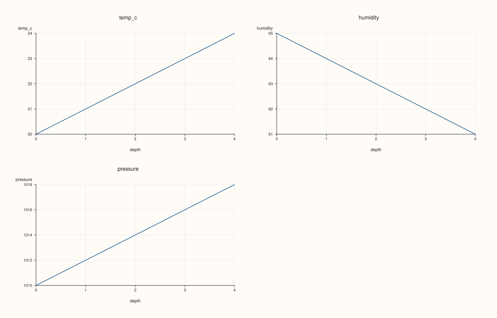
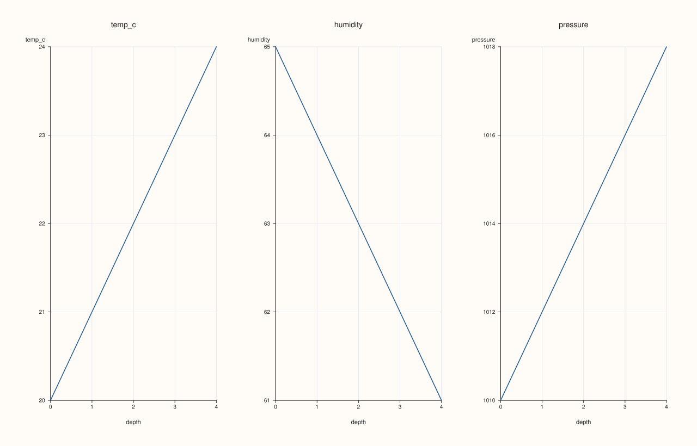

<!-- pluss-hand-authored -->
<!-- pluss-signature-hash: 1a3165eacf1d -->

# ArchivePlotAccessor::depth_facet

[Back to ArchivePlotAccessor API Reference](../../archive_plot_accessor_api_reference)

## Signatures

```cpp
pluss::pl::Studio ArchivePlotAccessor::depth_facet(pluss::msharp::RangeView::Of<std::string_view> keys = {}) const

pluss::pl::Studio ArchivePlotAccessor::depth_facet(
    pluss::msharp::RangeView::Of<std::string_view> keys,
    const AtlasDepthFacetPlotOptions& options) const
```

## What It Does

The same multi-key depth comparison as [`depth_compare()`](depth_compare.md), laid out as
one small-multiple pane per key instead of one shared overlaid pane — reuses
[`AtlasPlotAccessor::depth_facet`](../atlas-plot/depth_facet.md) directly. Same
empty-`keys`-tabelizes-the-whole-archive behavior as `depth_compare()` — see that page's
important callout.

## Parameters

**keys** (`RangeView<std::string_view>`, defaults to `{}`)
    Same resolution as [`depth_compare()`](depth_compare.md): empty selects every
    numeric key in the first catalog.

**options** (`const AtlasDepthFacetPlotOptions&`)
    The identical struct documented on
    [`AtlasPlotAccessor::depth_facet`](../atlas-plot/depth_facet.md)
    (`statistic`, `show_grid`, `rows`, `cols`, `grid_gap_x`, `grid_gap_y`, `max_features`).

## Returns

`pluss::pl::Studio`
    A figure laid out as a small-multiple grid, one pane per selected key.

## Examples

Example 1. Default: every numeric key in the first catalog, auto-sized grid.

```cpp
using namespace pluss::kindle::literals;

std::vector<std::string> cities = {"Accra", "Tema", "Kumasi", "Takoradi", "Ho"};
auto city_labels = pluss::table::Slate(pluss::make_note(cities));

std::vector<pluss::kindle::Catalog> catalogs;
for (int i = 0; i < 5; ++i) {
    double base = static_cast<double>(i);
    catalogs.push_back(pluss::kindle::Catalog({
        "temp_c"_k = pluss::kindle::Stream(pluss::make_series({18.0 + base, 19.0 + base, 20.0 + base, 21.0 + base, 22.0 + base}))
                         .with_label(city_labels),
        "humidity"_k = pluss::kindle::Stream(pluss::make_series({55.0 - base, 60.0 - base, 65.0 - base, 70.0 - base, 75.0 - base}))
                           .with_label(city_labels),
        "pressure"_k = pluss::kindle::Stream(pluss::make_series(
                                  {1005.0 + base * 2, 1008.0 + base * 2, 1010.0 + base * 2, 1012.0 + base * 2, 1015.0 + base * 2}))
                           .with_label(city_labels),
    }));
}
auto archive = pluss::kindle::Archive(catalogs, pluss::kindle::Stream(pluss::make_note({"day1", "day2", "day3", "day4", "day5"})));

auto chart = archive.plot().depth_facet();
chart.show();
```



Example 2. Explicit `rows`/`cols` grid shape.

```cpp
using namespace pluss::kindle::literals;

std::vector<std::string> cities = {"Accra", "Tema", "Kumasi", "Takoradi", "Ho"};
auto city_labels = pluss::table::Slate(pluss::make_note(cities));

std::vector<pluss::kindle::Catalog> catalogs;
for (int i = 0; i < 5; ++i) {
    double base = static_cast<double>(i);
    catalogs.push_back(pluss::kindle::Catalog({
        "temp_c"_k = pluss::kindle::Stream(pluss::make_series({18.0 + base, 19.0 + base, 20.0 + base, 21.0 + base, 22.0 + base}))
                         .with_label(city_labels),
        "humidity"_k = pluss::kindle::Stream(pluss::make_series({55.0 - base, 60.0 - base, 65.0 - base, 70.0 - base, 75.0 - base}))
                           .with_label(city_labels),
        "pressure"_k = pluss::kindle::Stream(pluss::make_series(
                                  {1005.0 + base * 2, 1008.0 + base * 2, 1010.0 + base * 2, 1012.0 + base * 2, 1015.0 + base * 2}))
                           .with_label(city_labels),
    }));
}
auto archive = pluss::kindle::Archive(catalogs, pluss::kindle::Stream(pluss::make_note({"day1", "day2", "day3", "day4", "day5"})));

pluss::table::AtlasDepthFacetPlotOptions options;
options.rows = 1;
options.cols = 3;
auto chart = archive.plot().depth_facet(pluss::msharp::RangeView::Of<std::string_view>{}, options);
chart.show();
```



## Notes

- An empty `keys` tabelizes the whole archive — see [`depth_compare()`](depth_compare.md)'s
  important callout.
- Delegates to [`AtlasPlotAccessor::depth_facet`](../atlas-plot/depth_facet.md) for the
  reduction, grid layout, and rendering.

## See Also

- [`ArchivePlotAccessor::depth_compare`](depth_compare.md): the same multi-key comparison,
  overlaid on one pane instead of faceted.
- [`ArchivePlotAccessor::depth`](depth.md): the single-key version this generalizes.

<div class="pluss-inline-prev-next">
  <a class="prev-link" href="depth_compare.html">
    <span class="label">Previous</span>
    <span class="title">depth_compare</span>
  </a>
  <a class="next-link" href="depth_rolling.html">
    <span class="label">Next</span>
    <span class="title">depth_rolling</span>
  </a>
</div>
