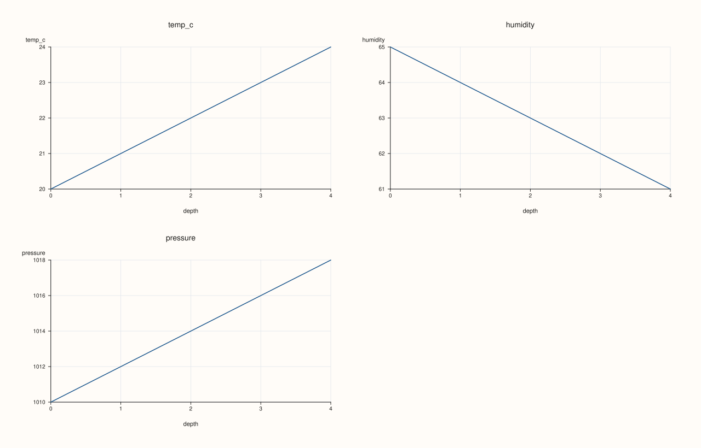
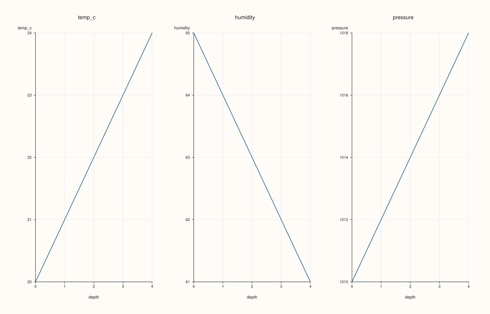
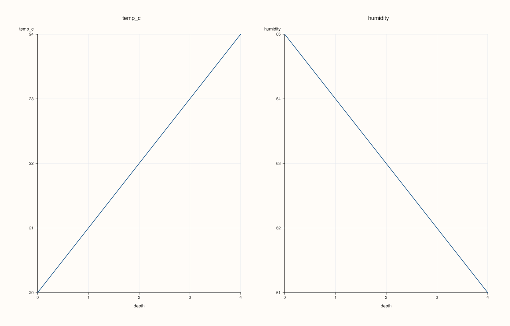
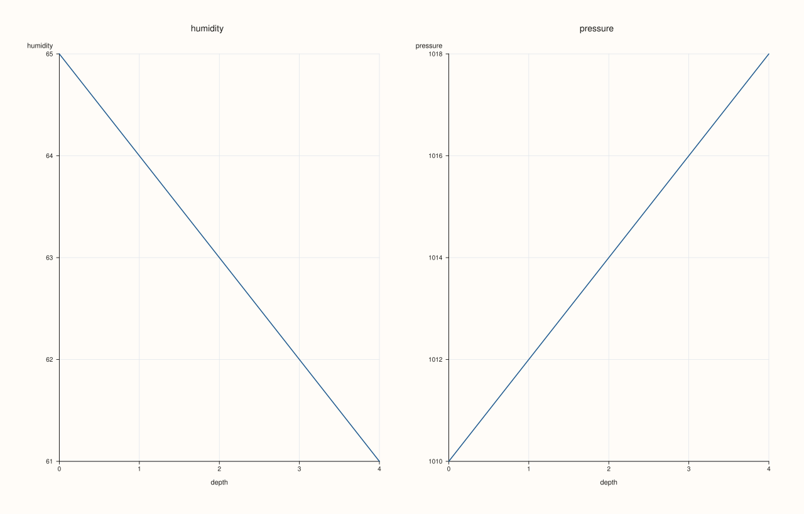

<!-- pluss-hand-authored -->
<!-- pluss-signature-hash: cd58a0a6ce5a -->

# ArchivePlotAccessor::depth_facet

[Back to ArchivePlotAccessor API Reference](../../archive_plot_accessor_api_reference)

## Signatures

```cpp
pluss::pl::Studio ArchivePlotAccessor::depth_facet(pluss::RangeView<std::string_view> keys = {}) const

pluss::pl::Studio ArchivePlotAccessor::depth_facet(
    pluss::RangeView<std::string_view> keys,
    const ArchiveDepthFacetPlotOptions& options) const

pluss::pl::Studio ArchivePlotAccessor::depth_facet(const ArchiveDepthFacetPlotOptions& options) const
```

## What It Does

The same multi-key depth comparison as [`depth_compare()`](depth_compare.md), laid out as
one small-multiple pane per key instead of one shared overlaid pane. The keys are chosen as for
`depth_compare()`, see [Selecting keys](depth_compare.md#selecting-keys). Same
empty-`keys`-tabelizes-the-whole-archive behavior as `depth_compare()` — see that page's
important callout.

## Parameters

**keys** (`pluss::RangeView<std::string_view>`, defaults to `{}`)

Same resolution as [`depth_compare()`](depth_compare.md): empty selects every
numeric key in the first catalog.

**options** (`const ArchiveDepthFacetPlotOptions&`)

The settings of the plot.

| Field | Type | Default |
|---|---|---|
| `statistic` | `pluss::table::AtlasDepthStatistic` | `Mean` |
| `show_grid` | `bool` | `true` |
| `rows` | `std::int64_t` | `0` (automatic) |
| `cols` | `std::int64_t` | `0` (automatic) |
| `grid_gap_x` | `double` | `16.0` |
| `grid_gap_y` | `double` | `16.0` |
| `max_keys` | `std::int64_t` | `0` (no cap) |
| `keys` | `KeySelection` | no knob set |

## Returns

`pluss::pl::Studio`
    A figure laid out as a small-multiple grid, one pane per selected key.

## Examples

Example 1. Default: every numeric key in the first catalog, auto-sized grid.

```cpp
using namespace pluss::kindle::literals;

std::vector<std::string> cities = {"Accra", "Tema", "Kumasi", "Takoradi", "Ho"};
auto city_labels = pluss::table::Shelf(pluss::make_note(cities));

std::vector<pluss::kindle::Catalog> catalogs;
for (int i = 0; i < 5; ++i) {
    double base = static_cast<double>(i);
    catalogs.push_back(pluss::kindle::Catalog({
        "temp_c"_k = pluss::kindle::Stream(pluss::make_series({18.0 + base, 19.0 + base, 20.0 + base, 21.0 + base, 22.0 + base}))
                         .with_label(city_labels),
        "humidity"_k = pluss::kindle::Stream(pluss::make_series({55.0 - base, 60.0 - base, 65.0 - base, 70.0 - base, 75.0 - base}))
                           .with_label(city_labels),
        "pressure"_k = pluss::kindle::Stream(pluss::make_series(
                                  {1005.0 + base * 2, 1008.0 + base * 2, 1010.0 + base * 2, 1012.0 + base * 2, 1015.0 + base * 2}))
                           .with_label(city_labels),
    }));
}
auto archive = pluss::kindle::Archive(catalogs, pluss::kindle::Stream(pluss::make_note({"day1", "day2", "day3", "day4", "day5"})));

auto chart = archive.plot().depth_facet();
chart.show();
```



Example 2. Explicit `rows`/`cols` grid shape.

```cpp
using namespace pluss::kindle::literals;

std::vector<std::string> cities = {"Accra", "Tema", "Kumasi", "Takoradi", "Ho"};
auto city_labels = pluss::table::Shelf(pluss::make_note(cities));

std::vector<pluss::kindle::Catalog> catalogs;
for (int i = 0; i < 5; ++i) {
    double base = static_cast<double>(i);
    catalogs.push_back(pluss::kindle::Catalog({
        "temp_c"_k = pluss::kindle::Stream(pluss::make_series({18.0 + base, 19.0 + base, 20.0 + base, 21.0 + base, 22.0 + base}))
                         .with_label(city_labels),
        "humidity"_k = pluss::kindle::Stream(pluss::make_series({55.0 - base, 60.0 - base, 65.0 - base, 70.0 - base, 75.0 - base}))
                           .with_label(city_labels),
        "pressure"_k = pluss::kindle::Stream(pluss::make_series(
                                  {1005.0 + base * 2, 1008.0 + base * 2, 1010.0 + base * 2, 1012.0 + base * 2, 1015.0 + base * 2}))
                           .with_label(city_labels),
    }));
}
auto archive = pluss::kindle::Archive(catalogs, pluss::kindle::Stream(pluss::make_note({"day1", "day2", "day3", "day4", "day5"})));

pluss::kindle::ArchiveDepthFacetPlotOptions options;
options.rows = 1;
options.cols = 3;
auto chart = archive.plot().depth_facet({}, options);
chart.show();
```



Example 3. A key selection with a cap: every numeric key except `pressure`, at most two.

```cpp
auto chart = archive.plot().depth_facet({.keys = {.exclude_keys = {"pressure"}}, .max_keys = 2});
```

Two panes, `temp_c` and `humidity`, using the archive of
[`depth_compare()`](depth_compare.md#selecting-keys).



Example 4. `include_keys` with an explicit grid shape.

```cpp
pluss::kindle::ArchiveDepthFacetPlotOptions options;
options.keys.include_keys = {"humidity", "pressure"};
options.rows = 1;
options.cols = 2;
auto chart = archive.plot().depth_facet(options);
```



Example 5. Misuse. `all_keys` with `include_keys`:

```cpp
archive.plot().depth_facet({.keys = {.all_keys = true, .include_keys = {"humidity"}}});
```

```text
Archive::plot().depth_facet: all_keys and include_keys cannot be combined: all_keys already means every numeric key. To plot only some keys set include_keys instead (and leave all_keys false), or to plot everything remove include_keys.
```

An unknown key named in the call:

```cpp
archive.plot().depth_facet({"humidty"});
```

```text
Archive::plot().depth_facet: unknown key 'humidty'. Did you mean 'humidity'? Available keys = [temp_c, humidity, pressure]. Fix the spelling or remove 'humidty'.
```

## Notes

- An empty `keys` tabelizes the whole archive — see [`depth_compare()`](depth_compare.md)'s
  important callout.

## See Also

- [`ArchivePlotAccessor::depth_compare`](depth_compare.md): the same multi-key comparison,
  overlaid on one pane instead of faceted.
- [`ArchivePlotAccessor::depth`](depth.md): the single-key version this generalizes.

<div class="pluss-inline-prev-next">
  <a class="prev-link" href="depth_compare.html">
    <span class="label">Previous</span>
    <span class="title">depth_compare</span>
  </a>
  <a class="next-link" href="depth_rolling.html">
    <span class="label">Next</span>
    <span class="title">depth_rolling</span>
  </a>
</div>
