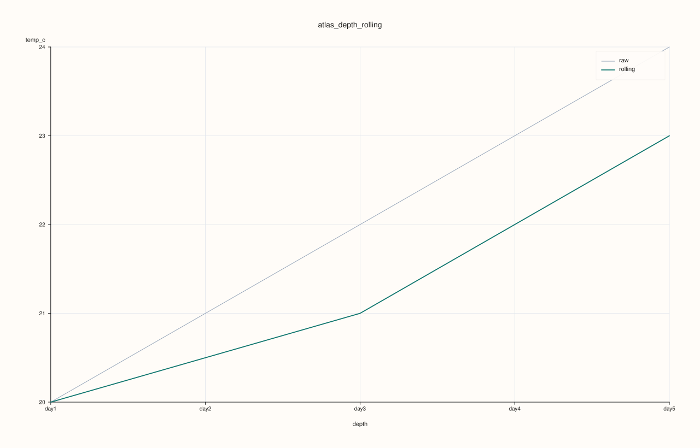
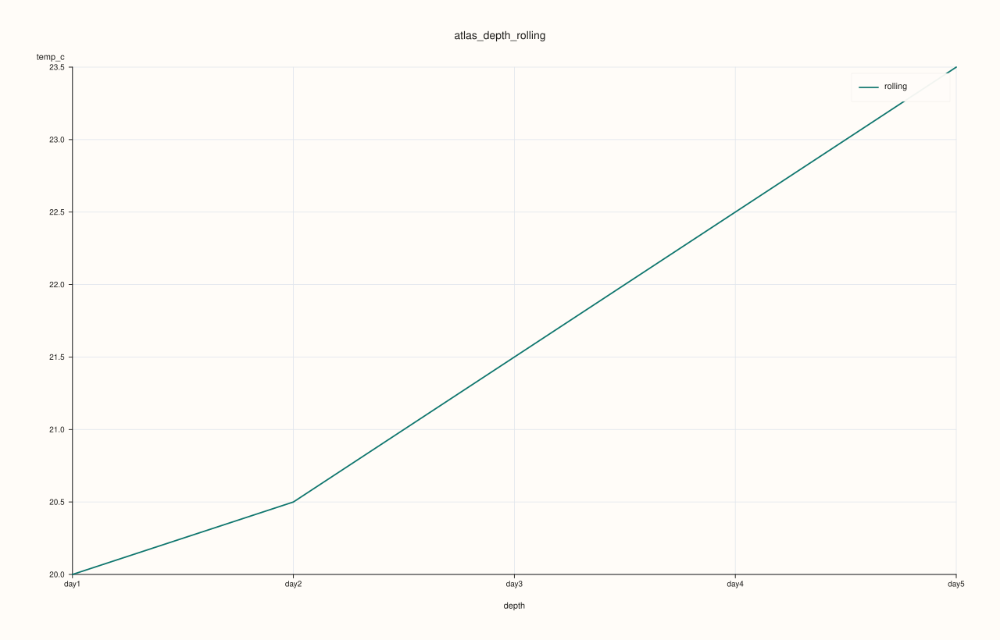

<!-- pluss-hand-authored -->
<!-- pluss-signature-hash: 0356d18b5e62 -->

# ArchivePlotAccessor::depth_rolling

[Back to ArchivePlotAccessor API Reference](../../archive_plot_accessor_api_reference)

## Signatures

```cpp
pluss::pl::Studio ArchivePlotAccessor::depth_rolling(std::string_view key) const
pluss::pl::Studio ArchivePlotAccessor::depth_rolling(std::string_view key, const AtlasDepthRollingPlotOptions& options) const
```

## What It Does

Draws [`depth()`](depth.md)'s center-statistic line for `key`, plus a rolling-window
smoothed version overlaid on top — reuses
[`AtlasPlotAccessor::depth_rolling`](../atlas-plot/depth_rolling.md) directly. See
[`surface()`](surface.md)'s important callouts for the scoped-tabelize and ragged-catalog
behavior shared by every single/pairwise-key method on this accessor.

## Parameters

**key** (`std::string_view`)
    The numeric key to reduce per depth level and smooth.

**options** (`const AtlasDepthRollingPlotOptions&`)
    The identical struct documented on
    [`AtlasPlotAccessor::depth_rolling`](../atlas-plot/depth_rolling.md)
    (`statistic`, `window`, `show_raw`, `show_grid`, `raw_line_width`,
    `rolling_line_width`).

## Returns

`pluss::pl::Studio`
    A figure with one pane: the raw per-depth statistic line, plus a rolling-window
    smoothed line, unless `show_raw = false`.

## Examples

Example 1. Default: raw statistic plus a 3-catalog rolling window.

```cpp
using namespace pluss::kindle::literals;

std::vector<std::string> cities = {"Accra", "Tema", "Kumasi", "Takoradi", "Ho"};
auto city_labels = pluss::table::Slate(pluss::make_note(cities));

std::vector<pluss::kindle::Catalog> catalogs;
for (int i = 0; i < 5; ++i) {
    double base = static_cast<double>(i);
    catalogs.push_back(pluss::kindle::Catalog({
        "temp_c"_k = pluss::kindle::Stream(pluss::make_series({18.0 + base, 19.0 + base, 20.0 + base, 21.0 + base, 22.0 + base}))
                         .with_label(city_labels),
    }));
}
auto archive = pluss::kindle::Archive(catalogs, pluss::kindle::Stream(pluss::make_note({"day1", "day2", "day3", "day4", "day5"})));

auto chart = archive.plot().depth_rolling("temp_c");
chart.show();
```



Example 2. `window = 2`, `show_raw = false`: only the smoothed line, over a shorter window.

```cpp
using namespace pluss::kindle::literals;

std::vector<std::string> cities = {"Accra", "Tema", "Kumasi", "Takoradi", "Ho"};
auto city_labels = pluss::table::Slate(pluss::make_note(cities));

std::vector<pluss::kindle::Catalog> catalogs;
for (int i = 0; i < 5; ++i) {
    double base = static_cast<double>(i);
    catalogs.push_back(pluss::kindle::Catalog({
        "temp_c"_k = pluss::kindle::Stream(pluss::make_series({18.0 + base, 19.0 + base, 20.0 + base, 21.0 + base, 22.0 + base}))
                         .with_label(city_labels),
    }));
}
auto archive = pluss::kindle::Archive(catalogs, pluss::kindle::Stream(pluss::make_note({"day1", "day2", "day3", "day4", "day5"})));

pluss::table::AtlasDepthRollingPlotOptions options;
options.window = 2;
options.show_raw = false;
auto chart = archive.plot().depth_rolling("temp_c", options);
chart.show();
```



## Notes

- Only tabelizes the requested `key` — see [`surface()`](surface.md)'s important callout.
- Delegates to [`AtlasPlotAccessor::depth_rolling`](../atlas-plot/depth_rolling.md) for the
  reduction, smoothing, and rendering.

## See Also

- [`ArchivePlotAccessor::depth`](depth.md): the unsmoothed version of the same per-depth
  reduction.
- [`ArchivePlotAccessor::depth_compare`](depth_compare.md): several keys' center statistics
  compared, instead of one key's raw-vs-smoothed comparison.

<div class="pluss-inline-prev-next">
  <a class="prev-link" href="depth_facet.html">
    <span class="label">Previous</span>
    <span class="title">depth_facet</span>
  </a>
  <a class="next-link" href="frames.html">
    <span class="label">Next</span>
    <span class="title">frames</span>
  </a>
</div>
