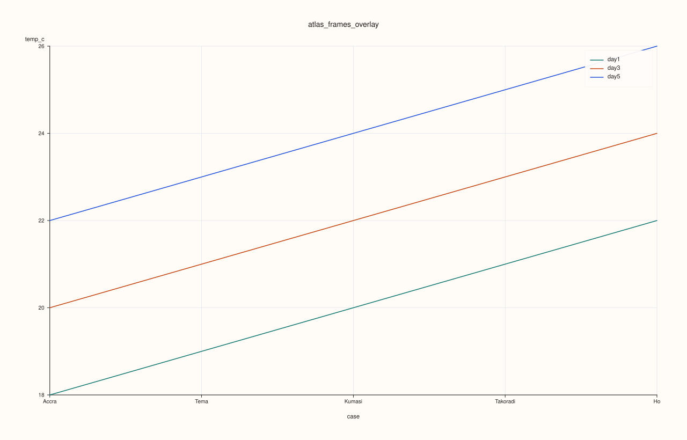
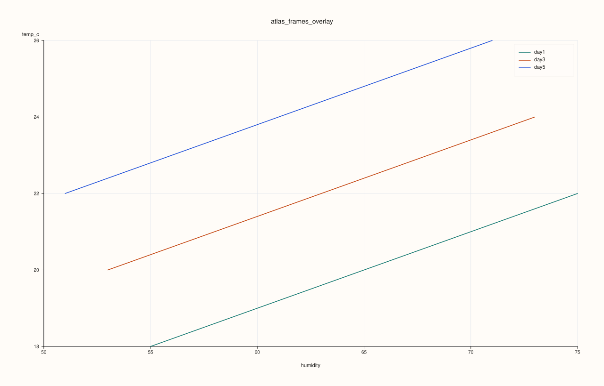
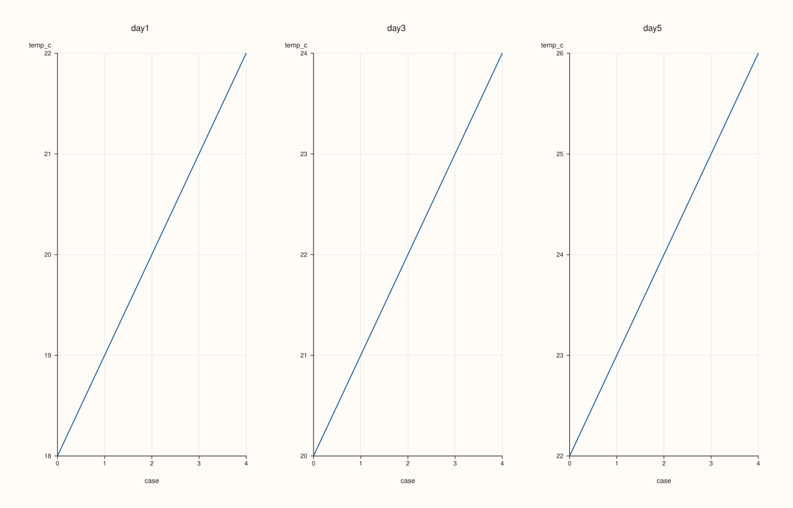
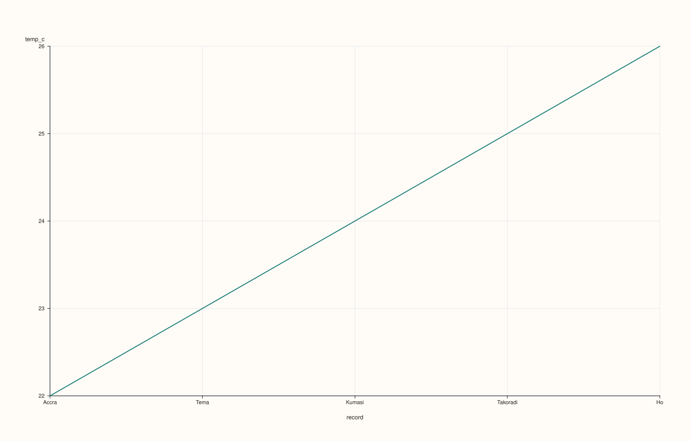

<!-- pluss-hand-authored -->
<!-- pluss-signature-hash: e8449ca3ac64 -->

# ArchivePlotAccessor::frames

[Back to ArchivePlotAccessor API Reference](../../archive_plot_accessor_api_reference)

## Signatures

```cpp
ArchivePlotAccessor::frames(std::int64_t frame_index = 0) const -> CatalogPlotAccessor

ArchivePlotAccessor::frames(pluss::msharp::RangeView::Int frame_indices,
                            std::string_view y_key,
                            std::optional<std::string_view> x_key = std::nullopt) const -> pluss::pl::Studio

ArchivePlotAccessor::frames(pluss::msharp::RangeView::Int frame_indices,
                            std::string_view y_key,
                            std::optional<std::string_view> x_key,
                            const pluss::table::AtlasFramesPlotOptions& options) const -> pluss::pl::Studio
```

## What It Does

Two genuinely different things share the name `frames()`, mirroring
[`AtlasPlotAccessor::frames`](../atlas-plot/frames.md) one layer up:

- The **single-index overload** (`frames(frame_index)`) is an entry point, not a chart
  builder — it returns a [`CatalogPlotAccessor`](../../catalog_plot_accessor_api_reference)
  bound to one catalog of the stack (`archive.catalog(frame_index).plot(options().figure)`),
  so you can call any of that accessor's own plotting methods
  (`.line(...)`, `.scatter(...)`, `.hist(...)`, etc.) on a single depth-slice as if it were a
  standalone `Catalog`. Supports negative indexing (`-1` is the last catalog); an
  out-of-range index throws `"Archive: index out of bounds"` — this check runs at the
  `Archive::catalog()` layer, before `ArchivePlotAccessor` gets involved at all.
- The **multi-index overloads** (`frames(indices, y_key, ...)`) build an actual
  `pluss::pl::Studio` chart directly, overlaying (or faceting) the same key across several
  catalogs at once.

```{important} The multi-index overloads delegate through a freshly built AtlasPlotAccessor
Every multi-index call tabelizes the selected catalogs (`Catalog::tabelize()`, projected to
just `y_key`/`x_key` first) into `DataFrame`s, wraps them in a fresh
`pluss::table::AtlasPlotAccessor`, and calls that accessor's own `frames()` — reusing
[`AtlasPlotAccessor::frames`](../atlas-plot/frames.md)'s logic exactly rather than
duplicating it. This means the frame-index resolution rules (negative wraps, duplicates
dedupe, out-of-range throws) are identical to Atlas's — but the throw message still says
`"Atlas::plot().frames: ..."`, not `"Archive::plot().frames: ..."`, since it's the same
underlying implementation. See Example 7.
```

```{important} Archive doesn't require equal-length catalogs the way Atlas requires equal-length frames
Unlike constructing a strict `Atlas` (which validates every frame has the same row count),
`Archive` is the ragged-capable depth stack — its catalogs can have different row counts.
The `AtlasPlotAccessor` this method builds internally is constructed directly from the
tabelized catalogs (bypassing `Atlas`'s own strict-validation constructor), so ragged catalog
lengths are accepted here even though a literal `Atlas(frames, ...)` construction with the
same mismatched row counts would throw.
```

## Parameters

**frame_index** (`std::int64_t`, default `0`)
    Which catalog to bind, for the single-index overload. Negative indices wrap from the
    end.

**frame_indices** (`pluss::msharp::RangeView::Int`)
    Which catalogs to include, for the multi-index overloads. Out-of-range or negative
    indices resolve the same way [`AtlasPlotAccessor::frames`](../atlas-plot/frames.md)
    documents; duplicates (after normalizing negatives) are deduplicated.

**y_key** (`std::string_view`)
    The key drawn from each selected catalog, one line trace per catalog.

**x_key** (`std::optional<std::string_view>`, default `std::nullopt`)
    The key used as each catalog's x-axis. Left as `std::nullopt`, each catalog's own
    record axis is used instead (positional, or the key's own label if it has one — the same
    self-axis rule [`CatalogPlotAccessor::line`](../catalog-plot/line.md) uses).

**options** (`const pluss::table::AtlasFramesPlotOptions&`)
    The identical struct documented on
    [`AtlasPlotAccessor::frames`](../atlas-plot/frames.md) (`mode`, `show_grid`,
    `rows`, `cols`, `grid_gap_x`, `grid_gap_y`, `line_width`).

## Returns

`CatalogPlotAccessor` (single-index overload) or `pluss::pl::Studio` (multi-index
overloads) — see "What It Does" above.

## Examples

Example 1. Single-index overload: bind catalog `0` and chain into its own `.line(...)`.

```cpp
using namespace pluss::kindle::literals;

std::vector<std::string> cities = {"Accra", "Tema", "Kumasi", "Takoradi", "Ho"};
auto city_labels = pluss::table::Thread(pluss::make_note(cities));

std::vector<pluss::kindle::Catalog> catalogs;
for (int i = 0; i < 5; ++i) {
    double base = static_cast<double>(i);
    catalogs.push_back(pluss::kindle::Catalog({
        "temp_c"_k = pluss::kindle::Stream(pluss::make_series({18.0 + base, 19.0 + base, 20.0 + base, 21.0 + base, 22.0 + base}))
                         .with_label(city_labels),
    }));
}
auto archive = pluss::kindle::Archive(catalogs, pluss::kindle::Stream(pluss::make_note({"day1", "day2", "day3", "day4", "day5"})));

auto chart = archive.plot().frames(0).line("temp_c");
chart.show();
```


Example 2. Multi-index overload, no `x_key`: each selected catalog's `temp_c` overlaid,
using each catalog's own positional record axis.

```cpp
using namespace pluss::kindle::literals;

std::vector<std::string> cities = {"Accra", "Tema", "Kumasi", "Takoradi", "Ho"};
auto city_labels = pluss::table::Thread(pluss::make_note(cities));

std::vector<pluss::kindle::Catalog> catalogs;
for (int i = 0; i < 5; ++i) {
    double base = static_cast<double>(i);
    catalogs.push_back(pluss::kindle::Catalog({
        "temp_c"_k = pluss::kindle::Stream(pluss::make_series({18.0 + base, 19.0 + base, 20.0 + base, 21.0 + base, 22.0 + base}))
                         .with_label(city_labels),
    }));
}
auto archive = pluss::kindle::Archive(catalogs, pluss::kindle::Stream(pluss::make_note({"day1", "day2", "day3", "day4", "day5"})));

auto chart = archive.plot().frames(pluss::msharp::RangeView::Int{0, 2, 4}, "temp_c");
chart.show();
```



Example 3. Multi-index overload, explicit `x_key`: each catalog's `temp_c` plotted against
its own `humidity`.

```cpp
using namespace pluss::kindle::literals;

std::vector<std::string> cities = {"Accra", "Tema", "Kumasi", "Takoradi", "Ho"};
auto city_labels = pluss::table::Thread(pluss::make_note(cities));

std::vector<pluss::kindle::Catalog> catalogs;
for (int i = 0; i < 5; ++i) {
    double base = static_cast<double>(i);
    catalogs.push_back(pluss::kindle::Catalog({
        "temp_c"_k = pluss::kindle::Stream(pluss::make_series({18.0 + base, 19.0 + base, 20.0 + base, 21.0 + base, 22.0 + base}))
                         .with_label(city_labels),
        "humidity"_k = pluss::kindle::Stream(pluss::make_series({55.0 - base, 60.0 - base, 65.0 - base, 70.0 - base, 75.0 - base}))
                           .with_label(city_labels),
    }));
}
auto archive = pluss::kindle::Archive(catalogs, pluss::kindle::Stream(pluss::make_note({"day1", "day2", "day3", "day4", "day5"})));

auto chart = archive.plot().frames(pluss::msharp::RangeView::Int{0, 2, 4}, "temp_c", "humidity");
chart.show();
```



Example 4. Multi-index overload, `Facet` mode: one subplot per selected catalog instead of
one overlaid pane.

```cpp
using namespace pluss::kindle::literals;

std::vector<std::string> cities = {"Accra", "Tema", "Kumasi", "Takoradi", "Ho"};
auto city_labels = pluss::table::Thread(pluss::make_note(cities));

std::vector<pluss::kindle::Catalog> catalogs;
for (int i = 0; i < 5; ++i) {
    double base = static_cast<double>(i);
    catalogs.push_back(pluss::kindle::Catalog({
        "temp_c"_k = pluss::kindle::Stream(pluss::make_series({18.0 + base, 19.0 + base, 20.0 + base, 21.0 + base, 22.0 + base}))
                         .with_label(city_labels),
    }));
}
auto archive = pluss::kindle::Archive(catalogs, pluss::kindle::Stream(pluss::make_note({"day1", "day2", "day3", "day4", "day5"})));

pluss::table::AtlasFramesPlotOptions options;
options.mode = pluss::table::AtlasFrameSelectionMode::Facet;
options.rows = 1;
options.cols = 3;
auto chart = archive.plot().frames(pluss::msharp::RangeView::Int{0, 2, 4}, "temp_c", std::nullopt, options);
chart.show();
```



Example 5. Single-index overload, negative index: `-1` wraps to the last catalog.

```cpp
using namespace pluss::kindle::literals;

std::vector<std::string> cities = {"Accra", "Tema", "Kumasi", "Takoradi", "Ho"};
auto city_labels = pluss::table::Thread(pluss::make_note(cities));

std::vector<pluss::kindle::Catalog> catalogs;
for (int i = 0; i < 5; ++i) {
    double base = static_cast<double>(i);
    catalogs.push_back(pluss::kindle::Catalog({
        "temp_c"_k = pluss::kindle::Stream(pluss::make_series({18.0 + base, 19.0 + base, 20.0 + base, 21.0 + base, 22.0 + base}))
                         .with_label(city_labels),
    }));
}
auto archive = pluss::kindle::Archive(catalogs, pluss::kindle::Stream(pluss::make_note({"day1", "day2", "day3", "day4", "day5"})));

auto chart = archive.plot().frames(-1).line("temp_c");
chart.show();
```

`-1` resolves to the 5th (last) catalog — the same values `frames(4)` would bind, since the
fixture has 5 catalogs.



Example 6. Single-index overload, out-of-range: throws before any tabelizing or plotting
work.

```cpp
using namespace pluss::kindle::literals;

std::vector<pluss::kindle::Catalog> catalogs{pluss::kindle::Catalog({
    "temp_c"_k = pluss::kindle::Stream(pluss::make_series({18.0, 19.0})),
})};
auto archive = pluss::kindle::Archive(catalogs);

try {
  auto bad = archive.plot().frames(99);
} catch (const std::exception& e) {
  std::cout << e.what();
}
```

### Output

```text
Archive: index out of bounds
```

Example 7. Multi-index overload, out-of-range: throws with the delegated-to
`AtlasPlotAccessor`'s own message, not an `Archive`-specific one.

```cpp
using namespace pluss::kindle::literals;

std::vector<pluss::kindle::Catalog> catalogs{pluss::kindle::Catalog({
    "temp_c"_k = pluss::kindle::Stream(pluss::make_series({18.0, 19.0})),
})};
auto archive = pluss::kindle::Archive(catalogs);

try {
  auto bad = archive.plot().frames(pluss::msharp::RangeView::Int{0, 99}, "temp_c");
} catch (const std::exception& e) {
  std::cout << e.what();
}
```

### Output

```text
Atlas::plot().frames: frame index out of bounds
```

Example 8. Multi-index overload, duplicate indices: `{0, 0, 2, 2, 4}` dedupes to
`{0, 2, 4}` — produces the identical chart to Example 2.

```cpp
using namespace pluss::kindle::literals;

std::vector<std::string> cities = {"Accra", "Tema", "Kumasi", "Takoradi", "Ho"};
auto city_labels = pluss::table::Thread(pluss::make_note(cities));

std::vector<pluss::kindle::Catalog> catalogs;
for (int i = 0; i < 5; ++i) {
    double base = static_cast<double>(i);
    catalogs.push_back(pluss::kindle::Catalog({
        "temp_c"_k = pluss::kindle::Stream(pluss::make_series({18.0 + base, 19.0 + base, 20.0 + base, 21.0 + base, 22.0 + base}))
                         .with_label(city_labels),
    }));
}
auto archive = pluss::kindle::Archive(catalogs, pluss::kindle::Stream(pluss::make_note({"day1", "day2", "day3", "day4", "day5"})));

auto chart = archive.plot().frames(pluss::msharp::RangeView::Int{0, 0, 2, 2, 4}, "temp_c");
chart.show();
```


## Notes

- The single-index overload's out-of-range check (`"Archive: index out of bounds"`) runs at
  `Archive::catalog()`, entirely separate from the multi-index overloads' delegated-to
  `AtlasPlotAccessor` check (`"Atlas::plot().frames: frame index out of bounds"`) — the two
  messages differ because they come from two different layers.
- The multi-index overloads only ever tabelize the specific catalogs/keys actually
  requested — see [`surface()`](surface.md)'s important callout for why that scoping matters.
- Ragged (unequal-length) catalogs are accepted here, unlike constructing a strict `Atlas`
  directly — see the important callout above.

## See Also

- [`AtlasPlotAccessor::frames`](../atlas-plot/frames.md): the method the multi-index
  overloads delegate to.
- [`CatalogPlotAccessor`](../../catalog_plot_accessor_api_reference): every chart method
  available on the accessor the single-index overload returns.
- [`Archive::plot`](../archive/plot.md): the entry point this accessor is reached from.

<div class="pluss-inline-prev-next">
  <a class="prev-link" href="depth_rolling.html">
    <span class="label">Previous</span>
    <span class="title">depth_rolling</span>
  </a>
  <a class="next-link" href="surface.html">
    <span class="label">Next</span>
    <span class="title">surface</span>
  </a>
</div>
