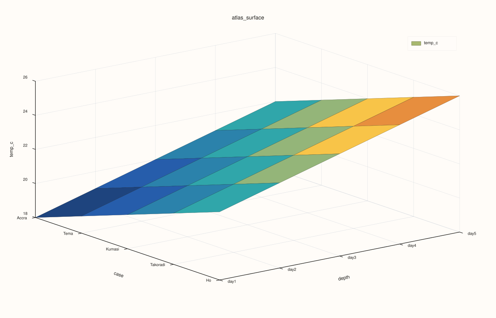
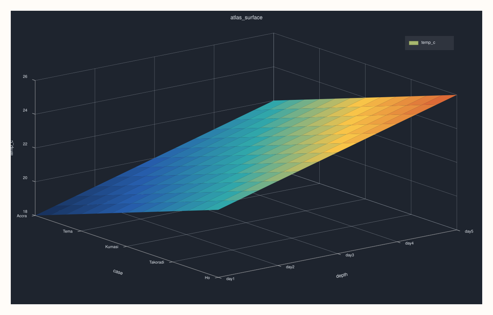

<!-- pluss-hand-authored -->
<!-- pluss-signature-hash: 0295154c89cd -->

# ArchivePlotAccessor::surface

[Back to ArchivePlotAccessor API Reference](../../archive_plot_accessor_api_reference)

## Signatures

```cpp
pluss::pl::Studio ArchivePlotAccessor::surface(std::string_view key) const
pluss::pl::Studio ArchivePlotAccessor::surface(std::string_view key, const Surface3DPlotOptions& options) const
```

## What It Does

Builds a 3D surface (case × depth × `key`) across the archive's catalog stack — the same
grid [`AtlasPlotAccessor::surface`](../atlas-plot/surface.md) builds across a frame stack,
one layer up. `key`'s value at every record, in every catalog, forms a continuous filled
sheet over a record-position/depth-position grid.

```{important} Only the requested key is tabelized, not the whole archive
This method (and every other single/pairwise-key method on this accessor except
[`triplot()`](triplot.md) with an empty selection) tabelizes **only** the catalogs projected
down to `key` first (`archive.keys({key})`), not the whole archive. This matters for
performance and correctness: `Catalog::tabelize()`'s default policy inner-joins by label
across every key in a catalog, so an unrelated ragged or mismatched key elsewhere in the
stack never affects this method's result — only `key` itself needs to line up across
catalogs.
```

```{important} Returns a Studio, not printable output
Like every method on `ArchivePlotAccessor`, this builds and returns a `pluss::pl::Studio` —
call `.show()`/`.to_svg()`/`.save_svg(path)`/etc. to view or persist it; `std::cout << chart`
does not compile.
```

## Parameters

**key** (`std::string_view`)
    The numeric key forming the surface's z-axis. Must exist and be numeric in every
    catalog in the (possibly depth-selected) stack.

**options** (`const Surface3DPlotOptions&`)
    The identical struct documented on
    [`AtlasPlotAccessor::surface`](../atlas-plot/surface.md) (`scene`, `trace`).

## Returns

`pluss::pl::Studio`
    A figure with one 3D pane holding a single filled surface trace.

## Examples

Example 1. Plot `temp_c` as a surface across every catalog's records and the depth stack,
using default scene/trace settings.

```cpp
using namespace pluss::kindle::literals;

std::vector<std::string> cities = {"Accra", "Tema", "Kumasi", "Takoradi", "Ho"};
auto city_labels = pluss::table::Slate(pluss::make_note(cities));

std::vector<pluss::kindle::Catalog> catalogs;
for (int i = 0; i < 5; ++i) {
    double base = static_cast<double>(i);
    catalogs.push_back(pluss::kindle::Catalog({
        "temp_c"_k = pluss::kindle::Stream(pluss::make_series({18.0 + base, 19.0 + base, 20.0 + base, 21.0 + base, 22.0 + base}))
                         .with_label(city_labels),
    }));
}
auto archive = pluss::kindle::Archive(catalogs, pluss::kindle::Stream(pluss::make_note({"day1", "day2", "day3", "day4", "day5"})));

auto chart = archive.plot().surface("temp_c");
chart.show();
```



Example 2. Same surface, with an explicit `Studio`-preset scene and smooth shading.

```cpp
using namespace pluss::kindle::literals;

std::vector<std::string> cities = {"Accra", "Tema", "Kumasi", "Takoradi", "Ho"};
auto city_labels = pluss::table::Slate(pluss::make_note(cities));

std::vector<pluss::kindle::Catalog> catalogs;
for (int i = 0; i < 5; ++i) {
    double base = static_cast<double>(i);
    catalogs.push_back(pluss::kindle::Catalog({
        "temp_c"_k = pluss::kindle::Stream(pluss::make_series({18.0 + base, 19.0 + base, 20.0 + base, 21.0 + base, 22.0 + base}))
                         .with_label(city_labels),
    }));
}
auto archive = pluss::kindle::Archive(catalogs, pluss::kindle::Stream(pluss::make_note({"day1", "day2", "day3", "day4", "day5"})));

pluss::table::Surface3DPlotOptions options;
options.scene.preset = pluss::pl::flash::ScenePreset3D::Studio;
options.trace.shade = pluss::pl::ShadeMode::Smooth;
auto chart = archive.plot().surface("temp_c", options);
chart.show();
```



## Notes

- Only tabelizes the requested `key`, not the whole archive — see the important callout
  above.
- Ragged (unequal-length) catalogs are accepted, the same as [`frames()`](frames.md)'s
  multi-index overloads — see that page's important callout.
- Delegates to [`AtlasPlotAccessor::surface`](../atlas-plot/surface.md) for the actual grid
  construction — see that page for the full mechanics.

## See Also

- [`ArchivePlotAccessor::wireframe`](wireframe.md): the same case×depth×key grid, drawn as
  an open mesh instead of a filled sheet.
- [`ArchivePlotAccessor::cloud3`](cloud3.md): a genuinely 3-key scatter, rather than one key
  over a record/depth grid.
- [`Archive::plot`](../archive/plot.md): the entry point this accessor is reached from.

<div class="pluss-inline-prev-next">
  <a class="prev-link" href="frames.html">
    <span class="label">Previous</span>
    <span class="title">frames</span>
  </a>
  <a class="next-link" href="triplot.html">
    <span class="label">Next</span>
    <span class="title">triplot</span>
  </a>
</div>
