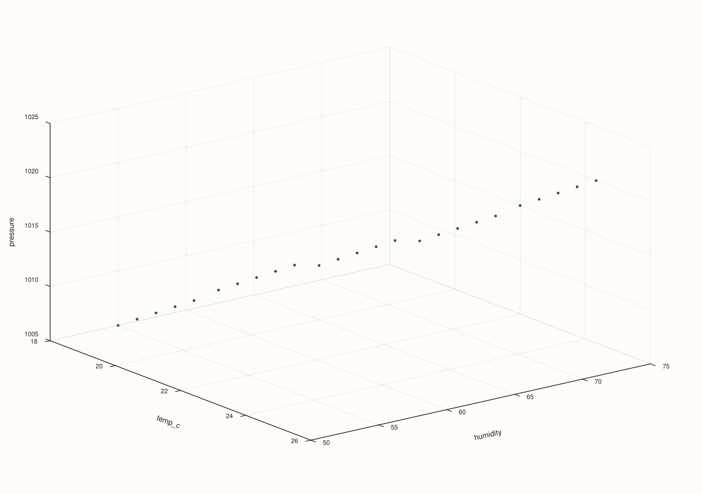

<!-- pluss-hand-authored -->
<!-- pluss-signature-hash: 301b5dd895c1 -->

# ArchivePlotAccessor::triplot

[Back to ArchivePlotAccessor API Reference](../../archive_plot_accessor_api_reference)

## Signatures

```cpp
pluss::pl::Studio ArchivePlotAccessor::triplot() const
pluss::pl::Studio ArchivePlotAccessor::triplot(const pluss::pl::flash::TriplotOptions& options) const
pluss::pl::Studio ArchivePlotAccessor::triplot(pluss::msharp::RangeView::Of<std::string_view> keys) const
pluss::pl::Studio ArchivePlotAccessor::triplot(pluss::msharp::RangeView::Of<std::string_view> keys,
                                               const pluss::pl::flash::TriplotOptions& options) const
```

## What It Does

Flattens every record, in every catalog of the depth stack, into one combined pool of rows,
then builds a pairwise small-multiple grid across the selected numeric keys — reuses
[`AtlasPlotAccessor::triplot`](../atlas-plot/triplot.md) directly, one layer up (where
"frames" are catalogs and "cases" are records instead of `DataFrame` rows).

```{important} An empty keys selection tabelizes the whole archive, not just the selected keys
Same rule as [`depth_compare()`](depth_compare.md)/[`depth_facet()`](depth_facet.md): the
no-argument and options-only overloads (`keys = {}`) resolve to every numeric key in the
**first** catalog, which isn't known ahead of time — so those overloads tabelize the
**entire** archive up front. Passing an explicit, non-empty `keys` avoids this, tabelizing
only those keys, the same scoped behavior [`surface()`](surface.md)/[`cloud3()`](cloud3.md)/
etc. have.
```

## Parameters

**keys** (`RangeView<std::string_view>`, defaults to `{}`)
    The numeric keys to include, at least three. An empty range (the default) selects every
    numeric key in the first catalog — see the important callout above.

**options** (`const pluss::pl::flash::TriplotOptions&`)
    The identical struct documented on
    [`AtlasPlotAccessor::triplot`](../atlas-plot/triplot.md) (`kind`, `labels`,
    `max_features`/`max_panels`/`rows`/`cols`/`max_points`, `ridge_levels`, `show_grid`,
    sizing fields, `auto_size`).

## Returns

`pluss::pl::Studio`
    A figure with one small-multiple pane per key pair, flattened across every catalog's
    records.

## Examples

Example 1. No-argument call: default options, every numeric key in the first catalog.

```cpp
using namespace pluss::kindle::literals;

std::vector<pluss::kindle::Catalog> catalogs;
for (int i = 0; i < 5; ++i) {
    double base = static_cast<double>(i);
    catalogs.push_back(pluss::kindle::Catalog({
        "temp_c"_k = pluss::kindle::Stream(pluss::make_series({18.0 + base, 19.0 + base, 20.0 + base, 21.0 + base, 22.0 + base})),
        "humidity"_k = pluss::kindle::Stream(pluss::make_series({55.0 - base, 60.0 - base, 65.0 - base, 70.0 - base, 75.0 - base})),
        "pressure"_k = pluss::kindle::Stream(pluss::make_series(
            {1005.0 + base * 2, 1008.0 + base * 2, 1010.0 + base * 2, 1012.0 + base * 2, 1015.0 + base * 2})),
    }));
}
auto archive = pluss::kindle::Archive(catalogs, pluss::kindle::Stream(pluss::make_note({"day1", "day2", "day3", "day4", "day5"})));

auto chart = archive.plot().triplot();
chart.show();
```

All 25 records (5 catalogs × 5 records each) are pooled together, and every pair among
`temp_c`, `humidity`, `pressure` gets its own scatter pane.



Example 2. Options-only overload: same default key selection, explicit `Cloud` kind (the
default made explicit).

```cpp
using namespace pluss::kindle::literals;

std::vector<pluss::kindle::Catalog> catalogs;
for (int i = 0; i < 5; ++i) {
    double base = static_cast<double>(i);
    catalogs.push_back(pluss::kindle::Catalog({
        "temp_c"_k = pluss::kindle::Stream(pluss::make_series({18.0 + base, 19.0 + base, 20.0 + base, 21.0 + base, 22.0 + base})),
        "humidity"_k = pluss::kindle::Stream(pluss::make_series({55.0 - base, 60.0 - base, 65.0 - base, 70.0 - base, 75.0 - base})),
        "pressure"_k = pluss::kindle::Stream(pluss::make_series(
            {1005.0 + base * 2, 1008.0 + base * 2, 1010.0 + base * 2, 1012.0 + base * 2, 1015.0 + base * 2})),
    }));
}
auto archive = pluss::kindle::Archive(catalogs, pluss::kindle::Stream(pluss::make_note({"day1", "day2", "day3", "day4", "day5"})));

pluss::pl::flash::TriplotOptions options;
options.kind = pluss::pl::flash::TriplotKind::Cloud;
auto chart = archive.plot().triplot(options);
chart.show();
```


Example 3. Keys-only overload: an explicit key list, default options.

```cpp
using namespace pluss::kindle::literals;

std::vector<pluss::kindle::Catalog> catalogs;
for (int i = 0; i < 5; ++i) {
    double base = static_cast<double>(i);
    catalogs.push_back(pluss::kindle::Catalog({
        "temp_c"_k = pluss::kindle::Stream(pluss::make_series({18.0 + base, 19.0 + base, 20.0 + base, 21.0 + base, 22.0 + base})),
        "humidity"_k = pluss::kindle::Stream(pluss::make_series({55.0 - base, 60.0 - base, 65.0 - base, 70.0 - base, 75.0 - base})),
        "pressure"_k = pluss::kindle::Stream(pluss::make_series(
            {1005.0 + base * 2, 1008.0 + base * 2, 1010.0 + base * 2, 1012.0 + base * 2, 1015.0 + base * 2})),
    }));
}
auto archive = pluss::kindle::Archive(catalogs, pluss::kindle::Stream(pluss::make_note({"day1", "day2", "day3", "day4", "day5"})));

auto chart = archive.plot().triplot(pluss::msharp::RangeView::Of<std::string_view>{"temp_c", "humidity", "pressure"});
chart.show();
```


Example 4. Full keys-and-options call, capping `max_features` to `3` (a no-op with exactly
three keys, shown for completeness).

```cpp
using namespace pluss::kindle::literals;

std::vector<pluss::kindle::Catalog> catalogs;
for (int i = 0; i < 5; ++i) {
    double base = static_cast<double>(i);
    catalogs.push_back(pluss::kindle::Catalog({
        "temp_c"_k = pluss::kindle::Stream(pluss::make_series({18.0 + base, 19.0 + base, 20.0 + base, 21.0 + base, 22.0 + base})),
        "humidity"_k = pluss::kindle::Stream(pluss::make_series({55.0 - base, 60.0 - base, 65.0 - base, 70.0 - base, 75.0 - base})),
        "pressure"_k = pluss::kindle::Stream(pluss::make_series(
            {1005.0 + base * 2, 1008.0 + base * 2, 1010.0 + base * 2, 1012.0 + base * 2, 1015.0 + base * 2})),
    }));
}
auto archive = pluss::kindle::Archive(catalogs, pluss::kindle::Stream(pluss::make_note({"day1", "day2", "day3", "day4", "day5"})));

pluss::pl::flash::TriplotOptions options;
options.max_features = 3;
auto chart = archive.plot().triplot(
    pluss::msharp::RangeView::Of<std::string_view>{"temp_c", "humidity", "pressure"}, options);
chart.show();
```


## Notes

- Requires at least three numeric keys, whether resolved from the empty-keys default or an
  explicit list — the same requirement
  [`AtlasPlotAccessor::triplot`](../atlas-plot/triplot.md) enforces.
- An empty `keys` tabelizes the whole archive — see the important callout above.
- Every catalog's records are pooled together — no per-catalog breakdown, unlike
  [`cloud3()`](cloud3.md)'s per-catalog traces.

## See Also

- [`ArchivePlotAccessor::cloud3`](cloud3.md): a single 3D scatter of exactly three named
  keys, broken out per catalog — the depth-aware counterpart to this method's
  pooled-across-catalogs view.
- [`Archive::plot`](../archive/plot.md): the entry point this accessor is reached from.

<div class="pluss-inline-prev-next">
  <a class="prev-link" href="surface.html">
    <span class="label">Previous</span>
    <span class="title">surface</span>
  </a>
  <a class="next-link" href="wireframe.html">
    <span class="label">Next</span>
    <span class="title">wireframe</span>
  </a>
</div>
