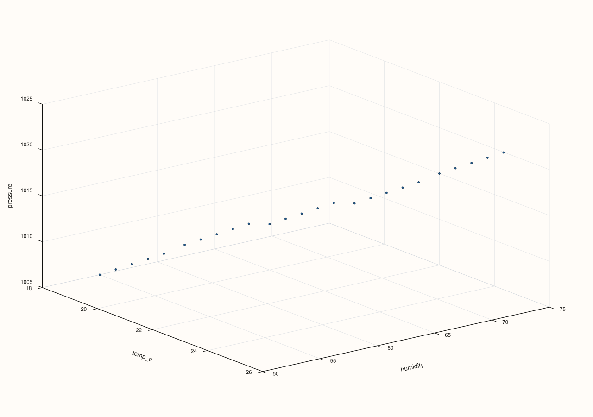
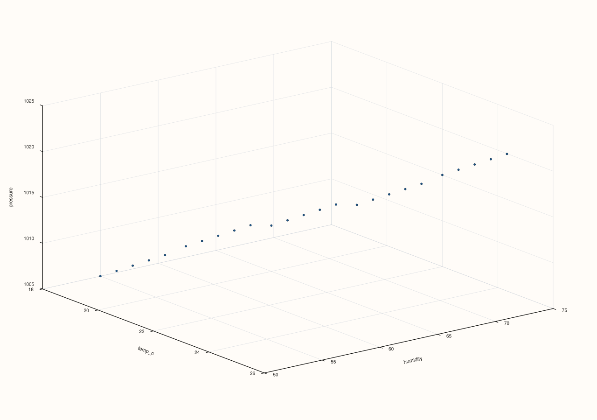
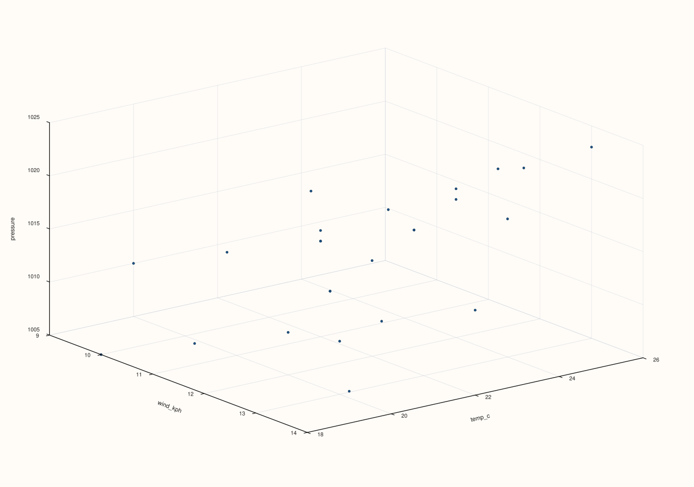

<!-- pluss-hand-authored -->
<!-- pluss-signature-hash: 6c4133775549 -->

# ArchivePlotAccessor::triplot

[Back to ArchivePlotAccessor API Reference](../../archive_plot_accessor_api_reference)

## Signatures

```cpp
pluss::pl::Studio ArchivePlotAccessor::triplot() const
pluss::pl::Studio ArchivePlotAccessor::triplot(const ArchiveTriplotPlotOptions& options) const
pluss::pl::Studio ArchivePlotAccessor::triplot(pluss::RangeView<std::string_view> keys) const
pluss::pl::Studio ArchivePlotAccessor::triplot(pluss::RangeView<std::string_view> keys,
                                               const ArchiveTriplotPlotOptions& options) const
```

## What It Does

Flattens every record, in every catalog of the depth stack, into one combined pool of rows,
then builds a pairwise small-multiple grid across the selected numeric keys. The keys are named in
the call or chosen by a `KeySelection` (`all_keys`, `include_keys`, `exclude_keys`), with the rules of
[Selecting keys](depth_compare.md#selecting-keys); the accessor-level selection of `Archive::plot(keys)` applies
when the call gives none.

```{important} An empty keys selection tabelizes the whole archive, not just the selected keys
Same rule as [`depth_compare()`](depth_compare.md)/[`depth_facet()`](depth_facet.md): the
no-argument and options-only overloads (`keys = {}`) resolve to every numeric key in the
**first** catalog, which isn't known ahead of time — so those overloads tabelize the
**entire** archive up front. Passing an explicit, non-empty `keys` avoids this, tabelizing
only those keys, the same scoped behavior [`surface()`](surface.md)/[`cloud3()`](cloud3.md)/
etc. have.
```

## Parameters

**keys** (`pluss::RangeView<std::string_view>`, defaults to `{}`)

The numeric keys to include, at least three. An empty range (the default) selects every
numeric key in the first catalog — see the important callout above.

**options** (`const ArchiveTriplotPlotOptions&`)

The style of the grid and the key selection.

| Field | Type | Default |
|---|---|---|
| `kind` | `pluss::pl::flash::TriplotKind` | `Cloud` |
| `labels` | `std::vector<std::string>` | empty (the key names) |
| `max_keys` | `std::int64_t` | `0` (no cap) |
| `max_panels` | `std::int64_t` | `9` |
| `rows` | `std::int64_t` | `0` (automatic) |
| `cols` | `std::int64_t` | `0` (automatic) |
| `max_points` | `std::int64_t` | `2500` |
| `ridge_levels` | `std::int64_t` | `8` |
| `show_grid` | `bool` | `true` |
| `auto_size` | `bool` | `true` |
| `min_width`, `min_height` | `double` | `1280.0`, `900.0` |
| `cell_width`, `cell_height` | `double` | `360.0`, `300.0` |
| `outer_pad_x`, `outer_pad_y` | `double` | `100.0` |
| `grid_gap_x`, `grid_gap_y` | `double` | `10.0` |
| `keys` | `KeySelection` | no knob set |

## Returns

`pluss::pl::Studio`
    A figure with one small-multiple pane per key pair, flattened across every catalog's
    records.

## Examples

Example 1. No-argument call: default options, every numeric key in the first catalog.

```cpp
using namespace pluss::kindle::literals;

std::vector<pluss::kindle::Catalog> catalogs;
for (int i = 0; i < 5; ++i) {
    double base = static_cast<double>(i);
    catalogs.push_back(pluss::kindle::Catalog({
        "temp_c"_k = pluss::kindle::Stream(pluss::make_series({18.0 + base, 19.0 + base, 20.0 + base, 21.0 + base, 22.0 + base})),
        "humidity"_k = pluss::kindle::Stream(pluss::make_series({55.0 - base, 60.0 - base, 65.0 - base, 70.0 - base, 75.0 - base})),
        "pressure"_k = pluss::kindle::Stream(pluss::make_series(
            {1005.0 + base * 2, 1008.0 + base * 2, 1010.0 + base * 2, 1012.0 + base * 2, 1015.0 + base * 2})),
    }));
}
auto archive = pluss::kindle::Archive(catalogs, pluss::kindle::Stream(pluss::make_note({"day1", "day2", "day3", "day4", "day5"})));

auto chart = archive.plot().triplot();
chart.show();
```

All 25 records (5 catalogs × 5 records each) are pooled together, and every pair among
`temp_c`, `humidity`, `pressure` gets its own scatter pane.


Example 2. Options-only overload: same default key selection, explicit `Cloud` kind (the
default made explicit).

```cpp
using namespace pluss::kindle::literals;

std::vector<pluss::kindle::Catalog> catalogs;
for (int i = 0; i < 5; ++i) {
    double base = static_cast<double>(i);
    catalogs.push_back(pluss::kindle::Catalog({
        "temp_c"_k = pluss::kindle::Stream(pluss::make_series({18.0 + base, 19.0 + base, 20.0 + base, 21.0 + base, 22.0 + base})),
        "humidity"_k = pluss::kindle::Stream(pluss::make_series({55.0 - base, 60.0 - base, 65.0 - base, 70.0 - base, 75.0 - base})),
        "pressure"_k = pluss::kindle::Stream(pluss::make_series(
            {1005.0 + base * 2, 1008.0 + base * 2, 1010.0 + base * 2, 1012.0 + base * 2, 1015.0 + base * 2})),
    }));
}
auto archive = pluss::kindle::Archive(catalogs, pluss::kindle::Stream(pluss::make_note({"day1", "day2", "day3", "day4", "day5"})));

pluss::kindle::ArchiveTriplotPlotOptions options;
options.kind = pluss::pl::flash::TriplotKind::Cloud;
auto chart = archive.plot().triplot(options);
chart.show();
```


Example 3. Keys-only overload: an explicit key list, default options.

```cpp
using namespace pluss::kindle::literals;

std::vector<pluss::kindle::Catalog> catalogs;
for (int i = 0; i < 5; ++i) {
    double base = static_cast<double>(i);
    catalogs.push_back(pluss::kindle::Catalog({
        "temp_c"_k = pluss::kindle::Stream(pluss::make_series({18.0 + base, 19.0 + base, 20.0 + base, 21.0 + base, 22.0 + base})),
        "humidity"_k = pluss::kindle::Stream(pluss::make_series({55.0 - base, 60.0 - base, 65.0 - base, 70.0 - base, 75.0 - base})),
        "pressure"_k = pluss::kindle::Stream(pluss::make_series(
            {1005.0 + base * 2, 1008.0 + base * 2, 1010.0 + base * 2, 1012.0 + base * 2, 1015.0 + base * 2})),
    }));
}
auto archive = pluss::kindle::Archive(catalogs, pluss::kindle::Stream(pluss::make_note({"day1", "day2", "day3", "day4", "day5"})));

auto chart = archive.plot().triplot({"temp_c", "humidity", "pressure"});
chart.show();
```


Example 4. Full keys-and-options call, capping `max_keys` to `3` (a no-op with exactly
three keys, shown for completeness).

```cpp
using namespace pluss::kindle::literals;

std::vector<pluss::kindle::Catalog> catalogs;
for (int i = 0; i < 5; ++i) {
    double base = static_cast<double>(i);
    catalogs.push_back(pluss::kindle::Catalog({
        "temp_c"_k = pluss::kindle::Stream(pluss::make_series({18.0 + base, 19.0 + base, 20.0 + base, 21.0 + base, 22.0 + base})),
        "humidity"_k = pluss::kindle::Stream(pluss::make_series({55.0 - base, 60.0 - base, 65.0 - base, 70.0 - base, 75.0 - base})),
        "pressure"_k = pluss::kindle::Stream(pluss::make_series(
            {1005.0 + base * 2, 1008.0 + base * 2, 1010.0 + base * 2, 1012.0 + base * 2, 1015.0 + base * 2})),
    }));
}
auto archive = pluss::kindle::Archive(catalogs, pluss::kindle::Stream(pluss::make_note({"day1", "day2", "day3", "day4", "day5"})));

pluss::kindle::ArchiveTriplotPlotOptions options;
options.max_keys = 3;
auto chart = archive.plot().triplot(
    {"temp_c", "humidity", "pressure"}, options);
chart.show();
```



Example 5. A key selection: every numeric key except `wind_kph`.

```cpp
using namespace pluss::kindle::literals;

std::vector<pluss::kindle::Catalog> catalogs;
for (int i = 0; i < 5; ++i) {
    double base = static_cast<double>(i);
    catalogs.push_back(pluss::kindle::Catalog({
        "temp_c"_k = pluss::kindle::Stream(pluss::make_series({18.0 + base, 19.0 + base, 20.0 + base, 21.0 + base, 22.0 + base})),
        "humidity"_k = pluss::kindle::Stream(pluss::make_series({55.0 - base, 60.0 - base, 65.0 - base, 70.0 - base, 75.0 - base})),
        "pressure"_k = pluss::kindle::Stream(pluss::make_series(
            {1005.0 + base * 2, 1008.0 + base * 2, 1010.0 + base * 2, 1012.0 + base * 2, 1015.0 + base * 2})),
        "wind_kph"_k = pluss::kindle::Stream(pluss::make_series({10.0 + base, 14.0 - base, 9.0 + base, 12.0, 11.0 + base * 0.5})),
    }));
}
auto archive = pluss::kindle::Archive(catalogs, pluss::kindle::Stream(pluss::make_note({"day1", "day2", "day3", "day4", "day5"})));

auto chart = archive.plot().triplot({.keys = {.exclude_keys = {"wind_kph"}}});
```



Example 6. `include_keys`, in the order given.

```cpp
auto chart = archive.plot().triplot({.keys = {.include_keys = {"wind_kph", "temp_c", "pressure"}}});
```



Example 7. Misuse, using the archive of Example 5.

```cpp
archive.plot().triplot({.keys = {.include_keys = {"temp_c", "pressure"}}});
```

```text
Archive::plot().triplot: requires at least three numeric keys; found 2. Name at least three keys or set all_keys.
```

```cpp
archive.plot().triplot({"temp_c", "pressure", "wnd_kph"});
```

```text
Archive::plot().triplot: unknown key 'wnd_kph'. Did you mean 'wind_kph'? Available keys = [temp_c, humidity, pressure, wind_kph]. Fix the spelling or remove 'wnd_kph'.
```

```cpp
archive.plot().triplot({.keys = {.all_keys = true, .exclude_keys = {"temp_c"}}});
```

```text
Archive::plot().triplot: all_keys and exclude_keys cannot be combined: all_keys already means every numeric key. To drop some keys set exclude_keys instead (and leave all_keys false), or to plot everything remove exclude_keys.
```

## Notes

- Requires at least three numeric keys, whether resolved from the empty-keys default, a selection or an
  explicit list.
- An empty `keys` tabelizes the whole archive — see the important callout above.
- Every catalog's records are pooled together — no per-catalog breakdown, unlike
  [`cloud3()`](cloud3.md)'s per-catalog traces.

## See Also

- [`ArchivePlotAccessor::cloud3`](cloud3.md): a single 3D scatter of exactly three named
  keys, broken out per catalog — the depth-aware counterpart to this method's
  pooled-across-catalogs view.
- [`Archive::plot`](../archive/plot.md): the entry point this accessor is reached from.

<div class="pluss-inline-prev-next">
  <a class="prev-link" href="surface.html">
    <span class="label">Previous</span>
    <span class="title">surface</span>
  </a>
  <a class="next-link" href="wireframe.html">
    <span class="label">Next</span>
    <span class="title">wireframe</span>
  </a>
</div>
