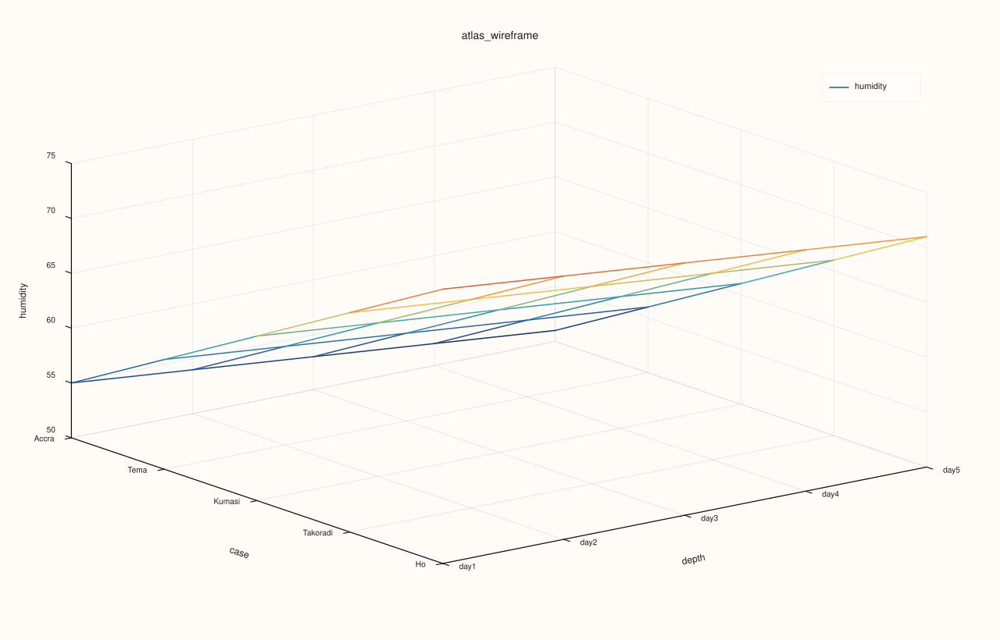
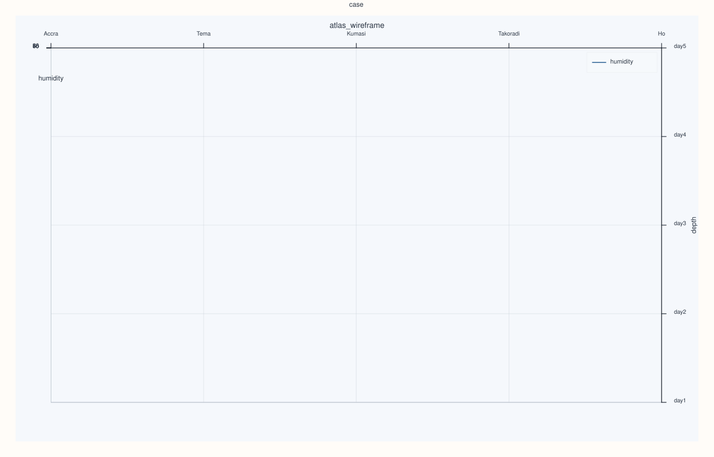

<!-- pluss-hand-authored -->
<!-- pluss-signature-hash: 88cf6bfd5895 -->

# ArchivePlotAccessor::wireframe

[Back to ArchivePlotAccessor API Reference](../../archive_plot_accessor_api_reference)

## Signatures

```cpp
pluss::pl::Studio ArchivePlotAccessor::wireframe(std::string_view key) const
pluss::pl::Studio ArchivePlotAccessor::wireframe(std::string_view key, const Wireframe3DPlotOptions& options) const
```

## What It Does

Builds the same case × depth × `key` grid as [`surface()`](surface.md), but draws it as an
open mesh (a lattice of connecting lines) instead of a filled sheet — the same distinction
[`AtlasPlotAccessor::wireframe`](../atlas-plot/wireframe.md) draws one layer up. See
[`surface()`](surface.md)'s important callouts for the scoped-tabelize and ragged-catalog
behavior shared by every single/pairwise-key method on this accessor.

## Parameters

**key** (`std::string_view`)
    The numeric key forming the mesh's z-axis. Must exist and be numeric in every catalog
    in the stack.

**options** (`const Wireframe3DPlotOptions&`)
    Same shape as [`Surface3DPlotOptions`](surface.md): `scene`
    (`Plot3DSceneOptions`) and `trace` (`Plot3DTraceOptions`).

## Returns

`pluss::pl::Studio`
    A figure with one 3D pane holding a single wireframe (lattice) trace.

## Examples

Example 1. Plot `humidity` as a wireframe mesh across every catalog's records and the depth
stack.

```cpp
using namespace pluss::kindle::literals;

std::vector<std::string> cities = {"Accra", "Tema", "Kumasi", "Takoradi", "Ho"};
auto city_labels = pluss::table::Slate(pluss::make_note(cities));

std::vector<pluss::kindle::Catalog> catalogs;
for (int i = 0; i < 5; ++i) {
    double base = static_cast<double>(i);
    catalogs.push_back(pluss::kindle::Catalog({
        "humidity"_k = pluss::kindle::Stream(pluss::make_series({55.0 - base, 60.0 - base, 65.0 - base, 70.0 - base, 75.0 - base}))
                           .with_label(city_labels),
    }));
}
auto archive = pluss::kindle::Archive(catalogs, pluss::kindle::Stream(pluss::make_note({"day1", "day2", "day3", "day4", "day5"})));

auto chart = archive.plot().wireframe("humidity");
chart.show();
```



Example 2. Same mesh, with a `Topology`-preset scene.

```cpp
using namespace pluss::kindle::literals;

std::vector<std::string> cities = {"Accra", "Tema", "Kumasi", "Takoradi", "Ho"};
auto city_labels = pluss::table::Slate(pluss::make_note(cities));

std::vector<pluss::kindle::Catalog> catalogs;
for (int i = 0; i < 5; ++i) {
    double base = static_cast<double>(i);
    catalogs.push_back(pluss::kindle::Catalog({
        "humidity"_k = pluss::kindle::Stream(pluss::make_series({55.0 - base, 60.0 - base, 65.0 - base, 70.0 - base, 75.0 - base}))
                           .with_label(city_labels),
    }));
}
auto archive = pluss::kindle::Archive(catalogs, pluss::kindle::Stream(pluss::make_note({"day1", "day2", "day3", "day4", "day5"})));

pluss::table::Wireframe3DPlotOptions options;
options.scene.preset = pluss::pl::flash::ScenePreset3D::Topology;
auto chart = archive.plot().wireframe("humidity", options);
chart.show();
```



## Notes

- Only tabelizes the requested `key`, not the whole archive — see
  [`surface()`](surface.md)'s important callout.
- Ragged (unequal-length) catalogs are accepted — see [`frames()`](frames.md)'s important
  callout.
- Delegates to [`AtlasPlotAccessor::wireframe`](../atlas-plot/wireframe.md) for the actual
  mesh construction.

## See Also

- [`ArchivePlotAccessor::surface`](surface.md): the filled-sheet counterpart, same
  underlying grid.
- [`ArchivePlotAccessor::cloud3`](cloud3.md): a genuinely 3-key scatter, rather than one key
  over a record/depth grid.
- [`Archive::plot`](../archive/plot.md): the entry point this accessor is reached from.

<div class="pluss-inline-prev-next">
  <a class="prev-link" href="triplot.html">
    <span class="label">Previous</span>
    <span class="title">triplot</span>
  </a>
</div>
