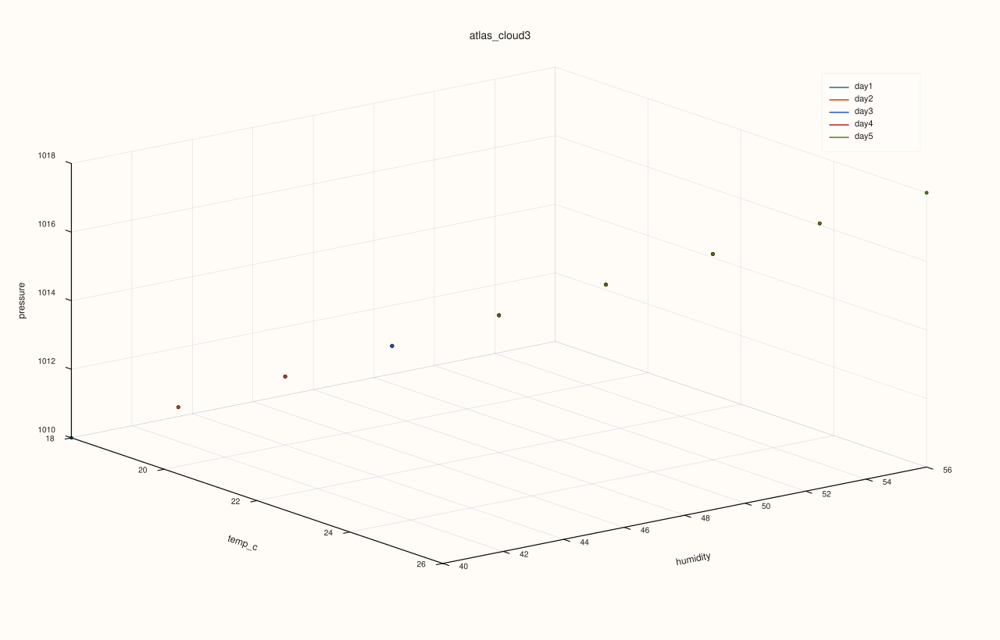
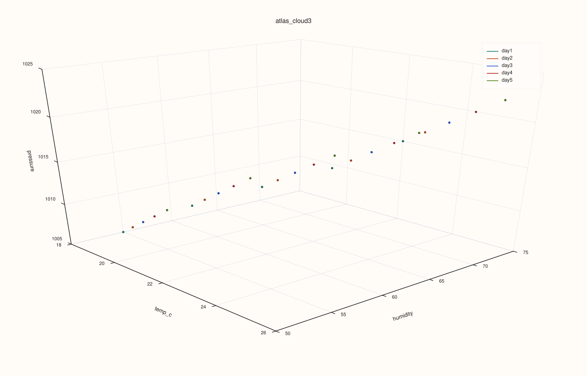

<!-- pluss-hand-authored -->
<!-- pluss-signature-hash: 6f0df9b2a860 -->

# AtlasPlotAccessor::cloud3

[Back to AtlasPlotAccessor API Reference](../../atlas_plot_accessor_api_reference)

## Signatures

```cpp
pluss::pl::Studio AtlasPlotAccessor::cloud3(std::string_view x_feature,
                                            std::string_view y_feature,
                                            std::string_view z_feature) const

pluss::pl::Studio AtlasPlotAccessor::cloud3(std::string_view x_feature,
                                            std::string_view y_feature,
                                            std::string_view z_feature,
                                            const Scatter3DPlotOptions& options) const
```

## What It Does

Builds a genuine 3-feature 3D scatter — one point per case, per selected frame — plotting
`x_feature`, `y_feature`, and `z_feature` as coordinates. Unlike [`surface()`](surface.md)/
[`wireframe()`](wireframe.md), which grid a *single* feature against case and depth position,
`cloud3()` plots three independent data features against each other; each selected frame becomes
its own colored, labeled point cloud.

```{important} Returns a Studio, not printable output
Like every method on `AtlasPlotAccessor`, this builds and returns a `pluss::pl::Studio` —
call `.show()`/`.to_svg()`/`.save_svg(path)`/etc. to view or persist it; `std::cout << chart` does
not compile.
```

## Parameters

**x_feature**, **y_feature**, **z_feature** (`std::string_view`)
    The three numeric features forming each point's coordinates. Each must exist in every
    selected frame.

**options** (`const Scatter3DPlotOptions&`)
    `scene` (`Plot3DSceneOptions`), `trace` (`Plot3DTraceOptions`), and `default_marker_size`
    (`double`, default `12.0`) — the point size applied when no per-point size series is given.

## Returns

`pluss::pl::Studio`
    A figure with one 3D pane holding one labeled point-cloud trace per selected frame.

## Examples

Example 1. Plot `temp_c`/`humidity`/`pressure` as a 3D scatter, one point cloud per frame.

```cpp
using namespace pluss::table;

std::vector<DataFrame> frames;
std::vector<std::string> cities = {"Accra", "Tema", "Kumasi", "Takoradi", "Ho"};
for (int i = 0; i < 5; ++i) {
    double base = static_cast<double>(i);
    frames.push_back(DataFrame({
        {"temp_c", Thread(pluss::make_series({18.0 + base, 19.0 + base, 20.0 + base, 21.0 + base, 22.0 + base}))},
        {"humidity", Thread(pluss::make_series({55.0 - base, 60.0 - base, 65.0 - base, 70.0 - base, 75.0 - base}))},
        {"pressure", Thread(pluss::make_series({1005.0 + base * 2, 1008.0 + base * 2, 1010.0 + base * 2, 1012.0 + base * 2, 1015.0 + base * 2}))},
    }, Thread(pluss::make_note(cities))));
}
auto atlas = Atlas(frames, Thread(pluss::make_note({"day1", "day2", "day3", "day4", "day5"})));

auto chart = atlas.plot().cloud3("temp_c", "humidity", "pressure");
chart.show();
```



Each of the five frames' 5 cases forms a 5-point cloud, colored and legend-labeled by depth
(`"day1"`...`"day5"`).

Example 2. Same three features, with a larger fixed marker size and a `Presentation`-preset
scene.

```cpp
using namespace pluss::table;

std::vector<DataFrame> frames;
std::vector<std::string> cities = {"Accra", "Tema", "Kumasi", "Takoradi", "Ho"};
for (int i = 0; i < 5; ++i) {
    double base = static_cast<double>(i);
    frames.push_back(DataFrame({
        {"temp_c", Thread(pluss::make_series({18.0 + base, 19.0 + base, 20.0 + base, 21.0 + base, 22.0 + base}))},
        {"humidity", Thread(pluss::make_series({55.0 - base, 60.0 - base, 65.0 - base, 70.0 - base, 75.0 - base}))},
        {"pressure", Thread(pluss::make_series({1005.0 + base * 2, 1008.0 + base * 2, 1010.0 + base * 2, 1012.0 + base * 2, 1015.0 + base * 2}))},
    }, Thread(pluss::make_note(cities))));
}
auto atlas = Atlas(frames, Thread(pluss::make_note({"day1", "day2", "day3", "day4", "day5"})));

Scatter3DPlotOptions options;
options.default_marker_size = 20.0;
options.scene.preset = pluss::pl::flash::ScenePreset3D::Presentation;
auto chart = atlas.plot().cloud3("temp_c", "humidity", "pressure", options);
chart.show();
```



## Notes

- All three features must be numeric and present in every frame selected by
  `options().depth_axis` — a missing feature in any of them throws.
- Every selected frame must share the same case count — a mismatched frame throws.
- Each frame gets its own consistent color across its point cloud, drawn from a fixed
  10-color palette cycling by depth position.

## See Also

- [`AtlasPlotAccessor::surface`](surface.md) / [`wireframe()`](wireframe.md): a single feature
  gridded over case and depth position, rather than three independent features.
- [`Atlas::plot`](../atlas/plot.md): the entry point this accessor is reached from.

<div class="pluss-inline-prev-next">
  <a class="next-link" href="depth.html">
    <span class="label">Next</span>
    <span class="title">depth</span>
  </a>
</div>
