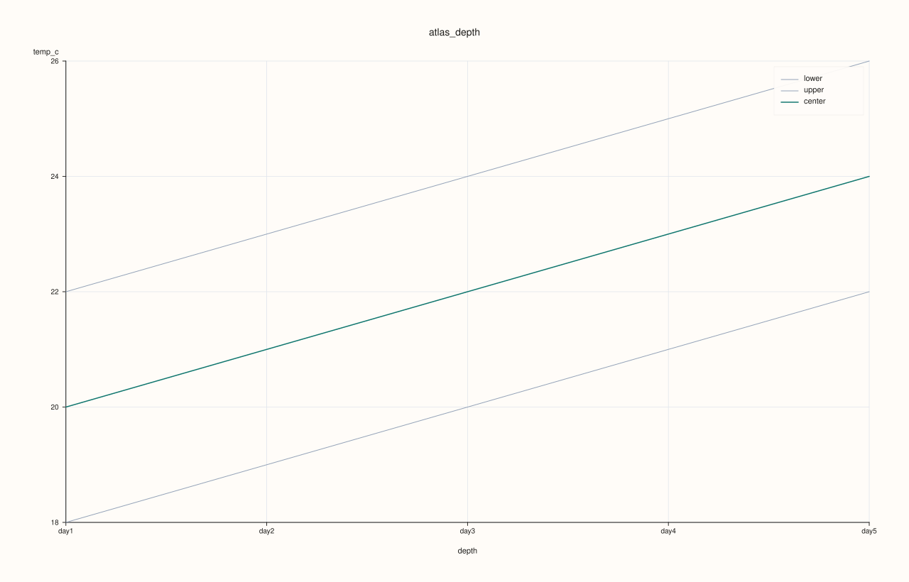

<!-- pluss-hand-authored -->
<!-- pluss-signature-hash: 2436f207097e -->

# AtlasPlotAccessor::depth

[Back to AtlasPlotAccessor API Reference](../../atlas_plot_accessor_api_reference)

## Signatures

```cpp
AtlasPlotAccessor::depth(std::string_view feature) const -> pluss::pl::Studio
AtlasPlotAccessor::depth(std::string_view feature, const AtlasDepthPlotOptions& options) const -> pluss::pl::Studio
```

## What It Does

Reduces `feature` to a single scalar per frame (statistic `options.center`, default
`Mean`) and plots that scalar against depth position — one point per frame in the
stack, connected into a line, with the x-axis being each frame's depth (its position,
or `depth_labels()`'s value if set). Optionally also computes `options.lower`/`upper`
statistics (default `Min`/`Max`) per frame and draws them as a shaded band around the
center line.

```{important} Returns a Studio, not printable output
Like every method on `AtlasPlotAccessor`, this builds and returns a `pluss::pl::Studio` —
call `.show()`/`.save_svg(path)`/etc. to view or persist it; `std::cout << chart` does
not compile.
```

## Parameters

**feature** (`std::string_view`)
    The numeric feature to reduce and plot, one value per frame.

**options** (`const AtlasDepthPlotOptions&`)
    `center` (`AtlasDepthStatistic`, default `Mean`) is the line's own statistic;
    `lower`/`upper` (`std::optional<AtlasDepthStatistic>`, default `Min`/`Max`) are
    the band edges — set either to `std::nullopt` to omit that band edge entirely;
    `show_grid` (default `true`); `center_trace_width`/`band_trace_width` control
    line thickness. `AtlasDepthStatistic` has four values: `Mean`, `Median`, `Min`,
    `Max`.

## Returns

`pluss::pl::Studio`
    A figure with one 2D pane: a center line (one point per frame) plus an optional
    shaded min/max band.

## Examples

Example 1. Plot a feature's per-frame mean, with its default min/max band, across a
5-frame atlas.

```cpp
using namespace pluss::table;

std::vector<DataFrame> frames;
for (int i = 0; i < 5; ++i) {
    double base = static_cast<double>(i);
    frames.push_back(DataFrame({
        {"temp_c", Thread(pluss::make_series({18.0 + base, 19.0 + base, 20.0 + base, 21.0 + base, 22.0 + base}))},
    }));
}
auto atlas = Atlas(frames, Thread(pluss::make_note({"day1", "day2", "day3", "day4", "day5"})));

auto chart = atlas.plot().depth("temp_c");
chart.save_svg("depth_temp.svg");
```

Each frame's `temp_c` values are `{18, 19, 20, 21, 22}` shifted up by that frame's
index, so the center line (mean) is a straight `20, 21, 22, 23, 24` across the five
"dayN" depth positions, with the shaded band spanning each frame's own min (`18`
through `22`) to max (`22` through `26`).



## Notes

- `feature` is reduced independently within each selected frame — the band and
  center line never mix values across frames.
- Set `options.lower`/`options.upper` to `std::nullopt` to draw just the center line,
  with no band.
- `options.depth_axis` (shared with [`surface()`](surface.md)/[`cloud3()`](cloud3.md)/
  etc.) controls which frames are included and in what order.

## See Also

- [`AtlasPlotAccessor::depth_compare`](depth_compare.md): the same per-frame
  reduction, overlaid for several features on one chart instead of a single
  feature's band.
- [`AtlasPlotAccessor::depth_rolling`](depth_rolling.md): the same reduced series,
  smoothed with a rolling average across depth.
- [`Atlas::plot`](../atlas/plot.md): how to enter this accessor.

<div class="pluss-inline-prev-next">
  <a class="prev-link" href="cloud3.html">
    <span class="label">Previous</span>
    <span class="title">cloud3</span>
  </a>
  <a class="next-link" href="depth_compare.html">
    <span class="label">Next</span>
    <span class="title">depth_compare</span>
  </a>
</div>
