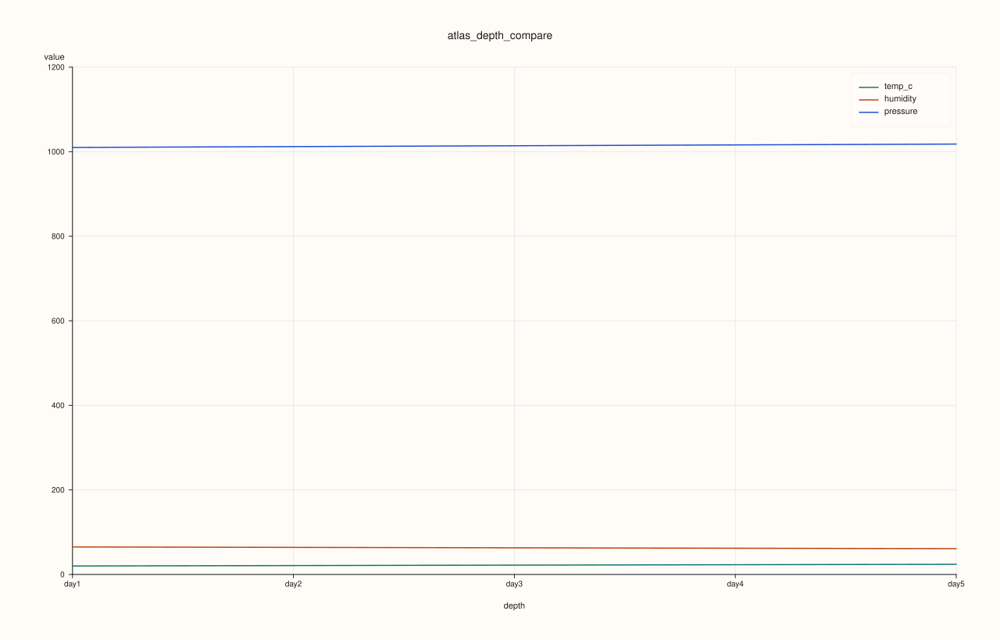
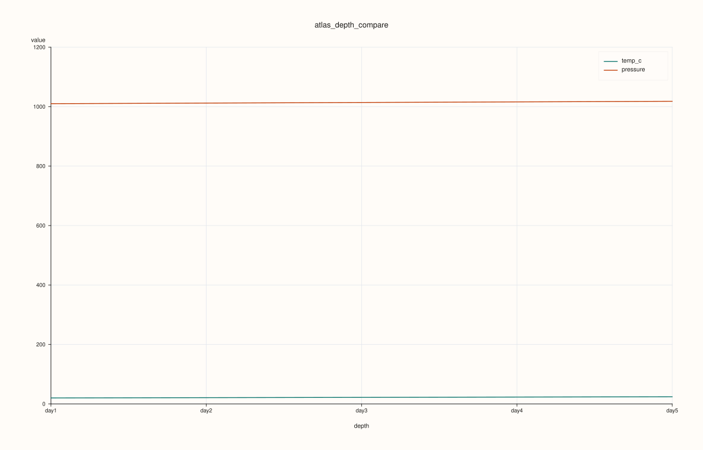
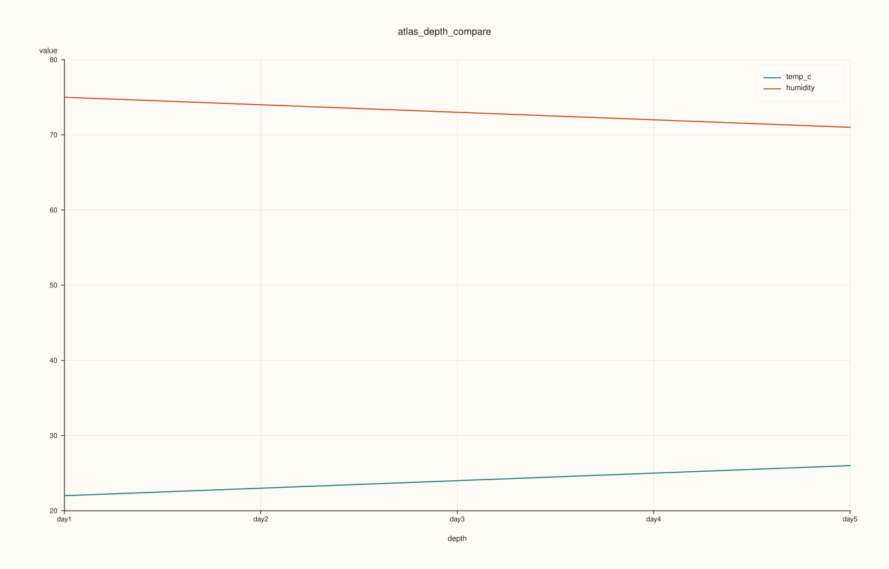

<!-- pluss-hand-authored -->
<!-- pluss-signature-hash: 72c3fbb015ee -->

# AtlasPlotAccessor::depth_compare

[Back to AtlasPlotAccessor API Reference](../../atlas_plot_accessor_api_reference)

## Signatures

```cpp
pluss::pl::Studio AtlasPlotAccessor::depth_compare(pluss::msharp::RangeView::Of<std::string_view> features = {}) const

pluss::pl::Studio AtlasPlotAccessor::depth_compare(pluss::msharp::RangeView::Of<std::string_view> features,
                                                    const AtlasDepthComparePlotOptions& options) const
```

## What It Does

Like [`depth()`](depth.md), reduces each feature to a single scalar per frame (statistic
`options.statistic`, default `Mean`), but overlays **several features at once** as separate lines
on one pane, rather than one feature's center-plus-band. Useful for comparing how differently
several numeric features trend across the depth stack.

```{important} Returns a Studio, not printable output
Like every method on `AtlasPlotAccessor`, this builds and returns a `pluss::pl::Studio` —
call `.show()`/`.to_svg()`/`.save_svg(path)`/etc. to view or persist it; `std::cout << chart` does
not compile.
```

## Parameters

**features** (`pluss::msharp::RangeView::Of<std::string_view>`, defaults to `{}`)
    The numeric features to overlay. An empty range (the default) selects **every** numeric
    feature present in the first frame.

**options** (`const AtlasDepthComparePlotOptions&`)
    `statistic` (`AtlasDepthStatistic`, default `Mean`): the per-frame reduction applied to every
    feature. `show_grid` (default `true`). `line_width` (default `1.5F`). `max_features`
    (`std::int64_t`, default `0`): caps the number of features actually plotted — `0` means no
    cap; a positive value truncates the (deduplicated) selection down to that many, keeping the
    first ones in selection order.

## Returns

`pluss::pl::Studio`
    A figure with one 2D pane, one labeled line per selected feature.

## Examples

Example 1. Default call: overlay every numeric feature's per-frame mean.

```cpp
using namespace pluss::table;

std::vector<DataFrame> frames;
for (int i = 0; i < 5; ++i) {
    double base = static_cast<double>(i);
    frames.push_back(DataFrame({
        {"temp_c", Slate(pluss::make_series({18.0 + base, 19.0 + base, 20.0 + base, 21.0 + base, 22.0 + base}))},
        {"humidity", Slate(pluss::make_series({55.0 - base, 60.0 - base, 65.0 - base, 70.0 - base, 75.0 - base}))},
        {"pressure", Slate(pluss::make_series({1005.0 + base * 2, 1008.0 + base * 2, 1010.0 + base * 2, 1012.0 + base * 2, 1015.0 + base * 2}))},
    }));
}
auto atlas = Atlas(frames, Slate(pluss::make_note({"day1", "day2", "day3", "day4", "day5"})));

auto chart = atlas.plot().depth_compare();
chart.show();
```



All three features — `temp_c`, `humidity`, `pressure` — each get their own line, since `features`
was left at its empty default.

Example 2. Passing explicit `features` narrows the comparison to just those.

```cpp
using namespace pluss::table;

std::vector<DataFrame> frames;
for (int i = 0; i < 5; ++i) {
    double base = static_cast<double>(i);
    frames.push_back(DataFrame({
        {"temp_c", Slate(pluss::make_series({18.0 + base, 19.0 + base, 20.0 + base, 21.0 + base, 22.0 + base}))},
        {"humidity", Slate(pluss::make_series({55.0 - base, 60.0 - base, 65.0 - base, 70.0 - base, 75.0 - base}))},
        {"pressure", Slate(pluss::make_series({1005.0 + base * 2, 1008.0 + base * 2, 1010.0 + base * 2, 1012.0 + base * 2, 1015.0 + base * 2}))},
    }));
}
auto atlas = Atlas(frames, Slate(pluss::make_note({"day1", "day2", "day3", "day4", "day5"})));

auto chart = atlas.plot().depth_compare(pluss::msharp::RangeView::Of<std::string_view>{"temp_c", "pressure"});
chart.show();
```



Only `temp_c` and `humidity` — sorry, `temp_c` and `pressure` — are drawn; `humidity` is left out.

Example 3. `options.statistic` and `options.max_features` together: compare per-frame *maximums*
instead of means, and cap the plotted feature count to `2` even though `features` was left empty
(matching all three).

```cpp
using namespace pluss::table;

std::vector<DataFrame> frames;
for (int i = 0; i < 5; ++i) {
    double base = static_cast<double>(i);
    frames.push_back(DataFrame({
        {"temp_c", Slate(pluss::make_series({18.0 + base, 19.0 + base, 20.0 + base, 21.0 + base, 22.0 + base}))},
        {"humidity", Slate(pluss::make_series({55.0 - base, 60.0 - base, 65.0 - base, 70.0 - base, 75.0 - base}))},
        {"pressure", Slate(pluss::make_series({1005.0 + base * 2, 1008.0 + base * 2, 1010.0 + base * 2, 1012.0 + base * 2, 1015.0 + base * 2}))},
    }));
}
auto atlas = Atlas(frames, Slate(pluss::make_note({"day1", "day2", "day3", "day4", "day5"})));

AtlasDepthComparePlotOptions options;
options.statistic = AtlasDepthStatistic::Max;
options.max_features = 2;
auto chart = atlas.plot().depth_compare({}, options);
chart.show();
```



Only the first two features in the frame's own feature order survive the `max_features = 2`
truncation, even though the empty `features` argument would otherwise have matched all three.

## Notes

- `features = {}` selects every numeric feature in the **first** frame — a feature only present in
  later frames is never picked up this way.
- `max_features` truncates *after* deduplication, keeping the first ones in whatever order they
  were resolved (request order for an explicit list, feature-declaration order for the
  all-features default) — see Example 3.
- `options.depth_axis` (shared with [`depth()`](depth.md)/[`depth_facet()`](depth_facet.md)/
  [`depth_rolling()`](depth_rolling.md)) controls which frames are included and in what order.

## See Also

- [`AtlasPlotAccessor::depth`](depth.md): a single feature's center-plus-band, rather than several
  features overlaid.
- [`AtlasPlotAccessor::depth_facet`](depth_facet.md): the same multi-feature comparison, drawn as
  small multiples instead of overlaid on one pane.
- [`Atlas::plot`](../atlas/plot.md): the entry point this accessor is reached from.

<div class="pluss-inline-prev-next">
  <a class="prev-link" href="depth.html">
    <span class="label">Previous</span>
    <span class="title">depth</span>
  </a>
  <a class="next-link" href="depth_facet.html">
    <span class="label">Next</span>
    <span class="title">depth_facet</span>
  </a>
</div>
