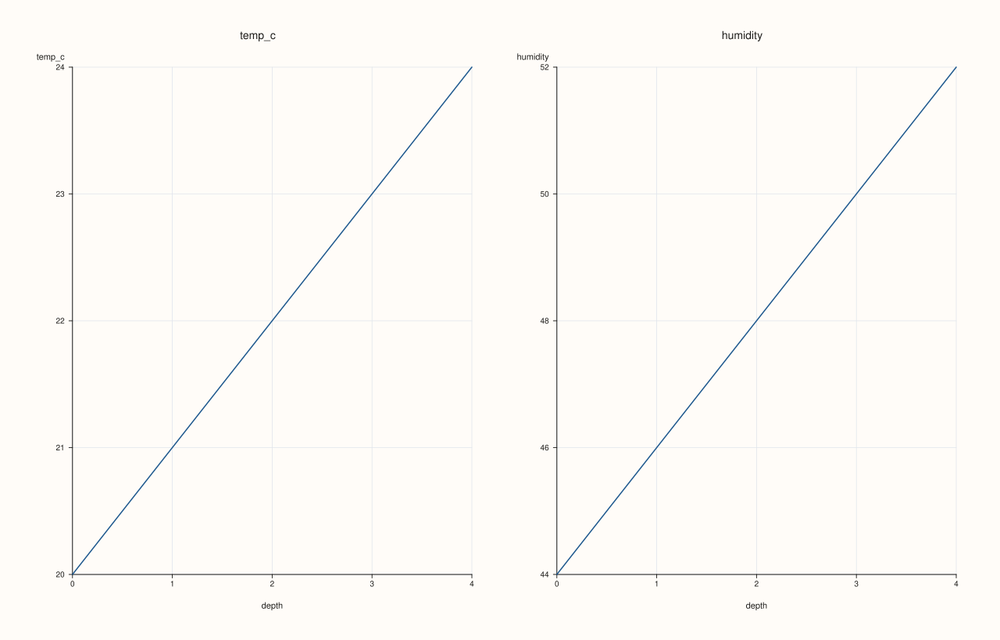
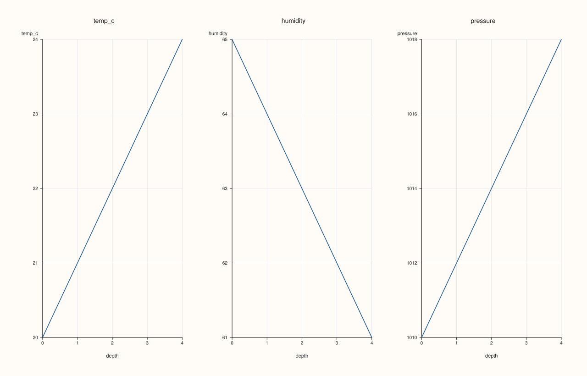

<!-- pluss-hand-authored -->
<!-- pluss-signature-hash: 25519d9a1155 -->

# AtlasPlotAccessor::depth_facet

[Back to AtlasPlotAccessor API Reference](../../atlas_plot_accessor_api_reference)

## Signatures

```cpp
pluss::pl::Studio AtlasPlotAccessor::depth_facet(pluss::msharp::RangeView::Of<std::string_view> features = {}) const

pluss::pl::Studio AtlasPlotAccessor::depth_facet(pluss::msharp::RangeView::Of<std::string_view> features,
                                                  const AtlasDepthFacetPlotOptions& options) const
```

## What It Does

The same per-frame reduction and multi-feature selection as
[`depth_compare()`](depth_compare.md), but instead of overlaying every feature's line on one
shared pane, each feature gets its own small-multiple pane in a grid — easier to read when the
features have very different scales, since each pane gets its own y-axis.

```{important} Returns a Studio, not printable output
Like every method on `AtlasPlotAccessor`, this builds and returns a `pluss::pl::Studio` —
call `.show()`/`.to_svg()`/`.save_svg(path)`/etc. to view or persist it; `std::cout << chart` does
not compile.
```

## Parameters

**features** (`pluss::msharp::RangeView::Of<std::string_view>`, defaults to `{}`)
    The numeric features to facet, one pane each. An empty range (the default) selects **every**
    numeric feature present in the first frame.

**options** (`const AtlasDepthFacetPlotOptions&`)
    `statistic` (`AtlasDepthStatistic`, default `Mean`): the per-frame reduction applied to every
    feature. `show_grid` (default `true`). `rows`/`cols` (facet grid shape, `0` auto-sizes).
    `grid_gap_x`/`grid_gap_y`. `max_features` (`std::int64_t`, default `0`, `0` means no cap) —
    same truncation semantics as [`depth_compare`](depth_compare.md)'s `max_features`.

## Returns

`pluss::pl::Studio`
    A figure with one small-multiple pane per selected feature, each showing that feature's
    per-frame reduction against depth.

## Examples

Example 1. Default call: facet every numeric feature into its own pane, auto-sized grid.

```cpp
using namespace pluss::table;

std::vector<DataFrame> frames;
for (int i = 0; i < 5; ++i) {
    double base = static_cast<double>(i);
    frames.push_back(DataFrame({
        {"temp_c", Slate(pluss::make_series({18.0 + base, 19.0 + base, 20.0 + base, 21.0 + base, 22.0 + base}))},
        {"humidity", Slate(pluss::make_series({55.0 - base, 60.0 - base, 65.0 - base, 70.0 - base, 75.0 - base}))},
        {"pressure", Slate(pluss::make_series({1005.0 + base * 2, 1008.0 + base * 2, 1010.0 + base * 2, 1012.0 + base * 2, 1015.0 + base * 2}))},
    }));
}
auto atlas = Atlas(frames, Slate(pluss::make_note({"day1", "day2", "day3", "day4", "day5"})));

auto chart = atlas.plot().depth_facet();
chart.show();
```



`temp_c`, `humidity`, and `pressure` each get their own pane, laid out in an auto-sized grid.

Example 2. Explicit `options.rows`/`options.cols` force a single row of three panes instead of
the auto-sized default.

```cpp
using namespace pluss::table;

std::vector<DataFrame> frames;
for (int i = 0; i < 5; ++i) {
    double base = static_cast<double>(i);
    frames.push_back(DataFrame({
        {"temp_c", Slate(pluss::make_series({18.0 + base, 19.0 + base, 20.0 + base, 21.0 + base, 22.0 + base}))},
        {"humidity", Slate(pluss::make_series({55.0 - base, 60.0 - base, 65.0 - base, 70.0 - base, 75.0 - base}))},
        {"pressure", Slate(pluss::make_series({1005.0 + base * 2, 1008.0 + base * 2, 1010.0 + base * 2, 1012.0 + base * 2, 1015.0 + base * 2}))},
    }));
}
auto atlas = Atlas(frames, Slate(pluss::make_note({"day1", "day2", "day3", "day4", "day5"})));

AtlasDepthFacetPlotOptions options;
options.rows = 1;
options.cols = 3;
auto chart = atlas.plot().depth_facet({}, options);
chart.show();
```



## Notes

- `features = {}` selects every numeric feature in the **first** frame — a feature only present in
  later frames is never picked up this way.
- `rows`/`cols` left at `0` (the default) auto-sizes the grid to the number of selected features;
  set both explicitly to control the exact layout, as in Example 2.
- `options.depth_axis` (shared with [`depth()`](depth.md)/[`depth_compare()`](depth_compare.md)/
  [`depth_rolling()`](depth_rolling.md)) controls which frames are included and in what order.

## See Also

- [`AtlasPlotAccessor::depth_compare`](depth_compare.md): the overlaid counterpart, all features
  sharing one pane instead of getting their own.
- [`AtlasPlotAccessor::frames`](frames.md)'s `Facet` mode: small multiples over *frames* instead
  of over *features*.
- [`Atlas::plot`](../atlas/plot.md): the entry point this accessor is reached from.

<div class="pluss-inline-prev-next">
  <a class="prev-link" href="depth_compare.html">
    <span class="label">Previous</span>
    <span class="title">depth_compare</span>
  </a>
  <a class="next-link" href="depth_rolling.html">
    <span class="label">Next</span>
    <span class="title">depth_rolling</span>
  </a>
</div>
