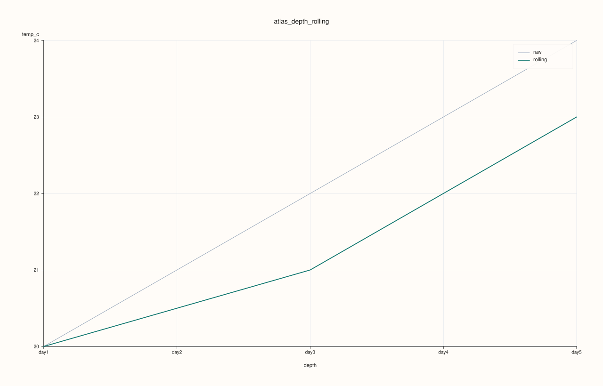
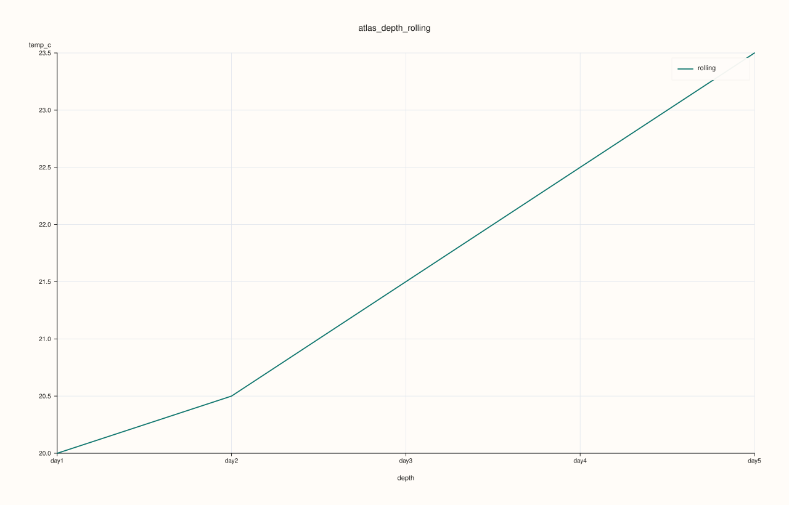

<!-- pluss-hand-authored -->
<!-- pluss-signature-hash: d50e582d84ac -->

# AtlasPlotAccessor::depth_rolling

[Back to AtlasPlotAccessor API Reference](../../atlas_plot_accessor_api_reference)

## Signatures

```cpp
pluss::pl::Studio AtlasPlotAccessor::depth_rolling(std::string_view feature) const
pluss::pl::Studio AtlasPlotAccessor::depth_rolling(std::string_view feature, const AtlasDepthRollingPlotOptions& options) const
```

## What It Does

Reduces `feature` to a single scalar per frame (statistic `options.statistic`, default `Mean`) —
the same per-frame reduction [`depth()`](depth.md) uses for its center line — then draws both the
raw reduced series and a rolling average of it, smoothing out frame-to-frame noise.

```{important} Returns a Studio, not printable output
Like every method on `AtlasPlotAccessor`, this builds and returns a `pluss::pl::Studio` —
call `.show()`/`.to_svg()`/`.save_svg(path)`/etc. to view or persist it; `std::cout << chart` does
not compile.
```

## Parameters

**feature** (`std::string_view`)
    The numeric feature to reduce and smooth, one value per frame.

**options** (`const AtlasDepthRollingPlotOptions&`)
    `statistic` (`AtlasDepthStatistic`, default `Mean`). `window` (`std::int64_t`, default `3`):
    the rolling-average window size, in frames. `show_raw` (`bool`, default `true`): whether the
    unsmoothed raw series is drawn alongside the rolling average. `show_grid` (default `true`).
    `raw_line_width`/`rolling_line_width` control line thickness.

## Returns

`pluss::pl::Studio`
    A figure with one 2D pane: the raw per-frame reduced series (if `show_raw`) plus its rolling
    average.

## Examples

Example 1. Default call: raw per-frame means plus a 3-frame rolling average.

```cpp
using namespace pluss::table;

std::vector<DataFrame> frames;
for (int i = 0; i < 5; ++i) {
    double base = static_cast<double>(i);
    frames.push_back(DataFrame({
        {"temp_c", Slate(pluss::make_series({18.0 + base, 19.0 + base, 20.0 + base, 21.0 + base, 22.0 + base}))},
    }));
}
auto atlas = Atlas(frames, Slate(pluss::make_note({"day1", "day2", "day3", "day4", "day5"})));

auto chart = atlas.plot().depth_rolling("temp_c");
chart.show();
```



Both the raw line (per-frame mean, `20, 21, 22, 23, 24`) and its 3-frame rolling average appear —
the rolling line lags and smooths the raw one.

Example 2. A shorter `window` and `show_raw = false` draws only the smoothed line, with a
tighter rolling window.

```cpp
using namespace pluss::table;

std::vector<DataFrame> frames;
for (int i = 0; i < 5; ++i) {
    double base = static_cast<double>(i);
    frames.push_back(DataFrame({
        {"temp_c", Slate(pluss::make_series({18.0 + base, 19.0 + base, 20.0 + base, 21.0 + base, 22.0 + base}))},
    }));
}
auto atlas = Atlas(frames, Slate(pluss::make_note({"day1", "day2", "day3", "day4", "day5"})));

AtlasDepthRollingPlotOptions options;
options.window = 2;
options.show_raw = false;
auto chart = atlas.plot().depth_rolling("temp_c", options);
chart.show();
```



## Notes

- `window` is measured in frames, not in any depth-label unit — a `window` of `3` averages the
  three most recent frames' reduced values, regardless of what `depth_labels()` are attached.
- Setting `show_raw = false` hides the unsmoothed series entirely, leaving just the rolling
  average — useful once you've confirmed the raw shape and only want the trend.
- `options.depth_axis` (shared with [`depth()`](depth.md)/[`depth_compare()`](depth_compare.md)/
  [`depth_facet()`](depth_facet.md)) controls which frames are included and in what order.

## See Also

- [`AtlasPlotAccessor::depth`](depth.md): the unsmoothed center-plus-band chart this method
  builds on.
- [`Atlas::plot`](../atlas/plot.md): the entry point this accessor is reached from.

<div class="pluss-inline-prev-next">
  <a class="prev-link" href="depth_facet.html">
    <span class="label">Previous</span>
    <span class="title">depth_facet</span>
  </a>
  <a class="next-link" href="frames.html">
    <span class="label">Next</span>
    <span class="title">frames</span>
  </a>
</div>
