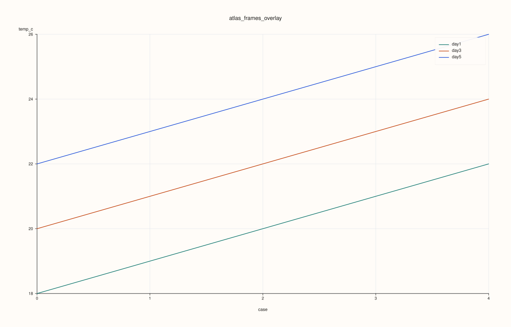
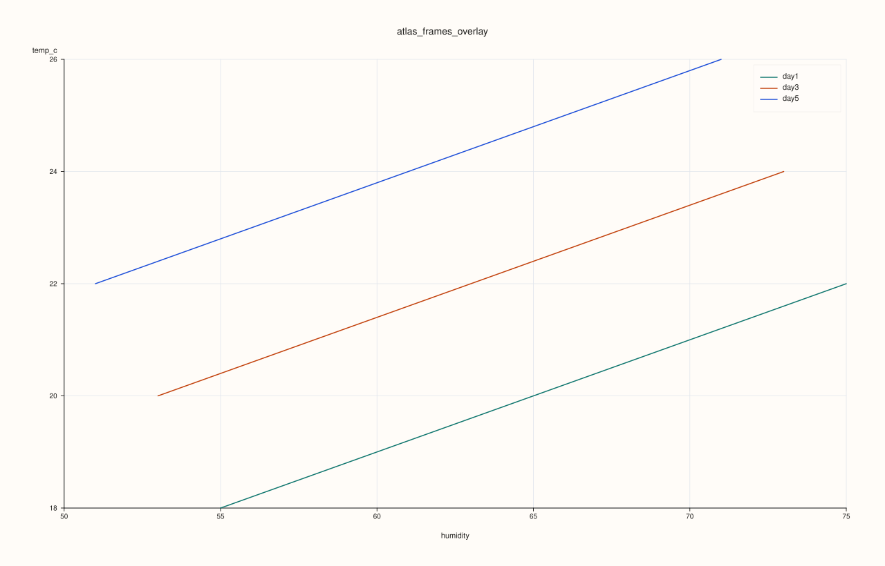
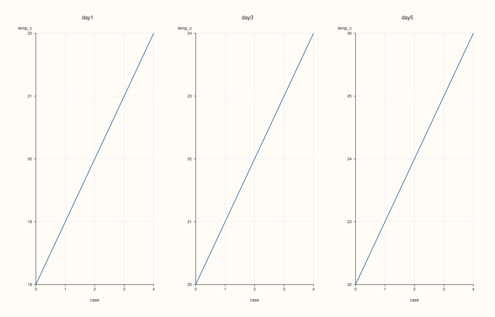
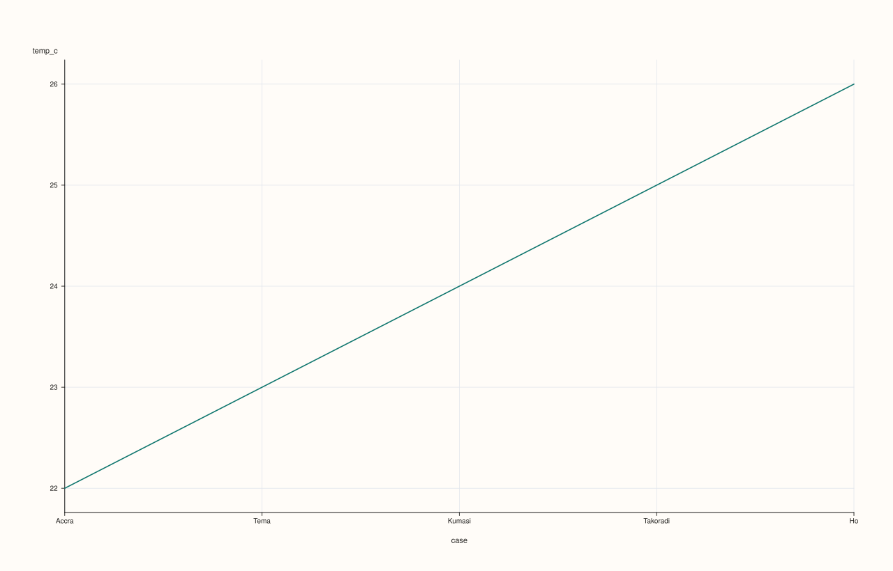
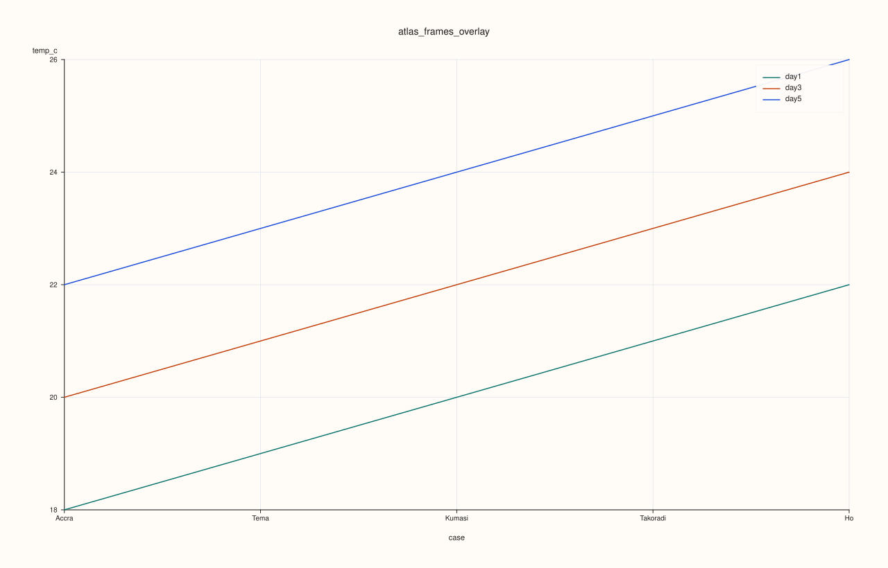

<!-- pluss-hand-authored -->
<!-- pluss-signature-hash: c562af9f8ee0 -->

# AtlasPlotAccessor::frames

[Back to AtlasPlotAccessor API Reference](../../atlas_plot_accessor_api_reference)

## Signatures

```cpp
DataFramePlotAccessor AtlasPlotAccessor::frames(std::int64_t frame_index = 0) const

pluss::pl::Studio AtlasPlotAccessor::frames(pluss::msharp::RangeView::Int frame_indices,
                                            std::string_view y_feature,
                                            std::optional<std::string_view> x_feature = std::nullopt) const

pluss::pl::Studio AtlasPlotAccessor::frames(pluss::msharp::RangeView::Int frame_indices,
                                            std::string_view y_feature,
                                            std::optional<std::string_view> x_feature,
                                            const AtlasFramesPlotOptions& options) const
```

## What It Does

Two genuinely different things share the name `frames()`:

- The **single-index overload** (`frames(frame_index)`) is an entry point, not a chart builder —
  it returns a [`DataFramePlotAccessor`](../../dataframe_plot_api_reference) bound to one
  frame of the stack, so you can call any of *that* accessor's own plotting methods
  (`.line(...)`, `.scatter(...)`, `.hist(...)`, etc.) on a single frame as if it were a standalone
  `DataFrame`.
- The **multi-index overloads** (`frames(indices, y_feature, ...)`) build an actual
  `pluss::pl::Studio` chart directly, overlaying (or faceting) the same feature across several
  frames at once, so you can compare how `y_feature` behaves frame-to-frame.

```{important} Returns a Studio, not printable output
Like every method on `AtlasPlotAccessor`, the multi-index overloads build and return a
`pluss::pl::Studio` — call `.show()`/`.to_svg()`/`.save_svg(path)`/etc. to view or persist it;
`std::cout << chart` does not compile. The single-index overload returns a
`DataFramePlotAccessor` instead — chain one of its own methods to get a `Studio`.
```

## Parameters

**frame_index** (`std::int64_t`, single-index overload, defaults to `0`)
    The depth position to select. Negative values count from the end (`-1` is the last frame).
    Out of range throws.

**frame_indices** (`pluss::msharp::RangeView::Int`, multi-index overloads)
    One or more depth positions to overlay/facet. Negative values count from the end. Duplicates
    (after resolving negatives) are silently collapsed to one occurrence, in first-seen order.
    Must select at least one frame.

**y_feature** (`std::string_view`, multi-index overloads)
    The numeric feature to plot on the y-axis, read from every selected frame.

**x_feature** (`std::optional<std::string_view>`, defaults to `std::nullopt`)
    The feature to plot on the x-axis. `std::nullopt` (the default) uses each frame's own case
    axis (row index or row label) instead of a data feature.

**options** (`const AtlasFramesPlotOptions&`)
    `mode` (`AtlasFrameSelectionMode`, default `Overlay`): `Overlay` draws every selected frame as
    its own line on one pane; `Facet` draws each in its own small-multiple pane. `rows`/`cols`
    (facet grid shape, `0` auto-sizes), `grid_gap_x`/`grid_gap_y`, `show_grid`, `line_width`.

## Returns

`DataFramePlotAccessor` (single-index overload)
    An accessor bound to one frame — chain any `DataFramePlotAccessor` method to get a `Studio`.

`pluss::pl::Studio` (multi-index overloads)
    A figure overlaying (or faceting) `y_feature` across the selected frames.

## Examples

Example 1. The single-index entry point: select frame `0` and chain a line plot on one of its
own features.

```cpp
using namespace pluss::table;

std::vector<DataFrame> frames;
std::vector<std::string> cities = {"Accra", "Tema", "Kumasi", "Takoradi", "Ho"};
for (int i = 0; i < 5; ++i) {
    double base = static_cast<double>(i);
    frames.push_back(DataFrame({
        {"temp_c", Slate(pluss::make_series({18.0 + base, 19.0 + base, 20.0 + base, 21.0 + base, 22.0 + base}))},
        {"humidity", Slate(pluss::make_series({55.0 - base, 60.0 - base, 65.0 - base, 70.0 - base, 75.0 - base}))},
    }, Slate(pluss::make_note(cities))));
}
auto atlas = Atlas(frames, Slate(pluss::make_note({"day1", "day2", "day3", "day4", "day5"})));

auto chart = atlas.plot().frames(0).line("temp_c");
chart.show();
```



The plotted line is frame `0`'s own `temp_c` values against its own case labels — this is exactly
`atlas.registry(...)`-style single-frame access wired straight into `DataFramePlotAccessor`, not a
depth-aware chart.

Example 2. Multi-index overlay: compare `temp_c` across three frames (`0`, `2`, `4`), x-axis
defaulting to the case axis.

```cpp
using namespace pluss::table;

std::vector<DataFrame> frames;
std::vector<std::string> cities = {"Accra", "Tema", "Kumasi", "Takoradi", "Ho"};
for (int i = 0; i < 5; ++i) {
    double base = static_cast<double>(i);
    frames.push_back(DataFrame({
        {"temp_c", Slate(pluss::make_series({18.0 + base, 19.0 + base, 20.0 + base, 21.0 + base, 22.0 + base}))},
        {"humidity", Slate(pluss::make_series({55.0 - base, 60.0 - base, 65.0 - base, 70.0 - base, 75.0 - base}))},
    }, Slate(pluss::make_note(cities))));
}
auto atlas = Atlas(frames, Slate(pluss::make_note({"day1", "day2", "day3", "day4", "day5"})));

auto chart = atlas.plot().frames(pluss::msharp::RangeView::Int{0, 2, 4}, "temp_c");
chart.show();
```


Each selected frame becomes its own labeled line (`"day1"`, `"day3"`, `"day5"`, from
`depth_labels()`), all sharing the same case-axis x-values.

Example 3. Multi-index overlay with an explicit `x_feature` — plot `temp_c` against `humidity`
instead of the case axis.

```cpp
using namespace pluss::table;

std::vector<DataFrame> frames;
std::vector<std::string> cities = {"Accra", "Tema", "Kumasi", "Takoradi", "Ho"};
for (int i = 0; i < 5; ++i) {
    double base = static_cast<double>(i);
    frames.push_back(DataFrame({
        {"temp_c", Slate(pluss::make_series({18.0 + base, 19.0 + base, 20.0 + base, 21.0 + base, 22.0 + base}))},
        {"humidity", Slate(pluss::make_series({55.0 - base, 60.0 - base, 65.0 - base, 70.0 - base, 75.0 - base}))},
    }, Slate(pluss::make_note(cities))));
}
auto atlas = Atlas(frames, Slate(pluss::make_note({"day1", "day2", "day3", "day4", "day5"})));

auto chart = atlas.plot().frames(pluss::msharp::RangeView::Int{0, 2, 4}, "temp_c", "humidity");
chart.show();
```



Example 4. Multi-index with explicit `options`: `Facet` mode gives each selected frame its own
small-multiple pane instead of overlaying them.

```cpp
using namespace pluss::table;

std::vector<DataFrame> frames;
std::vector<std::string> cities = {"Accra", "Tema", "Kumasi", "Takoradi", "Ho"};
for (int i = 0; i < 5; ++i) {
    double base = static_cast<double>(i);
    frames.push_back(DataFrame({
        {"temp_c", Slate(pluss::make_series({18.0 + base, 19.0 + base, 20.0 + base, 21.0 + base, 22.0 + base}))},
        {"humidity", Slate(pluss::make_series({55.0 - base, 60.0 - base, 65.0 - base, 70.0 - base, 75.0 - base}))},
    }, Slate(pluss::make_note(cities))));
}
auto atlas = Atlas(frames, Slate(pluss::make_note({"day1", "day2", "day3", "day4", "day5"})));

AtlasFramesPlotOptions options;
options.mode = AtlasFrameSelectionMode::Facet;
options.rows = 1;
options.cols = 3;
auto chart = atlas.plot().frames(pluss::msharp::RangeView::Int{0, 2, 4}, "temp_c", std::nullopt, options);
chart.show();
```



Example 5. A negative `frame_index` on the single-index overload counts from the end — `-1` is
frame `4`, the last one.

```cpp
using namespace pluss::table;

std::vector<DataFrame> frames;
std::vector<std::string> cities = {"Accra", "Tema", "Kumasi", "Takoradi", "Ho"};
for (int i = 0; i < 5; ++i) {
    double base = static_cast<double>(i);
    frames.push_back(DataFrame({
        {"temp_c", Slate(pluss::make_series({18.0 + base, 19.0 + base, 20.0 + base, 21.0 + base, 22.0 + base}))},
    }, Slate(pluss::make_note(cities))));
}
auto atlas = Atlas(frames, Slate(pluss::make_note({"day1", "day2", "day3", "day4", "day5"})));

auto chart = atlas.plot().frames(-1).line("temp_c");
chart.show();
```



Example 6. An out-of-range `frame_index` throws.

```cpp
using namespace pluss::table;

std::vector<DataFrame> frames;
for (int i = 0; i < 5; ++i) {
    frames.push_back(DataFrame({
        {"temp_c", Slate(pluss::make_series({18.0, 19.0, 20.0, 21.0, 22.0}))},
    }));
}
auto atlas = Atlas(frames);

try {
  auto accessor = atlas.plot().frames(99);
} catch (const std::exception& e) {
  std::string msg(e.what());
  std::cout << msg.substr(0, msg.find('\n'));
}
```

### Output

```text
Atlas::plot().frames: frame index out of bounds
```

Example 7. Duplicate indices in the multi-index overloads collapse to one occurrence each,
in first-seen order — `{0, 0, 2, 2, 4}` behaves identically to `{0, 2, 4}`.

```cpp
using namespace pluss::table;

std::vector<DataFrame> frames;
std::vector<std::string> cities = {"Accra", "Tema", "Kumasi", "Takoradi", "Ho"};
for (int i = 0; i < 5; ++i) {
    double base = static_cast<double>(i);
    frames.push_back(DataFrame({
        {"temp_c", Slate(pluss::make_series({18.0 + base, 19.0 + base, 20.0 + base, 21.0 + base, 22.0 + base}))},
    }, Slate(pluss::make_note(cities))));
}
auto atlas = Atlas(frames, Slate(pluss::make_note({"day1", "day2", "day3", "day4", "day5"})));

auto chart = atlas.plot().frames(pluss::msharp::RangeView::Int{0, 0, 2, 2, 4}, "temp_c");
chart.show();
```



## Notes

- Both `frame_index` (single overload) and every value in `frame_indices` (multi overloads)
  support Python-style negative indexing counting from the end of the depth stack.
- The multi-index overloads require `y_feature` (and `x_feature`, if given) to exist in **every**
  selected frame — a missing feature in any one of them throws.
- `x_feature = std::nullopt` (the default) uses each frame's own case axis — its row index, or its
  row labels if the frame was built with `Note`/`Timeline`/`TimeIndex`-kind case labels.
- Requires the atlas to have at least one frame — an empty atlas throws
  `"Atlas::plot().frames: atlas has no frames"`.

## See Also

- [`DataFramePlotAccessor` API Reference](../../dataframe_plot_api_reference): every
  method available on the accessor returned by the single-index overload.
- [`AtlasPlotAccessor::depth_compare`](depth_compare.md): compares *features* across depth rather
  than *frames* against each other.
- [`Atlas::plot`](../atlas/plot.md): the entry point this accessor is reached from.

<div class="pluss-inline-prev-next">
  <a class="prev-link" href="depth_rolling.html">
    <span class="label">Previous</span>
    <span class="title">depth_rolling</span>
  </a>
  <a class="next-link" href="surface.html">
    <span class="label">Next</span>
    <span class="title">surface</span>
  </a>
</div>
