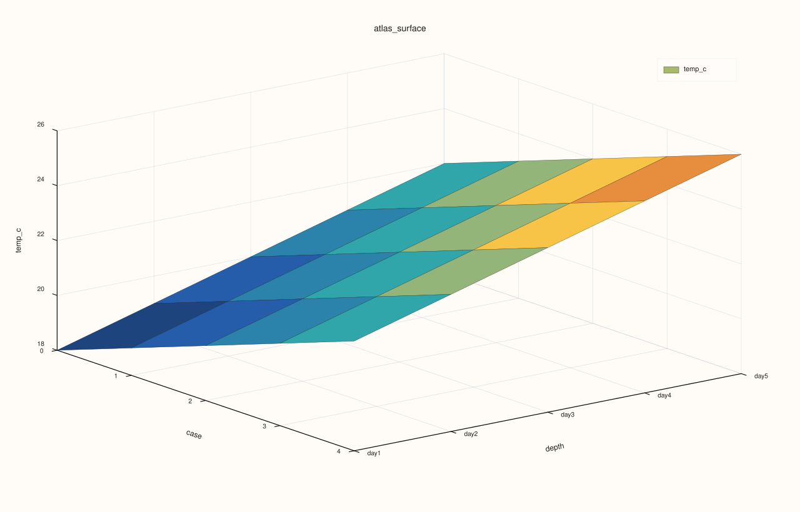
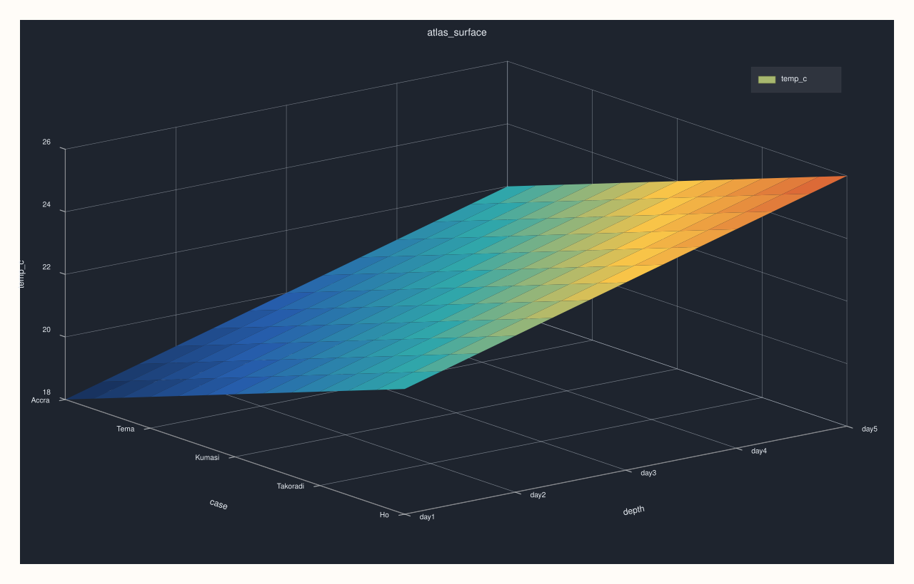

<!-- pluss-hand-authored -->
<!-- pluss-signature-hash: f4363fda9bad -->

# AtlasPlotAccessor::surface

[Back to AtlasPlotAccessor API Reference](../../atlas_plot_accessor_api_reference)

## Signatures

```cpp
pluss::pl::Studio AtlasPlotAccessor::surface(std::string_view feature) const
pluss::pl::Studio AtlasPlotAccessor::surface(std::string_view feature, const Surface3DPlotOptions& options) const
```

## What It Does

Builds a 3D surface (case × depth × `feature`) — `feature`'s value at every case, in every
selected frame, forms a continuous filled sheet over a case-position/depth-position grid.

```{important} Returns a Studio, not printable output
Like every method on `AtlasPlotAccessor`, this builds and returns a `pluss::pl::Studio` —
call `.show()`/`.to_svg()`/`.save_svg(path)`/etc. to view or persist it; `std::cout << chart` does
not compile.
```

## Parameters

**feature** (`std::string_view`)
    The numeric feature forming the surface's z-axis. Must exist in every selected frame.

**options** (`const Surface3DPlotOptions&`)
    `scene` (`Plot3DSceneOptions`): `preset` (`ScenePreset3D`: `Survey`/`Presentation`/`Studio`/
    `Topology`), `theme`, `camera_preset`/`camera`, `lighting`, `grid_style` — all optional,
    layered on top of the default scene. `trace` (`Plot3DTraceOptions`): `preset`
    (`TracePreset3D`), `shade` (`ShadeMode`: `Faceted`/`Flat`/`Smooth`), `lighting`, `material`,
    `line_width`, `transparent` — all optional.

## Returns

`pluss::pl::Studio`
    A figure with one 3D pane holding a single filled surface trace.

## Examples

Example 1. Plot `temp_c` as a surface across every frame's cases and the depth stack, using
default scene/trace settings.

```cpp
using namespace pluss::table;

std::vector<DataFrame> frames;
std::vector<std::string> cities = {"Accra", "Tema", "Kumasi", "Takoradi", "Ho"};
for (int i = 0; i < 5; ++i) {
    double base = static_cast<double>(i);
    frames.push_back(DataFrame({
        {"temp_c", Thread(pluss::make_series({18.0 + base, 19.0 + base, 20.0 + base, 21.0 + base, 22.0 + base}))},
    }, Thread(pluss::make_note(cities))));
}
auto atlas = Atlas(frames, Thread(pluss::make_note({"day1", "day2", "day3", "day4", "day5"})));

auto chart = atlas.plot().surface("temp_c");
chart.show();
```



The x-axis is each frame's case labels (`"Accra"`...`"Ho"`), the y-axis is the depth labels
(`"day1"`...`"day5"`), and the z-axis/surface height is `temp_c`.

Example 2. Same surface, with an explicit `Studio`-preset scene and smooth shading.

```cpp
using namespace pluss::table;

std::vector<DataFrame> frames;
std::vector<std::string> cities = {"Accra", "Tema", "Kumasi", "Takoradi", "Ho"};
for (int i = 0; i < 5; ++i) {
    double base = static_cast<double>(i);
    frames.push_back(DataFrame({
        {"temp_c", Thread(pluss::make_series({18.0 + base, 19.0 + base, 20.0 + base, 21.0 + base, 22.0 + base}))},
    }, Thread(pluss::make_note(cities))));
}
auto atlas = Atlas(frames, Thread(pluss::make_note({"day1", "day2", "day3", "day4", "day5"})));

Surface3DPlotOptions options;
options.scene.preset = pluss::pl::flash::ScenePreset3D::Studio;
options.trace.shade = pluss::pl::ShadeMode::Smooth;
auto chart = atlas.plot().surface("temp_c", options);
chart.show();
```



## Notes

- `feature` must exist and be numeric in every frame selected by `options().depth_axis` (shared
  across `surface()`/`wireframe()`/`cloud3()`) — a missing feature in any of them throws.
- `Studio`-, `Presentation`-, `Topology`-preset scenes change camera angle and lighting defaults
  without needing to hand-tune `camera`/`lighting` fields individually.
- Every selected frame must share the same case count — a mismatched frame throws.

## See Also

- [`AtlasPlotAccessor::wireframe`](wireframe.md): the same case×depth×feature grid, drawn as an
  open mesh instead of a filled sheet.
- [`AtlasPlotAccessor::cloud3`](cloud3.md): a genuinely 3-feature scatter, rather than one
  feature over a case/depth grid.
- [`Atlas::plot`](../atlas/plot.md): the entry point this accessor is reached from.

<div class="pluss-inline-prev-next">
  <a class="prev-link" href="frames.html">
    <span class="label">Previous</span>
    <span class="title">frames</span>
  </a>
  <a class="next-link" href="triplot.html">
    <span class="label">Next</span>
    <span class="title">triplot</span>
  </a>
</div>
