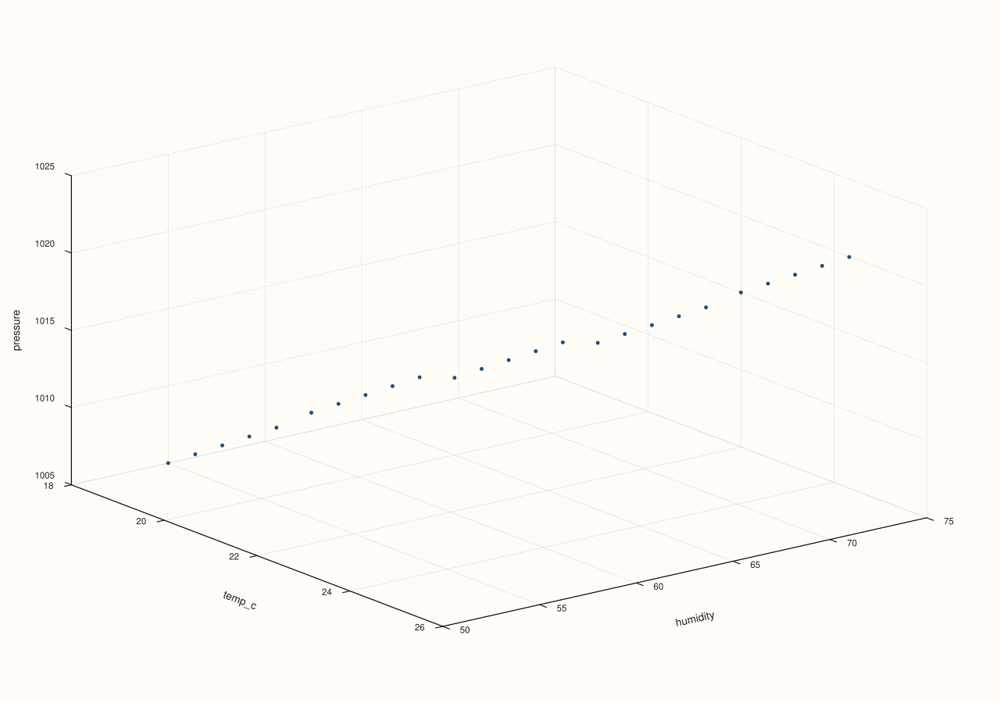

<!-- pluss-hand-authored -->
<!-- pluss-signature-hash: bb9ecfb2c9f1 -->

# AtlasPlotAccessor::triplot

[Back to AtlasPlotAccessor API Reference](../../atlas_plot_accessor_api_reference)

## Signatures

```cpp
pluss::pl::Studio AtlasPlotAccessor::triplot() const
pluss::pl::Studio AtlasPlotAccessor::triplot(const pluss::pl::flash::TriplotOptions& options) const
pluss::pl::Studio AtlasPlotAccessor::triplot(pluss::msharp::RangeView::Of<std::string_view> features) const
pluss::pl::Studio AtlasPlotAccessor::triplot(pluss::msharp::RangeView::Of<std::string_view> features,
                                             const pluss::pl::flash::TriplotOptions& options) const
```

## What It Does

Flattens every case, in every frame of the depth stack, into one combined pool of rows, then
builds a pairwise small-multiple grid (a "triplot") across the selected numeric features — every
pair of features gets its own pane, in the flavor set by `options.kind` (scatter clouds by
default). All four overloads end up calling the same four-argument primitive; the no-argument
and features-only overloads simply supply defaults for the pieces they omit.

```{important} Returns a Studio, not printable output
Like every method on `AtlasPlotAccessor`, this builds and returns a `pluss::pl::Studio` —
call `.show()`/`.to_svg()`/`.save_svg(path)`/etc. to view or persist it; `std::cout << chart` does
not compile.
```

## Parameters

**features** (`pluss::msharp::RangeView::Of<std::string_view>`, defaults to `{}`)
    The numeric features to include, at least three. An empty range (the default, used by the
    no-argument and options-only overloads) selects every numeric feature in the first frame.

**options** (`const pluss::pl::flash::TriplotOptions&`)
    `kind` (`TriplotKind`, default `Cloud`): the pane flavor — `Cloud` (scatter), `Sheet`,
    `Lattice`, `Spire`, `Ridge`. `labels` (defaults to the resolved feature names).
    `max_features`/`max_panels`/`rows`/`cols`/`max_points` cap or shape the grid. `show_grid`,
    sizing fields (`cell_width`/`cell_height`/`outer_pad_x`/`outer_pad_y`/`grid_gap_x`/
    `grid_gap_y`), and `auto_size` round out the layout controls.

## Returns

`pluss::pl::Studio`
    A figure with one small-multiple pane per feature pair, flattened across every frame's cases.

## Examples

Example 1. No-argument call: default options, every numeric feature in the first frame.

```cpp
using namespace pluss::table;

std::vector<DataFrame> frames;
for (int i = 0; i < 5; ++i) {
    double base = static_cast<double>(i);
    frames.push_back(DataFrame({
        {"temp_c", Slate(pluss::make_series({18.0 + base, 19.0 + base, 20.0 + base, 21.0 + base, 22.0 + base}))},
        {"humidity", Slate(pluss::make_series({55.0 - base, 60.0 - base, 65.0 - base, 70.0 - base, 75.0 - base}))},
        {"pressure", Slate(pluss::make_series({1005.0 + base * 2, 1008.0 + base * 2, 1010.0 + base * 2, 1012.0 + base * 2, 1015.0 + base * 2}))},
    }));
}
auto atlas = Atlas(frames, Slate(pluss::make_note({"day1", "day2", "day3", "day4", "day5"})));

auto chart = atlas.plot().triplot();
chart.show();
```


All 25 cases (5 frames × 5 cases each) are pooled together, and every pair among `temp_c`,
`humidity`, `pressure` gets its own scatter pane.

Example 2. Options-only overload: same default feature selection, explicit `Cloud` kind (the
default made explicit).

```cpp
using namespace pluss::table;

std::vector<DataFrame> frames;
for (int i = 0; i < 5; ++i) {
    double base = static_cast<double>(i);
    frames.push_back(DataFrame({
        {"temp_c", Slate(pluss::make_series({18.0 + base, 19.0 + base, 20.0 + base, 21.0 + base, 22.0 + base}))},
        {"humidity", Slate(pluss::make_series({55.0 - base, 60.0 - base, 65.0 - base, 70.0 - base, 75.0 - base}))},
        {"pressure", Slate(pluss::make_series({1005.0 + base * 2, 1008.0 + base * 2, 1010.0 + base * 2, 1012.0 + base * 2, 1015.0 + base * 2}))},
    }));
}
auto atlas = Atlas(frames, Slate(pluss::make_note({"day1", "day2", "day3", "day4", "day5"})));

pluss::pl::flash::TriplotOptions options;
options.kind = pluss::pl::flash::TriplotKind::Cloud;
auto chart = atlas.plot().triplot(options);
chart.show();
```


Example 3. Features-only overload: pass an explicit feature list, default options.

```cpp
using namespace pluss::table;

std::vector<DataFrame> frames;
for (int i = 0; i < 5; ++i) {
    double base = static_cast<double>(i);
    frames.push_back(DataFrame({
        {"temp_c", Slate(pluss::make_series({18.0 + base, 19.0 + base, 20.0 + base, 21.0 + base, 22.0 + base}))},
        {"humidity", Slate(pluss::make_series({55.0 - base, 60.0 - base, 65.0 - base, 70.0 - base, 75.0 - base}))},
        {"pressure", Slate(pluss::make_series({1005.0 + base * 2, 1008.0 + base * 2, 1010.0 + base * 2, 1012.0 + base * 2, 1015.0 + base * 2}))},
    }));
}
auto atlas = Atlas(frames, Slate(pluss::make_note({"day1", "day2", "day3", "day4", "day5"})));

auto chart = atlas.plot().triplot(pluss::msharp::RangeView::Of<std::string_view>{"temp_c", "humidity", "pressure"});
chart.show();
```



Example 4. Full four-argument-equivalent call: explicit features and explicit options together,
here capping `max_features` to `3` (a no-op with exactly three features, shown for completeness).

```cpp
using namespace pluss::table;

std::vector<DataFrame> frames;
for (int i = 0; i < 5; ++i) {
    double base = static_cast<double>(i);
    frames.push_back(DataFrame({
        {"temp_c", Slate(pluss::make_series({18.0 + base, 19.0 + base, 20.0 + base, 21.0 + base, 22.0 + base}))},
        {"humidity", Slate(pluss::make_series({55.0 - base, 60.0 - base, 65.0 - base, 70.0 - base, 75.0 - base}))},
        {"pressure", Slate(pluss::make_series({1005.0 + base * 2, 1008.0 + base * 2, 1010.0 + base * 2, 1012.0 + base * 2, 1015.0 + base * 2}))},
    }));
}
auto atlas = Atlas(frames, Slate(pluss::make_note({"day1", "day2", "day3", "day4", "day5"})));

pluss::pl::flash::TriplotOptions options;
options.max_features = 3;
auto chart = atlas.plot().triplot(
    pluss::msharp::RangeView::Of<std::string_view>{"temp_c", "humidity", "pressure"}, options);
chart.show();
```


## Notes

- Requires **at least three** numeric features, whether resolved from the empty-features default
  or from an explicit list — fewer than three throws
  `"Atlas::plot().triplot: requires at least three numeric series features"` (default case) or
  `"...requires at least three selected features"` (explicit case).
- `features = {}` selects every numeric feature in the **first** frame — a feature only present in
  later frames is never picked up this way, the same rule
  [`depth_compare()`](depth_compare.md)/[`depth_facet()`](depth_facet.md) use.
- Every frame's cases are pooled together — `triplot()` has no per-frame breakdown or legend the
  way [`cloud3()`](cloud3.md) does; it treats the whole depth stack as one dataset.
- If `options.labels` is left empty, it's filled in with the resolved feature names automatically.

## See Also

- [`AtlasPlotAccessor::cloud3`](cloud3.md): a single 3D scatter of exactly three named features,
  broken out per frame — the depth-aware counterpart to this method's pooled-across-frames view.
- [`Atlas::plot`](../atlas/plot.md): the entry point this accessor is reached from.

<div class="pluss-inline-prev-next">
  <a class="prev-link" href="surface.html">
    <span class="label">Previous</span>
    <span class="title">surface</span>
  </a>
  <a class="next-link" href="wireframe.html">
    <span class="label">Next</span>
    <span class="title">wireframe</span>
  </a>
</div>
