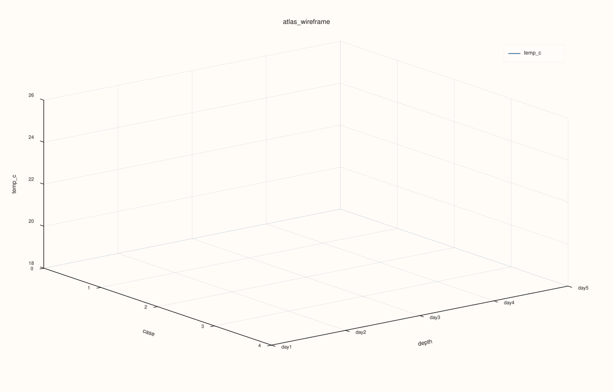
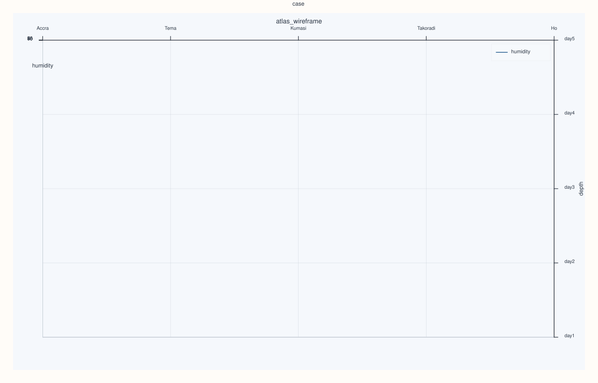

<!-- pluss-hand-authored -->
<!-- pluss-signature-hash: a6fac50d76e6 -->

# AtlasPlotAccessor::wireframe

[Back to AtlasPlotAccessor API Reference](../../atlas_plot_accessor_api_reference)

## Signatures

```cpp
pluss::pl::Studio AtlasPlotAccessor::wireframe(std::string_view feature) const
pluss::pl::Studio AtlasPlotAccessor::wireframe(std::string_view feature, const Wireframe3DPlotOptions& options) const
```

## What It Does

Builds the same case × depth × `feature` grid as [`surface()`](surface.md), but draws it as an
open mesh (a lattice of connecting lines) instead of a filled sheet — useful when you want to see
through the shape to gridlines or overlapping structure behind it.

```{important} Returns a Studio, not printable output
Like every method on `AtlasPlotAccessor`, this builds and returns a `pluss::pl::Studio` —
call `.show()`/`.to_svg()`/`.save_svg(path)`/etc. to view or persist it; `std::cout << chart` does
not compile.
```

## Parameters

**feature** (`std::string_view`)
    The numeric feature forming the mesh's z-axis. Must exist in every selected frame.

**options** (`const Wireframe3DPlotOptions&`)
    Same shape as [`Surface3DPlotOptions`](surface.md): `scene` (`Plot3DSceneOptions`) and
    `trace` (`Plot3DTraceOptions`).

## Returns

`pluss::pl::Studio`
    A figure with one 3D pane holding a single wireframe (lattice) trace.

## Examples

Example 1. Plot `humidity` as a wireframe mesh across every frame's cases and the depth stack.

```cpp
using namespace pluss::table;

std::vector<DataFrame> frames;
std::vector<std::string> cities = {"Accra", "Tema", "Kumasi", "Takoradi", "Ho"};
for (int i = 0; i < 5; ++i) {
    double base = static_cast<double>(i);
    frames.push_back(DataFrame({
        {"humidity", Slate(pluss::make_series({55.0 - base, 60.0 - base, 65.0 - base, 70.0 - base, 75.0 - base}))},
    }, Slate(pluss::make_note(cities))));
}
auto atlas = Atlas(frames, Slate(pluss::make_note({"day1", "day2", "day3", "day4", "day5"})));

auto chart = atlas.plot().wireframe("humidity");
chart.show();
```



Example 2. Same mesh, with a `Topology`-preset scene (a top-down-leaning camera suited to
grid/contour-like shapes).

```cpp
using namespace pluss::table;

std::vector<DataFrame> frames;
std::vector<std::string> cities = {"Accra", "Tema", "Kumasi", "Takoradi", "Ho"};
for (int i = 0; i < 5; ++i) {
    double base = static_cast<double>(i);
    frames.push_back(DataFrame({
        {"humidity", Slate(pluss::make_series({55.0 - base, 60.0 - base, 65.0 - base, 70.0 - base, 75.0 - base}))},
    }, Slate(pluss::make_note(cities))));
}
auto atlas = Atlas(frames, Slate(pluss::make_note({"day1", "day2", "day3", "day4", "day5"})));

Wireframe3DPlotOptions options;
options.scene.preset = pluss::pl::flash::ScenePreset3D::Topology;
auto chart = atlas.plot().wireframe("humidity", options);
chart.show();
```



## Notes

- `feature` must exist and be numeric in every frame selected by `options().depth_axis` (shared
  across `surface()`/`wireframe()`/`cloud3()`) — a missing feature in any of them throws.
- Every selected frame must share the same case count — a mismatched frame throws.

## See Also

- [`AtlasPlotAccessor::surface`](surface.md): the filled-sheet counterpart, same underlying grid.
- [`AtlasPlotAccessor::cloud3`](cloud3.md): a genuinely 3-feature scatter, rather than one
  feature over a case/depth grid.
- [`Atlas::plot`](../atlas/plot.md): the entry point this accessor is reached from.

<div class="pluss-inline-prev-next">
  <a class="prev-link" href="triplot.html">
    <span class="label">Previous</span>
    <span class="title">triplot</span>
  </a>
</div>
