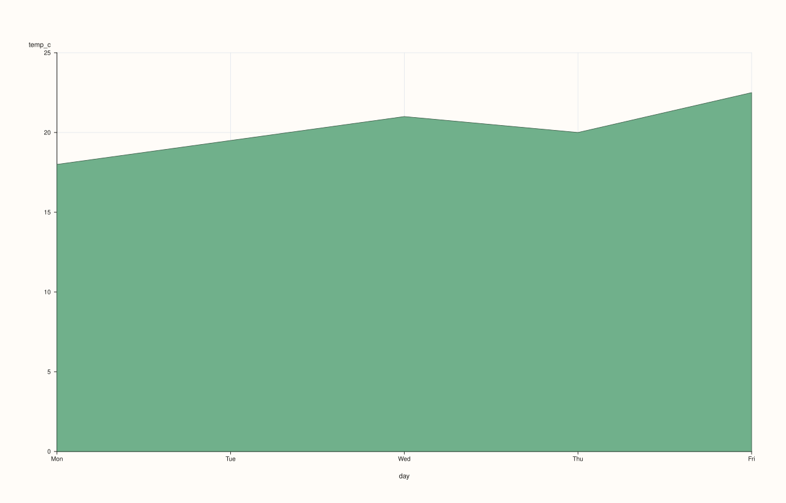
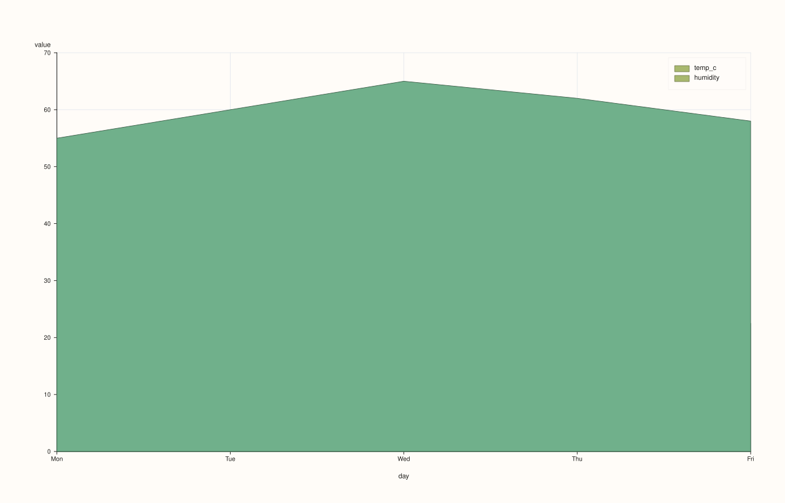

<!-- pluss-hand-authored -->
<!-- pluss-signature-hash: 775dbf0dc684 -->

# CatalogPlotAccessor::area

[Back to CatalogPlotAccessor API Reference](../../catalog_plot_accessor_api_reference)

## Signatures

```cpp
pluss::pl::Studio CatalogPlotAccessor::area(std::string_view y_key,
                                             std::optional<std::string_view> x_key = std::nullopt) const

pluss::pl::Studio CatalogPlotAccessor::area(pluss::msharp::RangeView::Of<std::string_view> y_keys = {},
                                             std::optional<std::string_view> x_key = std::nullopt) const

pluss::pl::Studio CatalogPlotAccessor::area(std::initializer_list<std::string_view> y_keys,
                                             std::optional<std::string_view> x_key = std::nullopt) const

pluss::pl::Studio CatalogPlotAccessor::area(std::string_view y_key,
                                             std::optional<std::string_view> x_key,
                                             const AreaPlotOptions& options) const

pluss::pl::Studio CatalogPlotAccessor::area(pluss::msharp::RangeView::Of<std::string_view> y_keys,
                                             std::optional<std::string_view> x_key,
                                             const AreaPlotOptions& options) const

pluss::pl::Studio CatalogPlotAccessor::area(std::initializer_list<std::string_view> y_keys,
                                             std::optional<std::string_view> x_key,
                                             const AreaPlotOptions& options) const
```

## What It Does

Exactly [`line()`](line.md)'s shape — one trace per y-key over a shared x-axis — filled down
to zero instead of drawn as a bare line. Every mechanic on this page (x-axis resolution, the
empty-`y_keys` default, the independent-per-key-axis gotcha with multiple keys and no shared
`x_key`, the `Studio`-return/no-`cout` behavior) is identical to `line()` — see that page for
the full explanation; only what's specific to `area()` is repeated here.

## Parameters

**y_key** / **y_keys** (`std::string_view` / `RangeView<std::string_view>` /
`std::initializer_list<std::string_view>`, `y_keys` defaults to `{}`)
    Same resolution as [`line()`](line.md).

**x_key** (`std::optional<std::string_view>`, default `std::nullopt`)
    Same three-step resolution as [`line()`](line.md).

**options** (`AreaPlotOptions`)

### `AreaPlotOptions` fields

| Field | Type | Default |
|---|---|---|
| `alpha` | `double` | `0.88` |
| `line_width` | `double` | `1.3` |
| `align` | `XYAlignOptions` | default constructed |

Note the higher default `alpha` (`0.88` vs. `line()`'s `1.0`) — a filled area reads
better slightly translucent than fully opaque. `align` controls how a mismatched-length
explicit `x_key`/y-key pair is reconciled — see
[`line()`](line.md) for the full explanation.

## Returns

`pluss::pl::Studio`
    A figure with one pane containing one filled-area trace per requested y-key.

## Examples

Example 1. Explicit x-key, single y-key.

```cpp
using namespace pluss::kindle::literals;

auto weather = pluss::kindle::Catalog({
    "day"_k = pluss::kindle::Stream(pluss::make_note({"Mon", "Tue", "Wed", "Thu", "Fri"})),
    "temp_c"_k = pluss::kindle::Stream(pluss::make_series({18.0, 19.5, 21.0, 20.0, 22.5})),
    "humidity"_k = pluss::kindle::Stream(pluss::make_series({55.0, 60.0, 65.0, 62.0, 58.0})),
});

auto chart = weather.plot().area("temp_c", "day");
chart.show();
```



Example 2. Multiple y-keys via a `RangeView`, same shared x-key.

```cpp
using namespace pluss::kindle::literals;

auto weather = pluss::kindle::Catalog({
    "day"_k = pluss::kindle::Stream(pluss::make_note({"Mon", "Tue", "Wed", "Thu", "Fri"})),
    "temp_c"_k = pluss::kindle::Stream(pluss::make_series({18.0, 19.5, 21.0, 20.0, 22.5})),
    "humidity"_k = pluss::kindle::Stream(pluss::make_series({55.0, 60.0, 65.0, 62.0, 58.0})),
});

std::vector<std::string_view> y_names{"temp_c", "humidity"};
auto chart = weather.plot().area(pluss::msharp::RangeView::Of<std::string_view>(y_names), "day");
chart.show();
```



Example 3. An explicit `AreaPlotOptions`, lowering opacity further.

```cpp
using namespace pluss::kindle::literals;

auto weather = pluss::kindle::Catalog({
    "day"_k = pluss::kindle::Stream(pluss::make_note({"Mon", "Tue", "Wed", "Thu", "Fri"})),
    "temp_c"_k = pluss::kindle::Stream(pluss::make_series({18.0, 19.5, 21.0, 20.0, 22.5})),
});

pluss::table::AreaPlotOptions area_options;
area_options.alpha = 0.4;
area_options.line_width = 2.0;

auto chart = weather.plot().area("temp_c", "day", area_options);
chart.show();
```


Example 4. An unknown key throws.

```cpp
using namespace pluss::kindle::literals;

auto weather = pluss::kindle::Catalog({
    "day"_k = pluss::kindle::Stream(pluss::make_note({"Mon", "Tue", "Wed", "Thu", "Fri"})),
    "temp_c"_k = pluss::kindle::Stream(pluss::make_series({18.0, 19.5, 21.0, 20.0, 22.5})),
});

try {
  auto bad = weather.plot().area("nonexistent");
} catch (const std::exception& e) {
  std::cout << e.what();
}
```

### Output

```text
Catalog::plot().area: unknown key 'nonexistent'
```

## Notes

- Every mechanic besides the fill and the higher default `alpha` is shared with
  [`line()`](line.md) — see that page for the full x-axis resolution and multi-key gotchas.
- Returns a `pluss::pl::Studio` — see [`line()`](line.md)'s important callout for how to
  view or save the result.

## See Also

- [`CatalogPlotAccessor::line`](line.md): the canonical explanation of this accessor's
  shared mechanics.
- [`CatalogPlotAccessor::step`](step.md): a step-function variant of the same shape.

<div class="pluss-inline-prev-next">
  <a class="next-link" href="auto_plot.html">
    <span class="label">Next</span>
    <span class="title">auto_plot</span>
  </a>
</div>
