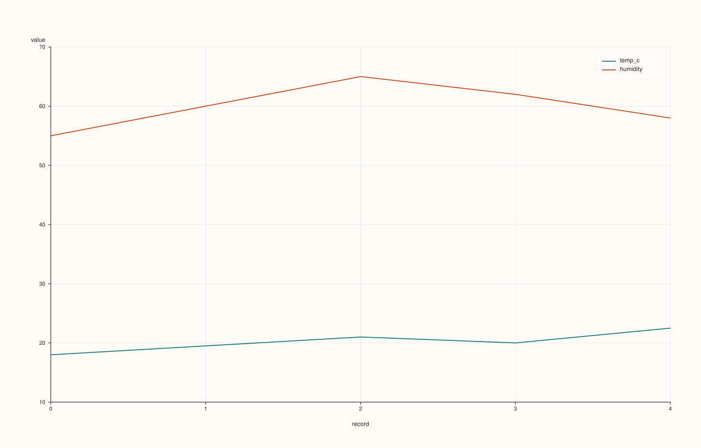
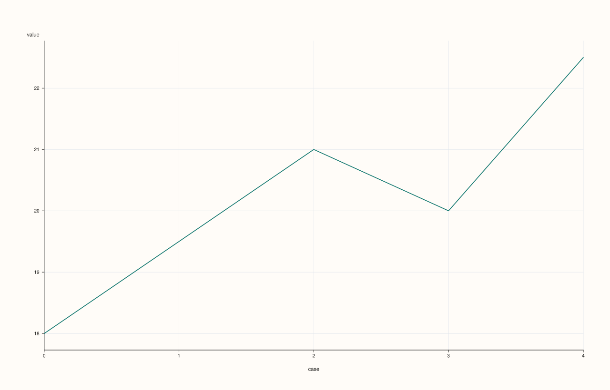

<!-- pluss-hand-authored -->
<!-- pluss-signature-hash: 6fbe1aeea9e3 -->

# CatalogPlotAccessor::auto_plot

[Back to CatalogPlotAccessor API Reference](../../catalog_plot_accessor_api_reference)

## Signatures

```cpp
pluss::pl::Studio CatalogPlotAccessor::auto_plot() const

pluss::pl::Studio CatalogPlotAccessor::auto_plot(const AutoPlotOptions& options) const
```

## What It Does

Picks a chart automatically from the catalog's own shape, with no feature/key selection
required from the caller — useful for a quick first look at an unfamiliar catalog. Unlike
`DataFrame::plot().auto_plot()`'s multi-rule decision tree (row count, feature count,
feature kinds all feed into the choice), `Catalog::plot().auto_plot()` only has **two**
outcomes, both of which delegate rather than drawing anything themselves:

- **Exactly one plottable (Series/Timeline/TimeIndex) key** — delegates straight to that
  single key's own `Stream::plot().auto_plot()` (`StreamPlotAccessor::auto_plot()`), passing
  the accessor's own `options_` through.
- **Zero, or two-or-more, plottable keys** — delegates to
  `line(pluss::msharp::RangeView::Of<std::string_view>{}, std::nullopt,
  pluss::table::LinePlotOptions{})` — i.e. exactly [`line()`](line.md)'s no-arguments,
  empty-selection form: every plottable key in the catalog, each its own trace, no shared
  `x_key` (so each key falls back to its own [self-axis](line.md)).

`options` is accepted for shape-compatibility with the wider plotting-option story but is
otherwise unused — `AutoPlotOptions` is an empty struct (`struct AutoPlotOptions {};`), so
the two overloads always behave identically.

## Parameters

**options** (`const AutoPlotOptions&`, optional)
    Accepted but unused — `AutoPlotOptions` has no fields.

## Returns

`pluss::pl::Studio`
    Either the single delegated key's own auto-plot chart, or a multi-key `line()` chart —
    see "What It Does" above.

## Examples

Example 1. Two or more plottable keys: delegates to `line()`'s empty-selection form.

```cpp
using namespace pluss::kindle::literals;

auto weather = pluss::kindle::Catalog({
    "temp_c"_k = pluss::kindle::Stream(pluss::make_series({18.0, 19.5, 21.0, 20.0, 22.5})),
    "humidity"_k = pluss::kindle::Stream(pluss::make_series({55.0, 60.0, 65.0, 62.0, 58.0})),
});

auto chart = weather.plot().auto_plot();
chart.show();
```

Both `temp_c` and `humidity` are plottable, so this is exactly
`weather.plot().line()` — every plottable key as its own line trace, each on its own
positional self-axis (both happen to be the same length here, so they line up).



Example 2. Exactly one plottable key: delegates to that key's own `Stream::plot().auto_plot()`.

```cpp
using namespace pluss::kindle::literals;

auto single = pluss::kindle::Catalog({
    "temp_c"_k = pluss::kindle::Stream(pluss::make_series({18.0, 19.5, 21.0, 20.0, 22.5})),
});

auto chart = single.plot().auto_plot();
chart.show();
```

`single` has exactly one plottable key, so this call is equivalent to
`single.keys("temp_c").plot().auto_plot()` — a single-stream chart, not a `line()` call.



Example 3. An undefined (default-constructed) catalog throws.

```cpp
pluss::kindle::Catalog empty;
try {
  auto bad = empty.plot().auto_plot();
} catch (const std::exception& e) {
  std::cout << e.what();
}
```

### Output

```text
Catalog::plot().auto_plot: undefined handle
```

A default-constructed `Catalog` is not just empty — `defined()` itself is `false`, so the
`defined()` check fails before the (separate) `empty()` check ever runs.

## Notes

- Only two outcomes: exactly one plottable key delegates to that key's own
  `Stream::plot().auto_plot()`; anything else (zero or several) delegates to `line()`'s
  empty-selection form. There is no row-count- or dtype-based branching the way
  `DataFrame::plot().auto_plot()` has.
- `options` is accepted but has no effect — `AutoPlotOptions` is an empty struct.
- An undefined handle throws before an empty-but-defined one would even be checked — see
  Example 3.
- Note keys are never counted as "plottable" here, the same exclusion every other method on
  this accessor applies via its empty-key-selection default.

## See Also

- [`CatalogPlotAccessor::line`](line.md): the chart this delegates to when there are zero or
  several plottable keys.
- [`Catalog::plot`](../catalog/plot.md): how to enter this accessor in the first place.

<div class="pluss-inline-prev-next">
  <a class="prev-link" href="area.html">
    <span class="label">Previous</span>
    <span class="title">area</span>
  </a>
  <a class="next-link" href="bar.html">
    <span class="label">Next</span>
    <span class="title">bar</span>
  </a>
</div>
