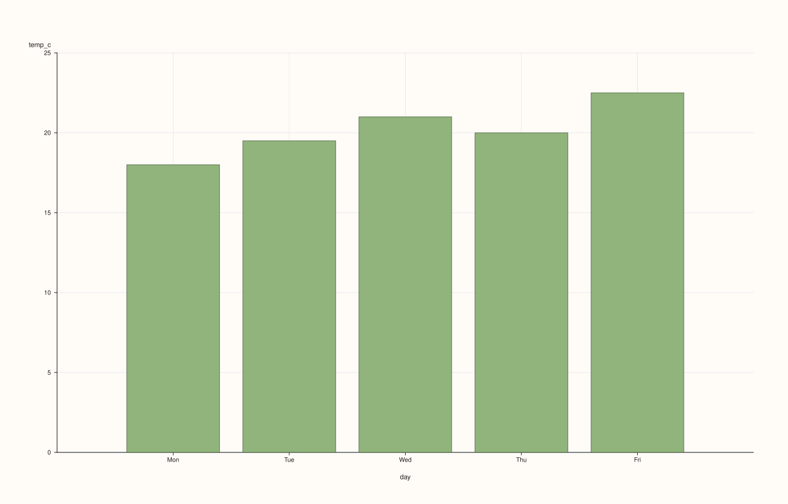
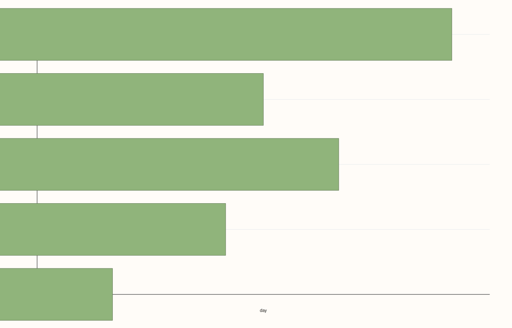
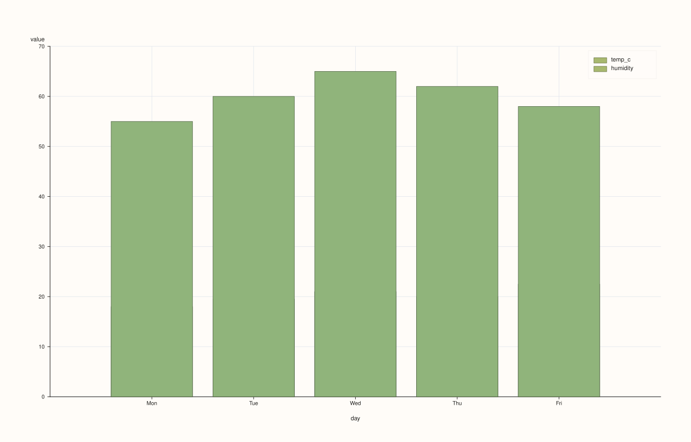

<!-- pluss-hand-authored -->
<!-- pluss-signature-hash: 4b931d657ee5 -->

# CatalogPlotAccessor::bar

[Back to CatalogPlotAccessor API Reference](../../catalog_plot_accessor_api_reference)

## Signatures

```cpp
CatalogPlotAccessor::bar(std::string_view y_key,
                          std::optional<std::string_view> x_key = std::nullopt) const -> pluss::pl::Studio

CatalogPlotAccessor::bar(pluss::msharp::RangeView::Of<std::string_view> y_keys = {},
                          std::optional<std::string_view> x_key = std::nullopt) const -> pluss::pl::Studio

CatalogPlotAccessor::bar(std::initializer_list<std::string_view> y_keys,
                          std::optional<std::string_view> x_key = std::nullopt) const -> pluss::pl::Studio

CatalogPlotAccessor::bar(std::string_view y_key,
                          std::optional<std::string_view> x_key,
                          const BarPlotOptions& options) const -> pluss::pl::Studio

CatalogPlotAccessor::bar(pluss::msharp::RangeView::Of<std::string_view> y_keys,
                          std::optional<std::string_view> x_key,
                          const BarPlotOptions& options) const -> pluss::pl::Studio

CatalogPlotAccessor::bar(std::initializer_list<std::string_view> y_keys,
                          std::optional<std::string_view> x_key,
                          const BarPlotOptions& options) const -> pluss::pl::Studio
```

## What It Does

The same y-keys-over-shared-x-axis shape as [`line()`](line.md), drawn as bars instead of a
connected line or filled area. See `line()` for the full x-axis resolution and multi-key
mechanics; this page covers what's specific to `bar()` — mainly `BarPlotOptions::horizontal`.

```{important} horizontal swaps which values feed which axis, not just the drawing direction
`BarPlotOptions::horizontal = true` doesn't just rotate the same bars 90 degrees — it draws
`flash::barplot(pane, y_values, x_values, ...)` (arguments swapped) instead of
`flash::barplot(pane, x_values, y_values, ...)`, so the resolved x-axis values become the
bars' *lengths* and the resolved y-key's values become the *category positions*. See
Example 2.
```

## Parameters

**y_key** / **y_keys** (`std::string_view` / `RangeView<std::string_view>` /
`std::initializer_list<std::string_view>`, `y_keys` defaults to `{}`)
    Same resolution as [`line()`](line.md).

**x_key** (`std::optional<std::string_view>`, default `std::nullopt`)
    Same three-step resolution as [`line()`](line.md).

**options** (`BarPlotOptions`)
    ```cpp
    struct BarPlotOptions {
      bool ci_enabled{false};
      double ci_level{0.95};
      bool horizontal{false};
      XYAlignOptions align{};
    };
    ```
    `ci_enabled`/`ci_level` are accepted for shape-compatibility with `DataFramePlotAccessor`
    but are not read by `Catalog::plot().bar()` — it always draws plain bars with a fixed
    `alpha = 0.88`/`line_width = 1.0` styling, regardless of these two fields.
    `horizontal = true` swaps which values become the bars' length vs. category axis — see
    the important callout above. `align` controls how a mismatched-length explicit
    `x_key`/y-key pair is reconciled — see
    [`line()`](line.md) for the full explanation.

## Returns

`pluss::pl::Studio`
    A figure with one pane containing one bar trace per requested y-key.

## Examples

Example 1. Explicit x-key, default (vertical) orientation.

```cpp
using namespace pluss::kindle::literals;

auto weather = pluss::kindle::Catalog({
    "day"_k = pluss::kindle::Stream(pluss::make_note({"Mon", "Tue", "Wed", "Thu", "Fri"})),
    "temp_c"_k = pluss::kindle::Stream(pluss::make_series({18.0, 19.5, 21.0, 20.0, 22.5})),
    "humidity"_k = pluss::kindle::Stream(pluss::make_series({55.0, 60.0, 65.0, 62.0, 58.0})),
});

auto chart = weather.plot().bar("temp_c", "day");
chart.show();
```



Example 2. `horizontal = true`: bars run left-to-right, `day` becomes the category axis.

```cpp
using namespace pluss::kindle::literals;

auto weather = pluss::kindle::Catalog({
    "day"_k = pluss::kindle::Stream(pluss::make_note({"Mon", "Tue", "Wed", "Thu", "Fri"})),
    "temp_c"_k = pluss::kindle::Stream(pluss::make_series({18.0, 19.5, 21.0, 20.0, 22.5})),
});

pluss::table::BarPlotOptions bar_options;
bar_options.horizontal = true;

auto chart = weather.plot().bar("temp_c", "day", bar_options);
chart.show();
```



Example 3. Multiple y-keys via a brace-init list.

```cpp
using namespace pluss::kindle::literals;

auto weather = pluss::kindle::Catalog({
    "day"_k = pluss::kindle::Stream(pluss::make_note({"Mon", "Tue", "Wed", "Thu", "Fri"})),
    "temp_c"_k = pluss::kindle::Stream(pluss::make_series({18.0, 19.5, 21.0, 20.0, 22.5})),
    "humidity"_k = pluss::kindle::Stream(pluss::make_series({55.0, 60.0, 65.0, 62.0, 58.0})),
});

auto chart = weather.plot().bar({"temp_c", "humidity"}, "day");
chart.show();
```



Example 4. An unknown key throws.

```cpp
using namespace pluss::kindle::literals;

auto weather = pluss::kindle::Catalog({
    "day"_k = pluss::kindle::Stream(pluss::make_note({"Mon", "Tue", "Wed", "Thu", "Fri"})),
    "temp_c"_k = pluss::kindle::Stream(pluss::make_series({18.0, 19.5, 21.0, 20.0, 22.5})),
});

try {
  auto bad = weather.plot().bar("nonexistent");
} catch (const std::exception& e) {
  std::cout << e.what();
}
```

### Output

```text
Catalog::plot().bar: unknown key 'nonexistent'
```

## Notes

- `ci_enabled`/`ci_level` are unused by this method despite being present on
  `BarPlotOptions` — they exist for shape-compatibility across the plotting option structs.
- `horizontal = true` swaps which values feed which axis, not just the render direction —
  see the important callout above.
- Every other mechanic is shared with [`line()`](line.md) — see that page for the full
  x-axis resolution and multi-key gotchas.

## See Also

- [`CatalogPlotAccessor::line`](line.md): the canonical explanation of this accessor's
  shared mechanics.
- [`CatalogPlotAccessor::hist`](hist.md): bars over binned value ranges instead of one bar
  per record.

<div class="pluss-inline-prev-next">
  <a class="prev-link" href="auto_plot.html">
    <span class="label">Previous</span>
    <span class="title">auto_plot</span>
  </a>
  <a class="next-link" href="corr_heatmap.html">
    <span class="label">Next</span>
    <span class="title">corr_heatmap</span>
  </a>
</div>
