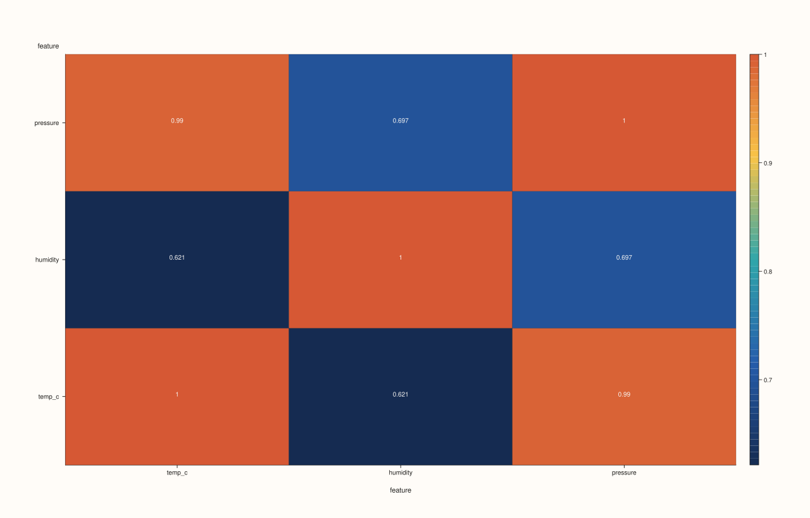
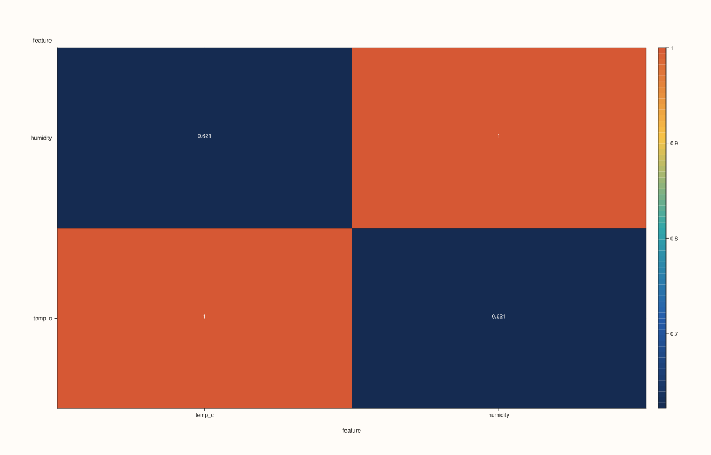
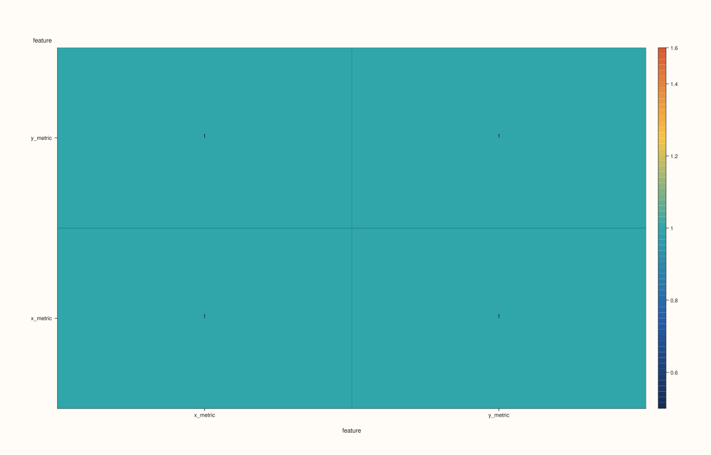

<!-- pluss-hand-authored -->
<!-- pluss-signature-hash: 4b87d8e66845 -->

# CatalogPlotAccessor::corr_heatmap

[Back to CatalogPlotAccessor API Reference](../../catalog_plot_accessor_api_reference)

## Signatures

```cpp
pluss::pl::Studio CatalogPlotAccessor::corr_heatmap(pluss::msharp::RangeView::Of<std::string_view> keys = {}) const

pluss::pl::Studio CatalogPlotAccessor::corr_heatmap(std::initializer_list<std::string_view> keys) const

pluss::pl::Studio CatalogPlotAccessor::corr_heatmap(pluss::msharp::RangeView::Of<std::string_view> keys,
                                                     const CatalogCorrHeatmapPlotOptions& options) const

pluss::pl::Studio CatalogPlotAccessor::corr_heatmap(std::initializer_list<std::string_view> keys,
                                                     const CatalogCorrHeatmapPlotOptions& options) const
```

## What It Does

Builds an N×N correlation matrix over the selected keys and renders it as a color-coded
heatmap — cell `(row, col)` is the correlation between `keys[row]` and `keys[col]` (always
`1.0` on the diagonal), using the shared pairwise-alignment machinery
[`scatter()`](scatter.md)'s numeric-pair branch and
[`scatter_matrix()`](scatter_matrix.md) both use.

```{important} GlobalInner picks one alignment for the whole matrix, not per pair
With the default `PairAlign::PairwiseInner`, each off-diagonal cell aligns its own pair of
keys independently — two different cells can end up keeping different rows. With
`PairAlign::GlobalInner`, one shared alignment context (`catalog_build_global_pair_context`)
is computed **once** up front from every selected key, and every cell reuses it — so every
cell's correlation is computed over the exact same subset of rows. See Example 3.
```

## Parameters

**keys** (`RangeView<std::string_view>` or `std::initializer_list<std::string_view>`,
defaults to `{}`)
    Same resolution as [`line()`](line.md): an empty range selects every
    plottable key. At least **two** resolved keys are required —
    `"Catalog::plot().corr_heatmap: need at least two plottable streams"` if fewer. See
    Example 4.

**options** (`CatalogCorrHeatmapPlotOptions`)

### `CatalogPairAlignOptions` fields

| Field | Type | Default |
|---|---|---|
| `align` | `PairAlign` | `PairAlign::PairwiseInner` |
| `align_by` | `PairAlignBy` | `PairAlignBy::Auto` |

### `CorrHeatmapPlotOptions` fields

| Field | Type | Default |
|---|---|---|
| `annotate_levels` | `bool` | `true` |
| `scale_guide` | `bool` | `true` |
| `borderless` | `bool` | `false` |

### `CatalogCorrHeatmapPlotOptions` fields

| Field | Type | Default |
|---|---|---|
| `align` | `CatalogPairAlignOptions` | default constructed |
| `heatmap` | `pluss::table::CorrHeatmapPlotOptions` | empty |
| `method` | `pluss::table::DataFrame::CorrMethod` | `pluss::table::DataFrame::CorrMethod::Pearson` |

`align`/`align_by` control cross-key alignment (see the important callout above).
`heatmap.annotate_levels`/`scale_guide`/`borderless` forward straight into the underlying
`flash::heatmap` cell. `method` selects `Pearson` (default), `Spearman`, or `KendallTau`
correlation.

## Returns

`pluss::pl::Studio`
    A figure with one pane holding a single heatmap trace, tick-labeled with the selected
    key names on both axes.

## Examples

Example 1. Default: every plottable key, default `PairwiseInner` alignment, Pearson
correlation.

```cpp
using namespace pluss::kindle::literals;

auto weather = pluss::kindle::Catalog({
    "temp_c"_k = pluss::kindle::Stream(pluss::make_series({18.0, 19.5, 21.0, 20.0, 22.5, 17.5})),
    "humidity"_k = pluss::kindle::Stream(pluss::make_series({55.0, 60.0, 65.0, 62.0, 58.0, 53.0})),
    "pressure"_k = pluss::kindle::Stream(pluss::make_series({1005.0, 1008.0, 1010.0, 1009.0, 1012.0, 1004.0})),
});

auto chart = weather.plot().corr_heatmap();
chart.show();
```



Example 2. An explicit key subset via a brace-init list.

```cpp
using namespace pluss::kindle::literals;

auto weather = pluss::kindle::Catalog({
    "temp_c"_k = pluss::kindle::Stream(pluss::make_series({18.0, 19.5, 21.0, 20.0, 22.5, 17.5})),
    "humidity"_k = pluss::kindle::Stream(pluss::make_series({55.0, 60.0, 65.0, 62.0, 58.0, 53.0})),
    "pressure"_k = pluss::kindle::Stream(pluss::make_series({1005.0, 1008.0, 1010.0, 1009.0, 1012.0, 1004.0})),
});

auto chart = weather.plot().corr_heatmap({"temp_c", "humidity"});
chart.show();
```



Example 3. `GlobalInner` alignment with `align_by = Label`, and `method = Spearman`, over
two differently-labeled streams.

```cpp
using namespace pluss::kindle::literals;

auto x_stream = pluss::kindle::Stream(pluss::make_series({10.0, 20.0, 30.0, 40.0, 50.0, 60.0}))
    .with_label(pluss::table::Slate(pluss::make_note({"a", "b", "c", "d", "e", "f"})));
auto y_stream = pluss::kindle::Stream(pluss::make_series({1.0, 2.0, 3.0, 4.0, 5.0}))
    .with_label(pluss::table::Slate(pluss::make_note({"b", "c", "d", "e", "f"})));
auto paired = pluss::kindle::Catalog({"x_metric"_k = x_stream, "y_metric"_k = y_stream});

pluss::kindle::CatalogCorrHeatmapPlotOptions options;
options.align.align = pluss::kindle::PairAlign::GlobalInner;
options.align.align_by = pluss::kindle::PairAlignBy::Label;
options.method = pluss::table::DataFrame::CorrMethod::Spearman;

auto chart = paired.plot().corr_heatmap({"x_metric", "y_metric"}, options);
chart.show();
```

Only the 5 labels present in both streams (`"b"`..`"f"`) are used to compute the
correlation — `x_metric`'s `"a"` row is dropped.



Example 4. Fewer than two resolved keys throws.

```cpp
using namespace pluss::kindle::literals;

auto weather = pluss::kindle::Catalog({
    "temp_c"_k = pluss::kindle::Stream(pluss::make_series({18.0, 19.5, 21.0})),
});

try {
  auto bad = weather.plot().corr_heatmap({"temp_c"});
} catch (const std::exception& e) {
  std::cout << e.what();
}
```

### Output

```text
Catalog::plot().corr_heatmap: need at least two plottable streams
```

## Notes

- An empty `keys` selects every plottable key, the same rule [`line()`](line.md) uses.
- At least two resolved keys are required — see Example 4.
- A pair with fewer than 2 aligned points after alignment/dropping non-finite values renders
  as `NaN` in that cell rather than throwing.
- `GlobalInner` computes one shared alignment context up front and reuses it for every
  cell; `PairwiseInner` (the default) aligns each cell's pair independently — see the
  important callout above.
- Returns a `pluss::pl::Studio` — see [`line()`](line.md)'s important callout for how to
  view or save the result.

## See Also

- [`CatalogPlotAccessor::scatter_matrix`](scatter_matrix.md): the same alignment machinery,
  rendered as pairwise scatter panels instead of a single correlation matrix.
- [`CatalogPlotAccessor::scatter`](scatter.md): the two-key version of the numeric-pair
  alignment this method generalizes to N keys.

<div class="pluss-inline-prev-next">
  <a class="prev-link" href="bar.html">
    <span class="label">Previous</span>
    <span class="title">bar</span>
  </a>
  <a class="next-link" href="density.html">
    <span class="label">Next</span>
    <span class="title">density</span>
  </a>
</div>
