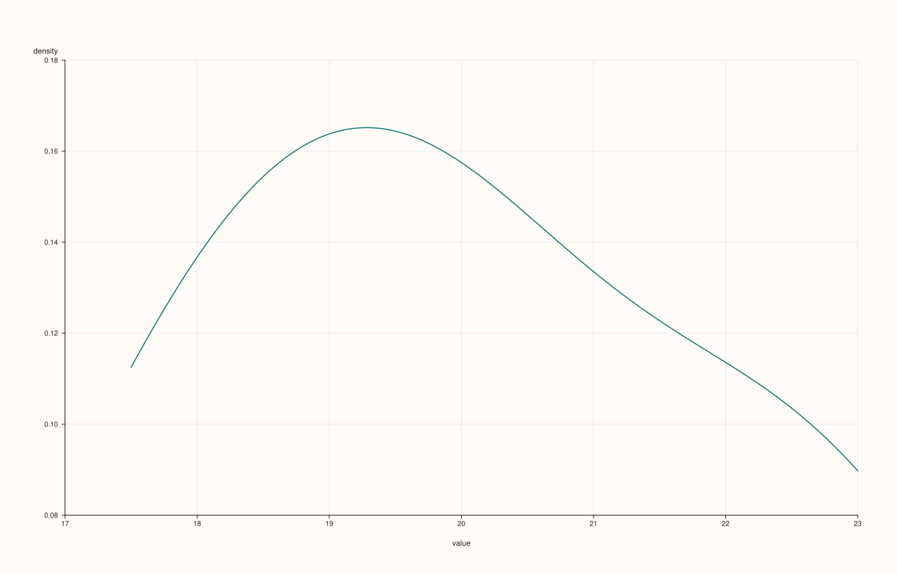
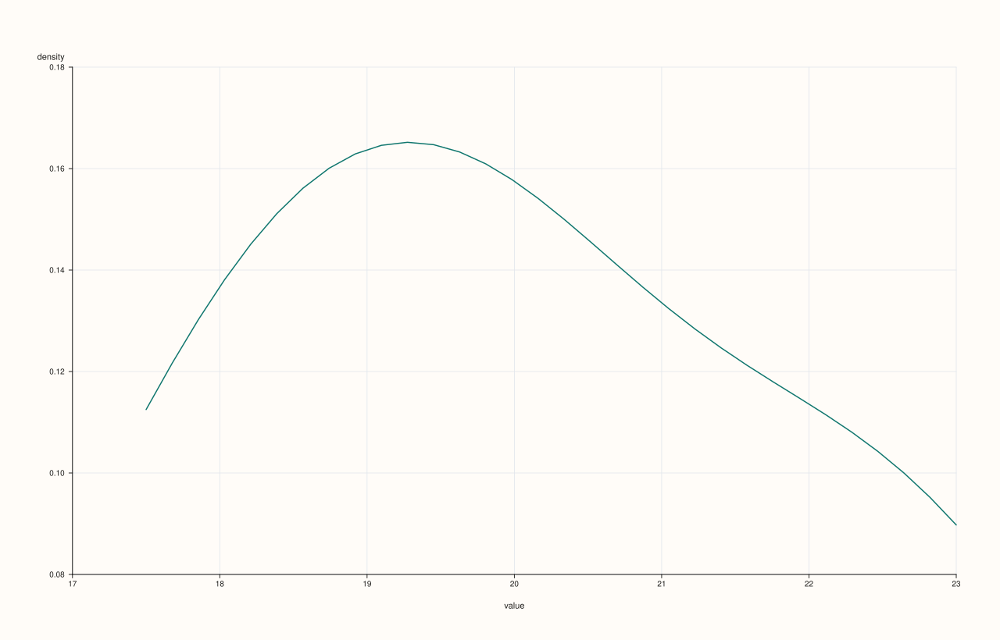
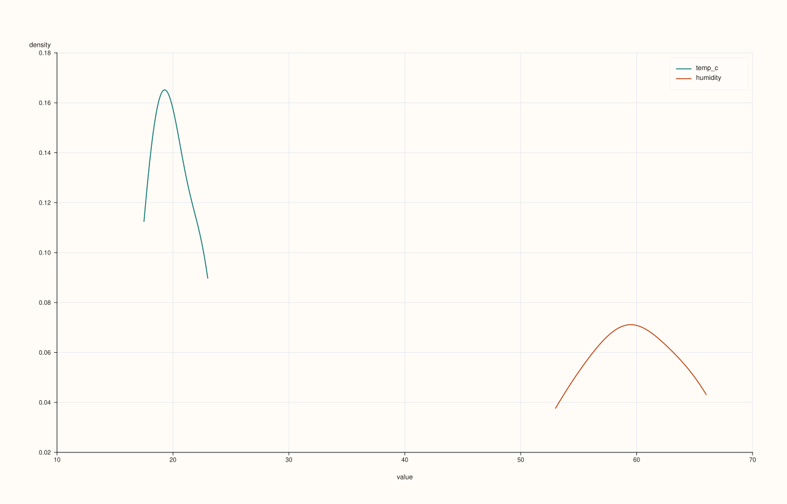
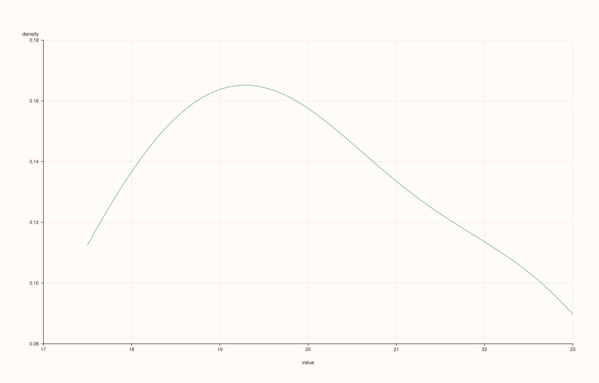

<!-- pluss-hand-authored -->
<!-- pluss-signature-hash: 19729b57d3e6 -->

# CatalogPlotAccessor::density

[Back to CatalogPlotAccessor API Reference](../../catalog_plot_accessor_api_reference)

## Signatures

```cpp
CatalogPlotAccessor::density(std::string_view key, std::int64_t points = 128) const -> pluss::pl::Studio

CatalogPlotAccessor::density(pluss::msharp::RangeView::Of<std::string_view> keys = {},
                              std::int64_t points = 128) const -> pluss::pl::Studio

CatalogPlotAccessor::density(std::initializer_list<std::string_view> keys,
                              std::int64_t points = 128) const -> pluss::pl::Studio

CatalogPlotAccessor::density(std::string_view key, const DensityPlotOptions& options) const -> pluss::pl::Studio

CatalogPlotAccessor::density(pluss::msharp::RangeView::Of<std::string_view> keys,
                              const DensityPlotOptions& options) const -> pluss::pl::Studio

CatalogPlotAccessor::density(std::initializer_list<std::string_view> keys,
                              const DensityPlotOptions& options) const -> pluss::pl::Studio
```

## What It Does

The same per-key distribution idea as [`hist()`](hist.md), drawn as a smoothed kernel
density curve (`flash::kdeplot`) instead of binned counts — one curve per requested key,
overlaid on a shared `"value"`/`"density"` axis pair.

## Parameters

**key** / **keys** (`std::string_view` / `RangeView<std::string_view>` /
`std::initializer_list<std::string_view>`, `keys` defaults to `{}`)
    Same resolution as [`hist()`](hist.md): an empty `keys` selects every
    plottable key; an explicitly named unknown key throws
    `"Catalog::plot().density: unknown key '<name>'"`, the same way `hist()`'s Example 5
    does.

**points** (`std::int64_t`, default `128`)
    The number of points the density curve is evaluated at, forwarded into a
    `DensityPlotOptions{.points = points}`. Internally clamped to a minimum of `16`
    regardless of what's passed.

**options** (`DensityPlotOptions`)

### `DensityPlotOptions` fields

| Field | Type | Default |
|---|---|---|
| `points` | `std::int64_t` | `128` |
| `alpha` | `double` | `1.0` |
| `line_width` | `double` | `1.5` |

## Returns

`pluss::pl::Studio`
    A figure with one pane containing one density curve per requested key.

## Examples

Example 1. A single key, default point count (`128`).

```cpp
using namespace pluss::kindle::literals;

auto weather = pluss::kindle::Catalog({
    "temp_c"_k = pluss::kindle::Stream(pluss::make_series({18.0, 19.5, 21.0, 20.0, 22.5, 17.5, 23.0, 19.0})),
    "humidity"_k = pluss::kindle::Stream(pluss::make_series({55.0, 60.0, 65.0, 62.0, 58.0, 53.0, 66.0, 59.0})),
});

auto chart = weather.plot().density("temp_c");
chart.show();
```



Example 2. An explicit, coarser point count.

```cpp
using namespace pluss::kindle::literals;

auto weather = pluss::kindle::Catalog({
    "temp_c"_k = pluss::kindle::Stream(pluss::make_series({18.0, 19.5, 21.0, 20.0, 22.5, 17.5, 23.0, 19.0})),
});

auto chart = weather.plot().density("temp_c", 32);
chart.show();
```



Example 3. Multiple keys via a brace-init list, both curves on the same pane.

```cpp
using namespace pluss::kindle::literals;

auto weather = pluss::kindle::Catalog({
    "temp_c"_k = pluss::kindle::Stream(pluss::make_series({18.0, 19.5, 21.0, 20.0, 22.5, 17.5, 23.0, 19.0})),
    "humidity"_k = pluss::kindle::Stream(pluss::make_series({55.0, 60.0, 65.0, 62.0, 58.0, 53.0, 66.0, 59.0})),
});

auto chart = weather.plot().density({"temp_c", "humidity"});
chart.show();
```



Example 4. An explicit `DensityPlotOptions`, tuning point count and opacity.

```cpp
using namespace pluss::kindle::literals;

auto weather = pluss::kindle::Catalog({
    "temp_c"_k = pluss::kindle::Stream(pluss::make_series({18.0, 19.5, 21.0, 20.0, 22.5, 17.5, 23.0, 19.0})),
});

pluss::table::DensityPlotOptions density_options;
density_options.points = 64;
density_options.alpha = 0.5;

auto chart = weather.plot().density("temp_c", density_options);
chart.show();
```



## Notes

- An empty `keys` selects every plottable key; an explicitly named unknown key throws — see
  [`hist()`](hist.md)'s identical rule and edge-case example.
- `points` is clamped to a minimum of `16` internally, regardless of the value passed.
- Every requested key's density curve is drawn on the same pane, sharing one
  `"value"`/`"density"` axis pair.
- Returns a `pluss::pl::Studio` — see [`line()`](line.md)'s important callout for how to
  view or save the result.

## See Also

- [`CatalogPlotAccessor::hist`](hist.md): the same per-key distribution idea, as binned
  counts instead of a smoothed curve.
- [`CatalogPlotAccessor::line`](line.md): the canonical explanation of this accessor's
  shared mechanics.

<div class="pluss-inline-prev-next">
  <a class="prev-link" href="corr_heatmap.html">
    <span class="label">Previous</span>
    <span class="title">corr_heatmap</span>
  </a>
  <a class="next-link" href="hist.html">
    <span class="label">Next</span>
    <span class="title">hist</span>
  </a>
</div>
