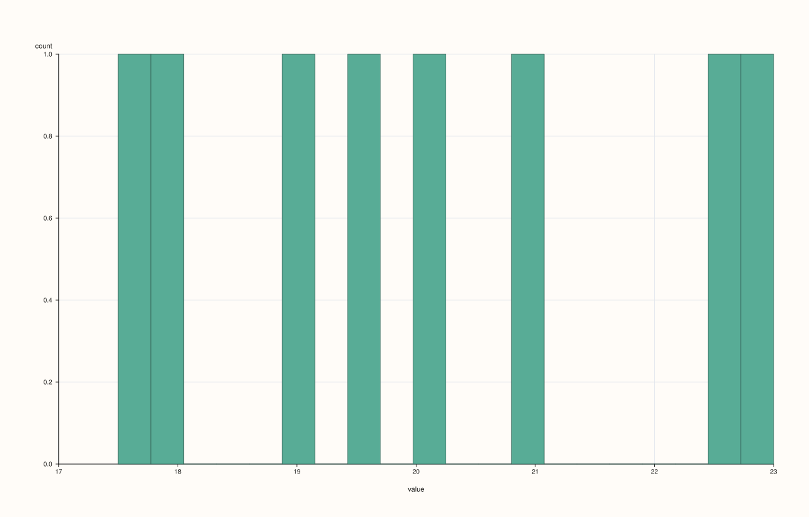
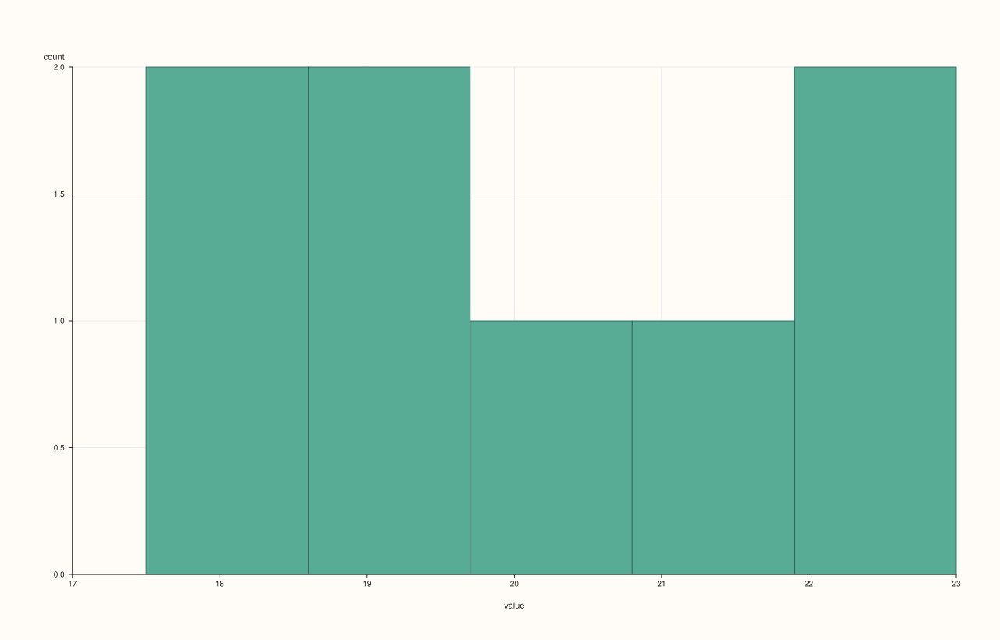
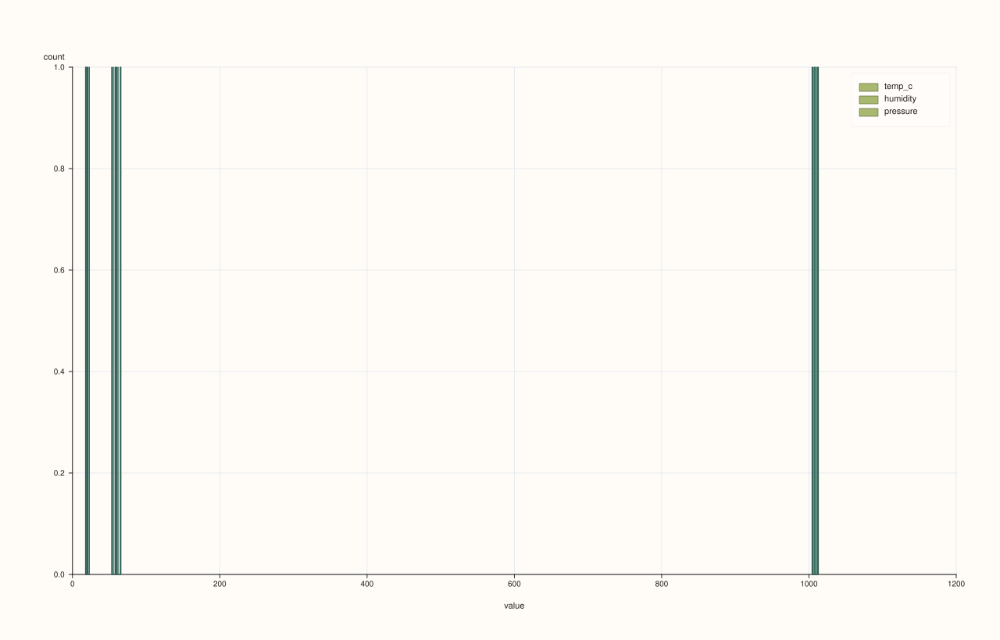
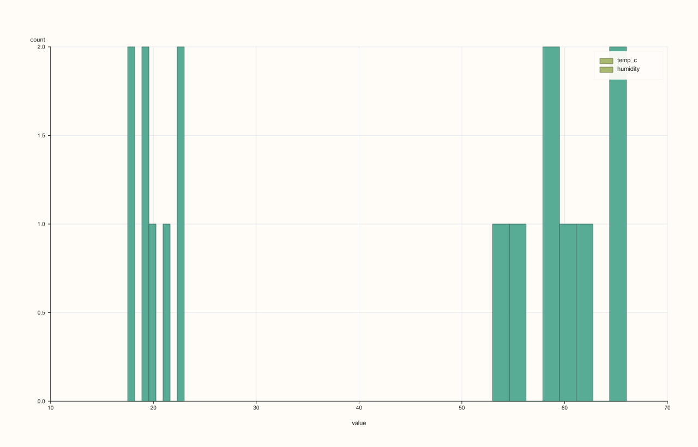

<!-- pluss-hand-authored -->
<!-- pluss-signature-hash: 6760225de816 -->

# CatalogPlotAccessor::hist

[Back to CatalogPlotAccessor API Reference](../../catalog_plot_accessor_api_reference)

## Signatures

```cpp
CatalogPlotAccessor::hist(std::string_view key, std::int64_t bins = 20) const -> pluss::pl::Studio

CatalogPlotAccessor::hist(pluss::msharp::RangeView::Of<std::string_view> keys = {},
                           std::int64_t bins = 20) const -> pluss::pl::Studio

CatalogPlotAccessor::hist(std::initializer_list<std::string_view> keys,
                           std::int64_t bins = 20) const -> pluss::pl::Studio

CatalogPlotAccessor::hist(std::string_view key, const HistPlotOptions& options) const -> pluss::pl::Studio

CatalogPlotAccessor::hist(pluss::msharp::RangeView::Of<std::string_view> keys,
                           const HistPlotOptions& options) const -> pluss::pl::Studio

CatalogPlotAccessor::hist(std::initializer_list<std::string_view> keys,
                           const HistPlotOptions& options) const -> pluss::pl::Studio
```

## What It Does

Draws one binned-count histogram trace per requested key, all overlaid on one pane (each
key's own value distribution). Unlike `line()`/`step()`/`area()`/`bar()`, there is no x-axis
resolution at all here — every histogram shares the same x-axis meaning ("value") and
y-axis meaning ("count"), regardless of key count.

## Parameters

**key** / **keys** (`std::string_view` / `RangeView<std::string_view>` /
`std::initializer_list<std::string_view>`, `keys` defaults to `{}`)
    Same resolution as [`line()`](line.md): an empty `keys` selects every
    plottable (Series/Timeline/TimeIndex) key in the catalog; an explicitly named unknown
    key throws `"Catalog::plot().hist: unknown key '<name>'"`.

**bins** (`std::int64_t`, default `20`)
    Bin count, forwarded straight into a `HistPlotOptions{.bins = bins}`. Unlike
    `DataFrame::plot().hist()`, there is no ambiguity between "explicit 20" and "the
    accessor's own default" here — `Catalog::plot().hist()` never reads
    `options().default_bins` at all; `20` is simply this parameter's own default value.

**options** (`HistPlotOptions`)

### `HistPlotOptions` fields

| Field | Type | Default |
|---|---|---|
| `bins` | `std::int64_t` | `20` |
| `alpha` | `double` | `0.95` |
| `line_width` | `double` | `1.0` |

## Returns

`pluss::pl::Studio`
    A figure with one pane containing one histogram trace per requested key.

## Examples

Example 1. A single key, default bin count (`20`).

```cpp
using namespace pluss::kindle::literals;

auto weather = pluss::kindle::Catalog({
    "temp_c"_k = pluss::kindle::Stream(pluss::make_series({18.0, 19.5, 21.0, 20.0, 22.5, 17.5, 23.0, 19.0})),
    "humidity"_k = pluss::kindle::Stream(pluss::make_series({55.0, 60.0, 65.0, 62.0, 58.0, 53.0, 66.0, 59.0})),
    "pressure"_k = pluss::kindle::Stream(pluss::make_series({1005.0, 1008.0, 1010.0, 1009.0, 1012.0, 1004.0, 1013.0, 1007.0})),
});

auto chart = weather.plot().hist("temp_c");
chart.show();
```



Example 2. An explicit, smaller bin count.

```cpp
using namespace pluss::kindle::literals;

auto weather = pluss::kindle::Catalog({
    "temp_c"_k = pluss::kindle::Stream(pluss::make_series({18.0, 19.5, 21.0, 20.0, 22.5, 17.5, 23.0, 19.0})),
});

auto chart = weather.plot().hist("temp_c", 5);
chart.show();
```



Example 3. Multiple keys via a brace-init list, default bin count, all overlaid on the same
pane.

```cpp
using namespace pluss::kindle::literals;

auto weather = pluss::kindle::Catalog({
    "temp_c"_k = pluss::kindle::Stream(pluss::make_series({18.0, 19.5, 21.0, 20.0, 22.5, 17.5, 23.0, 19.0})),
    "humidity"_k = pluss::kindle::Stream(pluss::make_series({55.0, 60.0, 65.0, 62.0, 58.0, 53.0, 66.0, 59.0})),
    "pressure"_k = pluss::kindle::Stream(pluss::make_series({1005.0, 1008.0, 1010.0, 1009.0, 1012.0, 1004.0, 1013.0, 1007.0})),
});

auto chart = weather.plot().hist({"temp_c", "humidity", "pressure"});
chart.show();
```



Example 4. An explicit `HistPlotOptions`, tuning bin count, opacity, and stroke width, on a
`RangeView`-supplied key list.

```cpp
using namespace pluss::kindle::literals;

auto weather = pluss::kindle::Catalog({
    "temp_c"_k = pluss::kindle::Stream(pluss::make_series({18.0, 19.5, 21.0, 20.0, 22.5, 17.5, 23.0, 19.0})),
    "humidity"_k = pluss::kindle::Stream(pluss::make_series({55.0, 60.0, 65.0, 62.0, 58.0, 53.0, 66.0, 59.0})),
});

std::vector<std::string_view> keys{"temp_c", "humidity"};
pluss::table::HistPlotOptions hist_options;
hist_options.bins = 8;
hist_options.alpha = 0.7;
hist_options.line_width = 1.5;

auto chart = weather.plot().hist(pluss::msharp::RangeView::Of<std::string_view>(keys), hist_options);
chart.show();
```



Example 5. An unknown key throws.

```cpp
using namespace pluss::kindle::literals;

auto weather = pluss::kindle::Catalog({
    "temp_c"_k = pluss::kindle::Stream(pluss::make_series({18.0, 19.5, 21.0, 20.0, 22.5})),
});

try {
  auto bad = weather.plot().hist("nope");
} catch (const std::exception& e) {
  std::cout << e.what();
}
```

### Output

```text
Catalog::plot().hist: unknown key 'nope'
```

## Notes

- An empty `keys` selects every plottable key in the catalog, the same rule
  [`line()`](line.md) uses — an explicitly named unknown key throws instead.
- `bins` has no accessor-level default the way `DataFrame::plot().hist()`'s does — `20` here
  is just this parameter's own default value, not read from `options().default_bins`.
- Every requested key's histogram is drawn on the same pane, sharing one `"value"`/`"count"`
  axis pair — there's no per-key axis story the way `line()`/`step()`/`area()`/`bar()` have.
- Returns a `pluss::pl::Studio` — see [`line()`](line.md)'s important callout for how to
  view or save the result.

## See Also

- [`CatalogPlotAccessor::density`](density.md): the same per-key distribution idea, as a
  smoothed density curve instead of binned counts.
- [`CatalogPlotAccessor::line`](line.md): the canonical explanation of this accessor's
  shared mechanics.

<div class="pluss-inline-prev-next">
  <a class="prev-link" href="density.html">
    <span class="label">Previous</span>
    <span class="title">density</span>
  </a>
  <a class="next-link" href="line.html">
    <span class="label">Next</span>
    <span class="title">line</span>
  </a>
</div>
