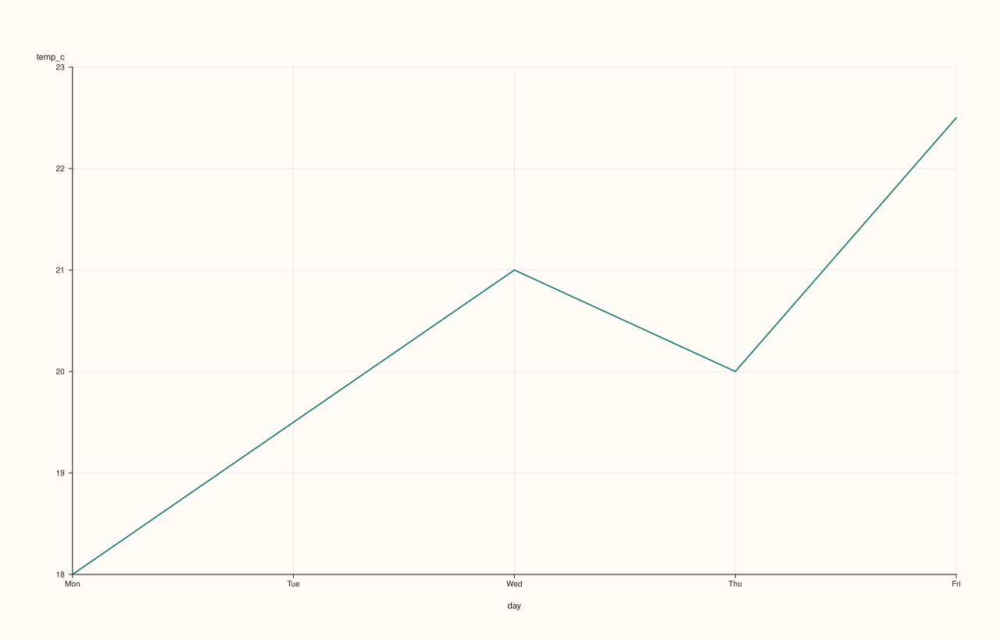
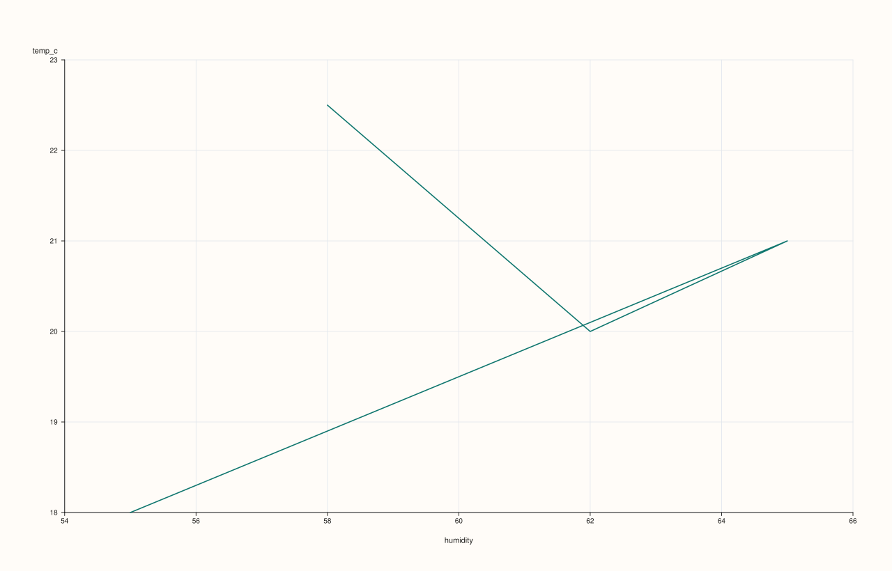
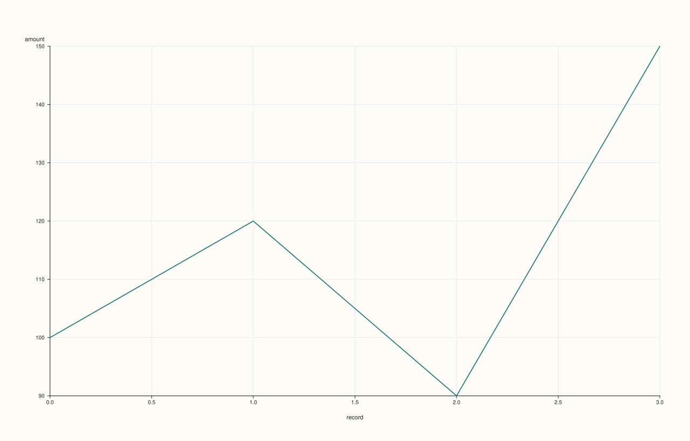
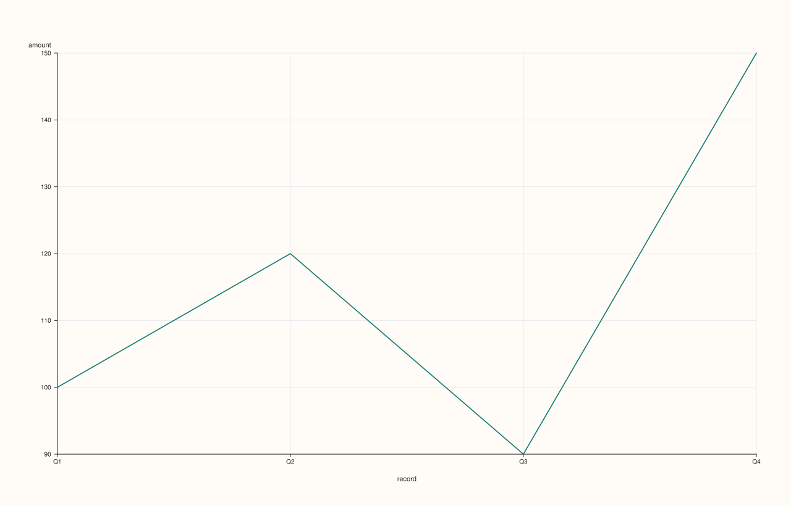
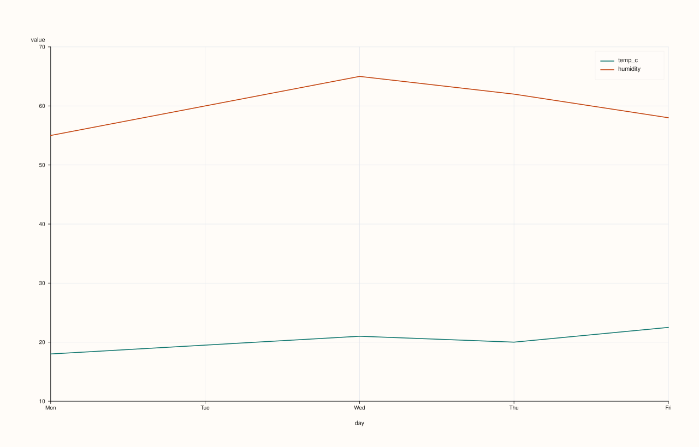
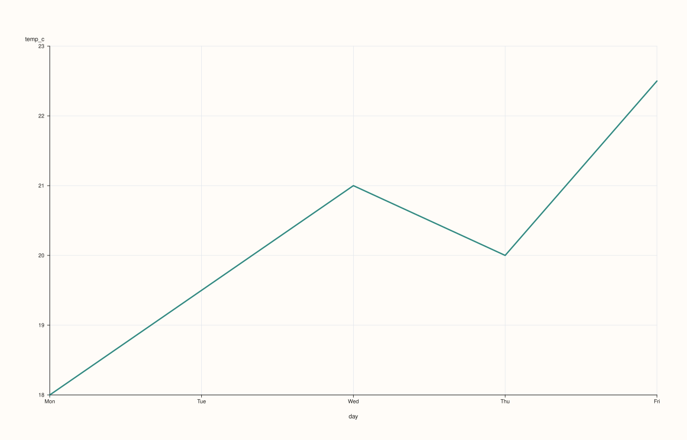
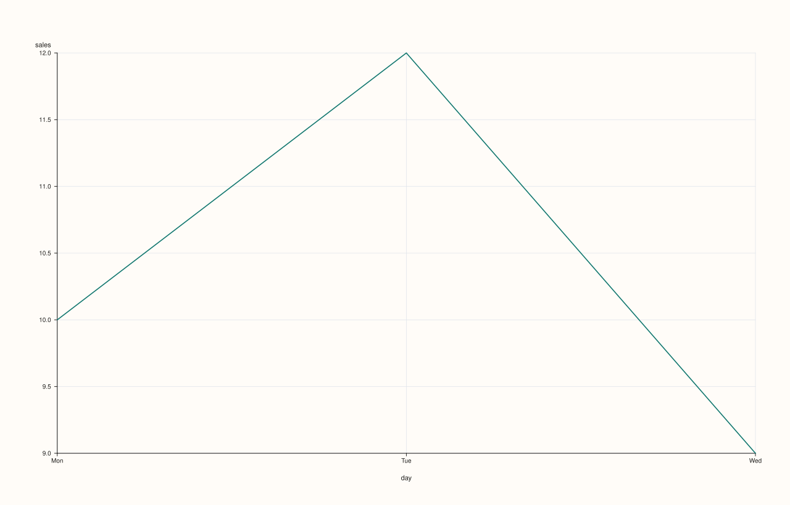
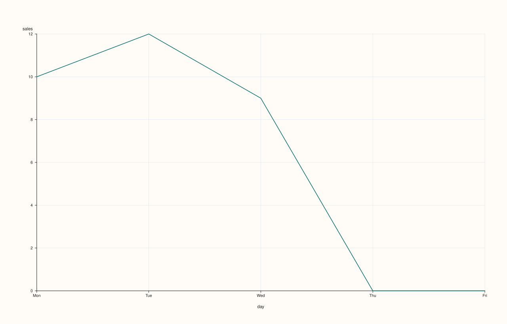

<!-- pluss-hand-authored -->
<!-- pluss-signature-hash: 0eebf24e097e -->

# CatalogPlotAccessor::line

[Back to CatalogPlotAccessor API Reference](../../catalog_plot_accessor_api_reference)

## Signatures

```cpp
CatalogPlotAccessor::line(std::string_view y_key,
                           std::optional<std::string_view> x_key = std::nullopt) const -> pluss::pl::Studio

CatalogPlotAccessor::line(pluss::msharp::RangeView::Of<std::string_view> y_keys = {},
                           std::optional<std::string_view> x_key = std::nullopt) const -> pluss::pl::Studio

CatalogPlotAccessor::line(std::initializer_list<std::string_view> y_keys,
                           std::optional<std::string_view> x_key = std::nullopt) const -> pluss::pl::Studio

CatalogPlotAccessor::line(std::string_view y_key,
                           std::optional<std::string_view> x_key,
                           const LinePlotOptions& options) const -> pluss::pl::Studio

CatalogPlotAccessor::line(pluss::msharp::RangeView::Of<std::string_view> y_keys,
                           std::optional<std::string_view> x_key,
                           const LinePlotOptions& options) const -> pluss::pl::Studio

CatalogPlotAccessor::line(std::initializer_list<std::string_view> y_keys,
                           std::optional<std::string_view> x_key,
                           const LinePlotOptions& options) const -> pluss::pl::Studio
```

## What It Does

Draws one line trace per requested y-key over a shared x-axis, returning a
`pluss::pl::Studio` figure. This page also explains mechanics shared by every method on
this accessor — `step()`, `area()`, `scatter()`, `bar()`, and the rest all follow the same
"nothing is drawn until you export it" and x-axis-resolution rules described here, so their
own pages link back to this one instead of repeating it. The three `initializer_list`
overloads are thin convenience wrappers that forward straight into the matching
`RangeView`-taking overload — same behavior, just a brace-init call site.

```{important} Every plot method returns a Studio, not a Catalog — and nothing prints
`line()` (like every method on this accessor) builds and returns a `pluss::pl::Studio` — a
figure object from the separate `PlussPl` plotting library. It does **not** print a table,
and `Studio` has no `operator<<`, so `std::cout << chart` will not compile. To actually see
or persist the result, call one of `Studio`'s own methods afterward:

- `chart.show()` — opens the figure in a native window or the OS default browser/viewer.
- `chart.save_svg("out.svg")`, `chart.save_pdf("out.pdf")`, `chart.save_png("out.png", dpi)`
  — write the figure to a file (`save_png` shells out to an external SVG-to-raster
  converter such as `rsvg-convert`, `inkscape`, or ImageMagick, and throws if none is found).
- `chart.to_svg()` / `chart.to_pdf()` — return the rendered markup as a `std::string`, for
  embedding elsewhere instead of writing a file.

Every example on this page ends with one of these calls to make that visible; none of them
show a rendered "Output" block the way `Catalog`/`Stream` method pages do, because there is
no text form of a chart to display.
```

### Choosing the x-axis: three ways to end up with an x-key

Every 2D chart method that takes an `x_key` argument resolves it the same way:

1. **Pass it explicitly** — `ct.plot().line("sales", "month")` always wins, regardless of
   any accessor-level default.
2. **Set a shared default on the accessor** — `ct.plot(options)` where
   `options.default_x_feature = "month"` lets every subsequent chart method omit `x_key`
   and still use `"month"`. An explicit `x_key` argument on a given call still takes
   precedence over this default. (`DataFramePlotOptions` is reused as-is for
   `Catalog::plot()` — there is no separate `CatalogPlotOptions` type, so the field is still
   named `default_x_feature` even though the value being resolved is a key.)
3. **Omit it entirely, with no default set** — falls back to the y-key's **own stream
   label** (`Stream::label()`, attached via `Stream::with_label()`), if it has one: the
   x-axis becomes that label's values, rendered as evenly spaced categorical positions if
   text/time-like or as real numeric coordinates if the label is itself numeric — but the
   axis title is always the literal string `"record"`, never the y-key's own label feature
   name. If the y-stream carries **no** label at all, the axis falls back further, to a bare
   `0..n-1` positional index, also titled `"record"`.

See Examples 1, 3, and 4 below for the explicit, no-label, and own-label paths in turn, and
Example 2 for the accessor-level default.

```{important} With several y-keys and no x_key, each trace still gets its own independent axis
When `y_keys` has more than one key and no `x_key` is resolved (no explicit argument, no
`options.default_x_feature`), the pane's x-axis is titled `"record"` but there is no single
shared x-axis object underneath it — **each** y-key's trace is positioned using *that key's
own* self-axis resolution (see "Choosing the x-axis" above — its own label if it has one,
otherwise its own `0..n-1` index), independently of every other
requested key. Two keys of different lengths, or with unrelated labels, will not line up
against each other on such a chart even though they share one pane — pass an explicit
`x_key` (or set `default_x_feature`) whenever the keys must be visually aligned.
```

## Parameters

**y_key** (`std::string_view`)
    A single Series/Timeline/TimeIndex key to draw as one line trace.

**y_keys** (`RangeView<std::string_view>` or `std::initializer_list<std::string_view>`,
defaults to `{}`)
    Several keys, each drawn as its own line trace on the same axes. A legend is shown
    automatically whenever more than one y-key is requested (and suppressed for a single
    key). An **empty** range (the default) selects every Series/Timeline/TimeIndex key in
    the catalog, in catalog order — Note keys are silently excluded from this default
    selection, not an error. If the catalog has no plottable keys at all, this throws
    `"Catalog::plot().line: no plottable streams found"`.

**x_key** (`std::optional<std::string_view>`, default `std::nullopt`)
    The key to use as the shared x-axis. See "Choosing the x-axis" above.

**options** (`LinePlotOptions`)

### `XYAlignMode` values

| Value | Numeric value | Description |
|---|---|---|
| `Strict` | — | — |
| `Inner` | — | — |
| `PadScalar` | — | — |

### `XYAlignBy` values

| Value | Numeric value | Description |
|---|---|---|
| `Auto` | — | — |
| `Label` | — | — |
| `Pos` | — | — |

### `XYAlignOptions` fields

| Field | Type | Default |
|---|---|---|
| `mode` | `XYAlignMode` | `XYAlignMode::Strict` |
| `align_by` | `XYAlignBy` | `XYAlignBy::Auto` |
| `pad_scalar` | `double` | `0.0` |

### `LinePlotOptions` fields

| Field | Type | Default |
|---|---|---|
| `alpha` | `double` | `1.0` |
| `line_width` | `double` | `1.6` |
| `y_limit_method` | `std::optional<pluss::pl::LimitMethod>` | `pluss::pl::LimitMethod::Padded` |
| `align` | `XYAlignOptions` | default constructed |

`alpha` controls trace opacity, `line_width` the stroke width. `y_limit_method` chooses
how the y-axis auto-fits to the data: `Padded` (the default) adds a small margin beyond
the data's min/max, `Tight` fits exactly to the data range with no margin, and
`TickAligned` snaps the limits outward to the nearest tick boundaries. `align` controls
how an explicit `x_key` of a different length than a y-key is reconciled — see "Aligning
x and y of different lengths" below.

### Aligning x and y of different lengths

`align` only matters when an explicit `x_key` is passed **and** that key's resolved length
differs from a given y-key's — with no `x_key` (the self-axis/record fallback) or with
matching lengths, `align`'s fields are never consulted at all. Three `XYAlignMode` values:

- **`Strict`** (the default): the mismatched pair throws
  `"Catalog::plot().line: x/y length mismatch between '<x_key>' and '<y_key>'"` — see
  Example 9.
- **`Inner`**: silently truncates both the x-axis and the y-values down to the shorter of
  the two, keeping only the leading overlap.
- **`PadScalar`**: keeps the x-axis at its **full** length, padding the shorter y-values out
  with `pad_scalar` (default `0.0`) for the positions that don't have a real value.

`align_by` (`Auto`/`Label`/`Pos`) chooses whether the reconciliation is positional or by each
stream's own attached label — same three-way choice as
[`CatalogScatterPlotOptions::align`](scatter.md)'s `align_by`, just spelled
`XYAlignBy` here instead of `PairAlignBy`. `Auto` (the default) uses `Label` only if **both**
the x-key's stream and the given y-key's stream carry their own label; otherwise `Pos`.

See Example 8 for `Inner` and `PadScalar` side by side.

## Returns

`pluss::pl::Studio`
    A figure with one pane containing one line trace per requested y-key.

## Examples

Example 1. Explicit x-key: the most common and clearest form.

```cpp
using namespace pluss::kindle::literals;

auto weather = pluss::kindle::Catalog({
    "day"_k = pluss::kindle::Stream(pluss::make_note({"Mon", "Tue", "Wed", "Thu", "Fri"})),
    "temp_c"_k = pluss::kindle::Stream(pluss::make_series({18.0, 19.5, 21.0, 20.0, 22.5})),
    "humidity"_k = pluss::kindle::Stream(pluss::make_series({55.0, 60.0, 65.0, 62.0, 58.0})),
    "pressure"_k = pluss::kindle::Stream(pluss::make_series({1005.0, 1008.0, 1010.0, 1009.0, 1012.0})),
});

auto chart = weather.plot().line("temp_c", "day");
chart.show();
```

`weather.plot()` enters the accessor with no shared options; `.line("temp_c", "day")` draws
`temp_c` on the y-axis against the Note key `day` on the x-axis (rendered as five evenly
spaced categorical positions labeled `"Mon"`..`"Fri"`), producing a single unlabeled
(no-legend) line trace.



Example 2. A shared `default_x_feature` set once on the accessor, used implicitly by
multiple chart calls, with an explicit `x_key` on a later call overriding it.

```cpp
using namespace pluss::kindle::literals;

auto weather = pluss::kindle::Catalog({
    "day"_k = pluss::kindle::Stream(pluss::make_note({"Mon", "Tue", "Wed", "Thu", "Fri"})),
    "temp_c"_k = pluss::kindle::Stream(pluss::make_series({18.0, 19.5, 21.0, 20.0, 22.5})),
    "humidity"_k = pluss::kindle::Stream(pluss::make_series({55.0, 60.0, 65.0, 62.0, 58.0})),
    "pressure"_k = pluss::kindle::Stream(pluss::make_series({1005.0, 1008.0, 1010.0, 1009.0, 1012.0})),
});

pluss::table::DataFramePlotOptions options;
options.default_x_feature = "day";

auto plot = weather.plot(options);
auto chart1 = plot.line("temp_c");                 // x defaults to "day"
auto chart2 = plot.line("temp_c", "humidity");      // explicit x_key="humidity" overrides the default
chart1.show();
chart2.show();
```

`chart1` uses `"day"` as its x-axis without repeating it. `chart2` demonstrates that an
explicit `x_key` argument (here, `"humidity"`, a plain numeric key) always wins over
`options.default_x_feature`, even when both are present in the same call — note that
`humidity` here becomes a genuinely numeric x-axis, quite different in shape from `day`'s
categorical one.

`chart1` (`temp_c` vs. default `day`):


`chart2` (`temp_c` vs. explicit `humidity`, overriding the default):



Example 3. No `x_key` at all, and the y-key's stream carries no label of its own — falls
back to a bare positional `0..n-1` index, titled `"record"`.

```cpp
using namespace pluss::kindle::literals;

auto readings = pluss::kindle::Catalog({
    "amount"_k = pluss::kindle::Stream(pluss::make_series({100.0, 120.0, 90.0, 150.0})),
});

auto chart = readings.plot().line("amount");
chart.show();
```

`amount` has no attached label (it was built from a plain `Stream(Series)` with no `cases`
argument and never had `with_label()` called on it), so `line("amount")` with no `x_key` and
no `default_x_feature` set falls all the way back to a positional index: the x-axis renders
`0`, `1`, `2`, `3` and the axis title is `"record"`.



Example 4. No `x_key`, but the y-key's stream **does** carry its own label — that label
becomes the x-axis, still titled `"record"` rather than the label's own meaning.

```cpp
using namespace pluss::kindle::literals;

auto amount_stream = pluss::kindle::Stream(pluss::make_series({100.0, 120.0, 90.0, 150.0}))
    .with_label(pluss::table::Slate(pluss::make_note({"Q1", "Q2", "Q3", "Q4"})));
auto quarterly = pluss::kindle::Catalog({"amount"_k = amount_stream});

auto chart = quarterly.plot().line("amount");
chart.show();
```

`amount_stream` was built with `.with_label(...)` attaching `"Q1"`..`"Q4"` as its own
per-value labels. With no `x_key` and no `default_x_feature`, `catalog_resolve_self_axis`
finds this label and uses it: the x-axis renders `"Q1"`..`"Q4"` as categorical positions —
but the axis title is still the literal `"record"`, not `"amount"` and not any name derived
from the label itself.



Example 5. Multiple y-keys overlaid on one pane, drawn from a brace-init list.

```cpp
using namespace pluss::kindle::literals;

auto weather = pluss::kindle::Catalog({
    "day"_k = pluss::kindle::Stream(pluss::make_note({"Mon", "Tue", "Wed", "Thu", "Fri"})),
    "temp_c"_k = pluss::kindle::Stream(pluss::make_series({18.0, 19.5, 21.0, 20.0, 22.5})),
    "humidity"_k = pluss::kindle::Stream(pluss::make_series({55.0, 60.0, 65.0, 62.0, 58.0})),
});

auto chart = weather.plot().line({"temp_c", "humidity"}, "day");
chart.show();
```

Two line traces share the same `day` x-axis and the same pane; a legend appears
automatically (labeled `"temp_c"` and `"humidity"`) because more than one y-key was
requested.


Example 6. The same multi-key call using a reusable `RangeView` instead of a brace-init
list — useful when the key list is built at runtime rather than known at the call site.

```cpp
using namespace pluss::kindle::literals;

auto weather = pluss::kindle::Catalog({
    "day"_k = pluss::kindle::Stream(pluss::make_note({"Mon", "Tue", "Wed", "Thu", "Fri"})),
    "temp_c"_k = pluss::kindle::Stream(pluss::make_series({18.0, 19.5, 21.0, 20.0, 22.5})),
    "humidity"_k = pluss::kindle::Stream(pluss::make_series({55.0, 60.0, 65.0, 62.0, 58.0})),
});

std::vector<std::string_view> y_names{"temp_c", "humidity"};
auto chart = weather.plot().line(pluss::msharp::RangeView::Of<std::string_view>(y_names), "day");
chart.show();
```

Behaves identically to Example 5 — the `RangeView` overload and the `initializer_list`
overload are the same underlying call, just accepting the y-key list in different forms.



Example 7. An explicit `LinePlotOptions`, tuning opacity, stroke width, and y-axis fit.

```cpp
using namespace pluss::kindle::literals;

auto weather = pluss::kindle::Catalog({
    "day"_k = pluss::kindle::Stream(pluss::make_note({"Mon", "Tue", "Wed", "Thu", "Fri"})),
    "temp_c"_k = pluss::kindle::Stream(pluss::make_series({18.0, 19.5, 21.0, 20.0, 22.5})),
});

pluss::table::LinePlotOptions line_options;
line_options.alpha = 0.85;
line_options.line_width = 2.5;

auto chart = weather.plot().line("temp_c", "day", line_options);
chart.show();
```

The line is drawn slightly translucent (`alpha = 0.85`) and thicker (`line_width = 2.5`)
than the default.



Example 8. `align`: an explicit `x_key` and y-key of different lengths, reconciled with
`Inner` (truncate to the shorter) and `PadScalar` (pad the shorter with a scalar) side by
side.

```cpp
using namespace pluss::kindle::literals;

auto short_metric = pluss::kindle::Catalog({
    "day"_k = pluss::kindle::Stream(pluss::make_note({"Mon", "Tue", "Wed", "Thu", "Fri"})),
    "sales"_k = pluss::kindle::Stream(pluss::make_series({10.0, 12.0, 9.0})),
});

pluss::table::LinePlotOptions inner_options;
inner_options.align.mode = pluss::table::XYAlignMode::Inner;
auto chart_inner = short_metric.plot().line("sales", "day", inner_options);
chart_inner.show();

pluss::table::LinePlotOptions pad_options;
pad_options.align.mode = pluss::table::XYAlignMode::PadScalar;
pad_options.align.pad_scalar = 0.0;
auto chart_pad = short_metric.plot().line("sales", "day", pad_options);
chart_pad.show();
```

`day` has 5 values, `sales` only 3. `Inner` (`chart_inner`) truncates the x-axis down to
`"Mon"`, `"Tue"`, `"Wed"` — only the leading 3-value overlap is drawn. `PadScalar`
(`chart_pad`) keeps all 5 `day` positions, filling `"Thu"`/`"Fri"`'s missing `sales` values
with `pad_scalar` (`0.0`).

`chart_inner`:



`chart_pad`:



Example 9. The default `Strict` alignment: a mismatched-length explicit `x_key`/y-key pair
throws instead of being reconciled.

```cpp
using namespace pluss::kindle::literals;

auto short_metric = pluss::kindle::Catalog({
    "day"_k = pluss::kindle::Stream(pluss::make_note({"Mon", "Tue", "Wed", "Thu", "Fri"})),
    "sales"_k = pluss::kindle::Stream(pluss::make_series({10.0, 12.0, 9.0})),
});

try {
  auto bad = short_metric.plot().line("sales", "day");
} catch (const std::exception& e) {
  std::cout << e.what();
}
```

### Output

```text
Catalog::plot().line: x/y length mismatch between 'day' and 'sales'
```

Example 10. The empty-selection edge case: an unknown key throws.

```cpp
using namespace pluss::kindle::literals;

auto weather = pluss::kindle::Catalog({
    "day"_k = pluss::kindle::Stream(pluss::make_note({"Mon", "Tue", "Wed", "Thu", "Fri"})),
    "temp_c"_k = pluss::kindle::Stream(pluss::make_series({18.0, 19.5, 21.0, 20.0, 22.5})),
});

try {
  auto bad = weather.plot().line("nonexistent");
} catch (const std::exception& e) {
  std::cout << e.what();
}
```

### Output

```text
Catalog::plot().line: unknown key 'nonexistent'
```

## Notes

- Returns a `pluss::pl::Studio`, never a `Catalog` and never printed text — see the
  important callout above for how to actually view or save the result.
- An explicitly named key that isn't in the catalog throws — see Example 10. Leaving
  `y_keys` empty is different: it silently selects every plottable (Series/Timeline/
  TimeIndex) key rather than throwing, unless the catalog has no plottable keys at all.
- A legend is shown automatically once more than one y-key is requested.
- The x-axis resolves in three steps — explicit argument, then `options.default_x_feature`,
  then the y-key's own stream label (or a bare positional index if it has none), always
  titled `"record"` in the fallback cases — see "Choosing the x-axis" above.
- With several y-keys and no shared x-axis, each trace is positioned independently — see the
  important callout above.
- `align`'s `Strict`/`Inner`/`PadScalar` modes only apply when an explicit `x_key` is
  resolved and its length differs from a y-key's — see "Aligning x and y of different
  lengths" and Examples 8–9. With several y-keys and `align.mode = Inner`, the pane's x-axis
  falls back to the bare key name (no tick labels), since different y-keys can end up
  trimmed to different lengths.

## See Also

- [`CatalogPlotAccessor::step`](step.md): the same shape, drawn as a step function instead
  of straight line segments.
- [`CatalogPlotAccessor::area`](area.md): a filled variant of the same y-keys-over-shared-
  x-axis idea.
- [`CatalogPlotAccessor::scatter`](scatter.md): points instead of connected lines, with an
  optional hue key and a genuinely different alignment story for plain numeric keys.
- [`Catalog::plot`](../catalog/plot.md): how to enter this accessor in the first place.

<div class="pluss-inline-prev-next">
  <a class="prev-link" href="hist.html">
    <span class="label">Previous</span>
    <span class="title">hist</span>
  </a>
  <a class="next-link" href="scatter.html">
    <span class="label">Next</span>
    <span class="title">scatter</span>
  </a>
</div>
