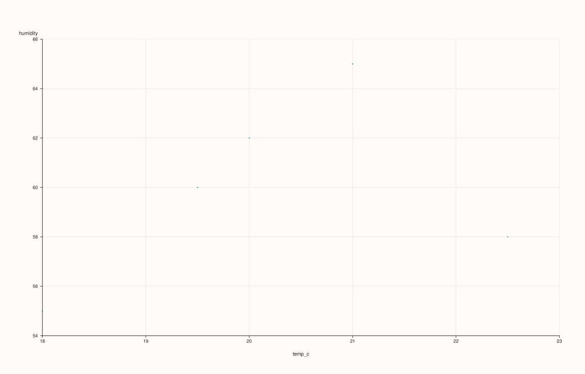
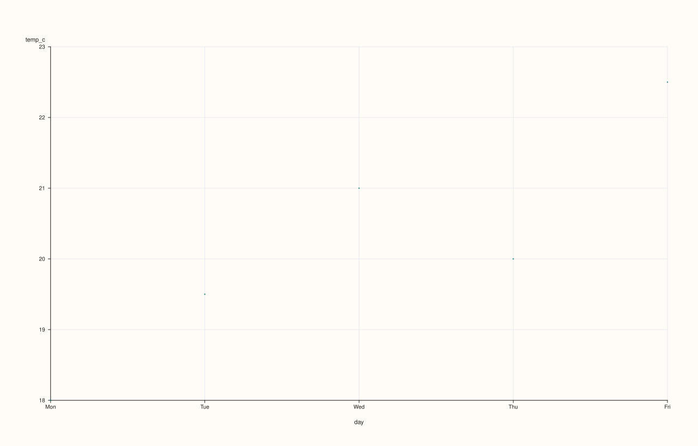
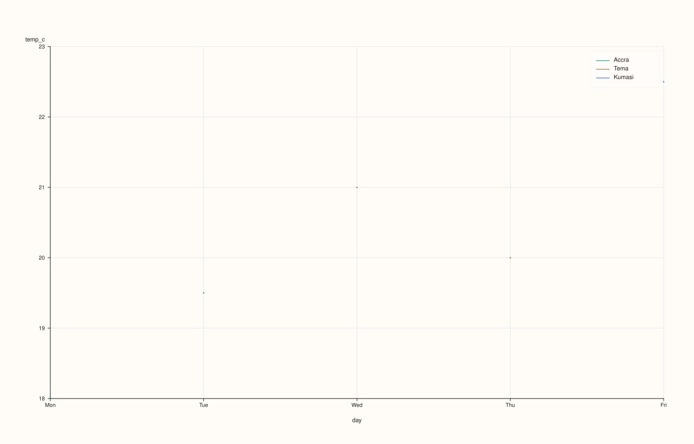
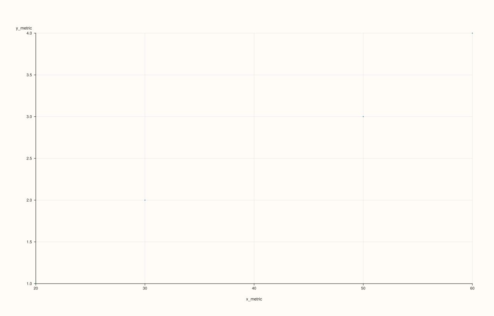

<!-- pluss-hand-authored -->
<!-- pluss-signature-hash: 3dee26767349 -->

# CatalogPlotAccessor::scatter

[Back to CatalogPlotAccessor API Reference](../../catalog_plot_accessor_api_reference)

## Signatures

```cpp
CatalogPlotAccessor::scatter(std::string_view x_key,
                              std::string_view y_key,
                              std::optional<std::string_view> hue_key = std::nullopt) const -> pluss::pl::Studio

CatalogPlotAccessor::scatter(std::string_view x_key,
                              std::string_view y_key,
                              std::optional<std::string_view> hue_key,
                              const pluss::table::ScatterPlotOptions& options) const -> pluss::pl::Studio

CatalogPlotAccessor::scatter(std::string_view x_key,
                              std::string_view y_key,
                              std::optional<std::string_view> hue_key,
                              const CatalogScatterPlotOptions& options) const -> pluss::pl::Studio
```

## What It Does

Draws one point per aligned `(x_key, y_key)` pair, optionally split into separate,
distinctly colored/labeled point groups by a categorical `hue_key`. `x_key`/`y_key` are
**required, plain (non-optional)** arguments, same as
[`DataFramePlotAccessor::scatter`](../dataframe-plot/scatter.md) — there is no row-label
fallback here.

```{important} Two entirely different code paths, chosen by x_key's slate kind
Unlike `line()`/`step()`/`area()`/`bar()` (which all share one x-axis-resolution helper),
`scatter()` branches on **`x_key`'s own slate kind**:

- If `x_key` resolves to a **Note, Timeline, or TimeIndex** key, it's treated as a *labeled
  axis*: positions are `0..n-1`, tick labels come from `x_key`'s own values, and `y_key`
  (which must be the same length) is read positionally against those same indices — no
  alignment machinery runs at all. See Examples 2 and 3.
- If `x_key` resolves to a **plain Series** key, it's treated as a genuinely numeric x-axis,
  and `x_key`/`y_key` are reconciled through the *same pairwise-alignment machinery*
  `corr_heatmap()`/`scatter_matrix()` use (`CatalogPairAlignOptions`/`PairAlign`/
  `PairAlignBy`) — by position (truncated to the shorter of the two, default) or by each
  stream's own attached label, with rows dropped wherever either value is non-finite. This
  is the only branch the three-argument `CatalogScatterPlotOptions` overload's `align` field
  actually affects. See Examples 1, 4, and 5.
```

```{important} hue_key has its own default-resolution and a stricter type requirement
`hue_key` resolves the same way `x_key` resolves elsewhere on this accessor: an explicit
argument wins, otherwise `options.default_hue_feature` (set via `ct.plot(options)`) is used
if present, otherwise there's no hue at all. A resolved `hue_key` **must** already be
Note-, Timeline-, or TimeIndex-kind — a plain numeric key throws `"Catalog::plot().scatter:
hue key '<name>' must be note-like or time-like"`. See Example 6.
```

## Parameters

**x_key** (`std::string_view`, required)
    The key for the horizontal axis. Its slate kind decides which alignment path is taken
    — see the important callout above.

**y_key** (`std::string_view`, required)
    The key for the vertical axis.

**hue_key** (`std::optional<std::string_view>`, default `std::nullopt`)
    Optional categorical key to split points into separate colored/labeled groups. Must
    resolve to a Note-, Timeline-, or TimeIndex-kind key if present — see the important
    callout above.

**options** (`pluss::table::ScatterPlotOptions` or `CatalogScatterPlotOptions`)
    ```cpp
    struct ScatterPlotOptions {
      double alpha{0.92};
      double line_width{1.1};
      bool fit_line{false};
      std::int64_t fit_order{1};
      bool fit_ci{false};
      double fit_confidence_level{0.95};
    };

    struct CatalogPairAlignOptions {
      PairAlign align{PairAlign::PairwiseInner};   // PairwiseInner | GlobalInner
      PairAlignBy align_by{PairAlignBy::Auto};     // Auto | Label | Pos
    };

    struct CatalogScatterPlotOptions {
      CatalogPairAlignOptions align{};
      pluss::table::ScatterPlotOptions scatter{};
    };
    ```
    Passing a bare `ScatterPlotOptions` (the second overload) is equivalent to passing a
    `CatalogScatterPlotOptions` with default-constructed `align` and that `scatter` value —
    it exists purely so a caller who doesn't care about alignment doesn't have to spell out
    the wrapper struct. `fit_line`/`fit_order`/`fit_ci`/`fit_confidence_level` are accepted
    for shape-compatibility with `DataFramePlotAccessor::scatter` but are **not** read by
    `Catalog::plot().scatter()` — no fit line is ever drawn here, regardless of these fields.
    `align`/`align_by` only affect the numeric-pair branch (plain `Series` `x_key`) — they
    have no effect when `x_key` resolves to a labeled-axis key.

## Returns

`pluss::pl::Studio`
    A figure with one pane: a single point trace with no hue, or one point trace per
    distinct hue value (each its own color, with a legend) when `hue_key` resolves to
    something.

## Examples

Example 1. Plain numeric `x_key`: the pairwise-alignment branch, no hue. Both streams are
the same length with no attached labels, so `PairwiseInner`/positional alignment keeps every
point.

```cpp
using namespace pluss::kindle::literals;

auto readings = pluss::kindle::Catalog({
    "temp_c"_k = pluss::kindle::Stream(pluss::make_series({18.0, 19.5, 21.0, 20.0, 22.5})),
    "humidity"_k = pluss::kindle::Stream(pluss::make_series({55.0, 60.0, 65.0, 62.0, 58.0})),
    "day"_k = pluss::kindle::Stream(pluss::make_note({"Mon", "Tue", "Wed", "Thu", "Fri"})),
    "city"_k = pluss::kindle::Stream(pluss::make_note({"Accra", "Accra", "Tema", "Tema", "Kumasi"})),
});

auto chart = readings.plot().scatter("temp_c", "humidity");
chart.show();
```



Example 2. A Note-kind `x_key`: the labeled-axis branch — positions `0..4`, tick labels from
`day`, `temp_c` read positionally.

```cpp
using namespace pluss::kindle::literals;

auto readings = pluss::kindle::Catalog({
    "temp_c"_k = pluss::kindle::Stream(pluss::make_series({18.0, 19.5, 21.0, 20.0, 22.5})),
    "humidity"_k = pluss::kindle::Stream(pluss::make_series({55.0, 60.0, 65.0, 62.0, 58.0})),
    "day"_k = pluss::kindle::Stream(pluss::make_note({"Mon", "Tue", "Wed", "Thu", "Fri"})),
    "city"_k = pluss::kindle::Stream(pluss::make_note({"Accra", "Accra", "Tema", "Tema", "Kumasi"})),
});

auto chart = readings.plot().scatter("day", "temp_c");
chart.show();
```



Example 3. Same labeled-axis branch, with a `hue_key`: points split into one trace per
distinct `city` value, in order of first appearance.

```cpp
using namespace pluss::kindle::literals;

auto readings = pluss::kindle::Catalog({
    "temp_c"_k = pluss::kindle::Stream(pluss::make_series({18.0, 19.5, 21.0, 20.0, 22.5})),
    "humidity"_k = pluss::kindle::Stream(pluss::make_series({55.0, 60.0, 65.0, 62.0, 58.0})),
    "day"_k = pluss::kindle::Stream(pluss::make_note({"Mon", "Tue", "Wed", "Thu", "Fri"})),
    "city"_k = pluss::kindle::Stream(pluss::make_note({"Accra", "Accra", "Tema", "Tema", "Kumasi"})),
});

auto chart = readings.plot().scatter("day", "temp_c", "city");
chart.show();
```

Three groups are drawn — `"Accra"`, `"Tema"`, `"Kumasi"` — in the order those values first
appear (rows 0/1, 2/3, 4), not sorted alphabetically. A legend labeled with each city is
shown automatically.



Example 4. An explicit `ScatterPlotOptions` on the numeric-pair branch.

```cpp
using namespace pluss::kindle::literals;

auto readings = pluss::kindle::Catalog({
    "temp_c"_k = pluss::kindle::Stream(pluss::make_series({18.0, 19.5, 21.0, 20.0, 22.5})),
    "humidity"_k = pluss::kindle::Stream(pluss::make_series({55.0, 60.0, 65.0, 62.0, 58.0})),
});

pluss::table::ScatterPlotOptions scatter_options;
scatter_options.alpha = 0.6;
scatter_options.line_width = 1.5;

auto chart = readings.plot().scatter("temp_c", "humidity", std::nullopt, scatter_options);
chart.show();
```


Example 5. `CatalogScatterPlotOptions` with `align = GlobalInner` and `align_by = Label`:
two streams of different lengths, each carrying its own label, aligned by matching label
values rather than truncated by position.

```cpp
using namespace pluss::kindle::literals;

auto x_stream = pluss::kindle::Stream(pluss::make_series({10.0, 20.0, 30.0, 40.0, 50.0, 60.0}))
    .with_label(pluss::table::Slate(pluss::make_note({"a", "b", "c", "d", "e", "f"})));
auto y_stream = pluss::kindle::Stream(pluss::make_series({1.0, 2.0, 3.0, 4.0}))
    .with_label(pluss::table::Slate(pluss::make_note({"b", "c", "e", "f"})));
auto paired = pluss::kindle::Catalog({"x_metric"_k = x_stream, "y_metric"_k = y_stream});

pluss::kindle::CatalogScatterPlotOptions options;
options.align.align = pluss::kindle::PairAlign::GlobalInner;
options.align.align_by = pluss::kindle::PairAlignBy::Label;

auto chart = paired.plot().scatter("x_metric", "y_metric", std::nullopt, options);
chart.show();
```

`x_metric` has 6 values labeled `"a"`..`"f"`; `y_metric` has 4 values labeled `"b"`, `"c"`,
`"e"`, `"f"`. With `align_by = Label`, only the 4 labels present in **both** streams
(`"b"`, `"c"`, `"e"`, `"f"`) survive — `x_metric`'s `"a"` and `"d"` rows are dropped, and
every `y_metric` row is kept.



Example 6. The hue type-requirement throw: a purely numeric `hue_key` is rejected.

```cpp
using namespace pluss::kindle::literals;

auto readings = pluss::kindle::Catalog({
    "temp_c"_k = pluss::kindle::Stream(pluss::make_series({18.0, 19.5, 21.0, 20.0, 22.5})),
    "humidity"_k = pluss::kindle::Stream(pluss::make_series({55.0, 60.0, 65.0, 62.0, 58.0})),
    "day"_k = pluss::kindle::Stream(pluss::make_note({"Mon", "Tue", "Wed", "Thu", "Fri"})),
});

try {
  auto bad = readings.plot().scatter("day", "temp_c", "humidity");
} catch (const std::exception& e) {
  std::cout << e.what();
}
```

### Output

```text
Catalog::plot().scatter: hue key 'humidity' must be note-like or time-like
```

Example 7. An unknown `x_key` throws.

```cpp
using namespace pluss::kindle::literals;

auto readings = pluss::kindle::Catalog({
    "temp_c"_k = pluss::kindle::Stream(pluss::make_series({18.0, 19.5, 21.0, 20.0, 22.5})),
});

try {
  auto bad = readings.plot().scatter("nope", "temp_c");
} catch (const std::exception& e) {
  std::cout << e.what();
}
```

### Output

```text
Catalog::plot().scatter: unknown x key 'nope'
```

## Notes

- `x_key`/`y_key` are required, non-optional arguments — there is no fallback the way
  `line()`/`bar()`/etc. have for a single axis.
- `x_key`'s slate kind picks the code path — see the important callout above. This is a
  meaningful difference from `DataFrame::plot().scatter`, which always treats both features
  as plain numeric columns.
- `align`/`align_by` (via `CatalogScatterPlotOptions`) only take effect on the numeric-pair
  branch — see Example 5 and `corr_heatmap()`/`scatter_matrix()` for the same alignment
  machinery used elsewhere.
- `fit_line`/`fit_order`/`fit_ci`/`fit_confidence_level` on `ScatterPlotOptions` are accepted
  but unused here — no fit line is ever drawn.
- `hue_key` resolves through `options.default_hue_feature` the same way `x_key` resolves
  through `default_x_feature` on the other methods, but must be Note-, Timeline-, or
  TimeIndex-kind or the call throws.
- Hue groups are ordered by first appearance in the data, not sorted.
- Returns a `pluss::pl::Studio` — see [`line()`](line.md)'s important callout for how to view
  or save the result.

## See Also

- [`CatalogPlotAccessor::line`](line.md): the canonical explanation of this accessor's
  shared mechanics.
- [`CatalogPlotAccessor::scatter_matrix`](scatter_matrix.md): every pairwise combination of
  several keys at once, reusing the same alignment machinery as this method's numeric-pair
  branch.
- [`CatalogPlotAccessor::corr_heatmap`](corr_heatmap.md): a correlation summary over the
  same kind of pairwise-aligned key pairs.

<div class="pluss-inline-prev-next">
  <a class="prev-link" href="line.html">
    <span class="label">Previous</span>
    <span class="title">line</span>
  </a>
  <a class="next-link" href="scatter_matrix.html">
    <span class="label">Next</span>
    <span class="title">scatter_matrix</span>
  </a>
</div>
