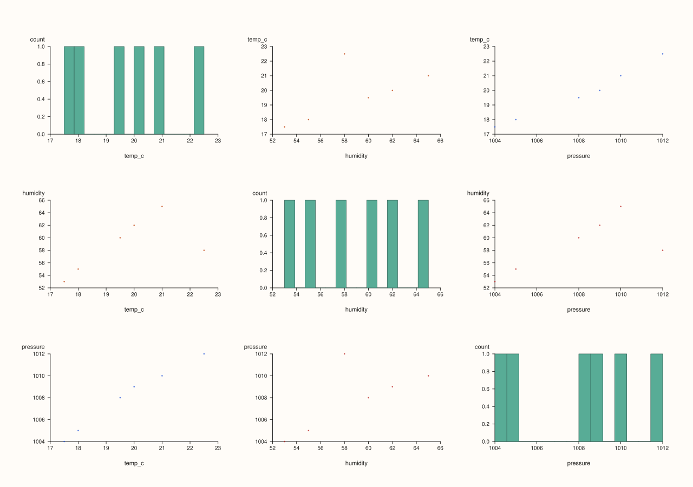
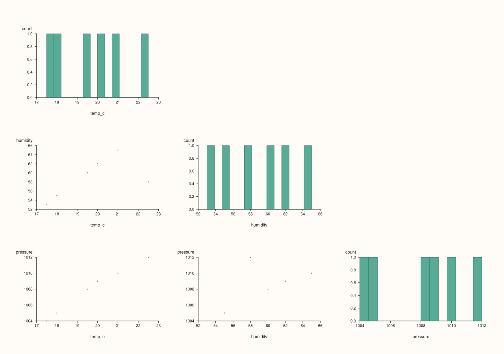
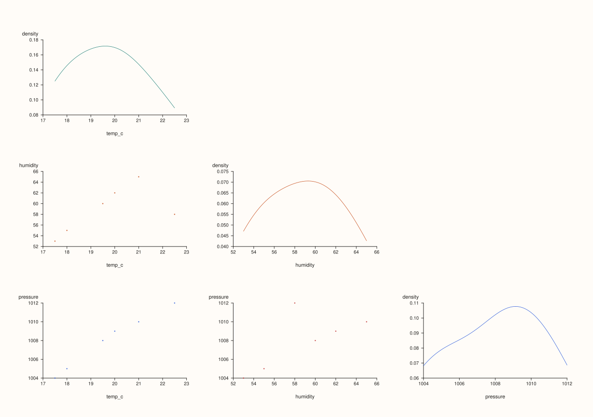

<!-- pluss-hand-authored -->
<!-- pluss-signature-hash: 4a2a56c3d889 -->

# CatalogPlotAccessor::scatter_matrix

[Back to CatalogPlotAccessor API Reference](../../catalog_plot_accessor_api_reference)

## Signatures

```cpp
CatalogPlotAccessor::scatter_matrix(pluss::msharp::RangeView::Of<std::string_view> keys = {}) const -> pluss::pl::Studio

CatalogPlotAccessor::scatter_matrix(std::initializer_list<std::string_view> keys) const -> pluss::pl::Studio

CatalogPlotAccessor::scatter_matrix(pluss::msharp::RangeView::Of<std::string_view> keys,
                                     pluss::table::ScatterMatrixTriangle triangle) const -> pluss::pl::Studio

CatalogPlotAccessor::scatter_matrix(std::initializer_list<std::string_view> keys,
                                     pluss::table::ScatterMatrixTriangle triangle) const -> pluss::pl::Studio

CatalogPlotAccessor::scatter_matrix(pluss::msharp::RangeView::Of<std::string_view> keys,
                                     const CatalogScatterMatrixPlotOptions& options) const -> pluss::pl::Studio

CatalogPlotAccessor::scatter_matrix(std::initializer_list<std::string_view> keys,
                                     const CatalogScatterMatrixPlotOptions& options) const -> pluss::pl::Studio
```

## What It Does

Lays out every pairwise combination of the selected keys as its own small scatter (or
regression) panel in an N×N mosaic, with each diagonal cell showing that one key's own
distribution (histogram or density) instead of a self-vs-self scatter. Off-diagonal cells
reuse the exact same pairwise-alignment machinery as [`scatter()`](scatter.md)'s
numeric-pair branch and [`corr_heatmap()`](corr_heatmap.md).

## Parameters

**keys** (`RangeView<std::string_view>` or `std::initializer_list<std::string_view>`,
defaults to `{}`)
    Same resolution as [`line()`](line.md): an empty range selects every
    plottable key. At least **two** resolved keys are required —
    `"Catalog::plot().scatter_matrix: need at least two plottable streams"` if fewer.

**triangle** (`pluss::table::ScatterMatrixTriangle`, an alias for
`pluss::pl::flash::PairPlotTriangle`)
    Shorthand for `CatalogScatterMatrixPlotOptions{}.matrix.pair.triangle = triangle` —
    `Full` (default, every cell), `Lower`, or `Upper`.

**options** (`CatalogScatterMatrixPlotOptions`)

### `CatalogPairAlignOptions` fields

| Field | Type | Default |
|---|---|---|
| `align` | `PairAlign` | `PairAlign::PairwiseInner` |
| `align_by` | `PairAlignBy` | `PairAlignBy::Auto` |

### `PairPlotOptions` fields

| Field | Type | Default |
|---|---|---|
| `triangle` | `PairPlotTriangle` | `PairPlotTriangle::Full` |
| `kind` | `PairPlotKind` | `PairPlotKind::Scatter` |
| `diag_kind` | `PairPlotDiagKind` | `PairPlotDiagKind::Histogram` |
| `corner` | `bool` | `false` |
| `labels` | `std::vector<std::string>` | empty |
| `max_points` | `std::int64_t` | `2500` |
| `diag_bins` | `std::int64_t` | `14` |
| `diag_density_points` | `std::int64_t` | `128` |

### `ScatterMatrixPlotOptions` fields

| Field | Type | Default |
|---|---|---|
| `corner` | `bool` | `false` |
| `pair` | `pluss::pl::flash::PairPlotOptions` | default constructed |

### `CatalogScatterMatrixPlotOptions` fields

| Field | Type | Default |
|---|---|---|
| `align` | `CatalogPairAlignOptions` | default constructed |
| `matrix` | `pluss::table::ScatterMatrixPlotOptions` | default constructed |

`matrix.corner = true` additionally forces `pair.triangle` from `Full` to `Lower` (a
no-op if `triangle` was already `Lower` or `Upper`). `pair.kind = Reg` draws a fitted
regression line (via `flash::regplot`) on off-diagonal cells instead of a plain point
cloud. `pair.diag_kind = Density` swaps the diagonal cells from histograms to smoothed
density curves. `pair.labels`, if left empty, is filled in with the resolved key names.
`align`/`align_by` control the same cross-key alignment
[`corr_heatmap()`](corr_heatmap.md) uses.

## Returns

`pluss::pl::Studio`
    A figure laid out as an N×N mosaic (one pane per visible cell, following `triangle`).

## Examples

Example 1. Default: every plottable key, `Full` triangle, histogram diagonal.

```cpp
using namespace pluss::kindle::literals;

auto weather = pluss::kindle::Catalog({
    "temp_c"_k = pluss::kindle::Stream(pluss::make_series({18.0, 19.5, 21.0, 20.0, 22.5, 17.5})),
    "humidity"_k = pluss::kindle::Stream(pluss::make_series({55.0, 60.0, 65.0, 62.0, 58.0, 53.0})),
    "pressure"_k = pluss::kindle::Stream(pluss::make_series({1005.0, 1008.0, 1010.0, 1009.0, 1012.0, 1004.0})),
});

auto chart = weather.plot().scatter_matrix();
chart.show();
```



Example 2. The `triangle`-overload: explicit keys, `Lower` triangle only (skips the
redundant upper-right mirrored cells).

```cpp
using namespace pluss::kindle::literals;

auto weather = pluss::kindle::Catalog({
    "temp_c"_k = pluss::kindle::Stream(pluss::make_series({18.0, 19.5, 21.0, 20.0, 22.5, 17.5})),
    "humidity"_k = pluss::kindle::Stream(pluss::make_series({55.0, 60.0, 65.0, 62.0, 58.0, 53.0})),
    "pressure"_k = pluss::kindle::Stream(pluss::make_series({1005.0, 1008.0, 1010.0, 1009.0, 1012.0, 1004.0})),
});

auto chart = weather.plot().scatter_matrix(
    {"temp_c", "humidity", "pressure"}, pluss::table::ScatterMatrixTriangle::Lower);
chart.show();
```



Example 3. `CatalogScatterMatrixPlotOptions` with `matrix.corner = true` and a `Density`
diagonal.

```cpp
using namespace pluss::kindle::literals;

auto weather = pluss::kindle::Catalog({
    "temp_c"_k = pluss::kindle::Stream(pluss::make_series({18.0, 19.5, 21.0, 20.0, 22.5, 17.5})),
    "humidity"_k = pluss::kindle::Stream(pluss::make_series({55.0, 60.0, 65.0, 62.0, 58.0, 53.0})),
    "pressure"_k = pluss::kindle::Stream(pluss::make_series({1005.0, 1008.0, 1010.0, 1009.0, 1012.0, 1004.0})),
});

pluss::kindle::CatalogScatterMatrixPlotOptions options;
options.matrix.corner = true;
options.matrix.pair.diag_kind = pluss::pl::flash::PairPlotDiagKind::Density;

auto chart = weather.plot().scatter_matrix({"temp_c", "humidity", "pressure"}, options);
chart.show();
```

`matrix.corner = true` forces the layout down to the lower triangle (same effect as passing
`ScatterMatrixTriangle::Lower` directly); the three diagonal cells now show density curves
instead of histograms.



Example 4. Fewer than two resolved keys throws.

```cpp
using namespace pluss::kindle::literals;

auto weather = pluss::kindle::Catalog({
    "temp_c"_k = pluss::kindle::Stream(pluss::make_series({18.0, 19.5, 21.0})),
});

try {
  auto bad = weather.plot().scatter_matrix({"temp_c"});
} catch (const std::exception& e) {
  std::cout << e.what();
}
```

### Output

```text
Catalog::plot().scatter_matrix: need at least two plottable streams
```

## Notes

- An empty `keys` selects every plottable key, the same rule [`line()`](line.md) uses.
- At least two resolved keys are required — see Example 4.
- `matrix.corner = true` overrides `Full` to `Lower`; it has no effect if `triangle` is
  already `Lower` or `Upper`.
- Diagonal cells never participate in the pairwise-alignment machinery — each diagonal cell
  only ever looks at its own key's own values.
- Off-diagonal cells with zero aligned points after alignment/downsampling simply draw no
  points, rather than throwing.
- Returns a `pluss::pl::Studio` — see [`line()`](line.md)'s important callout for how to
  view or save the result.

## See Also

- [`CatalogPlotAccessor::corr_heatmap`](corr_heatmap.md): the same alignment machinery,
  summarized as a single correlation coefficient per pair instead of a full scatter panel.
- [`CatalogPlotAccessor::scatter`](scatter.md): the two-key version of the numeric-pair
  alignment this method generalizes to every pair among N keys.

<div class="pluss-inline-prev-next">
  <a class="prev-link" href="scatter.html">
    <span class="label">Previous</span>
    <span class="title">scatter</span>
  </a>
  <a class="next-link" href="step.html">
    <span class="label">Next</span>
    <span class="title">step</span>
  </a>
</div>
