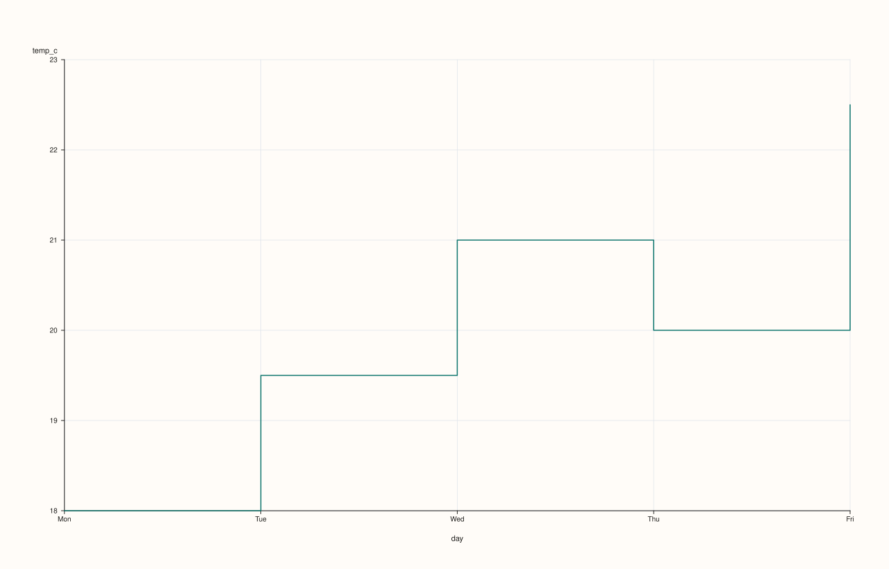
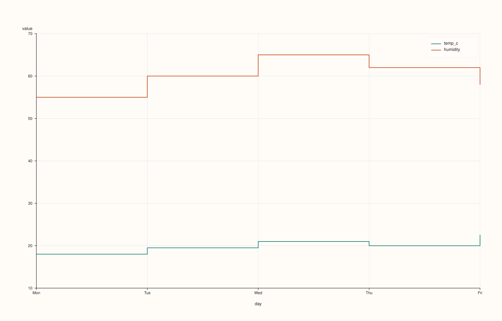
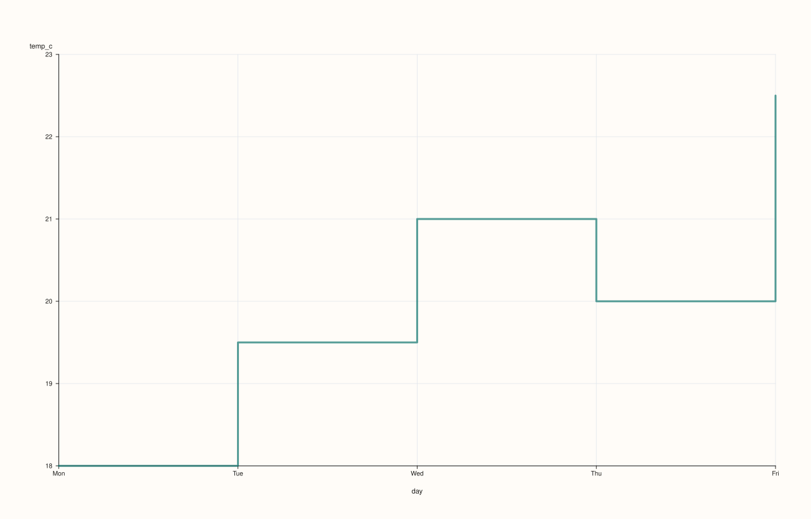

<!-- pluss-hand-authored -->
<!-- pluss-signature-hash: 7ad6ccb46b64 -->

# CatalogPlotAccessor::step

[Back to CatalogPlotAccessor API Reference](../../catalog_plot_accessor_api_reference)

## Signatures

```cpp
pluss::pl::Studio CatalogPlotAccessor::step(std::string_view y_key,
                                             std::optional<std::string_view> x_key = std::nullopt) const

pluss::pl::Studio CatalogPlotAccessor::step(pluss::msharp::RangeView::Of<std::string_view> y_keys = {},
                                             std::optional<std::string_view> x_key = std::nullopt) const

pluss::pl::Studio CatalogPlotAccessor::step(std::initializer_list<std::string_view> y_keys,
                                             std::optional<std::string_view> x_key = std::nullopt) const

pluss::pl::Studio CatalogPlotAccessor::step(std::string_view y_key,
                                             std::optional<std::string_view> x_key,
                                             const StepPlotOptions& options) const

pluss::pl::Studio CatalogPlotAccessor::step(pluss::msharp::RangeView::Of<std::string_view> y_keys,
                                             std::optional<std::string_view> x_key,
                                             const StepPlotOptions& options) const

pluss::pl::Studio CatalogPlotAccessor::step(std::initializer_list<std::string_view> y_keys,
                                             std::optional<std::string_view> x_key,
                                             const StepPlotOptions& options) const
```

## What It Does

Exactly [`line()`](line.md)'s shape — one trace per y-key over a shared x-axis — drawn as a
step function (each value held flat until the next x position) instead of straight
connecting segments. Every mechanic on this page (x-axis resolution, the empty-`y_keys`
default, the independent-per-key-axis gotcha with multiple keys and no shared `x_key`, the
`Studio`-return/no-`cout` behavior) is identical to `line()` — see that page for the full
explanation; only what's specific to `step()` is repeated here.

## Parameters

**y_key** / **y_keys** (`std::string_view` / `RangeView<std::string_view>` /
`std::initializer_list<std::string_view>`, `y_keys` defaults to `{}`)
    Same resolution as [`line()`](line.md): an empty `y_keys` selects every
    plottable key in the catalog; an explicitly named unknown key throws.

**x_key** (`std::optional<std::string_view>`, default `std::nullopt`)
    Same three-step resolution as [`line()`](line.md).

**options** (`StepPlotOptions`)

### `StepPlotOptions` fields

| Field | Type | Default |
|---|---|---|
| `alpha` | `double` | `1.0` |
| `line_width` | `double` | `1.5` |
| `align` | `XYAlignOptions` | default constructed |

`align` controls how a mismatched-length explicit `x_key`/y-key pair is reconciled
(`Strict` throws, the default; `Inner` truncates; `PadScalar` pads) — see
[`line()`](line.md) for the full explanation and
worked examples; the mechanics are identical here.

## Returns

`pluss::pl::Studio`
    A figure with one pane containing one step trace per requested y-key.

## Examples

Example 1. Explicit x-key, single y-key.

```cpp
using namespace pluss::kindle::literals;

auto weather = pluss::kindle::Catalog({
    "day"_k = pluss::kindle::Stream(pluss::make_note({"Mon", "Tue", "Wed", "Thu", "Fri"})),
    "temp_c"_k = pluss::kindle::Stream(pluss::make_series({18.0, 19.5, 21.0, 20.0, 22.5})),
    "humidity"_k = pluss::kindle::Stream(pluss::make_series({55.0, 60.0, 65.0, 62.0, 58.0})),
});

auto chart = weather.plot().step("temp_c", "day");
chart.show();
```



Example 2. Multiple y-keys via a brace-init list, same shared x-key.

```cpp
using namespace pluss::kindle::literals;

auto weather = pluss::kindle::Catalog({
    "day"_k = pluss::kindle::Stream(pluss::make_note({"Mon", "Tue", "Wed", "Thu", "Fri"})),
    "temp_c"_k = pluss::kindle::Stream(pluss::make_series({18.0, 19.5, 21.0, 20.0, 22.5})),
    "humidity"_k = pluss::kindle::Stream(pluss::make_series({55.0, 60.0, 65.0, 62.0, 58.0})),
});

auto chart = weather.plot().step({"temp_c", "humidity"}, "day");
chart.show();
```



Example 3. An explicit `StepPlotOptions`.

```cpp
using namespace pluss::kindle::literals;

auto weather = pluss::kindle::Catalog({
    "day"_k = pluss::kindle::Stream(pluss::make_note({"Mon", "Tue", "Wed", "Thu", "Fri"})),
    "temp_c"_k = pluss::kindle::Stream(pluss::make_series({18.0, 19.5, 21.0, 20.0, 22.5})),
});

pluss::table::StepPlotOptions step_options;
step_options.alpha = 0.7;
step_options.line_width = 3.0;

auto chart = weather.plot().step("temp_c", "day", step_options);
chart.show();
```



Example 4. An unknown key throws.

```cpp
using namespace pluss::kindle::literals;

auto weather = pluss::kindle::Catalog({
    "day"_k = pluss::kindle::Stream(pluss::make_note({"Mon", "Tue", "Wed", "Thu", "Fri"})),
    "temp_c"_k = pluss::kindle::Stream(pluss::make_series({18.0, 19.5, 21.0, 20.0, 22.5})),
});

try {
  auto bad = weather.plot().step("nonexistent");
} catch (const std::exception& e) {
  std::cout << e.what();
}
```

### Output

```text
Catalog::plot().step: unknown key 'nonexistent'
```

## Notes

- Every mechanic besides the step-vs-line geometry itself is shared with
  [`line()`](line.md) — see that page for the full x-axis resolution and multi-key gotchas.
- Returns a `pluss::pl::Studio` — see [`line()`](line.md)'s important callout for how to
  view or save the result.

## See Also

- [`CatalogPlotAccessor::line`](line.md): the canonical explanation of this accessor's
  shared mechanics.
- [`CatalogPlotAccessor::area`](area.md): the filled variant of the same shape.

<div class="pluss-inline-prev-next">
  <a class="prev-link" href="scatter_matrix.html">
    <span class="label">Previous</span>
    <span class="title">scatter_matrix</span>
  </a>
</div>
