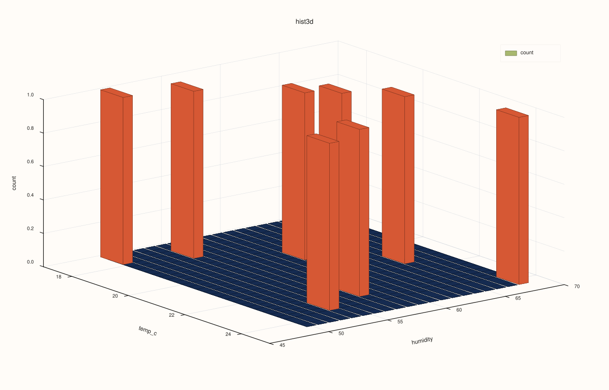
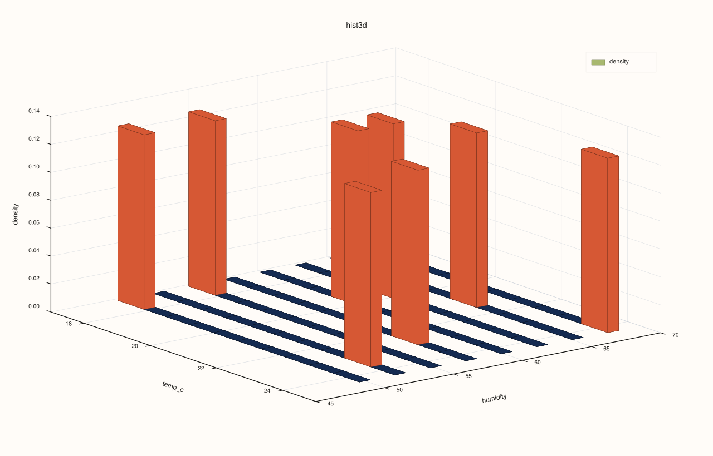

<!-- pluss-hand-authored -->
<!-- pluss-signature-hash: 3459ce26b95a -->

# CatalogPlot3DAccessor::hist

[Back to CatalogPlot3DAccessor API Reference](../../catalog_plot3d_accessor_api_reference)

## Signatures

```cpp
CatalogPlot3DAccessor::hist(std::string_view x_key,
                             std::string_view y_key,
                             const pluss::table::Hist3DPlotOptions& options = {}) const -> pluss::pl::Studio

CatalogPlot3DAccessor::hist(std::string_view x_key,
                             std::string_view y_key,
                             const CatalogHist3DPlotOptions& options) const -> pluss::pl::Studio
```

## What It Does

Builds a 2D-binned histogram over `(x_key, y_key)` and renders each bin's count (or, with
`normalize = true`, density) as a 3D bar/surface/wireframe grid, depending on
`Hist3DPlotOptions::as_surface`/`as_wireframe`. Reuses the same all-keys-reconciled-together
alignment [`CatalogPlot3DAccessor::scatter`](scatter.md) uses, over just the two
requested keys.

## Parameters

**x_key**, **y_key** (`std::string_view`, required)
    The two keys binned into the 2D histogram grid.

**options** (`pluss::table::Hist3DPlotOptions` or `CatalogHist3DPlotOptions`)
    ```cpp
    struct Hist3DPlotOptions {
      std::int64_t bins_x{26};
      std::int64_t bins_y{20};
      bool normalize{false};
      bool smooth{false};
      std::int64_t smooth_passes{1};
      bool as_surface{false};
      bool as_wireframe{false};
      Plot3DSceneOptions scene{};
      Plot3DTraceOptions trace{};
      XYAlignOptions align{XYAlignMode::Inner, XYAlignBy::Auto, 0.0};
    };

    struct CatalogHist3DPlotOptions {
      pluss::table::XYAlignMode align{pluss::table::XYAlignMode::Inner};
      pluss::table::XYAlignBy align_by{pluss::table::XYAlignBy::Auto};
      double pad_scalar{0.0};
      pluss::table::Hist3DPlotOptions hist{};
    };
    ```
    `bins_x`/`bins_y` set the grid resolution independently per axis. `normalize = true`
    switches the z-axis (and its label) from `"count"` to `"density"`. `smooth`/
    `smooth_passes` optionally blur the grid before rendering. `as_surface`/`as_wireframe`
    change the grid's render style; both `false` (the default) renders it as 3D bars.
    `align`/`align_by`/`pad_scalar` govern how `x_key`/`y_key` are reconciled — same
    `XYAlignMode`/`XYAlignBy` trio [`scatter()`](scatter.md) uses, defaulting to
    `Inner`.

## Returns

`pluss::pl::Studio`
    A figure with one 3D pane containing a single binned-grid trace, z-labeled `"count"` or
    `"density"` depending on `normalize`.

## Examples

Example 1. Default options: a 2D-binned count grid over `temp_c`/`humidity`.

```cpp
using namespace pluss::kindle::literals;

auto measurements = pluss::kindle::Catalog({
    "temp_c"_k = pluss::kindle::Stream(pluss::make_series({18.0, 19.5, 21.0, 20.0, 22.5, 23.0, 17.5, 24.0})),
    "humidity"_k = pluss::kindle::Stream(pluss::make_series({55.0, 60.0, 65.0, 62.0, 58.0, 54.0, 50.0, 68.0})),
});

auto chart = measurements.plot3d().hist("temp_c", "humidity");
chart.show();
```



Example 2. `CatalogHist3DPlotOptions` with `normalize = true` and a coarser grid.

```cpp
using namespace pluss::kindle::literals;

auto measurements = pluss::kindle::Catalog({
    "temp_c"_k = pluss::kindle::Stream(pluss::make_series({18.0, 19.5, 21.0, 20.0, 22.5, 23.0, 17.5, 24.0})),
    "humidity"_k = pluss::kindle::Stream(pluss::make_series({55.0, 60.0, 65.0, 62.0, 58.0, 54.0, 50.0, 68.0})),
});

pluss::kindle::CatalogHist3DPlotOptions options;
options.hist.normalize = true;
options.hist.bins_x = 10;
options.hist.bins_y = 8;

auto chart = measurements.plot3d().hist("temp_c", "humidity", options);
chart.show();
```

The z-axis is now `"density"` instead of `"count"`, over a coarser `10 × 8` grid.



Example 3. An unknown key throws.

```cpp
using namespace pluss::kindle::literals;

auto measurements = pluss::kindle::Catalog({
    "temp_c"_k = pluss::kindle::Stream(pluss::make_series({18.0, 19.5, 21.0})),
    "humidity"_k = pluss::kindle::Stream(pluss::make_series({55.0, 60.0, 65.0})),
});

try {
  auto bad = measurements.plot3d().hist("nope", "humidity");
} catch (const std::exception& e) {
  std::cout << e.what();
}
```

### Output

```text
Catalog::plot3d().hist: unknown x key 'nope'
```

## Notes

- `normalize` changes both the computed values and the z-axis label (`"count"` vs.
  `"density"`).
- `as_surface`/`as_wireframe` change render style but not the underlying binning.
- Uses the same all-keys-reconciled-together alignment as
  [`CatalogPlot3DAccessor::scatter`](scatter.md), over `x_key`/`y_key` only.
- Returns a `pluss::pl::Studio` — see
  [`CatalogPlotAccessor::line`](../catalog-plot/line.md)'s important callout for how to view
  or save the result.

## See Also

- [`CatalogPlotAccessor::hist`](../catalog-plot/hist.md): the 1D per-key histogram this
  method generalizes to a 2D grid.
- [`CatalogPlot3DAccessor::surface`](surface.md)/[`wireframe`](wireframe.md): a different
  kind of aggregated grid, built from an explicit `GroupOp` over a `z_key` rather than a
  binned count.

<div class="pluss-inline-prev-next">
  <a class="next-link" href="line.html">
    <span class="label">Next</span>
    <span class="title">line</span>
  </a>
</div>
