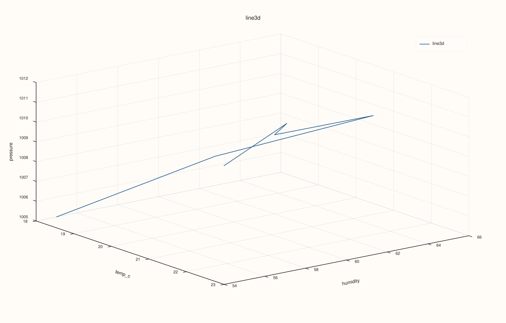
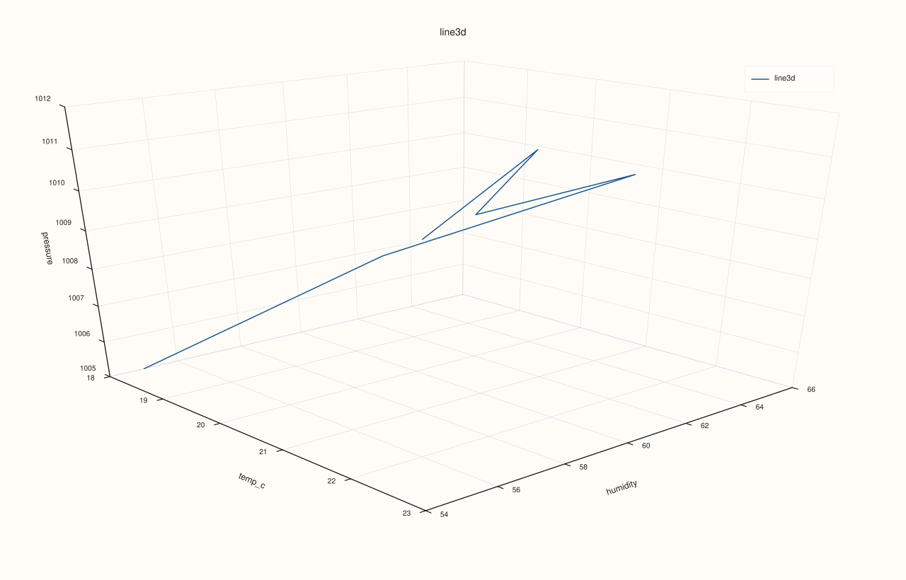

<!-- pluss-hand-authored -->
<!-- pluss-signature-hash: 0c9d71c7b851 -->

# CatalogPlot3DAccessor::line

[Back to CatalogPlot3DAccessor API Reference](../../catalog_plot3d_accessor_api_reference)

## Signatures

```cpp
CatalogPlot3DAccessor::line(std::string_view x_key,
                             std::string_view y_key,
                             std::string_view z_key,
                             const pluss::table::Line3DPlotOptions& options = {}) const -> pluss::pl::Studio

CatalogPlot3DAccessor::line(std::string_view x_key,
                             std::string_view y_key,
                             std::string_view z_key,
                             const CatalogLine3DPlotOptions& options) const -> pluss::pl::Studio
```

## What It Does

Draws one continuous 3D path (`flash::path3`) through the aligned `(x_key, y_key, z_key)`
rows, in row order — the 3D counterpart of [`CatalogPlotAccessor::line`](../catalog-plot/line.md),
except all three axes come from explicit keys rather than one key plus a resolved x-axis.
Reuses the same all-keys-reconciled-together alignment
[`CatalogPlot3DAccessor::scatter`](scatter.md) uses.

## Parameters

**x_key**, **y_key**, **z_key** (`std::string_view`, required)
The three keys forming the path's 3D coordinates, connected in row order after
alignment.

**options** (`pluss::table::Line3DPlotOptions` or `CatalogLine3DPlotOptions`)

The Catalog overloads accept the following settings:

| Option | Default | Purpose |
|---|---|---|
| `scene` | Pane defaults | Camera, theme, lighting, and grid settings. |
| `trace` | Trace defaults | Path shading and material settings. |
| `align` | Inner | Reconciles the three keys before plotting. |
| `align_by` | Auto | Chooses label or position matching. |
| `pad_scalar` | 0 | Fill value when scalar padding is selected. |

Pass the scene and trace settings through `Line3DPlotOptions`; the Catalog wrapper also exposes the alignment settings directly.

Same `scene`/`trace` shape documented in full on
[`CatalogPlot3DAccessor::scatter`](scatter.md) — `line()` has no fields of
its own beyond these two, plus the same `align`/`align_by`/`pad_scalar` alignment trio
(`XYAlignMode`/`XYAlignBy`) `scatter()` uses, defaulting to `Inner`.

## Returns

`pluss::pl::Studio`
    A figure with one 3D pane containing a single connected path trace.

## Examples

Example 1. Default options: a path through `temp_c`/`humidity`/`pressure`.

```cpp
using namespace pluss::kindle::literals;

auto measurements = pluss::kindle::Catalog({
    "temp_c"_k = pluss::kindle::Stream(pluss::make_series({18.0, 19.5, 21.0, 20.0, 22.5, 23.0})),
    "humidity"_k = pluss::kindle::Stream(pluss::make_series({55.0, 60.0, 65.0, 62.0, 58.0, 54.0})),
    "pressure"_k = pluss::kindle::Stream(pluss::make_series({1005.0, 1008.0, 1010.0, 1009.0, 1012.0, 1011.0})),
});

auto chart = measurements.plot3d().line("temp_c", "humidity", "pressure");
chart.show();
```



Example 2. `CatalogLine3DPlotOptions` with a `Presentation`-preset scene.

```cpp
using namespace pluss::kindle::literals;

auto measurements = pluss::kindle::Catalog({
    "temp_c"_k = pluss::kindle::Stream(pluss::make_series({18.0, 19.5, 21.0, 20.0, 22.5, 23.0})),
    "humidity"_k = pluss::kindle::Stream(pluss::make_series({55.0, 60.0, 65.0, 62.0, 58.0, 54.0})),
    "pressure"_k = pluss::kindle::Stream(pluss::make_series({1005.0, 1008.0, 1010.0, 1009.0, 1012.0, 1011.0})),
});

pluss::kindle::CatalogLine3DPlotOptions options;
options.line.scene.preset = pluss::pl::flash::ScenePreset3D::Presentation;

auto chart = measurements.plot3d().line("temp_c", "humidity", "pressure", options);
chart.show();
```



Example 3. An unknown key throws.

```cpp
using namespace pluss::kindle::literals;

auto measurements = pluss::kindle::Catalog({
    "temp_c"_k = pluss::kindle::Stream(pluss::make_series({18.0, 19.5, 21.0})),
    "humidity"_k = pluss::kindle::Stream(pluss::make_series({55.0, 60.0, 65.0})),
    "pressure"_k = pluss::kindle::Stream(pluss::make_series({1005.0, 1008.0, 1010.0})),
});

try {
  auto bad = measurements.plot3d().line("nope", "humidity", "pressure");
} catch (const std::exception& e) {
  std::cout << e.what();
}
```

### Output

```text
Catalog::plot3d().line: unknown x key 'nope'
```

## Notes

- The three keys are connected **in row order** after alignment — there is no sorting by
  any axis.
- Uses the same all-keys-reconciled-together alignment as
  [`CatalogPlot3DAccessor::scatter`](scatter.md) — see that page's important callout.
- Returns a `pluss::pl::Studio` — see
  [`CatalogPlotAccessor::line`](../catalog-plot/line.md)'s important callout for how to view
  or save the result.

## See Also

- [`CatalogPlot3DAccessor::scatter`](scatter.md): the same three keys, drawn as independent
  points instead of a connected path.
- [`Catalog::plot3d`](../catalog/plot3d.md): how to enter this accessor in the first place.

<div class="pluss-inline-prev-next">
  <a class="prev-link" href="hist.html">
    <span class="label">Previous</span>
    <span class="title">hist</span>
  </a>
  <a class="next-link" href="scatter.html">
    <span class="label">Next</span>
    <span class="title">scatter</span>
  </a>
</div>
