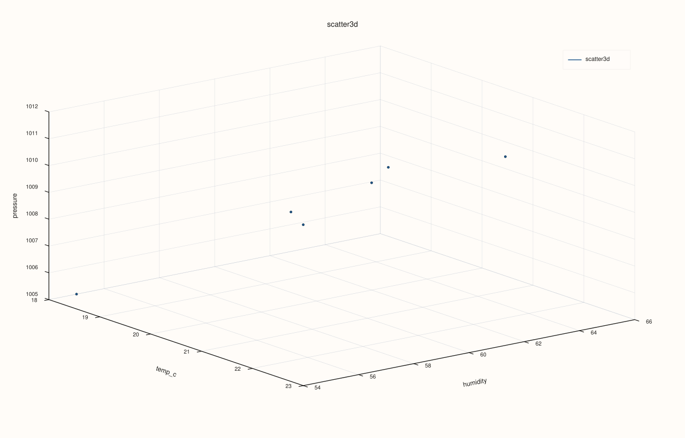
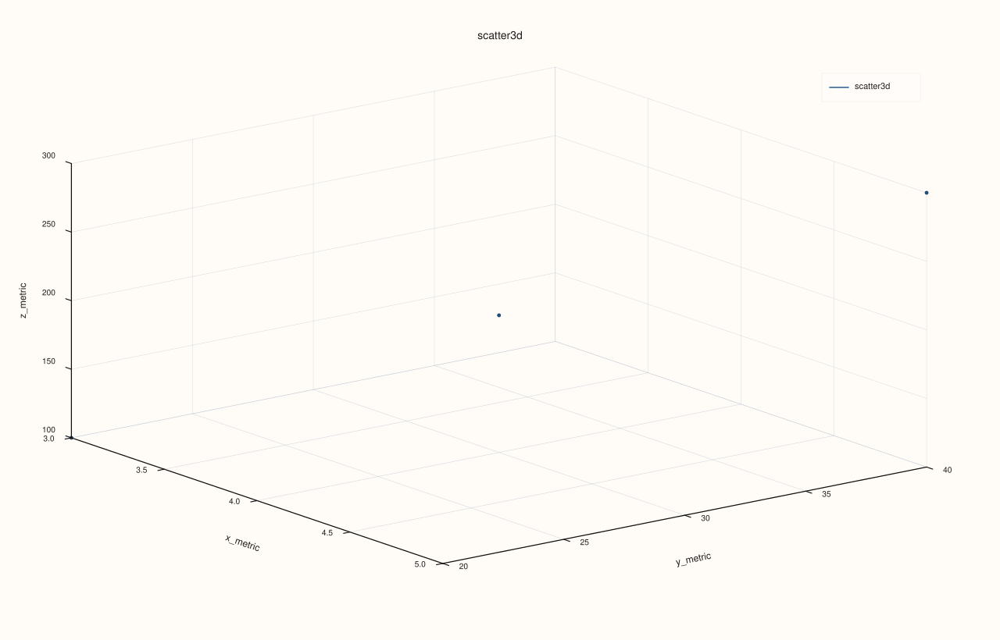

<!-- pluss-hand-authored -->
<!-- pluss-signature-hash: 6219edf31282 -->

# CatalogPlot3DAccessor::scatter

[Back to CatalogPlot3DAccessor API Reference](../../catalog_plot3d_accessor_api_reference)

## Signatures

```cpp
CatalogPlot3DAccessor::scatter(std::string_view x_key,
                                std::string_view y_key,
                                std::string_view z_key,
                                std::optional<std::string_view> size_key = std::nullopt,
                                std::optional<std::string_view> color_key = std::nullopt,
                                const pluss::table::Scatter3DPlotOptions& options = {}) const -> pluss::pl::Studio

CatalogPlot3DAccessor::scatter(std::string_view x_key,
                                std::string_view y_key,
                                std::string_view z_key,
                                std::optional<std::string_view> size_key,
                                std::optional<std::string_view> color_key,
                                const CatalogScatter3DPlotOptions& options) const -> pluss::pl::Studio
```

## What It Does

Draws one 3D point per aligned `(x_key, y_key, z_key)` row, optionally scaling each point's
marker size by `size_key` and/or its color by `color_key` — both **continuous** numeric
mappings, unlike [`CatalogPlotAccessor::scatter`](../catalog-plot/scatter.md)'s categorical
`hue_key`.

```{important} Every requested key is reconciled together as one group, not pairwise
`Catalog::plot3d()` methods enforce only per-key type homogeneity, not length homogeneity
across keys — two keys can have entirely different lengths. Every key actually requested
here (`x_key`, `y_key`, `z_key`, and whichever of `size_key`/`color_key` are set) is
reconciled together in a single pass (`catalog_align_numeric_streams`), governed by two
independent settings: `align` (`XYAlignMode`: `Strict`/`Inner`/`PadScalar` — how a length
mismatch across the group is handled) and `align_by` (`XYAlignBy`: `Auto`/`Label`/`Pos` —
whether reconciliation is positional or by each stream's own attached label). This is the
N-key generalization of [`CatalogPlotAccessor::scatter`](../catalog-plot/scatter.md)'s
two-key pairwise alignment, using the same `XYAlignMode`/`XYAlignBy` types
[`CatalogPlotAccessor::line`](../catalog-plot/line.md)
uses for its own `x_key`/y-key reconciliation. See Example 4.
```

## Parameters

**x_key**, **y_key**, **z_key** (`std::string_view`, required)
    The three keys forming each point's 3D position.

**size_key** (`std::optional<std::string_view>`, default `std::nullopt`)
    Optional numeric key controlling each point's marker size. When omitted,
    `options.default_marker_size` is used uniformly for every point.

**color_key** (`std::optional<std::string_view>`, default `std::nullopt`)
    Optional numeric key controlling each point's color, as a continuous color-mapped value
    — **not** a categorical grouping the way `hue_key` is on the 2D `scatter()`.

**options** (`pluss::table::Scatter3DPlotOptions` or `CatalogScatter3DPlotOptions`)
    ```cpp
    struct Plot3DSceneOptions {
      std::optional<ScenePreset3D> preset{std::nullopt};
      std::optional<ThemePreset3D> theme{std::nullopt};
      std::optional<CameraPreset3D> camera_preset{std::nullopt};
      std::optional<Camera3DOptions> camera{std::nullopt};
      std::optional<Lighting3DOptions> lighting{std::nullopt};
      std::optional<pluss::pl::GridStyle> grid_style{std::nullopt};
    };

    struct Plot3DTraceOptions {
      std::optional<TracePreset3D> preset{std::nullopt};
      std::optional<pluss::pl::ShadeMode> shade{std::nullopt};
      std::optional<pluss::pl::LightingMode> lighting{std::nullopt};
      std::optional<pluss::pl::MaterialProfile> material{std::nullopt};
      std::optional<float> line_width{std::nullopt};
      std::optional<bool> transparent{std::nullopt};
    };

    enum class XYAlignMode : std::uint8_t { Strict, Inner, PadScalar };
    enum class XYAlignBy : std::uint8_t { Auto, Label, Pos };

    struct XYAlignOptions {
      XYAlignMode mode{XYAlignMode::Strict};
      XYAlignBy align_by{XYAlignBy::Auto};
      double pad_scalar{0.0};
    };

    struct Scatter3DPlotOptions {
      Plot3DSceneOptions scene{};
      Plot3DTraceOptions trace{};
      double default_marker_size{12.0};
      XYAlignOptions align{XYAlignMode::Inner, XYAlignBy::Auto, 0.0};
    };

    struct CatalogScatter3DPlotOptions {
      pluss::table::XYAlignMode align{pluss::table::XYAlignMode::Inner};
      pluss::table::XYAlignBy align_by{pluss::table::XYAlignBy::Auto};
      double pad_scalar{0.0};
      pluss::table::Scatter3DPlotOptions scatter{};
    };
    ```
    Passing a bare `Scatter3DPlotOptions` (the first overload, also the one with all
    defaulted arguments) is equivalent to passing a `CatalogScatter3DPlotOptions` built from
    that value's own `align` field (`catalog_options.align = options.align.mode`, etc.) and
    that `scatter` value. Note `Scatter3DPlotOptions::align` defaults to `Inner` here — a
    looser default than [`LinePlotOptions::align`](../catalog-plot/line.md)'s
    `Strict` default, since a 3D scatter's whole point is plotting keys that aren't expected
    to share a row count. Unlike `CatalogPairAlignOptions` (used by the 2D pairwise methods),
    there is no `PairwiseInner`/`GlobalInner` axis here — every requested key is always
    reconciled together as one group, so `align`/`align_by`/`pad_scalar` are the only knobs.

## Returns

`pluss::pl::Studio`
    A figure with one 3D pane holding a single point-cloud trace.

## Examples

Example 1. Three keys, no size or color mapping.

```cpp
using namespace pluss::kindle::literals;

auto measurements = pluss::kindle::Catalog({
    "temp_c"_k = pluss::kindle::Stream(pluss::make_series({18.0, 19.5, 21.0, 20.0, 22.5, 23.0})),
    "humidity"_k = pluss::kindle::Stream(pluss::make_series({55.0, 60.0, 65.0, 62.0, 58.0, 54.0})),
    "pressure"_k = pluss::kindle::Stream(pluss::make_series({1005.0, 1008.0, 1010.0, 1009.0, 1012.0, 1011.0})),
    "wind"_k = pluss::kindle::Stream(pluss::make_series({5.0, 6.0, 4.0, 7.0, 5.5, 6.2})),
    "co2"_k = pluss::kindle::Stream(pluss::make_series({410.0, 415.0, 412.0, 418.0, 420.0, 417.0})),
});

auto chart = measurements.plot3d().scatter("temp_c", "humidity", "pressure");
chart.show();
```

Every point uses `options.default_marker_size` (`12.0`) uniformly, with no color mapping.


Example 2. Adding `size_key`: marker size now scales with `wind`.

```cpp
using namespace pluss::kindle::literals;

auto measurements = pluss::kindle::Catalog({
    "temp_c"_k = pluss::kindle::Stream(pluss::make_series({18.0, 19.5, 21.0, 20.0, 22.5, 23.0})),
    "humidity"_k = pluss::kindle::Stream(pluss::make_series({55.0, 60.0, 65.0, 62.0, 58.0, 54.0})),
    "pressure"_k = pluss::kindle::Stream(pluss::make_series({1005.0, 1008.0, 1010.0, 1009.0, 1012.0, 1011.0})),
    "wind"_k = pluss::kindle::Stream(pluss::make_series({5.0, 6.0, 4.0, 7.0, 5.5, 6.2})),
});

auto chart = measurements.plot3d().scatter("temp_c", "humidity", "pressure", "wind");
chart.show();
```



Example 3. Adding both `size_key` and `color_key`: marker size scales with `wind`, color
scales continuously with `co2`.

```cpp
using namespace pluss::kindle::literals;

auto measurements = pluss::kindle::Catalog({
    "temp_c"_k = pluss::kindle::Stream(pluss::make_series({18.0, 19.5, 21.0, 20.0, 22.5, 23.0})),
    "humidity"_k = pluss::kindle::Stream(pluss::make_series({55.0, 60.0, 65.0, 62.0, 58.0, 54.0})),
    "pressure"_k = pluss::kindle::Stream(pluss::make_series({1005.0, 1008.0, 1010.0, 1009.0, 1012.0, 1011.0})),
    "wind"_k = pluss::kindle::Stream(pluss::make_series({5.0, 6.0, 4.0, 7.0, 5.5, 6.2})),
    "co2"_k = pluss::kindle::Stream(pluss::make_series({410.0, 415.0, 412.0, 418.0, 420.0, 417.0})),
});

auto chart = measurements.plot3d().scatter("temp_c", "humidity", "pressure", "wind", "co2");
chart.show();
```


Example 4. `CatalogScatter3DPlotOptions` with `align_by = Label`, over three streams of
different lengths that each carry their own label — every key is aligned together to their
common labels in one pass.

```cpp
using namespace pluss::kindle::literals;

auto x_stream = pluss::kindle::Stream(pluss::make_series({1.0, 2.0, 3.0, 4.0, 5.0}))
    .with_label(pluss::table::Thread(pluss::make_note({"a", "b", "c", "d", "e"})));
auto y_stream = pluss::kindle::Stream(pluss::make_series({10.0, 20.0, 30.0, 40.0}))
    .with_label(pluss::table::Thread(pluss::make_note({"b", "c", "d", "e"})));
auto z_stream = pluss::kindle::Stream(pluss::make_series({100.0, 200.0, 300.0}))
    .with_label(pluss::table::Thread(pluss::make_note({"c", "d", "e"})));
auto labeled = pluss::kindle::Catalog({
    "x_metric"_k = x_stream, "y_metric"_k = y_stream, "z_metric"_k = z_stream,
});

pluss::kindle::CatalogScatter3DPlotOptions options;
options.align_by = pluss::table::XYAlignBy::Label;

auto chart = labeled.plot3d().scatter("x_metric", "y_metric", "z_metric", std::nullopt, std::nullopt, options);
chart.show();
```

`x_metric`/`y_metric`/`z_metric` have 5/4/3 values respectively; only the 3 labels common to
**all three** (`"c"`, `"d"`, `"e"`) survive — every point in the resulting cloud has a valid
value from all three keys.



Example 5. An unknown key throws.

```cpp
using namespace pluss::kindle::literals;

auto measurements = pluss::kindle::Catalog({
    "temp_c"_k = pluss::kindle::Stream(pluss::make_series({18.0, 19.5, 21.0})),
    "humidity"_k = pluss::kindle::Stream(pluss::make_series({55.0, 60.0, 65.0})),
    "pressure"_k = pluss::kindle::Stream(pluss::make_series({1005.0, 1008.0, 1010.0})),
});

try {
  auto bad = measurements.plot3d().scatter("nope", "humidity", "pressure");
} catch (const std::exception& e) {
  std::cout << e.what();
}
```

### Output

```text
Catalog::plot3d().scatter: unknown x key 'nope'
```

## Notes

- `size_key`/`color_key` are both continuous numeric mappings — there is no categorical hue
  grouping on `plot3d()` the way `CatalogPlotAccessor::scatter`'s `hue_key` has.
- Every requested key (2–5 of them, depending on how many optional keys are set) is aligned
  together as one group — see the important callout above.
- `align_by = Label` requires **every** requested key to carry its own label
  (`Stream::with_label()`); `Pos`/`Auto`-with-a-missing-label falls back to positional
  reconciliation, governed by `align`.
- `align` (`XYAlignMode`) defaults to `Inner` here (truncate to the shortest/common overlap)
  — a looser default than `line()`/`step()`/`area()`/`bar()`'s `Strict` default, since a 3D
  scatter's whole point is plotting keys that aren't expected to share a row count.
  `PadScalar` pads any missing position/label with `pad_scalar` (default `0.0`) instead of
  dropping it.
- Returns a `pluss::pl::Studio` — see
  [`CatalogPlotAccessor::line`](../catalog-plot/line.md)'s important callout for how to view
  or save the result.

## See Also

- [`CatalogPlotAccessor::scatter`](../catalog-plot/scatter.md): the 2D counterpart, with a
  categorical `hue_key` instead of a continuous `color_key`.
- [`CatalogPlot3DAccessor::line`](line.md): the same three-key idea, connected as a path
  instead of independent points.
- [`Catalog::plot3d`](../catalog/plot3d.md): how to enter this accessor in the first place.

<div class="pluss-inline-prev-next">
  <a class="prev-link" href="line.html">
    <span class="label">Previous</span>
    <span class="title">line</span>
  </a>
  <a class="next-link" href="surface.html">
    <span class="label">Next</span>
    <span class="title">surface</span>
  </a>
</div>
