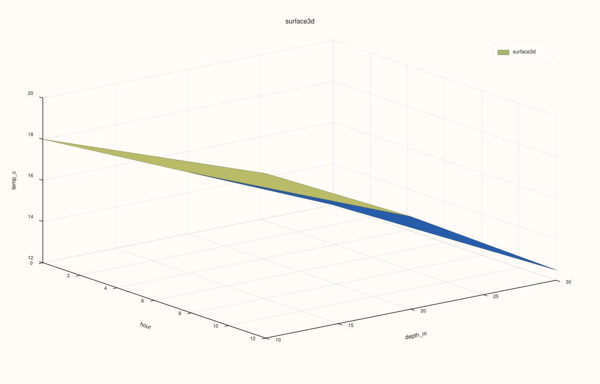
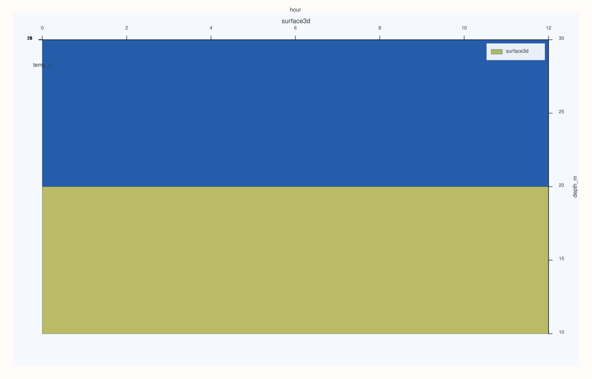

<!-- pluss-hand-authored -->
<!-- pluss-signature-hash: 4343341d59d1 -->

# CatalogPlot3DAccessor::surface

[Back to CatalogPlot3DAccessor API Reference](../../catalog_plot3d_accessor_api_reference)

## Signature

```cpp
CatalogPlot3DAccessor::surface(
    std::string_view x_key,
    std::string_view y_key,
    std::string_view z_key,
    pluss::table::DataFrame::GroupOp op = pluss::table::DataFrame::GroupOp::Mean,
    const pluss::table::Surface3DPlotOptions& options = {}) const -> pluss::pl::Studio
```

## What It Does

Delegates straight to
[`DataFramePlot3DAccessor::surface`](../dataframe-plot3d/surface.md) — the three keys are
first validated against the catalog, then projected down to just those three
(`base_.keys({x_key, y_key, z_key})`) and materialized into a `DataFrame` via
[`tabelize()`](../catalog/tabelize.md) before calling `.plot3d(options_).surface(x_key,
y_key, z_key, op, options)` on the result.

```{important} Projecting to exactly {x_key, y_key, z_key} before tabelize() matters
`tabelize()`'s default policy inner-joins by label across **every** key in the catalog, not
just the three being plotted. If the whole catalog were tabelized instead of just the
projected three-key slice, an unrelated ragged or mismatched key elsewhere in the catalog
could silently narrow (or break) the alignment of the three keys actually being plotted —
projecting first avoids that entirely.
```

See [`DataFramePlot3DAccessor::surface`](../dataframe-plot3d/surface.md) for the full grid
construction (pivoting `y_key`'s distinct values into rows, `x_key`'s into columns, and
aggregating `z_key` into each cell with `op`), the numeric-grid requirement that still
applies at render time, and how missing `(x, y)` combinations are filled.

## Parameters

**x_key**, **y_key**, **z_key** (`std::string_view`, required)
    Must all exist in the catalog — an unknown key throws before any projection/tabelize
    work happens.

**op** (`pluss::table::DataFrame::GroupOp`, default `Mean`)
    The aggregation applied per grid cell — see
    [`DataFramePlot3DAccessor::surface`](../dataframe-plot3d/surface.md) for
    the remaining numeric-rendering constraints after pivoting.

**options** (`const Surface3DPlotOptions&`)
    Same `scene`/`trace` shape documented on
    [`CatalogPlot3DAccessor::scatter`](scatter.md).

## Returns

`pluss::pl::Studio`
    A figure with one 3D pane containing a single filled surface-mesh trace over the
    aggregated grid.

## Examples

Example 1. Default `op` (`Mean`): a numeric `hour`/`depth_m` grid, aggregated by mean
`temp_c`.

```cpp
using namespace pluss::kindle::literals;

auto grid_data = pluss::kindle::Catalog({
    "hour"_k = pluss::kindle::Stream(pluss::make_series({0.0, 12.0, 0.0, 12.0, 0.0, 12.0})),
    "depth_m"_k = pluss::kindle::Stream(pluss::make_series({10.0, 10.0, 20.0, 20.0, 30.0, 30.0})),
    "temp_c"_k = pluss::kindle::Stream(pluss::make_series({18.0, 20.0, 15.0, 16.5, 12.0, 12.5})),
});

auto chart = grid_data.plot3d().surface("hour", "depth_m", "temp_c");
chart.show();
```

`hour`'s two distinct values (`0.0`, `12.0`) become x-columns; `depth_m`'s three distinct
values (`10.0`, `20.0`, `30.0`) become y-rows; each cell is the mean `temp_c` for that
hour/depth combination — here, each combination happens to have exactly one matching row.



Example 2. A different aggregation (`Max`) with a `Topology`-preset scene.

```cpp
using namespace pluss::kindle::literals;

auto grid_data = pluss::kindle::Catalog({
    "hour"_k = pluss::kindle::Stream(pluss::make_series({0.0, 12.0, 0.0, 12.0, 0.0, 12.0})),
    "depth_m"_k = pluss::kindle::Stream(pluss::make_series({10.0, 10.0, 20.0, 20.0, 30.0, 30.0})),
    "temp_c"_k = pluss::kindle::Stream(pluss::make_series({18.0, 20.0, 15.0, 16.5, 12.0, 12.5})),
});

pluss::table::Surface3DPlotOptions options;
options.scene.preset = pluss::pl::flash::ScenePreset3D::Topology;

auto chart = grid_data.plot3d().surface(
    "hour", "depth_m", "temp_c", pluss::table::DataFrame::GroupOp::Max, options);
chart.show();
```



## Notes

- All three keys must exist in the catalog — an unknown key throws
  `"Catalog::plot3d().surface: unknown x key '<name>'"` (or `y`/`z`) before any tabelize work
  runs.
- Delegates to [`DataFramePlot3DAccessor::surface`](../dataframe-plot3d/surface.md) after
  projecting to exactly the three requested keys — see the important callout above and that
  page for the grid-aggregation rules and zero-fill behavior for missing `(x, y)`
  combinations.
- Returns a `pluss::pl::Studio` — see
  [`CatalogPlotAccessor::line`](../catalog-plot/line.md)'s important callout for how to view
  or save the result.

## See Also

- [`CatalogPlot3DAccessor::wireframe`](wireframe.md): the identical grid construction,
  rendered as mesh edges instead of a filled surface.
- [`DataFramePlot3DAccessor::surface`](../dataframe-plot3d/surface.md): the full mechanics
  this method delegates to.
- [`Catalog::tabelize`](../catalog/tabelize.md): the materialization step this method runs
  internally on the projected three-key slice.

<div class="pluss-inline-prev-next">
  <a class="prev-link" href="scatter.html">
    <span class="label">Previous</span>
    <span class="title">scatter</span>
  </a>
  <a class="next-link" href="wireframe.html">
    <span class="label">Next</span>
    <span class="title">wireframe</span>
  </a>
</div>
