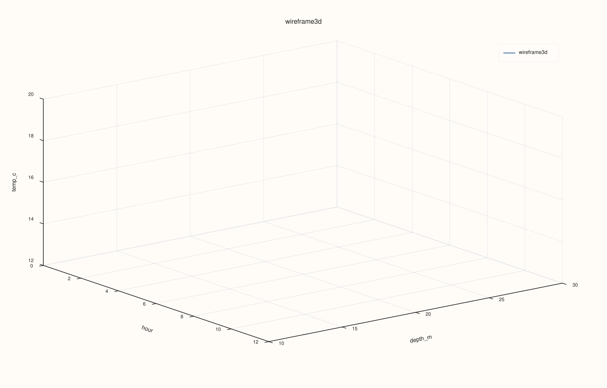
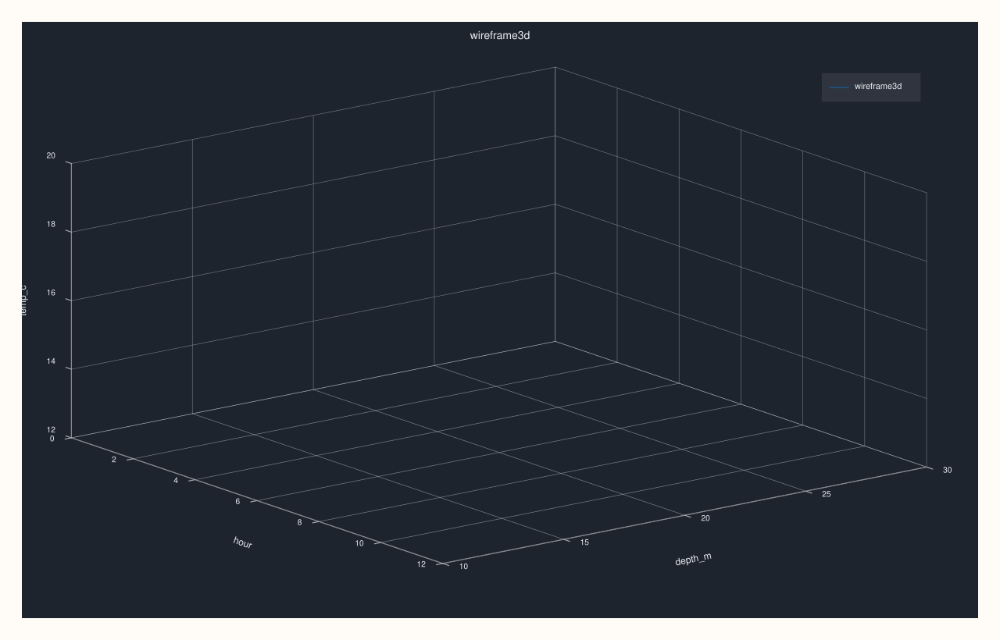

<!-- pluss-hand-authored -->
<!-- pluss-signature-hash: 1410b735c481 -->

# CatalogPlot3DAccessor::wireframe

[Back to CatalogPlot3DAccessor API Reference](../../catalog_plot3d_accessor_api_reference)

## Signature

```cpp
CatalogPlot3DAccessor::wireframe(
    std::string_view x_key,
    std::string_view y_key,
    std::string_view z_key,
    pluss::table::DataFrame::GroupOp op = pluss::table::DataFrame::GroupOp::Mean,
    const pluss::table::Wireframe3DPlotOptions& options = {}) const -> pluss::pl::Studio
```

## What It Does

The same projected-and-tabelized delegation as [`surface()`](surface.md) — validates the
three keys, projects to just `{x_key, y_key, z_key}`, materializes via
[`tabelize()`](../catalog/tabelize.md), and calls
[`DataFramePlot3DAccessor::wireframe`](../dataframe-plot3d/wireframe.md) on the result — but
drawn as an open mesh (a lattice of connecting lines) instead of a filled sheet.

## Parameters

**x_key**, **y_key**, **z_key** (`std::string_view`, required)
    Must all exist in the catalog — an unknown key throws before any projection/tabelize
    work happens.

**op** (`pluss::table::DataFrame::GroupOp`, default `Mean`)
    The aggregation applied per grid cell — see
    [`surface()`](surface.md)/[`DataFramePlot3DAccessor::surface`](../dataframe-plot3d/surface.md)
    for the remaining numeric-rendering constraints after pivoting.

**options** (`const Wireframe3DPlotOptions&`)
    Same `scene`/`trace` shape documented on
    [`CatalogPlot3DAccessor::scatter`](scatter.md).

## Returns

`pluss::pl::Studio`
    A figure with one 3D pane containing a single wireframe (lattice) trace over the
    aggregated grid.

## Examples

Example 1. Default `op` (`Mean`): the same grid as [`surface()`](surface.md)'s Example 1,
drawn as a mesh instead of a filled sheet.

```cpp
using namespace pluss::kindle::literals;

auto grid_data = pluss::kindle::Catalog({
    "hour"_k = pluss::kindle::Stream(pluss::make_series({0.0, 12.0, 0.0, 12.0, 0.0, 12.0})),
    "depth_m"_k = pluss::kindle::Stream(pluss::make_series({10.0, 10.0, 20.0, 20.0, 30.0, 30.0})),
    "temp_c"_k = pluss::kindle::Stream(pluss::make_series({18.0, 20.0, 15.0, 16.5, 12.0, 12.5})),
});

auto chart = grid_data.plot3d().wireframe("hour", "depth_m", "temp_c");
chart.show();
```



Example 2. A different aggregation (`Max`) with a `Studio`-preset scene.

```cpp
using namespace pluss::kindle::literals;

auto grid_data = pluss::kindle::Catalog({
    "hour"_k = pluss::kindle::Stream(pluss::make_series({0.0, 12.0, 0.0, 12.0, 0.0, 12.0})),
    "depth_m"_k = pluss::kindle::Stream(pluss::make_series({10.0, 10.0, 20.0, 20.0, 30.0, 30.0})),
    "temp_c"_k = pluss::kindle::Stream(pluss::make_series({18.0, 20.0, 15.0, 16.5, 12.0, 12.5})),
});

pluss::table::Wireframe3DPlotOptions options;
options.scene.preset = pluss::pl::flash::ScenePreset3D::Studio;

auto chart = grid_data.plot3d().wireframe(
    "hour", "depth_m", "temp_c", pluss::table::DataFrame::GroupOp::Max, options);
chart.show();
```



## Notes

- All three keys must exist in the catalog — an unknown key throws
  `"Catalog::plot3d().wireframe: unknown x key '<name>'"` (or `y`/`z`) before any tabelize
  work runs.
- Delegates to [`DataFramePlot3DAccessor::wireframe`](../dataframe-plot3d/wireframe.md)
  after projecting to exactly the three requested keys — see
  [`surface()`](surface.md)'s important callout for why the projection happens before
  `tabelize()`.
- Returns a `pluss::pl::Studio` — see
  [`CatalogPlotAccessor::line`](../catalog-plot/line.md)'s important callout for how to view
  or save the result.

## See Also

- [`CatalogPlot3DAccessor::surface`](surface.md): the identical grid construction, rendered
  as a filled sheet instead of mesh edges.
- [`DataFramePlot3DAccessor::wireframe`](../dataframe-plot3d/wireframe.md): the full
  mechanics this method delegates to.

<div class="pluss-inline-prev-next">
  <a class="prev-link" href="surface.html">
    <span class="label">Previous</span>
    <span class="title">surface</span>
  </a>
</div>
