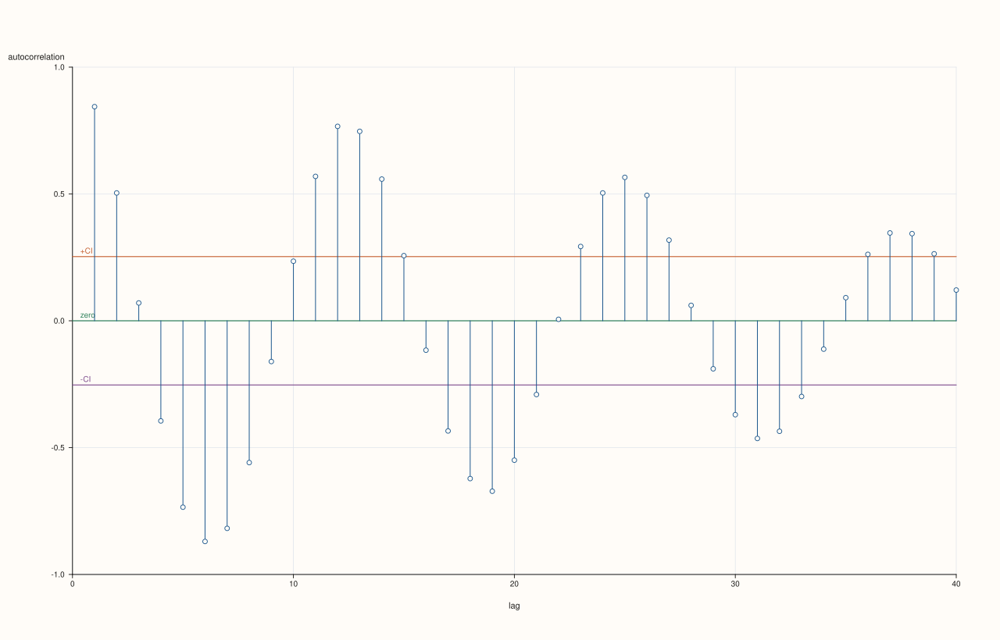
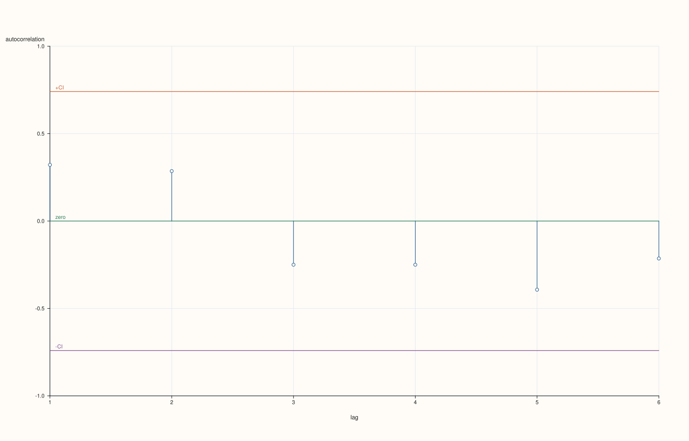
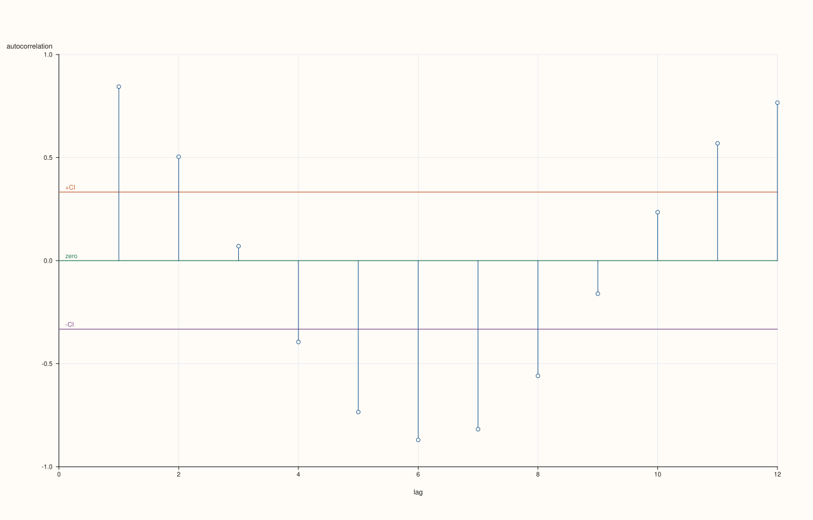
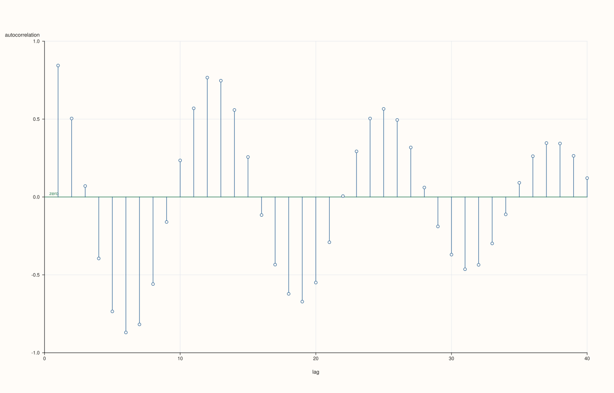

<!-- pluss-hand-authored -->
<!-- pluss-signature-hash: 708f2a0c72c2 -->

# DataFramePlotAccessor::act

[Back to DataFramePlotAccessor API Reference](../../dataframe_plot_api_reference)

## Signature

```cpp
pluss::pl::Studio DataFramePlotAccessor::act(
    std::string_view feature,
    const ActPlotOptions& options = {}) const
```

## What It Does

Draws an autocorrelation plot for one numeric feature: for each lag `k` from `1` up to
`max_lag`, computes the Pearson correlation between the series and itself shifted by `k`
positions, and draws one vertical spike per lag at that correlation value. This is a
standard diagnostic for spotting periodicity or serial dependence in a sequence — a spike
that stays well outside the confidence band at a given lag suggests the series at that lag
is not just noise.

`act()` is one of three closely related single-feature diagnostic plots on this accessor,
alongside [`lag()`](lag.md) (a single lag's scatter, rather than every lag's correlation)
and [`bootstrap()`](bootstrap.md) (a resampling-based diagnostic, unrelated to lags). All
three share the same feature-resolution rule: the named feature must resolve to exactly one
numeric (`Series`-kind) feature, validated via the accessor's
`numeric_feature_names(frame_, {feature}, where)` call — passing a non-numeric feature name
throws `"<where>: feature '<name>' is not a numeric Series"`.

```{important} include_zero_lag is always false here — lag 0 (always 1.0) is never shown
Internally, `act()` delegates to the same autocorrelation machinery used elsewhere in
`PlussPl`'s `flash` layer, but always with `include_zero_lag = false`. The lag-0
autocorrelation of any series with itself is trivially `1.0` and isn't informative, so
`act()`'s spikes always start at lag `1`, never lag `0`.
```

```{note} At least three data points are required
The underlying autocorrelation computation needs at least three points to be meaningful; a
feature with fewer than three rows throws `"flash::acfplot requires at least three points"`
even though `ActPlotOptions` itself has no explicit minimum-row-count field.
```

## Parameters

**feature** (`std::string_view`)
    The single numeric feature to autocorrelate against its own lagged copies. Must resolve
    to a `Series`-kind feature — see the shared-diagnostics note above.

**options** (`ActPlotOptions`)

### `ActPlotOptions` fields

| Field | Type | Default |
|---|---|---|
| `max_lag` | `std::int64_t` | `40` |
| `show_confidence_band` | `bool` | `true` |
| `confidence_level` | `double` | `0.95` |
| `trace_width` | `float` | `1.2F` |

`max_lag` is clamped internally to `[1, n - 1]` where `n` is the feature's row count, so
requesting a `max_lag` larger than the data supports doesn't throw — it's silently
capped. `show_confidence_band` draws two horizontal reference lines at
`±z / sqrt(n)`, where `z` is the z-score for `confidence_level` (using the same lookup
table as [`bar()`](bar.md)'s `ci_enabled` whiskers: `0.99 → 2.575829`, `0.98 →
2.326348`, `0.95 → 1.959964`, `0.90 → 1.644854`, anything else `→ 1.281552`). A spike
that crosses outside this band at a given lag is a rough visual cue that the
autocorrelation at that lag is unlikely to be pure noise. `trace_width` controls the
stroke width of each spike.

## Returns

`pluss::pl::Studio`
    A figure with one pane containing one autocorrelation spike per lag (`1..max_lag`), a
    zero reference line, and (when enabled) two confidence-band reference lines.

## Examples

Example 1. Default options: a periodic-looking sequence, autocorrelated out to lag 40 (or
fewer, if the data is shorter).

```cpp
using namespace pluss::table;

std::vector<double> wave;
for (int i = 0; i < 60; ++i) {
  wave.push_back(std::sin(static_cast<double>(i) * 0.5) + 0.1 * (i % 3));
}

auto series = DataFrame({
    {"signal", Slate(pluss::make_series(wave))},
});

auto chart = series.plot().act("signal");
chart.show();
```

Since `wave` has 60 rows, `max_lag = 40` (the default) fits within the `[1, 59]` clamp range
unchanged; expect strong spikes near lags that are multiples of the wave's period.



Example 2. A shorter feature: `max_lag` is silently clamped rather than throwing.

```cpp
auto small = DataFrame({
    {"reading", Slate(pluss::make_series({4.0, 5.0, 4.5, 6.0, 5.5, 7.0, 6.5}))},
});

auto chart = small.plot().act("reading");
chart.show();
```

`reading` has 7 rows, so `max_lag` is clamped to `6` (`n - 1`) even though the requested
default is `40`; spikes are drawn only for lags `1..6`.



Example 3. An explicit `ActPlotOptions`, narrowing `max_lag`, using a stricter
`confidence_level`, and thickening the spikes.

```cpp
ActPlotOptions options;
options.max_lag = 12;
options.confidence_level = 0.99;
options.trace_width = 2.0F;

auto chart = series.plot().act("signal", options);
chart.show();
```

The confidence band widens (using `z = 2.575829` for `0.99` instead of the default `0.95`'s
`1.959964`), making it harder for a spike to appear "significant."



Example 4. Disabling the confidence band entirely.

```cpp
ActPlotOptions bare_options;
bare_options.show_confidence_band = false;

auto chart = series.plot().act("signal", bare_options);
```

Only the raw spikes and the zero reference line are drawn — no `±CI` lines.



Example 5. A non-numeric feature throws.

```cpp
auto tagged = DataFrame({
    {"signal", Slate(pluss::make_series({1.0, 2.0, 1.5, 2.5}))},
    {"label",  Slate(pluss::make_note({"a", "b", "c", "d"}))},
});

try {
  auto bad = tagged.plot().act("label");
} catch (const std::exception& e) {
  std::cout << e.what();
}
```

### Output

```text
DataFrame::plot().act: feature 'label' is not a numeric Series
```

## Notes

- `feature` must resolve to exactly one numeric feature — see the shared-diagnostics note
  above.
- Lag `0` is never shown; spikes start at lag `1`.
- `max_lag` is clamped to `[1, n - 1]`, never throwing for an over-large request.
- A feature with fewer than three rows throws before any spike is drawn.
- Returns a `pluss::pl::Studio` — see [`line()`](line.md)'s important callout for how to
  view or save the result.

## See Also

- [`DataFramePlotAccessor::lag`](lag.md): a single lag's scatter plot, rather than every
  lag's correlation coefficient.
- [`DataFramePlotAccessor::bootstrap`](bootstrap.md): another single-feature diagnostic,
  based on resampling rather than lags.
- [`DataFramePlotAccessor::bar`](bar.md): shares the same z-score-for-confidence lookup
  table for its `ci_enabled` whiskers.

<div class="pluss-inline-prev-next">
  <a class="next-link" href="andrews_curves.html">
    <span class="label">Next</span>
    <span class="title">andrews_curves</span>
  </a>
</div>
