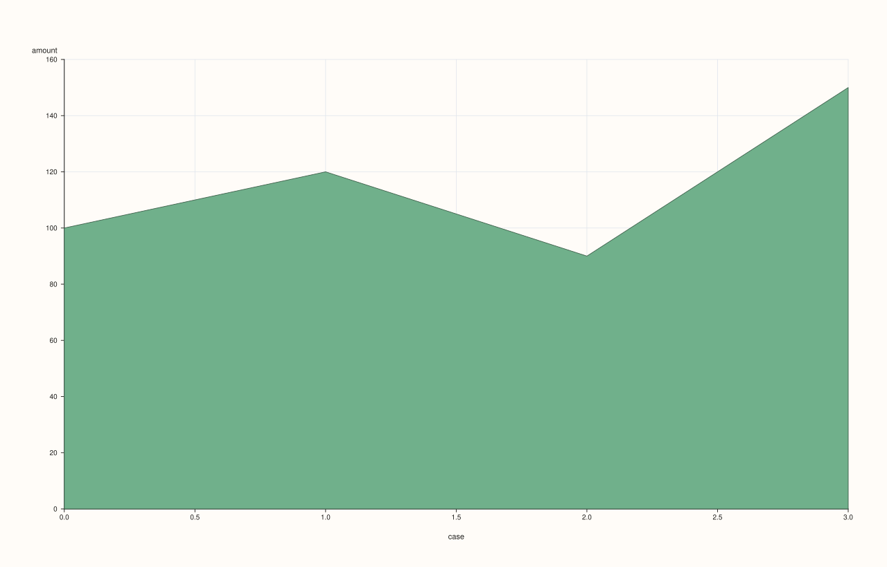

<!-- pluss-hand-authored -->
<!-- pluss-signature-hash: ba20fb9e79d1 -->

# DataFramePlotAccessor::area

[Back to DataFramePlotAccessor API Reference](../../dataframe_plot_api_reference)

## Signatures

```cpp
DataFramePlotAccessor::area(std::string_view y_feature,
                             std::optional<std::string_view> x_feature = std::nullopt) const -> pluss::pl::Studio

DataFramePlotAccessor::area(std::string_view y_feature,
                             std::optional<std::string_view> x_feature,
                             const AreaPlotOptions& options) const -> pluss::pl::Studio

DataFramePlotAccessor::area(pluss::msharp::RangeView::Of<std::string_view> y_features,
                             std::optional<std::string_view> x_feature = std::nullopt) const -> pluss::pl::Studio

DataFramePlotAccessor::area(pluss::msharp::RangeView::Of<std::string_view> y_features,
                             std::optional<std::string_view> x_feature,
                             const AreaPlotOptions& options) const -> pluss::pl::Studio

DataFramePlotAccessor::area(std::initializer_list<std::string_view> y_features,
                             std::optional<std::string_view> x_feature = std::nullopt) const -> pluss::pl::Studio

DataFramePlotAccessor::area(std::initializer_list<std::string_view> y_features,
                             std::optional<std::string_view> x_feature,
                             const AreaPlotOptions& options) const -> pluss::pl::Studio
```

## What It Does

Same shape as [`line()`](line.md) — one trace per y-feature over a shared x-axis, same
three overload families, same x-axis-resolution rules — but each trace is filled down to
the baseline instead of drawn as a bare line, and multiple y-features are drawn as
**independently overlapping** filled regions on the same axes (not stacked; for a stacked
composition view, see [`area_stacked()`](area_stacked.md)).

See [`line()`](line.md) for the full explanation of the shared mechanics — this page only
covers what's specific to `area()`.

## Parameters

**y_feature** / **y_features**
    Same as [`line()`](line.md): one or more numeric features, each drawn as its own filled
    area trace, overlapping rather than stacked. At least one is required — an empty list
    throws `"DataFrame::plot().area: at least one y feature is required"`.

**x_feature** (`std::optional<std::string_view>`, default `std::nullopt`)
    Same three-step resolution as [`line()`](line.md).

**options** (`AreaPlotOptions`)

### `AreaPlotOptions` fields

| Field | Type | Default |
|---|---|---|
| `alpha` | `double` | `0.88` |
| `line_width` | `double` | `1.3` |
| `align` | `XYAlignOptions` | default constructed |

`alpha` defaults noticeably lower than [`line()`](line.md)'s `1.0` — filled regions
default to slightly translucent so overlapping areas from multiple y-features stay
visually distinguishable instead of one fully opaque area hiding another. `align` is
present but inert here — see [`line()`](line.md)'s note on the field.

## Returns

`pluss::pl::Studio`
    A figure with one pane containing one filled area trace per requested y-feature.

## Examples

Example 1. A single feature, explicit x-axis.

```cpp
using namespace pluss::table;

auto sales = DataFrame({
    {"month",  Slate(pluss::make_note({"Jan", "Feb", "Mar", "Apr"}))},
    {"amount", Slate(pluss::make_series({100.0, 120.0, 90.0, 150.0}))},
    {"cost",   Slate(pluss::make_series({60.0, 80.0, 55.0, 95.0}))},
});

auto chart = sales.plot().area("amount", "month");
chart.show();
```


Example 2. Two y-features drawn as overlapping (not stacked) filled areas — where they
overlap, the default `alpha = 0.88` keeps both visible rather than one fully occluding the
other.

```cpp
auto chart = sales.plot().area({"amount", "cost"}, "month");
chart.show();
```


Example 3. The same multi-feature call via a reusable `RangeView`.

```cpp
std::vector<std::string_view> y_names{"amount", "cost"};
auto chart = sales.plot().area(pluss::msharp::RangeView::Of<std::string_view>(y_names), "month");
chart.save_pdf("sales_area.pdf");
```


Example 4. No `x_feature`: falls back to the frame's own row labels, titled `"case"` — see
[`line()`](line.md)'s Example 3 for the full explanation.

```cpp
auto chart = sales.plot().area("amount");
```



Example 5. An explicit `AreaPlotOptions`, raising opacity toward fully opaque and
thickening the outline.

```cpp
AreaPlotOptions area_options;
area_options.alpha = 1.0;
area_options.line_width = 2.0;

auto chart = sales.plot().area("amount", "month", area_options);
chart.show();
```


Example 6. Multiple y-features with an explicit options object.

```cpp
auto chart = sales.plot().area({"amount", "cost"}, "month", area_options);
```


## Notes

- Shares every mechanic described on [`line()`](line.md)'s page except the filled trace
  shape and the `AreaPlotOptions` struct's lower default `alpha`.
- Multiple y-features overlap rather than stack — see [`area_stacked()`](area_stacked.md)
  for the composition (accumulating) variant.
- At least one y-feature is required.
- Returns a `pluss::pl::Studio` — see [`line()`](line.md)'s important callout for how to
  view or save the result.

## See Also

- [`DataFramePlotAccessor::area_stacked`](area_stacked.md): the accumulating,
  composition-focused sibling of this method.
- [`DataFramePlotAccessor::line`](line.md): the unfilled counterpart, and the canonical
  explanation of this accessor's shared mechanics.

<div class="pluss-inline-prev-next">
  <a class="prev-link" href="andrews_curves.html">
    <span class="label">Previous</span>
    <span class="title">andrews_curves</span>
  </a>
  <a class="next-link" href="area_stacked.html">
    <span class="label">Next</span>
    <span class="title">area_stacked</span>
  </a>
</div>
