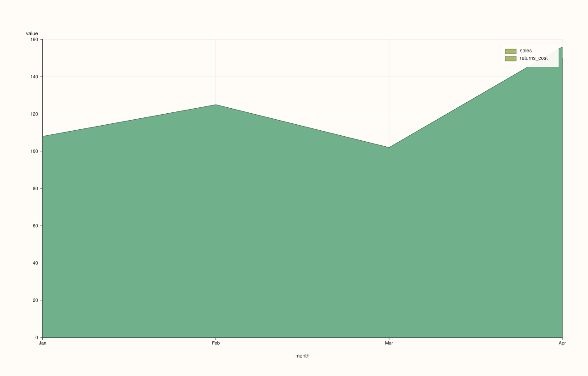
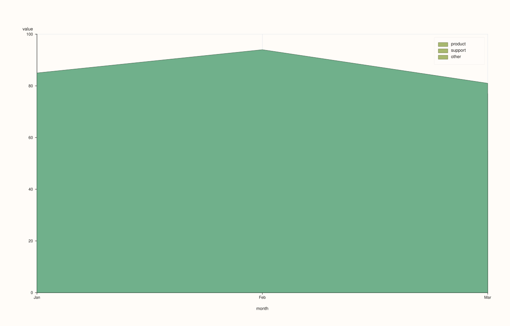

<!-- pluss-hand-authored -->
<!-- pluss-signature-hash: 31360c6c26fe -->

# DataFramePlotAccessor::area_stacked

[Back to DataFramePlotAccessor API Reference](../../dataframe_plot_api_reference)

## Signatures

```cpp
DataFramePlotAccessor::area_stacked(pluss::msharp::RangeView::Of<std::string_view> y_features,
                                     std::optional<std::string_view> x_feature = std::nullopt) const -> pluss::pl::Studio

DataFramePlotAccessor::area_stacked(pluss::msharp::RangeView::Of<std::string_view> y_features,
                                     std::optional<std::string_view> x_feature,
                                     const AreaStackedPlotOptions& options) const -> pluss::pl::Studio

DataFramePlotAccessor::area_stacked(std::initializer_list<std::string_view> y_features,
                                     std::optional<std::string_view> x_feature = std::nullopt) const -> pluss::pl::Studio

DataFramePlotAccessor::area_stacked(std::initializer_list<std::string_view> y_features,
                                     std::optional<std::string_view> x_feature,
                                     const AreaStackedPlotOptions& options) const -> pluss::pl::Studio
```

## What It Does

Draws several numeric y-features as a **stacked** area chart: each feature's values
accumulate on top of the running total of the features drawn before it, so the topmost
edge of the last trace represents the sum of every requested feature at that x position.
This is the composition view — "how much does each part contribute to the whole, at each
point" — as opposed to [`area()`](area.md), which draws independently overlapping
(non-accumulating) filled regions. Unlike every other line/area method on this accessor,
there is **no single-feature overload**: `area_stacked()` only accepts a `RangeView` or
`initializer_list` of y-features, since stacking a single feature on its own is a
degenerate case.

See [`line()`](line.md) for the shared x-axis-resolution rules (explicit argument, then
`options.default_x_feature`, then the frame's row labels titled `"case"`) and the
`Studio`-return / no-`cout` mechanics common to this whole accessor.

```{note} Each layer's fill actually reaches down to zero, not to the layer below it
Internally, each successive layer's cumulative top is computed correctly (feature 2's
"top" is feature 1's top plus feature 2's own height, and so on) — the stacking math itself
is exact. But each layer is filled from its own cumulative top down to a flat baseline of
`0`, not down to the previous layer's top. The correct stacked *shape* still comes through,
because each later (taller) layer is drawn on top of the earlier ones in the same pane and
visually covers the redundant region beneath it — but with the default semi-transparent
`alpha` (`0.7`), the color in an area where multiple layers overlap is a blend of every
layer drawn there, not a single flat color unique to one band. If a fully solid per-band
look matters, raise `alpha` toward `1.0` in `AreaStackedPlotOptions` so each later layer's
fill more fully occludes the ones beneath it.
```

## Parameters

**y_features** (`RangeView<std::string_view>` or `std::initializer_list<std::string_view>`)
    Numeric features to stack, in the order they're accumulated — the first feature forms
    the bottom band, the last feature's cumulative top is the total across all of them. At
    least one is required — an empty list throws `"DataFrame::plot().area_stacked: at least
    one y feature is required"`.

**x_feature** (`std::optional<std::string_view>`, default `std::nullopt`)
    Same three-step resolution as [`line()`](line.md).

**options** (`AreaStackedPlotOptions`)

### `AreaStackedPlotOptions` fields

| Field | Type | Default |
|---|---|---|
| `alpha` | `double` | `0.7` |
| `line_width` | `double` | `1.2` |

`alpha` defaults lower than both [`line()`](line.md) (`1.0`) and [`area()`](area.md)
(`0.88`) — see the note above for why: with several stacked, overlapping fills, a lower
default opacity keeps the underlying grid and boundary lines visible through the stack.

## Returns

`pluss::pl::Studio`
    A figure with one pane containing one filled area trace per requested y-feature, each
    one's top edge representing the running cumulative total up to and including that
    feature.

## Examples

Example 1. A two-feature stack with an explicit x-axis — `total`'s implied height at any
point is `sales + returns_cost` combined.

```cpp
using namespace pluss::table;

auto breakdown = DataFrame({
    {"month",        Slate(pluss::make_note({"Jan", "Feb", "Mar", "Apr"}))},
    {"sales",        Slate(pluss::make_series({100.0, 120.0, 90.0, 150.0}))},
    {"returns_cost", Slate(pluss::make_series({8.0, 5.0, 12.0, 6.0}))},
});

auto chart = breakdown.plot().area_stacked({"sales", "returns_cost"}, "month");
chart.show();
```

`sales` forms the bottom band (0 up to its own value at each month); `returns_cost` is
drawn stacked on top of it, its own cumulative top reaching `sales + returns_cost` at each
month.



Example 2. Three features stacked, via a reusable `RangeView` built at runtime.

```cpp
auto breakdown3 = DataFrame({
    {"month",   Slate(pluss::make_note({"Jan", "Feb", "Mar"}))},
    {"product", Slate(pluss::make_series({60.0, 70.0, 55.0}))},
    {"support", Slate(pluss::make_series({20.0, 18.0, 22.0}))},
    {"other",   Slate(pluss::make_series({5.0, 6.0, 4.0}))},
});

std::vector<std::string_view> parts{"product", "support", "other"};
auto chart = breakdown3.plot().area_stacked(
    pluss::msharp::RangeView::Of<std::string_view>(parts), "month");
chart.show();
```

The topmost trace's edge (`other`'s cumulative top) traces `product + support + other` at
each month — the total, decomposed into three accumulating bands beneath it.



Example 3. No `x_feature`: falls back to the frame's own row labels, exactly like every
other chart method on this accessor — see [`line()`](line.md)'s Example 3.

```cpp
auto chart = breakdown.plot().area_stacked({"sales", "returns_cost"});
```


Example 4. An explicit `AreaStackedPlotOptions`, raising opacity for a more solid-looking
stack (accepting more blending obscurity for earlier layers, per the note above).

```cpp
AreaStackedPlotOptions stacked_options;
stacked_options.alpha = 0.95;
stacked_options.line_width = 1.5;

auto chart = breakdown.plot().area_stacked({"sales", "returns_cost"}, "month", stacked_options);
chart.show();
```


Example 5. The `initializer_list` overload with an explicit options object.

```cpp
auto chart = breakdown.plot().area_stacked({"sales", "returns_cost"}, "month", stacked_options);
```


## Notes

- No single-feature overload exists — only `RangeView`/`initializer_list` forms.
- At least one y-feature is required.
- Each layer's fill reaches down to a flat `0` baseline, not the previous layer's top — see
  the note above for the practical implication on overlapping-fill color.
- Returns a `pluss::pl::Studio` — see [`line()`](line.md)'s important callout for how to
  view or save the result.

## See Also

- [`DataFramePlotAccessor::area`](area.md): the non-stacking, overlapping-fill sibling.
- [`DataFramePlotAccessor::bar_stacked`](bar_stacked.md): the same accumulating idea, drawn
  as discrete bars instead of continuous filled regions.
- [`DataFramePlotAccessor::line`](line.md): the canonical explanation of this accessor's
  shared x-axis and `Studio`-return mechanics.

<div class="pluss-inline-prev-next">
  <a class="prev-link" href="area.html">
    <span class="label">Previous</span>
    <span class="title">area</span>
  </a>
  <a class="next-link" href="auto_plot.html">
    <span class="label">Next</span>
    <span class="title">auto_plot</span>
  </a>
</div>
