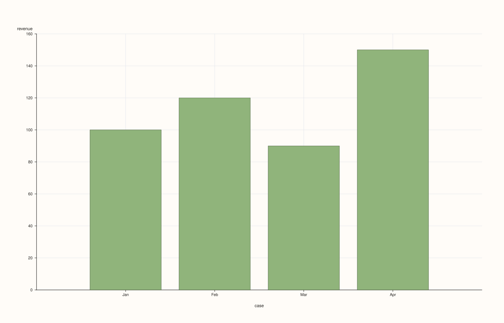
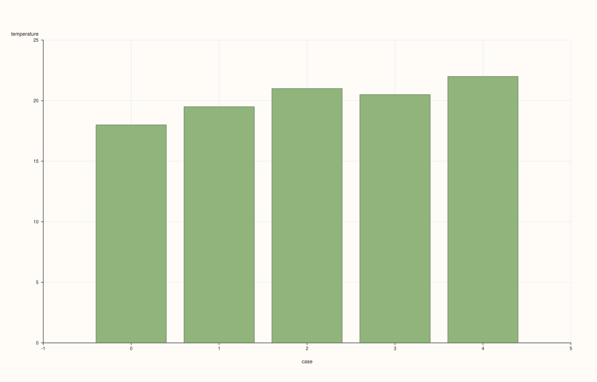
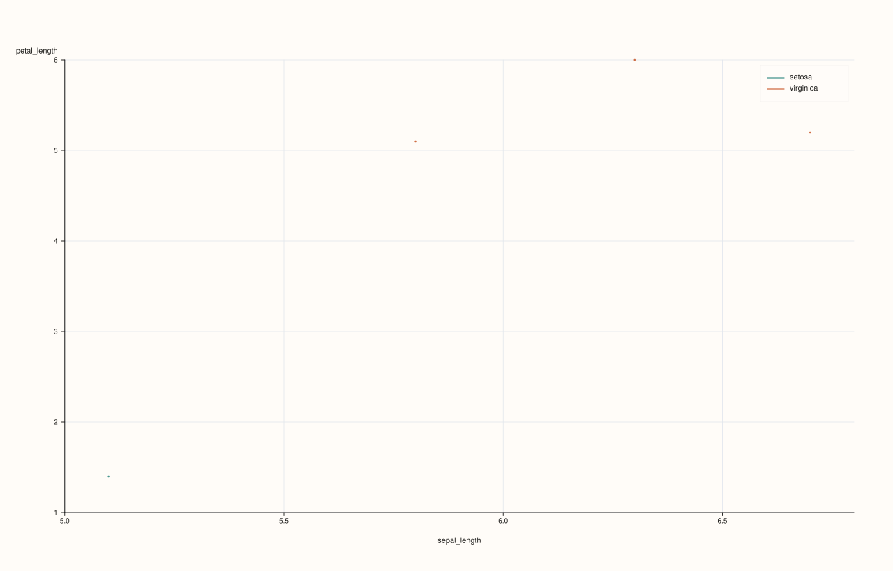
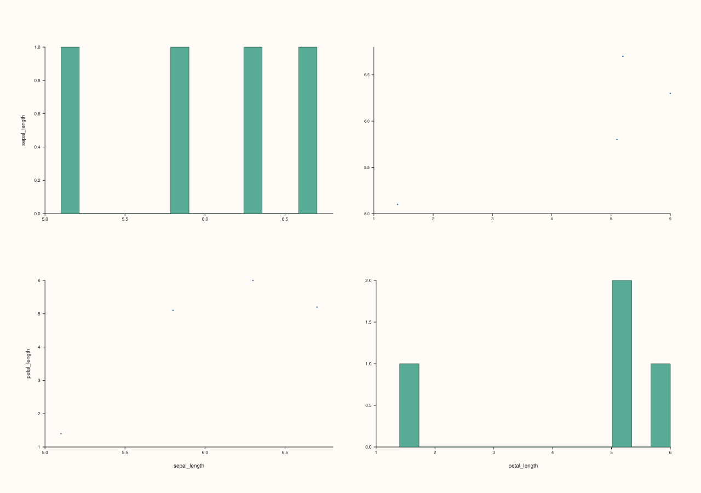
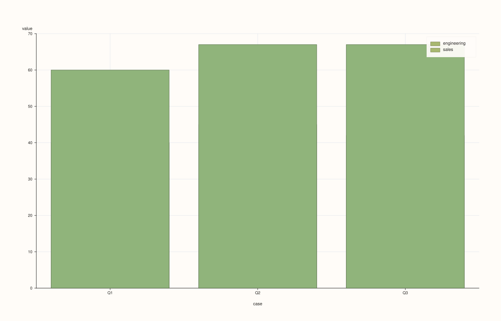
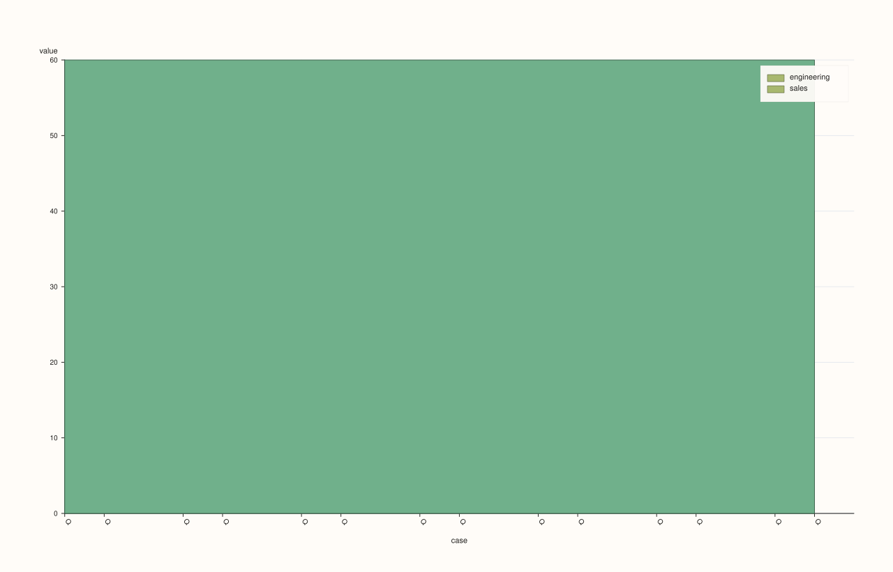
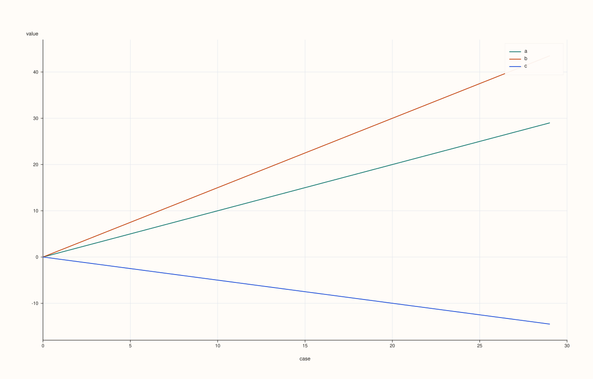
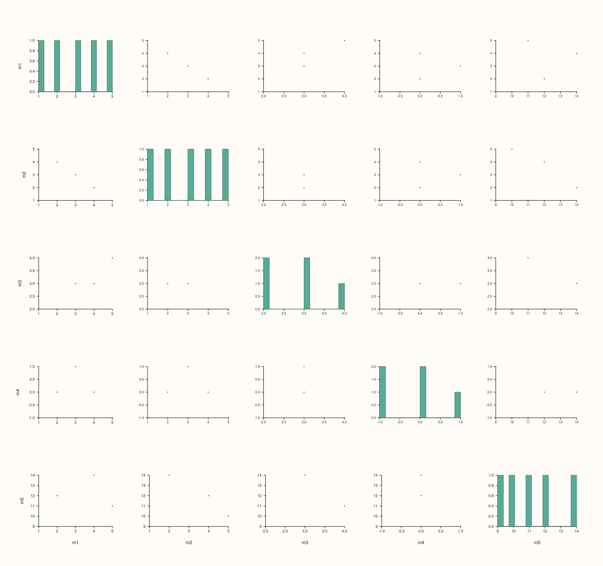
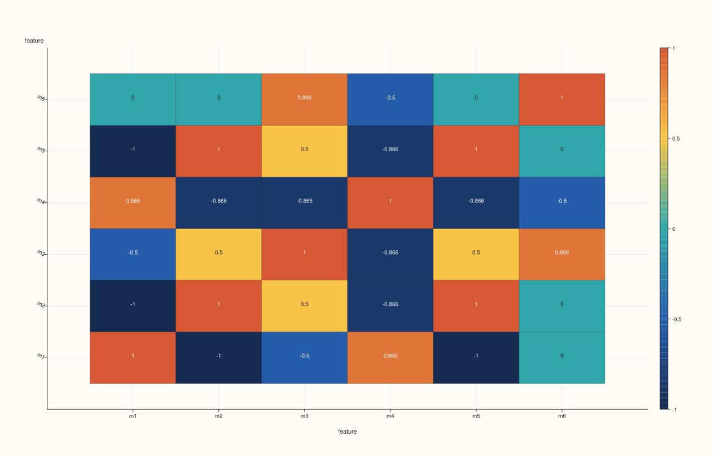

<!-- pluss-hand-authored -->
<!-- pluss-signature-hash: 3f9665753399 -->

# DataFramePlotAccessor::auto_plot

[Back to DataFramePlotAccessor API Reference](../../dataframe_plot_api_reference)

## Signatures

```cpp
DataFramePlotAccessor::auto_plot(
    pluss::msharp::RangeView::Of<std::string_view> features = {}) const -> pluss::pl::Studio

DataFramePlotAccessor::auto_plot(
    pluss::msharp::RangeView::Of<std::string_view> features,
    const AutoPlotOptions& options) const -> pluss::pl::Studio
```

## What It Does

Picks a chart type automatically for the requested (or inferred) numeric features and
delegates to the corresponding method on this same accessor — `auto_plot()` never draws
anything itself; every branch ends by calling straight into `bar()`, `line()`, `scatter()`,
`bar_stacked()`, `area_stacked()`, `scatter_matrix()`, or `corr_heatmap()`. The routing is a
fully deterministic decision tree based on how many numeric features resolve, whether the
frame's row labels are categorical/temporal, how many rows the frame has, whether a
hue-capable feature exists, and whether every selected column is non-negative. It exists for
quick, exploratory looks at a frame without having to pick a chart type by hand — for
anything beyond "show me something reasonable," reach for the specific method directly
instead.

The two-argument overload's `AutoPlotOptions` is currently an empty struct (reserved for
future use) — it has no effect on routing or rendering today; both overloads behave
identically.

Feature resolution follows the same rule as [`box()`](box.md): empty (default) `features`
infers every numeric feature in the frame, and an explicitly-passed non-numeric name throws
— see [`box()`](box.md)'s important callout for the exact rule and throw text.

```{important} The decision tree, in order
Given the resolved feature names (`names`) and whether `features` was passed non-empty
(`explicit_features`), the first matching rule below wins:

1. **Exactly one numeric feature.** If the frame's row-label thread is Note-, Timeline-, or
   TimeIndex-kind ("labeled") **and** the frame has 16 or fewer rows, routes to
   `bar(names.front())`. Otherwise routes to `line(names.front())`.
2. **Exactly two numeric features, and `features` was left empty/default.** If the frame
   has *any* Note/Timeline/TimeIndex-kind feature (checked across the whole frame, not just
   the two selected numeric ones), routes to `scatter(names[0], names[1], hue)` using the
   *first* such feature (in the frame's own column order) as the hue. This rule is skipped
   entirely — even with the same two resolved features — when `features` was passed
   explicitly rather than left empty.
3. **Two or three numeric features, labeled row axis, and every selected column
   non-negative** (non-finite cells treated as `0` for this check only). If the frame has 12
   or fewer rows, routes to `bar_stacked()` over the selected features; otherwise routes to
   `area_stacked()`.
4. **Two, three, or four numeric features, and the frame "prefers an index plot"** — true
   when the row-label thread is labeled-kind, *or* the frame has more than 24 rows (either
   condition alone is enough). Routes to `line()` with all selected features as `y_features`.
5. **Five or fewer numeric features, and 256 or fewer rows.** Routes to a scatter-matrix
   view equivalent to `scatter_matrix(names)` with default options (`Full` triangle).
6. **Everything else** (more than five features, or too many rows for step 5 to apply).
   Routes to a correlation-heatmap view equivalent to `corr_heatmap(names)` with default
   options.
```

## Parameters

**features** (`RangeView<std::string_view>`, default `{}`)
    Numeric features to consider. Empty (the default) infers every numeric feature in the
    frame — see [`box()`](box.md)'s important callout for the exact rule. Whether this
    argument was left empty or passed explicitly also affects routing directly (rule 2
    above only fires for the default/empty case).

**options** (`AutoPlotOptions`)
    ```cpp
    struct AutoPlotOptions {};
    ```
    Currently empty; reserved for future routing controls.

## Returns

`pluss::pl::Studio`
    Whatever the routed-to method returns — the figure shape (pane count, trace kind, axis
    labels) depends entirely on which rule fired.

## Examples

Example 1. One numeric feature, labeled (Note-kind) row axis, few rows: routes to `bar()`.

```cpp
using namespace pluss::table;

auto monthly = DataFrame({
    {"revenue", Thread(pluss::make_series({100.0, 120.0, 90.0, 150.0}))},
}, Thread(pluss::make_note({"Jan", "Feb", "Mar", "Apr"})));

auto chart = monthly.plot().auto_plot();
chart.show();
```

Row labels are Note-kind and there are only 4 rows (`≤ 16`), so this is equivalent to
`monthly.plot().bar("revenue")`.



Example 2. One numeric feature, default (numeric) row axis: routes to `line()`.

```cpp
auto trend = DataFrame({
    {"temperature", Thread(pluss::make_series({18.0, 19.5, 21.0, 20.5, 22.0}))},
});

auto chart = trend.plot().auto_plot();
chart.show();
```

No row labels were provided, so `trend`'s row axis defaults to a plain numeric case index
(not labeled-kind) — this is equivalent to `trend.plot().line("temperature")`.



Example 3. Two numeric features (default/empty `features`), with a hue-capable feature
elsewhere in the frame: routes to `scatter()` with that feature as hue.

```cpp
auto flowers = DataFrame({
    {"sepal_length", Thread(pluss::make_series({5.1, 6.7, 5.8, 6.3}))},
    {"petal_length", Thread(pluss::make_series({1.4, 5.2, 5.1, 6.0}))},
    {"species",      Thread(pluss::make_note({"setosa", "virginica", "virginica", "virginica"}))},
});

auto chart = flowers.plot().auto_plot();
chart.save_pdf("flowers_auto.pdf");
```

`species` is the only Note/Timeline/TimeIndex-kind feature in the frame, and `features` was
left at its default empty value, so this is equivalent to
`flowers.plot().scatter("sepal_length", "petal_length", "species")`.



Example 4. The same two numeric features, but requested explicitly: the hue-scatter rule is
skipped even though `species` still exists.

```cpp
auto chart = flowers.plot().auto_plot({"sepal_length", "petal_length"});
```

Because `features` was passed non-empty this time, rule 2 never fires — routing falls
through to rule 3 (labeled row axis check) or beyond, exactly as if `species` didn't exist
for hue-selection purposes. (`flowers` has no explicit row labels here, so its row axis is
the default numeric index, and this particular example actually falls all the way through
to rule 5's scatter-matrix fallback.)



Example 5. Two non-negative features, labeled row axis, few rows: routes to `bar_stacked()`.

```cpp
auto budget = DataFrame({
    {"engineering", Thread(pluss::make_series({40.0, 45.0, 42.0}))},
    {"sales",       Thread(pluss::make_series({20.0, 22.0, 25.0}))},
}, Thread(pluss::make_note({"Q1", "Q2", "Q3"})));

auto chart = budget.plot().auto_plot();
chart.show();
```

Both features are all-nonnegative, the row axis is labeled, and there are only 3 rows
(`≤ 12`) — equivalent to `budget.plot().bar_stacked({"engineering", "sales"})`.



Example 6. The same shape but with more than 12 rows: routes to `area_stacked()` instead.

```cpp
std::vector<double> eng(20, 40.0), sales(20, 20.0);
auto wide_budget = DataFrame({
    {"engineering", Thread(pluss::make_series(eng))},
    {"sales",       Thread(pluss::make_series(sales))},
}, Thread(pluss::make_note(std::vector<std::string>(20, "Q"))));

auto chart = wide_budget.plot().auto_plot();
```

Still all-nonnegative and labeled, but now 20 rows (`> 12`) — equivalent to
`wide_budget.plot().area_stacked({"engineering", "sales"})`.



Example 7. Three numeric features, no labeled axis, more than 24 rows: routes to a
multi-feature `line()`.

```cpp
std::vector<double> a, b, c;
for (int i = 0; i < 30; ++i) {
  a.push_back(static_cast<double>(i));
  b.push_back(static_cast<double>(i) * 1.5);
  c.push_back(static_cast<double>(i) * -0.5);
}

auto series = DataFrame({
    {"a", Thread(pluss::make_series(a))},
    {"b", Thread(pluss::make_series(b))},
    {"c", Thread(pluss::make_series(c))},
});

auto chart = series.plot().auto_plot();
chart.show();
```

No row labels (default numeric index) but 30 rows (`> 24`) makes `prefer_index_plot()` true
regardless; 3 features fits within rule 4's `≤ 4` cap — equivalent to
`series.plot().line({"a", "b", "c"})`.



Example 8. Five numeric features, few rows, no other rule matching first: routes to a
scatter-matrix.

```cpp
auto metrics = DataFrame({
    {"m1", Thread(pluss::make_series({1.0, 2.0, 3.0, 4.0, 5.0}))},
    {"m2", Thread(pluss::make_series({5.0, 4.0, 3.0, 2.0, 1.0}))},
    {"m3", Thread(pluss::make_series({2.0, 2.0, 3.0, 3.0, 4.0}))},
    {"m4", Thread(pluss::make_series({-1.0, 0.0, 1.0, 0.0, -1.0}))},
    {"m5", Thread(pluss::make_series({10.0, 12.0, 9.0, 14.0, 11.0}))},
});

auto chart = metrics.plot().auto_plot();
chart.show();
```

5 features (at rule 5's `≤ 5` boundary) and 5 rows (well within `≤ 256`) — equivalent to
`metrics.plot().scatter_matrix({"m1", "m2", "m3", "m4", "m5"})`. (`m4` contains negative
values, which would have disqualified rules 3 and 4 anyway even at a smaller feature count.)



Example 9. More than five numeric features: routes to a correlation heatmap.

```cpp
auto wide_metrics = DataFrame({
    {"m1", Thread(pluss::make_series({1.0, 2.0, 3.0}))},
    {"m2", Thread(pluss::make_series({3.0, 2.0, 1.0}))},
    {"m3", Thread(pluss::make_series({2.0, 3.0, 1.0}))},
    {"m4", Thread(pluss::make_series({1.0, 1.0, 2.0}))},
    {"m5", Thread(pluss::make_series({4.0, 3.0, 2.0}))},
    {"m6", Thread(pluss::make_series({0.0, 1.0, 0.0}))},
});

auto chart = wide_metrics.plot().auto_plot();
chart.save_pdf("wide_metrics_auto.pdf");
```

6 features exceeds rule 5's `≤ 5` cap, so routing falls all the way to the final rule —
equivalent to `wide_metrics.plot().corr_heatmap({"m1", ..., "m6"})`.



Example 10. A non-numeric feature name in an explicit request throws, same as
[`box()`](box.md).

```cpp
auto tagged = DataFrame({
    {"revenue", Thread(pluss::make_series({100.0, 120.0, 90.0}))},
    {"region",  Thread(pluss::make_note({"East", "West", "East"}))},
});

try {
  auto bad = tagged.plot().auto_plot({"revenue", "region"});
} catch (const std::exception& e) {
  std::cout << e.what();
}
```

### Output

```text
DataFrame::plot().auto_plot: feature 'region' is not a numeric Series
```

## Notes

- Every branch delegates to another method on this same accessor — `auto_plot()` performs
  no rendering of its own.
- Rule 2 (hue scatter) only fires when `features` is left at its empty default; an explicit
  two-feature request skips straight past it.
- `AutoPlotOptions` is currently empty and has no effect.
- Empty (default) `features` infers every numeric feature — see [`box()`](box.md)'s
  important callout for the exact rule.
- Returns a `pluss::pl::Studio` — see [`line()`](line.md)'s important callout for how to
  view or save the result.

## See Also

- [`DataFramePlotAccessor::brief`](brief.md): a fixed textual summary instead of an
  automatically chosen chart type.
- Every method named in the decision tree above (`bar`, `line`, `scatter`, `bar_stacked`,
  `area_stacked`, `scatter_matrix`, `corr_heatmap`): the actual chart-drawing methods
  `auto_plot()` delegates to.

<div class="pluss-inline-prev-next">
  <a class="prev-link" href="area_stacked.html">
    <span class="label">Previous</span>
    <span class="title">area_stacked</span>
  </a>
  <a class="next-link" href="bar.html">
    <span class="label">Next</span>
    <span class="title">bar</span>
  </a>
</div>
