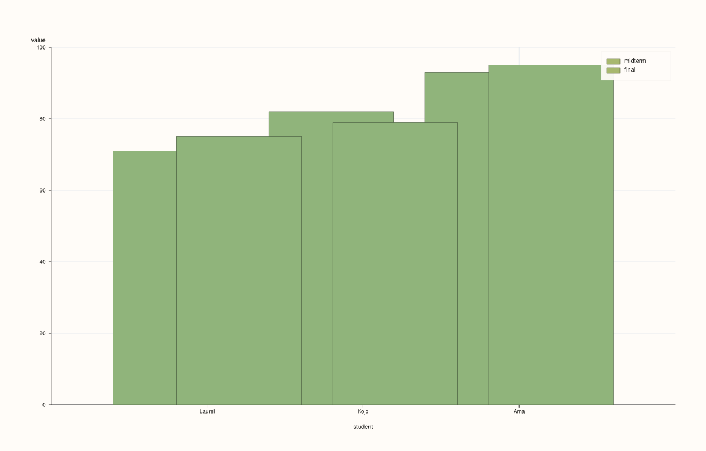
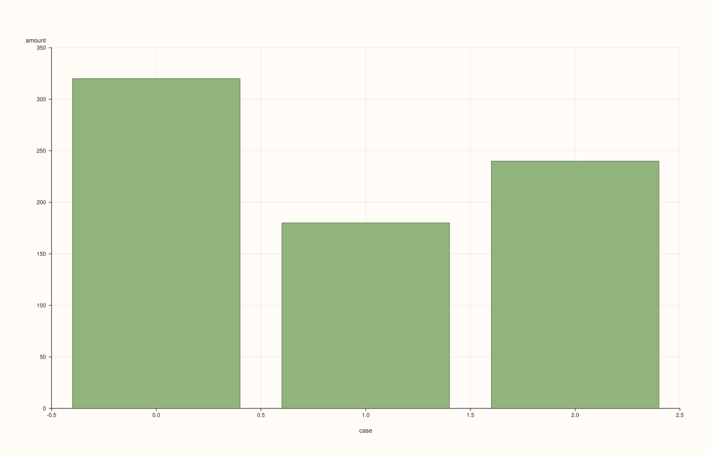
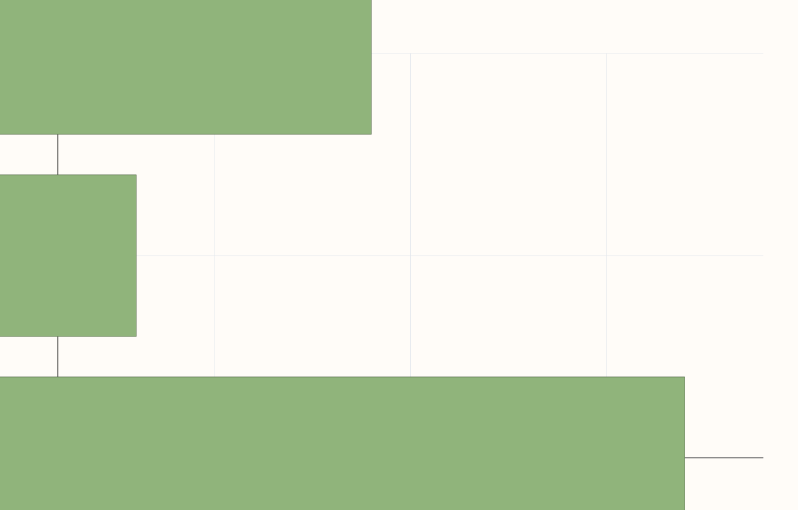
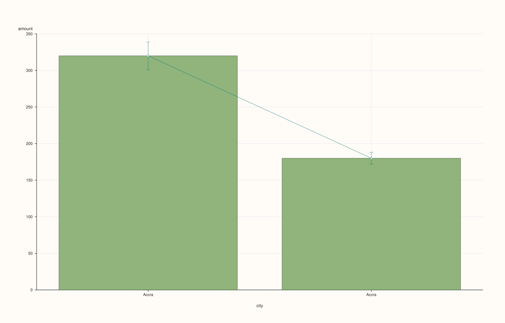

<!-- pluss-hand-authored -->
<!-- pluss-signature-hash: 72c5be14d456 -->

# DataFramePlotAccessor::bar

[Back to DataFramePlotAccessor API Reference](../../dataframe_plot_api_reference)

## Signatures

```cpp
DataFramePlotAccessor::bar(std::string_view y_feature,
                            std::optional<std::string_view> x_feature = std::nullopt) const -> pluss::pl::Studio

DataFramePlotAccessor::bar(std::string_view y_feature,
                            std::optional<std::string_view> x_feature,
                            const BarPlotOptions& options) const -> pluss::pl::Studio

DataFramePlotAccessor::bar(pluss::msharp::RangeView::Of<std::string_view> y_features,
                            std::optional<std::string_view> x_feature = std::nullopt) const -> pluss::pl::Studio

DataFramePlotAccessor::bar(pluss::msharp::RangeView::Of<std::string_view> y_features,
                            std::optional<std::string_view> x_feature,
                            const BarPlotOptions& options) const -> pluss::pl::Studio

DataFramePlotAccessor::bar(std::initializer_list<std::string_view> y_features,
                            std::optional<std::string_view> x_feature = std::nullopt) const -> pluss::pl::Studio

DataFramePlotAccessor::bar(std::initializer_list<std::string_view> y_features,
                            std::optional<std::string_view> x_feature,
                            const BarPlotOptions& options) const -> pluss::pl::Studio
```

## What It Does

Draws one bar per row for a single y-feature, or **grouped** (side-by-side) bars per row
when several y-features are requested — each feature gets its own narrower bar sharing the
row's axis position, rather than stacking (see [`bar_stacked()`](bar_stacked.md) for the
accumulating variant). Same three overload families and x-axis-resolution rules as
[`line()`](line.md).

See [`line()`](line.md) for the shared x-axis-resolution rules and `Studio`-return / no-`cout`
mechanics.

## Parameters

**y_feature** / **y_features**
    One or more numeric features. A single feature draws one bar series; several draw
    grouped bars sharing each axis position. At least one is required — an empty list
    throws `"DataFrame::plot().bar: at least one y feature is required"`.

**x_feature** (`std::optional<std::string_view>`, default `std::nullopt`)
    Same three-step resolution as [`line()`](line.md) — falls back to the frame's row
    labels (titled `"case"`) if omitted with no default set.

**options** (`BarPlotOptions`)

### `BarPlotOptions` fields

| Field | Type | Default |
|---|---|---|
| `ci_enabled` | `bool` | `false` |
| `ci_level` | `double` | `0.95` |
| `horizontal` | `bool` | `false` |
| `align` | `XYAlignOptions` | default constructed |

`horizontal = true` swaps the chart's orientation: bars extend along the x-axis instead
of the y-axis, and the category axis becomes the vertical one.

    `ci_enabled = true` switches from "one bar per row" to **aggregated** bars: rows sharing
    the same x-axis position (same category label, or same numeric x-value) are grouped,
    each bar's height becomes the **mean** of that group, and a whisker/error-bar trace is
    overlaid showing a normal-approximation confidence interval at `ci_level` (default
    `0.95`, i.e. roughly ±1.96 standard errors). A group with only one row still draws a bar
    (at that row's own value, as its "mean") but its whisker has zero width — there's no
    variance to estimate from a single sample.

    `align` is present but inert here — see [`line()`](line.md)'s note on the field.

## Returns

`pluss::pl::Studio`
    A figure with one pane containing one bar trace per y-feature (grouped side-by-side if
    more than one), plus a whisker trace per y-feature when `ci_enabled = true`.

## Examples

Example 1. A single feature, explicit categorical x-axis.

```cpp
using namespace pluss::table;

auto sales = DataFrame({
    {"city",   Slate(pluss::make_note({"Accra", "Tema", "Kumasi"}))},
    {"amount", Slate(pluss::make_series({320.0, 180.0, 240.0}))},
});

auto chart = sales.plot().bar("amount", "city");
chart.show();
```

One bar per city, no legend (single y-feature).


Example 2. Two y-features, grouped (side-by-side) bars sharing each x position.

```cpp
auto exams = DataFrame({
    {"student", Slate(pluss::make_note({"Laurel", "Kojo", "Ama"}))},
    {"midterm", Slate(pluss::make_series({71.0, 82.0, 93.0}))},
    {"final",   Slate(pluss::make_series({75.0, 79.0, 95.0}))},
});

auto chart = exams.plot().bar({"midterm", "final"}, "student");
chart.show();
```

Each student gets two narrower bars side by side (`midterm`, `final`) instead of one — the
per-group bar width automatically shrinks to fit both within that student's axis slot. A
legend labeled `"midterm"`/`"final"` is shown automatically.



Example 3. The same grouped call via a reusable `RangeView`.

```cpp
std::vector<std::string_view> y_names{"midterm", "final"};
auto chart = exams.plot().bar(pluss::msharp::RangeView::Of<std::string_view>(y_names), "student");
chart.save_pdf("exams.pdf");
```


Example 4. No `x_feature`: falls back to the frame's own row labels, exactly like every
other chart method on this accessor — see [`line()`](line.md)'s Example 3.

```cpp
auto chart = sales.plot().bar("amount");
```



Example 5. `horizontal = true` — bars extend sideways, category axis runs vertically.

```cpp
BarPlotOptions horizontal_options;
horizontal_options.horizontal = true;

auto chart = sales.plot().bar("amount", "city", horizontal_options);
chart.show();
```



Example 6. `ci_enabled = true` — rows sharing the same category are aggregated into a mean
bar with a confidence-interval whisker.

```cpp
auto repeated = DataFrame({
    {"city",   Slate(pluss::make_note({"Accra", "Accra", "Accra", "Tema", "Tema"}))},
    {"amount", Slate(pluss::make_series({300.0, 320.0, 340.0, 175.0, 185.0}))},
});

BarPlotOptions ci_options;
ci_options.ci_enabled = true;
ci_options.ci_level = 0.90;

auto chart = repeated.plot().bar("amount", "city", ci_options);
chart.show();
```

`"Accra"`'s three rows are aggregated into one bar at the mean of `300, 320, 340 = 320`,
with a 90% confidence-interval whisker computed from those three samples; `"Tema"`'s two
rows aggregate to a bar at `180` with its own (wider, since fewer samples) whisker.



## Notes

- One y-feature draws a plain bar series; several draw grouped (not stacked) bars — see
  [`bar_stacked()`](bar_stacked.md) for stacking.
- `horizontal = true` swaps which axis the bars extend along.
- `ci_enabled = true` switches to aggregated mean-plus-confidence-interval bars, grouping
  rows that share an x-axis position; a lone row in a group still bars at its own value with
  a zero-width whisker.
- Returns a `pluss::pl::Studio` — see [`line()`](line.md)'s important callout for how to
  view or save the result.

## See Also

- [`DataFramePlotAccessor::bar_stacked`](bar_stacked.md): the accumulating counterpart.
- [`DataFramePlotAccessor::line`](line.md): the canonical explanation of this accessor's
  shared mechanics.
- [`DataFramePlotAccessor::box`](box.md) / [`violin`](violin.md): distribution-shape
  summaries, an alternative to `ci_enabled`'s mean-and-interval view.

<div class="pluss-inline-prev-next">
  <a class="prev-link" href="auto_plot.html">
    <span class="label">Previous</span>
    <span class="title">auto_plot</span>
  </a>
  <a class="next-link" href="bar_stacked.html">
    <span class="label">Next</span>
    <span class="title">bar_stacked</span>
  </a>
</div>
