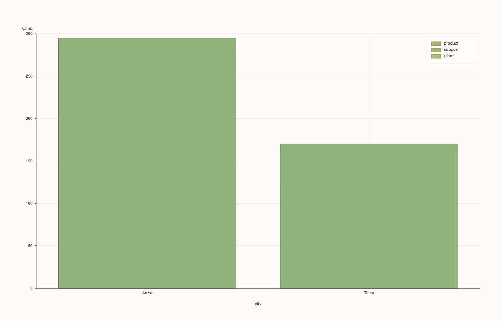
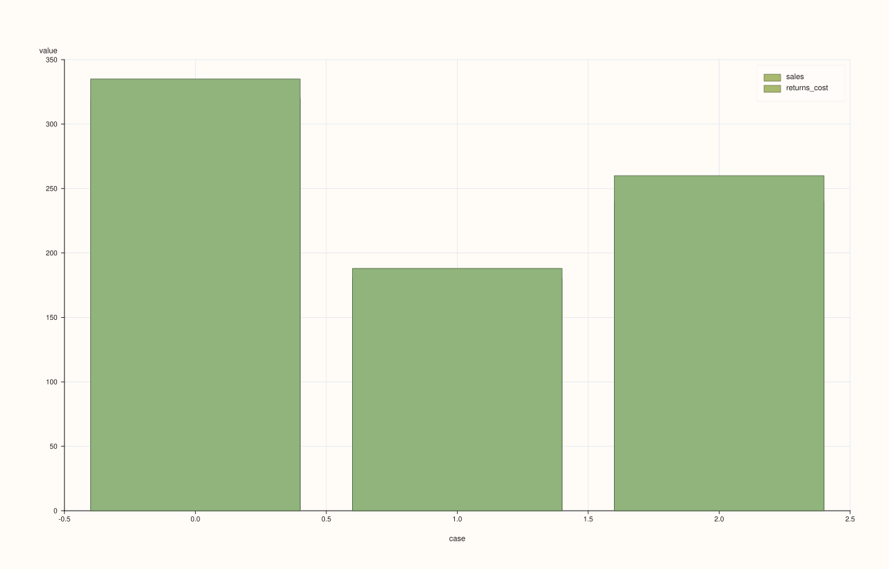

<!-- pluss-hand-authored -->
<!-- pluss-signature-hash: fc1314bac9eb -->

# DataFramePlotAccessor::bar_stacked

[Back to DataFramePlotAccessor API Reference](../../dataframe_plot_api_reference)

## Signatures

```cpp
DataFramePlotAccessor::bar_stacked(pluss::msharp::RangeView::Of<std::string_view> y_features,
                                    std::optional<std::string_view> x_feature = std::nullopt) const -> pluss::pl::Studio

DataFramePlotAccessor::bar_stacked(pluss::msharp::RangeView::Of<std::string_view> y_features,
                                    std::optional<std::string_view> x_feature,
                                    const BarStackedPlotOptions& options) const -> pluss::pl::Studio

DataFramePlotAccessor::bar_stacked(std::initializer_list<std::string_view> y_features,
                                    std::optional<std::string_view> x_feature = std::nullopt) const -> pluss::pl::Studio

DataFramePlotAccessor::bar_stacked(std::initializer_list<std::string_view> y_features,
                                    std::optional<std::string_view> x_feature,
                                    const BarStackedPlotOptions& options) const -> pluss::pl::Studio
```

## What It Does

The bar-chart counterpart to [`area_stacked()`](area_stacked.md): each y-feature's values
accumulate on top of the running total of the features stacked before it, so the topmost
bar segment's height represents the sum of every requested feature at that x position. Like
`area_stacked()`, there is **no single-feature overload** — only `RangeView` and
`initializer_list` forms — since stacking one feature alone is degenerate.

See [`line()`](line.md) for the shared x-axis-resolution rules and `Studio`-return / no-`cout`
mechanics.

```{note} Same overlapping-fill mechanism as area_stacked()
Exactly like [`area_stacked()`](area_stacked.md), each layer is drawn as a full bar from a
baseline of `0` up to its own cumulative top, not from the previous layer's top — the
correct stacked shape comes from later (taller) bars being drawn on top of earlier ones in
the same pane. `BarStackedPlotOptions`'s default `alpha` (`0.65`) is semi-transparent, so
overlapping regions blend colors from every layer drawn there rather than showing one flat
color per band — raise `alpha` toward `1.0` for a fully solid, unambiguous per-band look.
```

## Parameters

**y_features** (`RangeView<std::string_view>` or `std::initializer_list<std::string_view>`)
    Numeric features to stack, in accumulation order — the first forms the bottom segment,
    the last feature's cumulative top is the grand total. At least one is required — an
    empty list throws `"DataFrame::plot().bar_stacked: at least one y feature is required"`.

**x_feature** (`std::optional<std::string_view>`, default `std::nullopt`)
    Same three-step resolution as [`line()`](line.md).

**options** (`BarStackedPlotOptions`)
    ```cpp
    struct BarStackedPlotOptions {
      double alpha{0.65};
      double line_width{1.0};
    };
    ```

## Returns

`pluss::pl::Studio`
    A figure with one pane containing one bar trace per requested y-feature, each stacked
    on the cumulative total of the ones before it.

## Examples

Example 1. A two-feature stack with an explicit categorical x-axis.

```cpp
using namespace pluss::table;

auto breakdown = DataFrame({
    {"city",         Thread(pluss::make_note({"Accra", "Tema", "Kumasi"}))},
    {"sales",        Thread(pluss::make_series({320.0, 180.0, 240.0}))},
    {"returns_cost", Thread(pluss::make_series({15.0, 8.0, 20.0}))},
});

auto chart = breakdown.plot().bar_stacked({"sales", "returns_cost"}, "city");
chart.show();
```

Each city gets one bar whose bottom segment is `sales` and whose top segment (stacked above
it) reaches `sales + returns_cost`.


Example 2. Three features stacked, via a reusable `RangeView`.

```cpp
auto parts_df = DataFrame({
    {"city",    Thread(pluss::make_note({"Accra", "Tema"}))},
    {"product", Thread(pluss::make_series({200.0, 120.0}))},
    {"support", Thread(pluss::make_series({80.0, 40.0}))},
    {"other",   Thread(pluss::make_series({15.0, 10.0}))},
});

std::vector<std::string_view> parts{"product", "support", "other"};
auto chart = parts_df.plot().bar_stacked(
    pluss::msharp::RangeView::Of<std::string_view>(parts), "city");
chart.show();
```



Example 3. No `x_feature`: falls back to the frame's own row labels, as with every other
chart method on this accessor — see [`line()`](line.md)'s Example 3.

```cpp
auto chart = breakdown.plot().bar_stacked({"sales", "returns_cost"});
```



Example 4. An explicit `BarStackedPlotOptions`, raising opacity toward a fully solid look.

```cpp
BarStackedPlotOptions stacked_options;
stacked_options.alpha = 1.0;
stacked_options.line_width = 1.2;

auto chart = breakdown.plot().bar_stacked({"sales", "returns_cost"}, "city", stacked_options);
chart.show();
```


Example 5. The `initializer_list` overload with an explicit options object.

```cpp
auto chart = breakdown.plot().bar_stacked({"sales", "returns_cost"}, "city", stacked_options);
```


## Notes

- No single-feature overload; only `RangeView`/`initializer_list` forms.
- At least one y-feature is required.
- Same "each layer fills from a flat zero baseline, correct shape via draw order" mechanism
  as [`area_stacked()`](area_stacked.md) — see the note above.
- Returns a `pluss::pl::Studio` — see [`line()`](line.md)'s important callout for how to
  view or save the result.

## See Also

- [`DataFramePlotAccessor::bar`](bar.md): the non-stacking, grouped-bars sibling.
- [`DataFramePlotAccessor::area_stacked`](area_stacked.md): the same accumulating idea as
  continuous filled regions instead of discrete bars.
- [`DataFramePlotAccessor::line`](line.md): the canonical explanation of this accessor's
  shared mechanics.

<div class="pluss-inline-prev-next">
  <a class="prev-link" href="bar.html">
    <span class="label">Previous</span>
    <span class="title">bar</span>
  </a>
  <a class="next-link" href="bootstrap.html">
    <span class="label">Next</span>
    <span class="title">bootstrap</span>
  </a>
</div>
