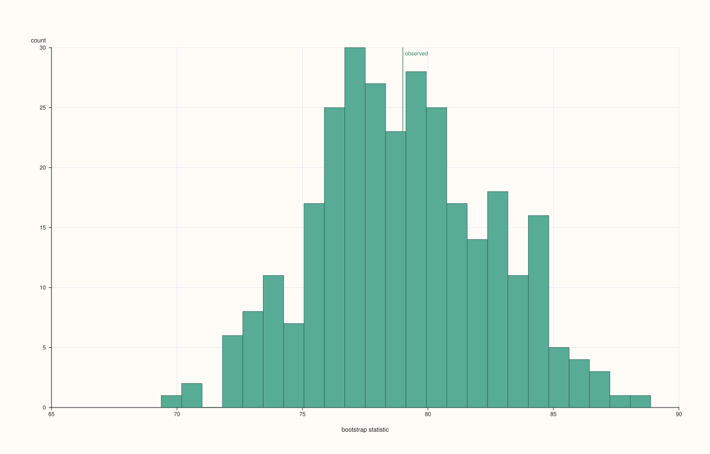
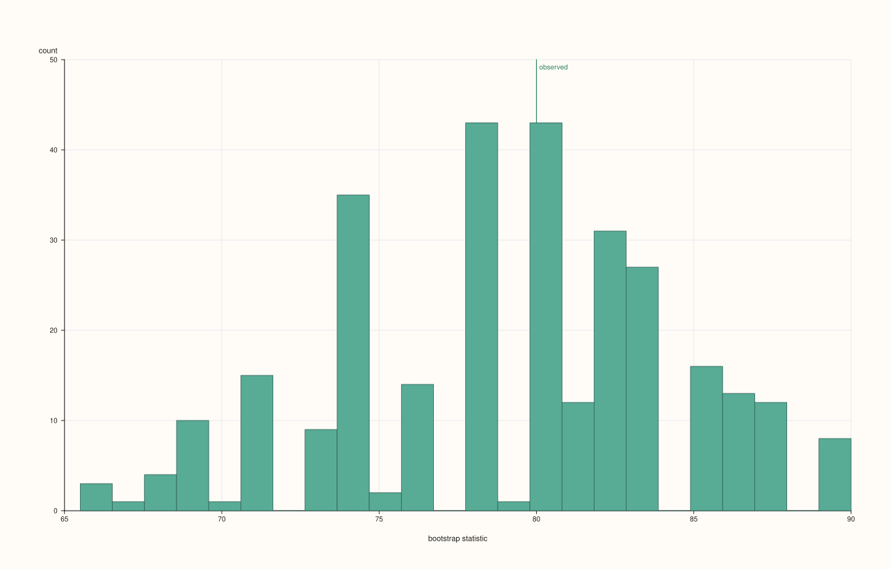
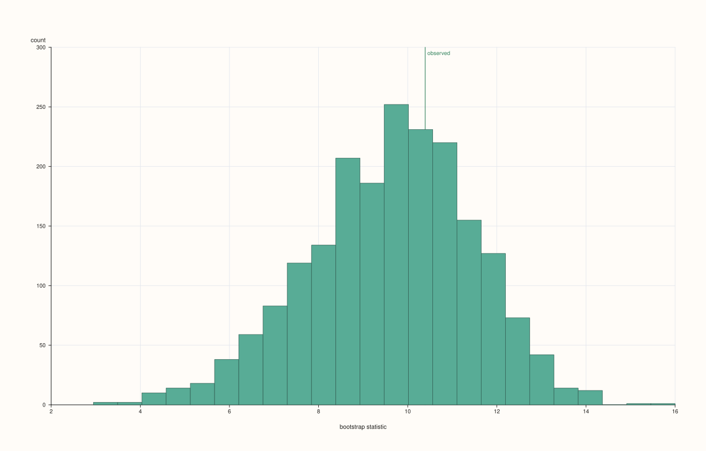
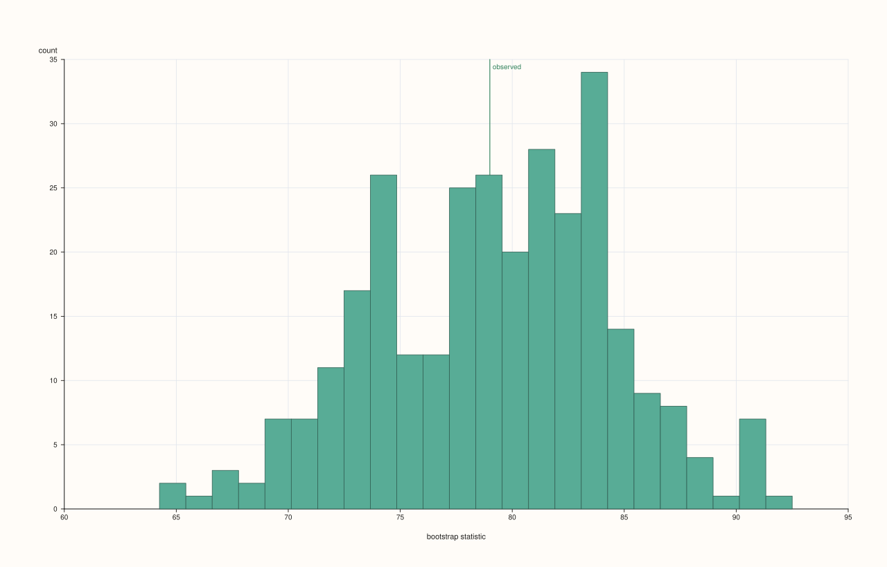
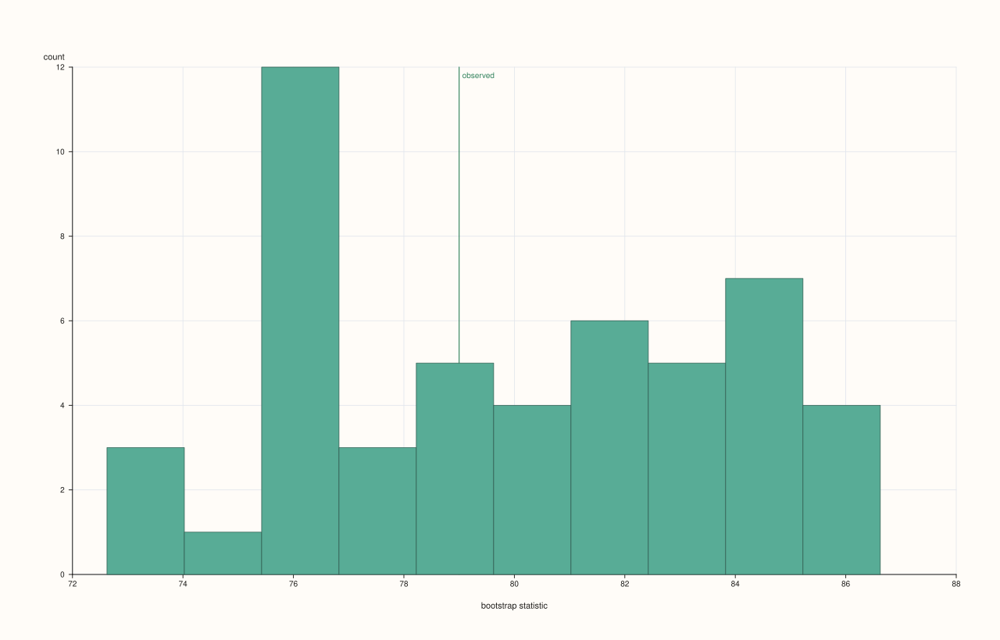

<!-- pluss-hand-authored -->
<!-- pluss-signature-hash: 3eaa07974c32 -->

# DataFramePlotAccessor::bootstrap

[Back to DataFramePlotAccessor API Reference](../../dataframe_plot_api_reference)

## Signature

```cpp
DataFramePlotAccessor::bootstrap(
    std::string_view feature,
    const BootstrapPlotOptions& options = {}) const -> pluss::pl::Studio
```

## What It Does

Draws a bootstrap sampling-distribution plot for one numeric feature: repeatedly resamples
the feature's values with replacement, computes a chosen summary statistic (mean, median, or
standard deviation) on each resample, and histograms the resulting distribution of that
statistic. A vertical reference line marks the statistic computed on the original,
un-resampled data. This is a way to visualize how much a summary statistic would plausibly
vary if the data collection were repeated, without assuming any particular parametric
distribution.

Shares the single-feature resolution rule with [`act()`](act.md) and [`lag()`](lag.md): the
named feature must resolve to exactly one numeric (`Series`-kind) feature — see
[`act()`](act.md)'s callout for the exact throw text.

```{note} At least two data points are required
A feature with fewer than two rows throws `"flash::bootstrapplot requires at least two
points"`.
```

## Parameters

**feature** (`std::string_view`)
    The single numeric feature to bootstrap. Must resolve to a `Series`-kind feature — see
    [`act()`](act.md)'s shared-diagnostics note.

**options** (`BootstrapPlotOptions`)

### `BootstrapStatistic` values

| Value | Numeric value | Description |
|---|---|---|
| `Mean` | — | — |
| `Median` | — | — |
| `Std` | — | — |

### `BootstrapPlotOptions` fields

| Field | Type | Default |
|---|---|---|
| `samples` | `std::int64_t` | `300` |
| `sample_size` | `std::int64_t` | `0` |
| `seed` | `std::uint64_t` | `7` |
| `bins` | `int` | `24` |
| `statistic` | `BootstrapStatistic` | `BootstrapStatistic::Mean` |
| `trace_width` | `float` | `0.85F` |

`samples` is how many resamples are drawn; clamped to a minimum of `8` internally.
`sample_size` is how many rows (with replacement) each resample draws — `0` (the
default) means "same size as the original feature," the conventional bootstrap setting;
a positive value overrides this. `seed` seeds the random draws deterministically — each
of the `samples` resamples uses `seed + i + 1` internally (`i` from `0` to
`samples - 1`), so the same `seed` reproduces the same sampling distribution across
runs. `statistic` chooses what's computed per resample: `Mean` (arithmetic mean),
`Median` (via a full sort and exact quantile at `0.5`), or `Std` (population standard
deviation, i.e. divided by `n` rather than `n - 1`). `bins` controls the histogram
resolution of the resulting distribution (floored to a minimum of `4`). `trace_width`
controls the histogram bars' outline width.

## Returns

`pluss::pl::Studio`
    A figure with one pane containing a histogram of the resampled statistic and a vertical
    reference line at the statistic computed on the full, original data.

## Examples

Example 1. Default options: bootstrap the mean, 300 resamples, same-size draws.

```cpp
using namespace pluss::table;

auto scores = DataFrame({
    {"score", Slate(pluss::make_series({71.0, 85.0, 90.0, 63.0, 78.0, 82.0, 95.0, 68.0}))},
});

auto chart = scores.plot().bootstrap("score");
chart.show();
```

300 resamples of 8 values each (drawn with replacement from the original 8), each resample's
mean computed and histogrammed into 24 bins (the default); the reference line marks the
original data's actual mean.



Example 2. Bootstrapping the median instead of the mean.

```cpp
BootstrapPlotOptions options;
options.statistic = BootstrapStatistic::Median;

auto chart = scores.plot().bootstrap("score", options);
chart.show();
```



Example 3. Bootstrapping the standard deviation, with more resamples and a fixed seed for
reproducibility.

```cpp
BootstrapPlotOptions std_options;
std_options.statistic = BootstrapStatistic::Std;
std_options.samples = 2000;
std_options.seed = 42;

auto chart = scores.plot().bootstrap("score", std_options);
chart.save_pdf("score_bootstrap_std.pdf");
```

Running this call twice with `seed = 42` produces the identical histogram both times, since
every resample's random draw is deterministically derived from `seed`.



Example 4. An explicit `sample_size` smaller than the original data — each resample draws
fewer rows than the full feature has.

```cpp
BootstrapPlotOptions small_draws;
small_draws.sample_size = 4;

auto chart = scores.plot().bootstrap("score", small_draws);
chart.show();
```

Each of the 300 resamples now draws only 4 values (with replacement) instead of 8, producing
a wider sampling distribution than the same-size default would.



Example 5. Coarser histogram resolution and a fewer-samples run.

```cpp
BootstrapPlotOptions coarse;
coarse.samples = 50;
coarse.bins = 10;

auto chart = scores.plot().bootstrap("score", coarse);
```



Example 6. Fewer than two rows throws.

```cpp
auto single_row = DataFrame({
    {"score", Slate(pluss::make_series({71.0}))},
});

try {
  auto bad = single_row.plot().bootstrap("score");
} catch (const std::exception& e) {
  std::cout << e.what();
}
```

### Output

```text
flash::bootstrapplot requires at least two points
```

## Notes

- `feature` must resolve to exactly one numeric feature — see [`act()`](act.md)'s shared
  note.
- `samples` is floored to `8`; `bins` is floored to `4`.
- `sample_size = 0` (the default) means each resample matches the original row count.
- `seed` makes the resampling fully deterministic and reproducible across runs.
- `Std` uses the population (÷ n) formula, not the sample (÷ n − 1) formula.
- Returns a `pluss::pl::Studio` — see [`line()`](line.md)'s important callout for how to
  view or save the result.

## See Also

- [`DataFramePlotAccessor::act`](act.md) / [`lag`](lag.md): the other two single-feature
  diagnostic plots on this accessor.
- [`DataFramePlotAccessor::hist`](hist.md): the general-purpose histogram this method
  specializes for a resampled statistic's distribution.

<div class="pluss-inline-prev-next">
  <a class="prev-link" href="bar_stacked.html">
    <span class="label">Previous</span>
    <span class="title">bar_stacked</span>
  </a>
  <a class="next-link" href="box.html">
    <span class="label">Next</span>
    <span class="title">box</span>
  </a>
</div>
