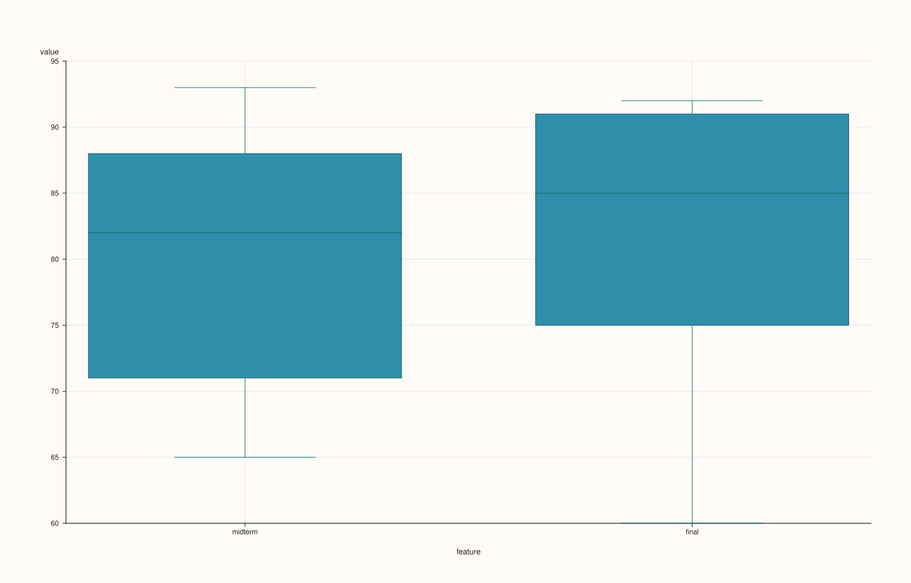

<!-- pluss-hand-authored -->
<!-- pluss-signature-hash: 7982b574794d -->

# DataFramePlotAccessor::box

[Back to DataFramePlotAccessor API Reference](../../dataframe_plot_api_reference)

## Signatures

```cpp
DataFramePlotAccessor::box(pluss::msharp::RangeView::Of<std::string_view> features = {}) const -> pluss::pl::Studio

DataFramePlotAccessor::box(pluss::msharp::RangeView::Of<std::string_view> features,
                            const BoxPlotOptions& options) const -> pluss::pl::Studio

DataFramePlotAccessor::box(std::initializer_list<std::string_view> features) const -> pluss::pl::Studio

DataFramePlotAccessor::box(std::initializer_list<std::string_view> features,
                            const BoxPlotOptions& options) const -> pluss::pl::Studio
```

## What It Does

Draws a box-and-whisker distribution summary for each requested numeric feature, one box
per feature, sharing a single pane with the feature names as x-axis tick labels — not one
pane per feature. This is a pure distribution-summary method: there's no x/y-feature
concept here at all, just a set of numeric features to summarize.

```{important} An empty features list means "every numeric feature in the frame"
Every distribution/multivariate method on this accessor that takes a `features` parameter
(`box`, [`violin`](violin.md), [`hist`](hist.md), [`density`](density.md),
[`corr_heatmap`](corr_heatmap.md), [`parallel`](parallel.md),
[`andrews_curves`](andrews_curves.md), [`radviz`](radviz.md)) shares this rule: passing an
explicit, non-empty list validates each named feature is a numeric `Series` (throwing
`"<method>: feature '<name>' is not a numeric Series"` if not); passing the default empty
`{}` instead auto-selects **every** `Series`-kind feature in the frame, throwing
`"<method>: no numeric Series features available"` if the frame has none. See Example 1 for
the empty-list, "infer everything" form.
```

```{note} Non-finite values are silently dropped per feature, not shown as gaps
Each feature's values are filtered to only the finite (non-`NaN`, non-infinite) ones before
the box statistics are computed — an invalid or missing cell simply doesn't contribute a
data point to its feature's box, rather than appearing as a visible gap or `NULL` marker.
```

## Parameters

**features** (`RangeView<std::string_view>` or `std::initializer_list<std::string_view>`,
default `{}`)
    Numeric features to summarize, each as its own box. Leave empty (the default) to use
    every numeric feature in the frame. At least one feature (explicit or inferred) is
    required — an entirely non-numeric frame throws `"DataFrame::plot().box: at least one
    numeric feature is required"` after the empty list resolves to nothing.

**options** (`BoxPlotOptions`)

### `BoxPlotOptions` fields

| Field | Type | Default |
|---|---|---|
| `alpha` | `double` | `0.95` |
| `line_width` | `double` | `1.1` |

## Returns

`pluss::pl::Studio`
    A figure with one pane containing one box per requested (or inferred) feature, x-axis
    ticks labeled with each feature's name.

## Examples

Example 1. No explicit features: every numeric feature in the frame is summarized.

```cpp
using namespace pluss::table;

auto scores = DataFrame({
    {"midterm", Slate(pluss::make_series({71.0, 82.0, 93.0, 65.0, 88.0}))},
    {"final",   Slate(pluss::make_series({75.0, 85.0, 91.0, 60.0, 92.0}))},
    {"cohort",  Slate(pluss::make_note({"Morning", "Evening", "Morning", "Evening", "Morning"}))},
});

auto chart = scores.plot().box();
chart.show();
```

`box()` with no arguments summarizes both `midterm` and `final` (the two `Series`-kind
features) as two side-by-side boxes; `cohort` (Note-kind) is silently excluded since it
isn't numeric.



Example 2. An explicit feature subset, via `initializer_list`.

```cpp
auto chart = scores.plot().box({"midterm", "final"});
chart.show();
```

Same result as Example 1 here, but written explicitly — useful when the frame has more
numeric features than you want summarized together.


Example 3. The same explicit subset via a reusable `RangeView`.

```cpp
std::vector<std::string_view> names{"midterm", "final"};
auto chart = scores.plot().box(pluss::msharp::RangeView::Of<std::string_view>(names));
chart.save_pdf("scores_box.pdf");
```


Example 4. An explicit `BoxPlotOptions`.

```cpp
BoxPlotOptions box_options;
box_options.alpha = 0.8;
box_options.line_width = 1.6;

auto chart = scores.plot().box({"midterm", "final"}, box_options);
chart.show();
```


Example 5. A feature that isn't numeric throws immediately.

```cpp
try {
  auto bad = scores.plot().box({"cohort"});
} catch (const std::exception& e) {
  std::cout << e.what();
}
```

### Output

```text
DataFrame::plot().box: feature 'cohort' is not a numeric Series
```

## Notes

- An empty (default) `features` list infers every numeric feature in the frame — see the
  important callout above.
- Non-finite values are dropped per feature before the box statistics are computed, rather
  than appearing as gaps.
- Every feature shares one pane, positioned side by side by feature name — not a mosaic of
  separate panes (contrast [`hist()`](hist.md)'s multi-feature mosaic layout).
- Returns a `pluss::pl::Studio` — see [`line()`](line.md)'s important callout for how to
  view or save the result.

## See Also

- [`DataFramePlotAccessor::violin`](violin.md): full distribution shape instead of just
  quartiles and whiskers, including a value-vs-group overload this method doesn't have.
- [`DataFramePlotAccessor::hist`](hist.md) / [`density`](density.md): other
  distribution-shape views.
- [`DataFramePlotAccessor::bar`](bar.md) with `ci_enabled = true`: mean-and-interval instead
  of full quartile summaries.

<div class="pluss-inline-prev-next">
  <a class="prev-link" href="bootstrap.html">
    <span class="label">Previous</span>
    <span class="title">bootstrap</span>
  </a>
  <a class="next-link" href="brief.html">
    <span class="label">Next</span>
    <span class="title">brief</span>
  </a>
</div>
