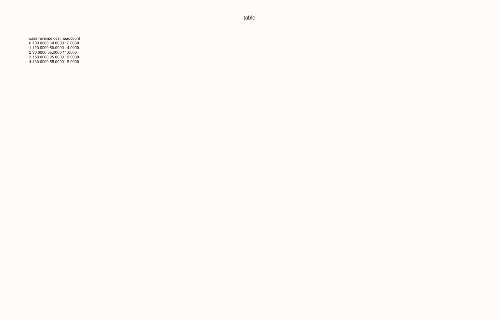
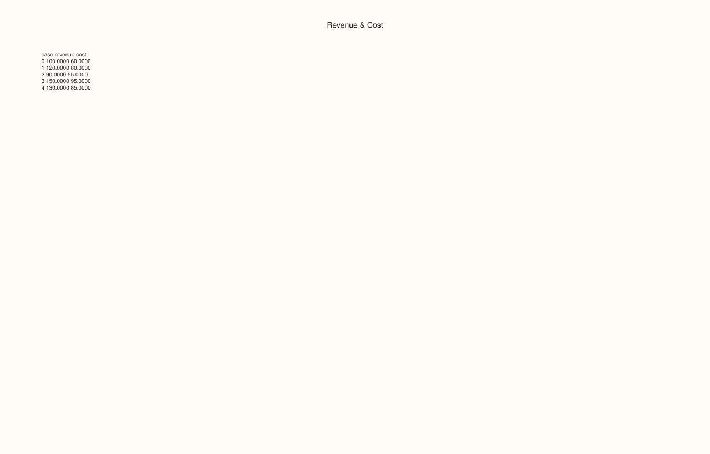
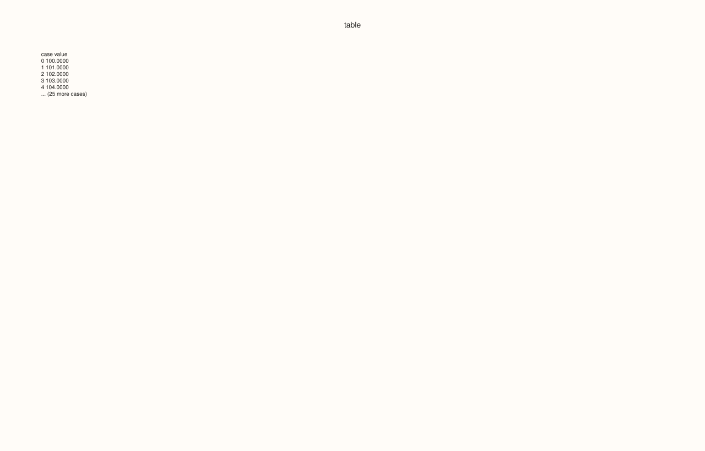
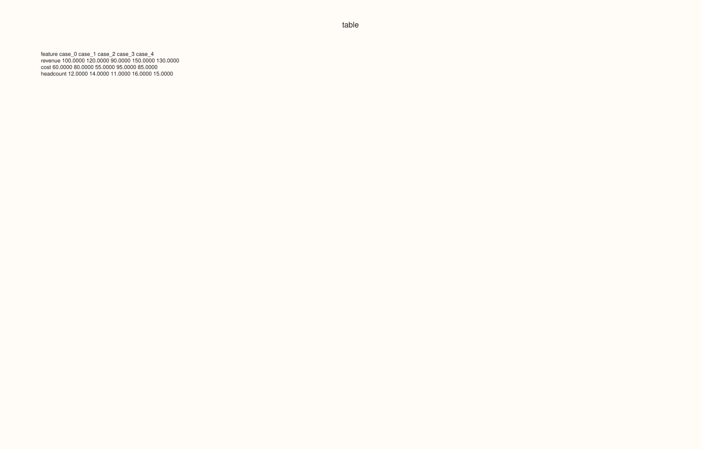
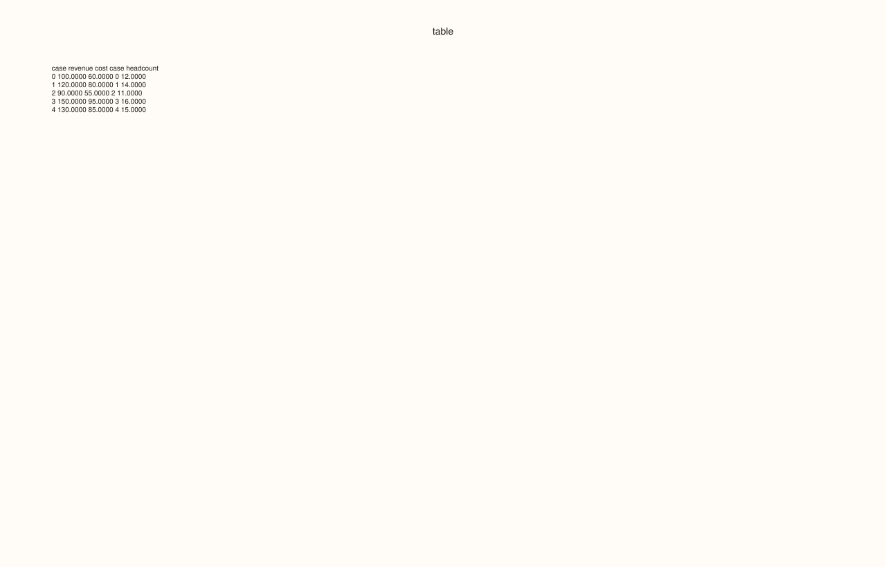
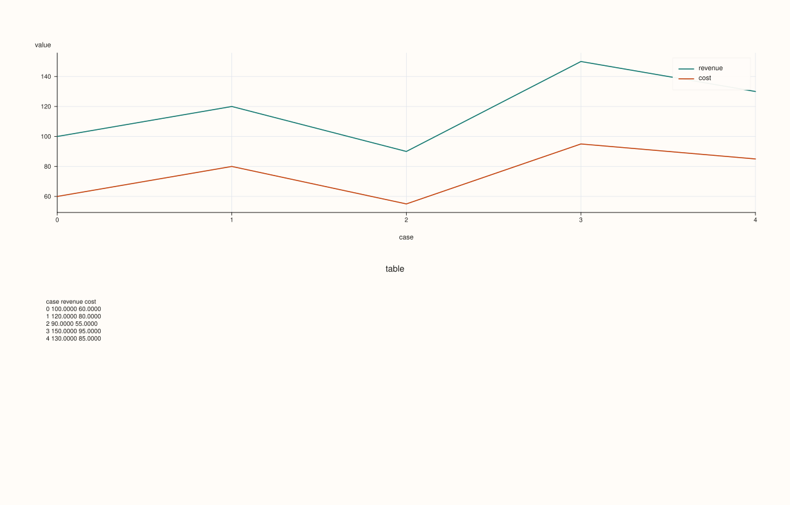

<!-- pluss-hand-authored -->
<!-- pluss-signature-hash: f153db32a12c -->

# DataFramePlotAccessor::brief

[Back to DataFramePlotAccessor API Reference](../../dataframe_plot_api_reference)

## Signatures

```cpp
DataFramePlotAccessor::brief(
    pluss::msharp::RangeView::Of<std::string_view> features = {},
    const BriefPlotOptions& options = {}) const -> pluss::pl::Studio

pluss::pl::Studio& DataFramePlotAccessor::brief(
    pluss::pl::Studio& figure,
    pluss::msharp::RangeView::Of<std::string_view> features = {},
    const BriefPlotOptions& options = {}) const
```

## What It Does

Renders a fixed-width, monospace-formatted text table of the requested numeric features'
raw values directly as a pane in a `Studio` — a "table as a figure" rather than any kind of
chart. Unlike every other method on this accessor, `brief()` doesn't plot points, lines,
bars, or bins; it formats each selected feature's values into aligned columns (with an
optional header, row/case index, and truncation past a configurable case limit) and draws
that text as the pane's caption, with the grid, legend, axes, and tick labels all switched
off. This makes it useful for embedding a compact numeric summary alongside real charts —
for example, appended into the same `Studio` returned by another plot call.

```{important} Two distinct overloads: fresh Studio vs. in-place composition
The first overload creates a brand-new `Studio` and returns it, the same as every other
method on this accessor. The second overload instead takes an existing `Studio&` **by
reference**, adds the table pane into it, and returns that same reference — genuinely
appending to a figure you already have, rather than starting a new one. This is the only
method on `DataFramePlotAccessor` that supports this in-place composition pattern; every
other method always constructs and returns a fresh `Studio`.
```

Shares the "empty features means every numeric feature" rule with [`box()`](box.md) — see
that page's important callout for the exact rule and throw text.

## Parameters

**figure** (`pluss::pl::Studio&`, in-place overload only)
    An existing figure to append the table pane into. Must already exist (default-constructed
    or returned from an earlier plot call); this overload never creates a new `Studio`.

**features** (`RangeView<std::string_view>`, default `{}`)
    Numeric features to summarize. Empty (the default) infers every numeric feature in the
    frame — see [`box()`](box.md)'s important callout for the exact rule.

**options** (`BriefPlotOptions`)
    ```cpp
    struct BriefPlotOptions {
      std::string title{"table"};
      int precision{4};
      bool include_header{true};
      std::int64_t max_cases{10};
      bool transpose{false};
      bool include_case_index{true};
      std::int64_t features_per_table{0};
      std::int64_t tables_per_row{1};
      std::int64_t table_gap_spaces{4};
    };
    ```
    `title` becomes the pane's own title text. `precision` (floored to `0`) sets fixed-point
    decimal places for every cell; a non-finite value always renders as the literal text
    `"nan"` regardless of `precision`. `include_header` toggles the column-name header row.
    `max_cases` (falling back to `10` if `≤ 0`) caps how many rows are printed before a
    trailing `"... (N more cases)"` line is appended; it does not affect which features are
    summarized, only how many rows. `transpose = true` swaps the orientation: features become
    rows and cases become columns (labeled `"case_0"`, `"case_1"`, ...) instead of the
    default features-as-columns, cases-as-rows layout. `include_case_index` toggles a leading
    `"case"` index column in the non-transposed layout (ignored when `transpose = true`, which
    always uses its own `"feature"` label column instead). `features_per_table` (falling back
    to "every feature in one table" if `≤ 0`) splits the feature set into multiple smaller
    tables of that width; `tables_per_row` (floored to `1`) then lays those sub-tables out
    side by side, `table_gap_spaces` (floored to `1`) spaces between them.

## Returns

For the first overload: `pluss::pl::Studio`, a fresh figure with one pane containing the
formatted table as its caption text (grid, legend, axis labels, and tick labels all
suppressed).

For the second overload: `pluss::pl::Studio&`, the same reference passed in, with the table
pane appended.

## Examples

Example 1. Default options: every numeric feature, up to 10 cases, in a fresh `Studio`.

```cpp
using namespace pluss::table;

auto metrics = DataFrame({
    {"revenue",   Thread(pluss::make_series({100.0, 120.0, 90.0, 150.0, 130.0}))},
    {"cost",      Thread(pluss::make_series({60.0, 80.0, 55.0, 95.0, 85.0}))},
    {"headcount", Thread(pluss::make_series({12.0, 14.0, 11.0, 16.0, 15.0}))},
});

auto chart = metrics.plot().brief();
chart.show();
```

A single pane titled `"table"` (the default), with a header row (`case`, `revenue`, `cost`,
`headcount`) followed by 5 data rows (all 5 cases fit within the default `max_cases = 10`, so
no truncation line is appended).



Example 2. An explicit feature subset and a custom title.

```cpp
BriefPlotOptions options;
options.title = "Revenue & Cost";

auto chart = metrics.plot().brief({"revenue", "cost"}, options);
chart.show();
```



Example 3. `max_cases` truncation on a larger frame.

```cpp
std::vector<double> many_values;
for (int i = 0; i < 30; ++i) {
  many_values.push_back(100.0 + i);
}

auto big = DataFrame({
    {"value", Thread(pluss::make_series(many_values))},
});

BriefPlotOptions capped;
capped.max_cases = 5;

auto chart = big.plot().brief({}, capped);
chart.save_pdf("big_brief.pdf");
```

Only the first 5 of 30 rows are printed, followed by a trailing `"... (25 more cases)"` line.



Example 4. `transpose = true`: features become rows, cases become columns.

```cpp
BriefPlotOptions transposed;
transposed.transpose = true;

auto chart = metrics.plot().brief({}, transposed);
```

The header row now reads `feature`, `case_0`, `case_1`, ..., and each subsequent row is one
feature's values across all shown cases — useful when there are many features but few cases,
the opposite orientation of the default layout.



Example 5. `features_per_table` and `tables_per_row`: splitting a wide feature set into
side-by-side sub-tables.

```cpp
BriefPlotOptions split;
split.features_per_table = 2;
split.tables_per_row = 2;

auto chart = metrics.plot().brief({}, split);
chart.show();
```

With 3 features and `features_per_table = 2`, the feature set splits into two sub-tables
(`revenue`/`cost`, then `headcount` alone); `tables_per_row = 2` places both side by side in
the same row of text, separated by `table_gap_spaces` (4, the default) spaces.



Example 6. The in-place overload: appending a `brief()` table into a `Studio` that already
has a real chart, rather than creating a separate figure.

```cpp
auto chart = metrics.plot().line({"revenue", "cost"});
metrics.plot().brief(chart, {"revenue", "cost"});
chart.show();
```

`chart` starts as the line plot's figure (one pane); the second call appends a second pane
containing the `brief()` table directly into the same `Studio`, and returns a reference to
that same `chart` object (which this example discards, since `chart` itself was already
modified in place).



Example 7. A non-numeric feature name throws, same as [`box()`](box.md).

```cpp
auto tagged = DataFrame({
    {"revenue", Thread(pluss::make_series({100.0, 120.0, 90.0}))},
    {"region",  Thread(pluss::make_note({"East", "West", "East"}))},
});

try {
  auto bad = tagged.plot().brief({"revenue", "region"});
} catch (const std::exception& e) {
  std::cout << e.what();
}
```

### Output

```text
DataFrame::plot().brief: feature 'region' is not a numeric Series
```

## Notes

- Empty (default) `features` infers every numeric feature — see [`box()`](box.md)'s
  important callout for the exact rule.
- The two-argument-plus-figure overload composes in place into an existing `Studio&`; every
  other method on this accessor (including `brief()`'s own other overload) always creates a
  fresh one — see the important callout above.
- `max_cases` truncates displayed rows, not the underlying feature selection.
- Non-finite cell values always render as the literal text `"nan"`, independent of
  `precision`.
- The rendered pane has no grid, legend, or axis labels — it exists purely to display text.
- Returns a `pluss::pl::Studio` (or `Studio&` for the in-place overload) — see
  [`line()`](line.md)'s important callout for how to view or save the result.

## See Also

- [`DataFramePlotAccessor::box`](box.md): the canonical explanation of the
  "empty features means every numeric feature" rule shared here.
- [`DataFramePlotAccessor::auto_plot`](auto_plot.md): picks a real chart type automatically,
  in contrast to `brief()`'s fixed textual summary.

<div class="pluss-inline-prev-next">
  <a class="prev-link" href="box.html">
    <span class="label">Previous</span>
    <span class="title">box</span>
  </a>
  <a class="next-link" href="corr_heatmap.html">
    <span class="label">Next</span>
    <span class="title">corr_heatmap</span>
  </a>
</div>
