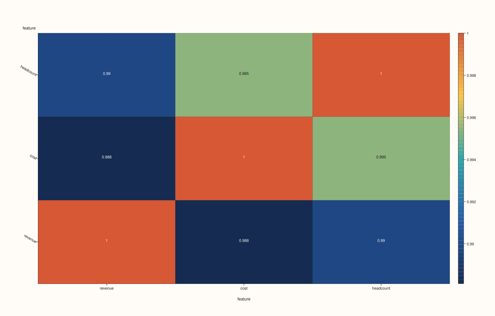
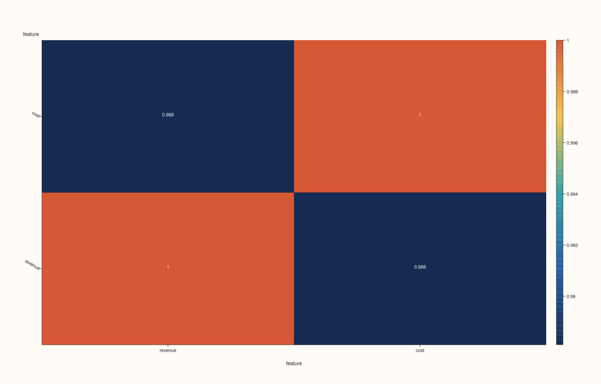
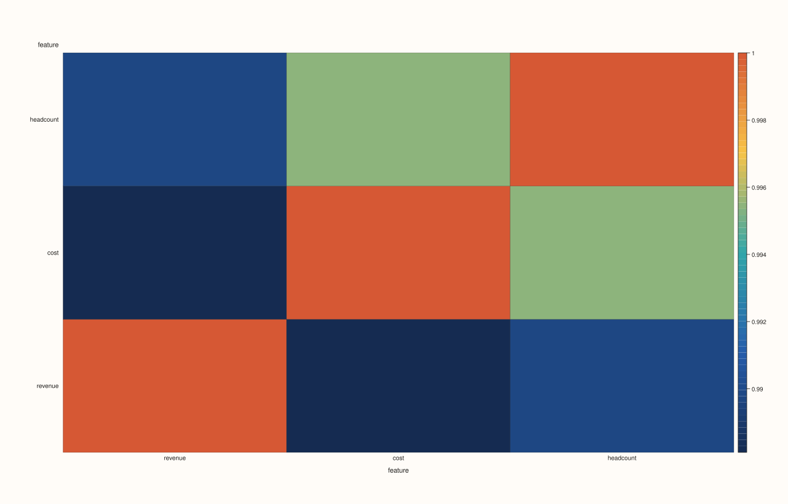

<!-- pluss-hand-authored -->
<!-- pluss-signature-hash: bfcf3b3c5514 -->

# DataFramePlotAccessor::corr_heatmap

[Back to DataFramePlotAccessor API Reference](../../dataframe_plot_api_reference)

## Signatures

```cpp
DataFramePlotAccessor::corr_heatmap(pluss::msharp::RangeView::Of<std::string_view> features = {}) const -> pluss::pl::Studio

DataFramePlotAccessor::corr_heatmap(pluss::msharp::RangeView::Of<std::string_view> features,
                                     const CorrHeatmapPlotOptions& options) const -> pluss::pl::Studio
```

## What It Does

Computes the frame's correlation matrix (via the same `DataFrame::corr()` used elsewhere —
specifically `frame.corr(false)`, its default-method, non-render form) restricted to the
requested features, and renders it as a square heatmap: both rows and columns are the
selected feature names, and each cell `(i, j)` is the correlation between feature `i` and
feature `j`. Follows the same numeric-feature rules as [`box()`](box.md) — an empty
(default) `features` list infers every numeric feature in the frame.

## Parameters

**features** (`RangeView<std::string_view>`, default `{}`)
    Numeric features to correlate. Empty (the default) infers every numeric feature in the
    frame — see [`box()`](box.md)'s important callout for the exact rule and throw text.

**options** (`CorrHeatmapPlotOptions`)
    ```cpp
    struct CorrHeatmapPlotOptions {
      bool annotate_levels{true};
      bool scale_guide{true};
      bool borderless{false};
    };
    ```
    Same fields as [`heatmap()`](heatmap.md)'s `HeatmapPlotOptions`, but note the different
    default: `annotate_levels` defaults to `true` here (each cell's correlation coefficient
    is printed by default), where plain `heatmap()` defaults it to `false`. `borderless =
    true` here also suppresses the default 30° y-tick rotation, same as `heatmap()`.

## Returns

`pluss::pl::Studio`
    A figure with one pane containing a square heatmap trace, feature names as both x and y
    tick labels.

## Examples

Example 1. No explicit features: every numeric feature in the frame is correlated against
every other.

```cpp
using namespace pluss::table;

auto metrics = DataFrame({
    {"revenue",  Slate(pluss::make_series({100.0, 120.0, 90.0, 150.0, 130.0}))},
    {"cost",     Slate(pluss::make_series({60.0, 80.0, 55.0, 95.0, 85.0}))},
    {"headcount", Slate(pluss::make_series({12.0, 14.0, 11.0, 16.0, 15.0}))},
});

auto chart = metrics.plot().corr_heatmap();
chart.show();
```

A 3×3 heatmap: `revenue`, `cost`, and `headcount`, each pairwise correlation coefficient
annotated on its cell by default (`annotate_levels` defaults to `true` here, unlike plain
`heatmap()`).



Example 2. An explicit feature subset, restricting the matrix to two features.

```cpp
auto chart = metrics.plot().corr_heatmap({"revenue", "cost"});
chart.show();
```

A 2×2 matrix — the diagonal cells are each feature's correlation with itself (always `1.0`)
and the two off-diagonal cells are `revenue` vs `cost`'s correlation, mirrored across the
diagonal.



Example 3. An explicit `CorrHeatmapPlotOptions`, disabling the value annotations and using
a borderless style.

```cpp
CorrHeatmapPlotOptions options;
options.annotate_levels = false;
options.borderless = true;

auto chart = metrics.plot().corr_heatmap({}, options);
chart.save_pdf("metrics_corr.pdf");
```

Passing `{}` explicitly (rather than omitting the argument) still triggers the "every
numeric feature" inference — the empty-list rule doesn't depend on whether the empty list
was the default or spelled out.



Example 4. A feature that isn't numeric throws, same as every method sharing this
`features`-validation rule.

```cpp
auto tagged = DataFrame({
    {"revenue", Slate(pluss::make_series({100.0, 120.0, 90.0}))},
    {"region",  Slate(pluss::make_note({"East", "West", "East"}))},
});

try {
  auto bad = tagged.plot().corr_heatmap({"revenue", "region"});
} catch (const std::exception& e) {
  std::cout << e.what();
}
```

### Output

```text
DataFrame::plot().corr_heatmap: feature 'region' is not a numeric Series
```

## Notes

- Empty (default) `features` infers every numeric feature — see [`box()`](box.md)'s
  important callout for the exact rule.
- Reuses `DataFrame::corr()` internally (`frame.corr(false)`) rather than recomputing
  correlations from scratch.
- `annotate_levels` defaults to `true` here, unlike plain [`heatmap()`](heatmap.md)'s
  `false` default.
- Returns a `pluss::pl::Studio` — see [`line()`](line.md)'s important callout for how to
  view or save the result.

## See Also

- [`DataFramePlotAccessor::heatmap`](heatmap.md): the general-purpose heatmap this method
  specializes, including its direct and grouped/pivot modes.
- [`DataFramePlotAccessor::scatter_matrix`](scatter_matrix.md): every pairwise scatter plot
  instead of a single correlation coefficient per pair.

<div class="pluss-inline-prev-next">
  <a class="prev-link" href="brief.html">
    <span class="label">Previous</span>
    <span class="title">brief</span>
  </a>
  <a class="next-link" href="density.html">
    <span class="label">Next</span>
    <span class="title">density</span>
  </a>
</div>
